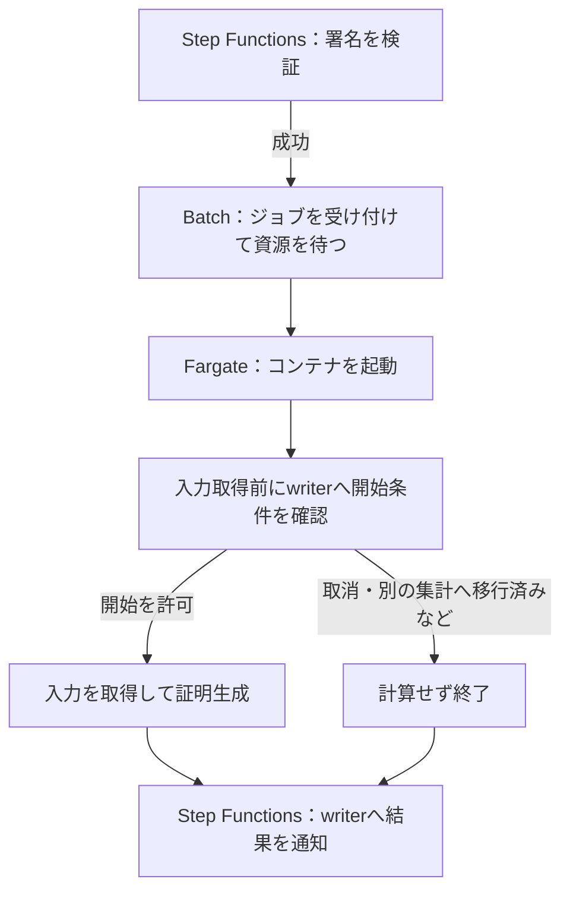

# 非同期プローバー

非同期プローバーは、保存済みの集計状態を確認してから計算を開始します。集計要求の受付から計算開始までには待ち時間があり、その間のキュー再配送による重複要求や利用者の取消に対応します。作業の到着だけでは起動しません。

## 集計要求の受付

`POST /api/sessions/:sessionId/finalizations` は、URL のセッションと capability を照合し、Turnstile、レート制限、集計開始の前提条件を確認します。AWS の非同期経路では、次の順で作業を登録します。

1. zkVM 入力を構築し、集計状態を `pending` として保存する。
2. 非公開 S3 の `sessions/{sessionId}/{finalizationId}/input.json` に入力を保存する。
3. 正しい S3 キーを含む作業メッセージを SQS へ送る。
4. `202 Accepted` と、`pending` の `FinalizationResource` を返す。

クライアントは、既知の `GET /api/sessions/:sessionId/finalizations/current` を capability 付きで呼び出して状態を取得します。応答に状態取得 URL を載せる方式は使いません。

## キューメッセージの検証と実行開始

`proof-dispatcher` は SQS メッセージを一件ずつ読みます。まずメッセージの形、`recordType`、セッションと集計の識別子を検証し、入力、出力先、バンドルの S3 キーが同じ集計の正規の配置であることを確認します。必要な AWS 設定が欠けていても開始できません。

次に、現在の集計レコードを読みます。該当するレコードがない場合や、メッセージの `finalizationId` が現在の `pending` と一致しない場合は、古い作業として破棄します。取消後に再配送された要求が、新しい計算を始めるのを防ぐためです。一方、壊れたメッセージ、キーの不整合、一時的な AWS 呼び出し失敗は再試行し、解消しなければ DLQ へ移します。

条件を満たすと `StartExecution` で Step Functions を開始します。dispatcher は入力ファイルを保存し直さず、この時点では状態を `running` にも変えません。計算資源の空きがまだ分からないからです。

develop の[保守設定](terraform.md#dynamodb-復旧先の切替)を有効にすると、新規セッション作成、プローバー・検証の SQS event-source mapping、後述する集計状態の定期整合処理を止め、Batch のジョブキューも無効にします。未消費の要求や待機中のジョブは残り、集計も `pending` のまま残り得ます。既存セッションの書込みと実行中の仕事の停止・整合確認は別途必要です。再開は新しいソースの保存 plan と承認で扱います。

## Step Functions

Step Functions は、署名検証、Batch へのジョブ投入、終了後の結果保存を管理します。計算資源の待機と Fargate への配置は Batch が担当します。



### Batch 投入前の署名検証

最初の `VerifyImageSignature` は、`image-signature-verifier` Lambda の固定バージョン ARN を呼びます。対象は、デプロイ時に内容のダイジェストで固定したプローバーイメージです。`result = VERIFIED` と `mode = cryptographic` の両方がそろった場合だけ、Batch への投入へ進みます。

署名処理中、署名プロファイルの不一致、検証資産や信頼ポリシーの不整合、暗号学的検証の失敗、時間切れはすべて起動を止めます。Lambda 呼び出し自体が回数を制限した再試行後も失敗すると、`RecordSignatureInvocationFailure` が拒否結果へ変換し、`CallbackSignatureFailed` で失敗を記録します。[イメージ署名](image-signing.md)が説明するように、署名処理の完了表示だけではこの条件を満たしません。

### Batch の待機とコンテナの開始条件

`RunProver` は `batch:submitJob.sync` でジョブを投入し、終了を待ちます。同じ環境のジョブは、Batch の共通資源（`REPLENISHABLE` consumable resource）2単位のうち1単位を使います。枠が埋まっている間は Batch で待機し、集計状態は `pending` のままです。

Batch が Fargate 上でコンテナを起動すると、entrypoint が `finalization-writer` に開始条件を確認します。これを起動時の admission と呼びます。writer が現在の集計として開始を許可し、`running` と `startedAtMs` を保存した場合だけ、入力取得とホストの実行へ進みます。待機中に取り消された場合や別の集計へ置き換わった場合、応答が欠けている場合や不正な場合は、計算を始めません。

Batch の実行試行（attempt）は1回に限定し、Step Functions も投入結果が不明な要求を再投入しません。終了後は成功・失敗・時間切れを writer へ通知します。枠の確保と解放は Batch が管理し、アプリの取消要求や完了通知だけで枠を解放しません。待機を含む期限とホストの期限は、[非同期モードの特性](../zkvm/host-and-proving.md#非同期モードの特性)で説明します。

### 運用イベントの記録

`semaphore-janitor` という名前の Lambda は、Batch の終了などのイベントを検査し、[運用台帳](observability.md#運用台帳の記録形式)へ記録します。現在は同時実行枠の回収を行いません。

## コンテナ内の証明生成

プローバーは [16 vCPU / 32 GiB を既定とする一回限りのタスク](design-and-services.md)です。Step Functions から、入力の `INPUT_S3_BUCKET` / `INPUT_S3_KEY`、出力の `OUTPUT_S3_BUCKET` / `OUTPUT_S3_PREFIX`、期待する `EXPECTED_IMAGE_ID` を受け取ります。

コンテナの entrypoint は起動時の admission を通過してから S3 の入力を取得し、必須フィールドを確認して zkVM host を実行します。続いて Rust の `prover-artifacts` が非公開入力と host 出力を厳密に読み、`journal.json` と公開監査用の `public-input.json`、`election-manifest.json`、`close-statement.json` を作ります。

配布前に同じ Rust ツールでファイルを読み直し、ジャーナルと公開監査ファイルの `methodVersion`、入力コミットメント、選挙情報の一致を確認します。その後、次の五つだけを ZIP にして、個別の関連ファイルとともに非公開 S3 へアップロードします。

```text
receipt.json
journal.json
public-input.json
election-manifest.json
close-statement.json
```

公開監査ファイルと正規化したハッシュの計算は `zkvm/host/src/artifacts.rs` が担当します。shell はプロセス起動、ファイル、ZIP、S3 と配布対象の制限を担当します。AWS 用プロファイルとこのコンテナは本物の STARK 証拠だけを許可し、開発用レシートを成功証明にできません。

## 公開用ファイルと内部ファイル

ZIP に収めるのは上記の五つのファイルです。`input.json` などの[保護対象](../verification/public-boundary.md)は ZIP の外に保存します。形式と配置は[バンドル構造](../verification/bundle-structure.md)にあります。

生成したビットマップは ZIP の外の同じ集計用接頭辞へ保存します。S3 に存在するだけで利用可能とは宣言せず、writer が内容を検証し、集計結果と一緒に保存できたことをもって利用可能にします。`verification.json` はこの段階ではまだなく、後続の検証作業で保存した後にレポート取得 API から配信します。

### failure-marker.json の形式と利用条件

コンテナが非ゼロ終了した場合、entrypoint は可能なら `failure-marker.json` を保存します。これは画面へ生のエラーを出さずに、障害の種類を writer へ伝えるための非公開ファイルです。

内容は `category` だけで、値は `configuration`、`input`、`prover_execution`、`infrastructure_interruption`、`artifact`、`upload`、`timeout`、`unknown` に限定します。生のエラー、識別子、保存先、イメージ情報、認証情報は入れません。

同じ集計の S3 接頭辞に新規作成のみを許可し、既存の異なる内容を上書きしません。writer は形と値を検証できたときだけ障害詳細へ取り込みます。存在しない場合や不正な場合は、一般的なタスク失敗として扱います。公開 ZIP、レポート、ブラウザ向けダウンロードには含めません。

## 結果の通知・保存と定期整合処理

成功通知を受けた `finalization-writer` は、まずバンドルのキーが `sessions/{sessionId}/{finalizationId}/bundle.zip` と一致することを確認します。バンドルからレシート、ジャーナル、公開監査ファイルを復元し、存在する個別ビットマップを[ビットマップの契約](../protocol/bitmap-merkle.md)で検証します。

復元が一時的に失敗した場合は、Step Functions が回数を制限して通知を再試行します。一時的ではない復元失敗は `FINALIZATION_BUNDLE_RESTORE_FAILED` として記録し、集計を `failed` にします。

復元できた結果とビットマップの利用可否、利用可能と宣言する付随データは、一つのトランザクションで保存します。この保存が失敗しても `succeeded` は公開せず、通知が再試行された場合に保存をやり直します。

成功結果の開始時刻には、同じ集計の起動時 admission で保存した `startedAtMs` を使います。通知の受信時刻から開始時刻を作り直しません。

失敗通知では署名、タスク、時間切れなどの理由を保存します。`PROVER_TASK_FAILED` の場合は、同じ集計の `failure-marker.json` を上記の条件で読み取ります。通知自体の配信失敗も Step Functions の再試行上限と失敗状態に従います。

通知が集計状態に反映されない場合に備え、EventBridge は 1 分ごとに `finalization-writer` を呼び出します。writer は未完了の集計を対応する Step Functions の実行状態と照合し、配送期限超過や結果の未記録を含む失敗・時間切れを保存します。実行の成功だけで集計を `succeeded` にはしません。この状態更新は、janitor による運用イベントの記録とは別です。

## 集計状態の取得

`GET /api/sessions/:sessionId/finalizations/current` は、保存済みの集計状態を読み取って返します。この GET 自体は Step Functions の実行状態を照会せず、集計状態も更新しません。

| 状態        | 何が起きているか                                                     |
| ----------- | -------------------------------------------------------------------- |
| `pending`   | 受付済み。配送、実行準備、同時実行枠を待っている                     |
| `running`   | 起動したコンテナに現在の集計として開始を許可し、開始時刻を保存した   |
| `succeeded` | バンドルを復元・確認し、結果とビットマップ利用可否を原子的に保存した |
| `failed`    | 署名、ジョブ、証拠の復元などの失敗を保存した                         |
| `timeout`   | タスクや Step Functions 実行の時間切れを保存した                     |

`succeeded` は証明生成の完了です。画面の「Verified」は、これからレシート、ジャーナル、投票と掲示板の証拠を評価して決まります。

## 証拠の取得

バンドルとレポートは capability で保護された API から取得します。大きい `bundle.zip` は Range 応答で分割取得できます。API は集計の識別子と S3 キーを照合し、別の集計のファイルや正規の配置でないファイルを返しません。直接の S3 URL や署名付き URL は通常のブラウザ・CLI の取得契約ではありません。

<!-- source: packages/api-contract/src/routes/inventory.ts, packages/api-contract/src/schemas/finalizations.ts, packages/runtime-config/src/env/runtimeProfile.ts, packages/application/src/finalize/usecases/finalize-async.ts, packages/application/src/finalize/reconcile-finalization.ts, packages/aws-adapters/src/finalize/async-prover-artifacts.ts, packages/aws-adapters/src/finalize/reconcileFinalizations.ts, apps/api/src/server/api/handlers/currentFinalization.ts, infra/docker/entrypoint.sh, zkvm/host/src/artifacts.rs, infra/docker/prover-failure-marker-contract.json, infra/lambdas/proof-dispatcher, infra/lambdas/finalization-writer, infra/lambdas/semaphore-janitor, infra/terraform/app/step_functions.tf, infra/terraform/app/finalization_sweep.tf, infra/terraform/app/prover_batch.tf -->
