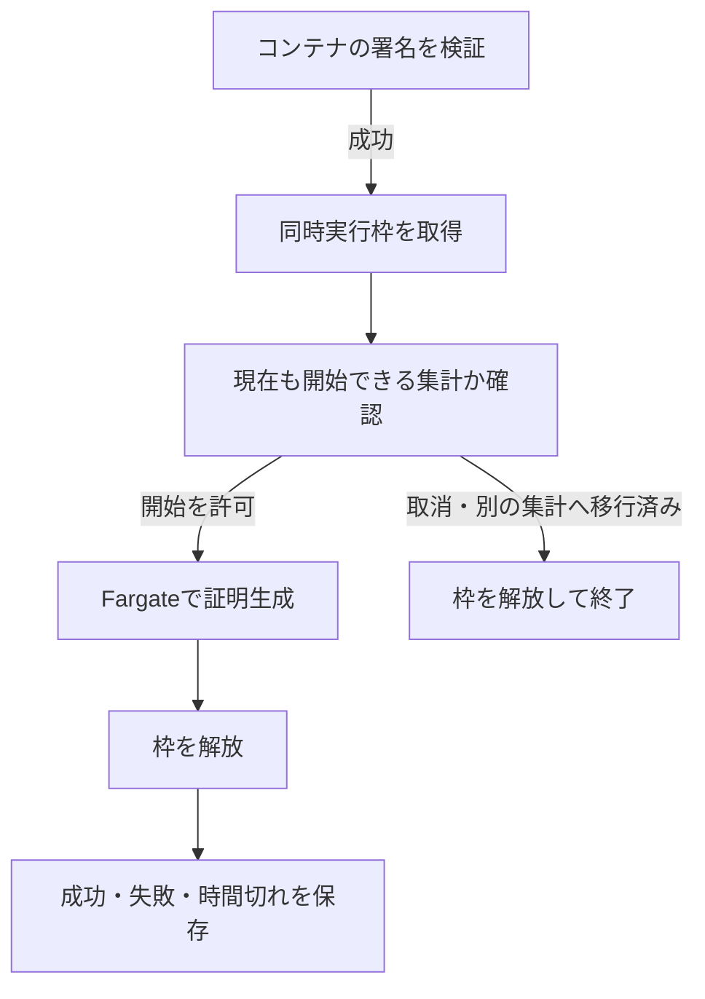

# 非同期プローバー

集計要求が受け付けられてから、実際に計算が始まるまでには待ち時間があります。キューの再配送で同じ要求が届くことも、その間に利用者が取り消すこともあります。非同期プローバーは、作業が届いたという理由だけでは起動せず、保存済みの集計状態を確認してから計算へ進みます。

<a id="finalize-受付"></a>

## 集計要求を受け付ける

`POST /api/sessions/:sessionId/finalizations` は、URL のセッションと capability を照合し、Turnstile、レート制限、集計開始の前提条件を確認します。AWS の非同期経路では、次の順で作業を登録します。

1. zkVM 入力を構築し、集計状態を `pending` として保存する。
2. 非公開 S3 の `sessions/{sessionId}/{finalizationId}/input.json` に入力を保存する。
3. 正しい S3 キーを含む作業メッセージを SQS へ送る。
4. `202 Accepted` と、`pending` の `FinalizationResource` を返す。

応答には状態取得 URL を含めません。クライアントは既知の `GET /api/sessions/:sessionId/finalizations/current` を capability 付きで呼び出します。

<a id="dispatch-処理"></a>

## キューから作業を起動する

`proof-dispatcher` は SQS メッセージを一件ずつ読みます。まずメッセージの形、`recordType`、セッションと集計の識別子を検証し、入力、出力先、バンドルの S3 キーが同じ集計の正規の配置であることを確認します。必要な AWS 設定が欠けていても開始できません。

次に、現在の集計レコードを読みます。該当するレコードがない場合や、メッセージの `finalizationId` が現在の `pending` と一致しない場合は、古い作業として破棄します。取消後に再配送された要求が、新しい計算を始めるのを防ぐためです。一方、壊れたメッセージ、キーの不整合、一時的な AWS 呼び出し失敗は再試行し、解消しなければ DLQ へ移します。

条件を満たすと `StartExecution` で Step Functions を開始します。dispatcher は入力ファイルを保存し直さず、この時点では状態を `running` にも変えません。計算資源の空きがまだ分からないからです。

<a id="dynamodb-recovery-phase-と-quiesce"></a>

develop 専用のアプリ復旧経路で[休止段階](terraform.md#dynamodb-recovery-selection)へ入った場合は、新規セッションの作成に加えて、プローバーと検証の SQS event-source mapping を停止します。未消費の要求はキューに残り、集計も `pending` のまま残り得ます。キュー消費を再開するのは active の段階だけです。

## Step Functions

Step Functions は、起動前の確認と計算の後始末を順序付けます。



### 署名を確かめてから資源を確保する

最初の `VerifyImageSignature` は、`image-signature-verifier` Lambda の `runtime` alias を呼びます。対象は、デプロイ時に内容のダイジェストで固定したプローバーイメージです。`result = VERIFIED` と `mode = cryptographic` の両方がそろった場合だけ、同時実行枠の取得へ進みます。

署名処理中、署名プロファイルの不一致、検証資産や信頼ポリシーの不整合、暗号学的検証の失敗、時間切れはすべて起動を止めます。Lambda 呼び出し自体が回数を制限した再試行後も失敗すると、`RecordSignatureInvocationFailure` が拒否結果へ変換し、`CallbackSignatureFailed` で失敗を記録します。[イメージ署名](image-signing.md)が説明するように、署名処理の完了表示だけではこの条件を満たしません。

### 待っている間の取消を見落とさない

`AcquireProverSlot` は DynamoDB の semaphore で、`RunProver` へ同時に進める数を制限します。枠が埋まっている間は Step Functions 内で待機・再試行し、利用者へは `pending` を返します。待機の上限に達すれば容量待ちの失敗を記録します。

枠を取れた後、`MarkProverStarted` が `finalization-writer` を呼び、ストアの更新条件をもう一度確認します。ここで開始を許可した場合だけ `running` と `startedAt` を保存します。待機中に取り消されたり、別の集計へ置き換わったりしていれば、枠を返して終了し、タスクを起動しません。

`RunProver` は `ecs:runTask.sync` で Fargate タスクを起動して完了を待ちます。正常終了、時間切れ、その他の失敗に応じて枠を解放し、writer に結果を通知します。`running` は開始が許可された状態なので、タスク開始の再試行中も含みます。

### 解放し損ねた枠を回収する

通常の解放は state machine の成功・時間切れ・失敗経路が担います。`semaphore-janitor` は、その後始末が完了しなかった場合を補います。

janitor は Step Functions の終了イベントで所有者の解放を試み、さらに30分ごとの確認で「タスクの時間制限＋15分」より古い所有者を調べます。古いというだけでは削除しません。対応する実行が `RUNNING` または `PENDING_REDRIVE` なら保持し、終了済みか存在しないことを確認できた実行だけを条件付き更新で解放します。

<a id="ecs-fargate-task"></a>

## コンテナ内で証明を生成する

プローバーは [16 vCPU / 32 GiB を既定とする一回限りのタスク](design-and-services.md)です。Step Functions から、入力の `INPUT_S3_BUCKET` / `INPUT_S3_KEY`、出力の `OUTPUT_S3_BUCKET` / `OUTPUT_S3_PREFIX`、期待する `EXPECTED_IMAGE_ID` を受け取ります。

コンテナの entrypoint は S3 から入力を取得し、必須フィールドを確認して zkVM host を実行します。続いて Rust の `prover-artifacts` が非公開入力と host 出力を厳密に読み、`journal.json` と公開監査用の `public-input.json`、`election-manifest.json`、`close-statement.json` を作ります。

ファイルを書けただけでは配布しません。同じ Rust ツールで読み直し、ジャーナルと公開監査ファイルの `methodVersion`、入力コミットメント、選挙情報の一致を確認します。その後、次の五つだけを ZIP にして、個別の関連ファイルとともに非公開 S3 へアップロードします。

```text
receipt.json
journal.json
public-input.json
election-manifest.json
close-statement.json
```

公開監査ファイルと正規化したハッシュの計算は `zkvm/host/src/artifacts.rs` が担当します。shell はプロセス起動、ファイル、ZIP、S3 と配布対象の制限を担当します。AWS 用プロファイルとこのコンテナは本物の STARK 証拠だけを許可し、開発用レシートを成功証明にできません。

<a id="artifact-境界"></a>

## 生成したファイルを公開用と内部用に分ける

一回の集計に属するファイルでも、すべてを ZIP に入れません。`input.json` など、[公開しないファイル](../verification/public-boundary.md)を除外します。形式と配置は[バンドル構造](../verification/bundle-structure.md)にあります。

生成したビットマップは ZIP の外の同じ集計用接頭辞へ保存します。S3 に存在するだけで利用可能とは宣言せず、writer が内容を検証し、集計結果と一緒に保存できたことをもって利用可能にします。`verification.json` はこの段階ではまだなく、後続の検証作業で保存した後にレポート取得 API から配信します。

### failure-marker.json の契約

コンテナが非ゼロ終了した場合、entrypoint は可能なら `failure-marker.json` を保存します。これは画面へ生のエラーを出さずに、障害の種類を writer へ伝えるための非公開ファイルです。

内容は `category` だけで、値は `configuration`、`input`、`prover_execution`、`infrastructure_interruption`、`artifact`、`upload`、`timeout`、`unknown` に限定します。生のエラー、識別子、保存先、イメージ情報、認証情報は入れません。

同じ集計の S3 接頭辞に新規作成のみを許可し、既存の異なる内容を上書きしません。writer は形と値を検証できたときだけ障害詳細へ取り込みます。存在しない場合や不正な場合は、一般的なタスク失敗として扱います。公開 ZIP、レポート、ブラウザ向けダウンロードには含めません。

<a id="callback-と-session-state"></a>

## 結果の通知と保存を確定する

成功通知を受けた `finalization-writer` は、まずバンドルのキーが `sessions/{sessionId}/{finalizationId}/bundle.zip` と一致することを確認します。バンドルからレシート、ジャーナル、公開監査ファイルを復元し、存在する個別ビットマップを[ビットマップの契約](../protocol/bitmap-merkle.md)で検証します。

復元が一時的に失敗した場合は、Step Functions が回数を制限して通知を再試行します。一時的ではない復元失敗は `FINALIZATION_BUNDLE_RESTORE_FAILED` として記録し、集計を `failed` にします。

復元できた結果とビットマップの利用可否、利用可能と宣言する付随データは、一つのトランザクションで保存します。この保存が失敗しても `succeeded` は公開せず、通知が再試行された場合に保存をやり直します。

失敗通知では署名、タスク、時間切れなどの理由を保存します。`PROVER_TASK_FAILED` の場合は、同じ集計の `failure-marker.json` を上記の条件で読み取ります。通知自体の配信失敗も Step Functions の再試行上限と失敗状態に従います。

<a id="client-polling-と判定境界"></a>

## ブラウザが完了を待つ

`GET /api/sessions/:sessionId/finalizations/current` は、現在の集計について次の進捗を返します。

| 状態        | 何が起きているか                                                     |
| ----------- | -------------------------------------------------------------------- |
| `pending`   | 受付済み。配送、実行準備、同時実行枠を待っている                     |
| `running`   | 枠を取得し、現在の集計として開始を許可した。タスク開始の再試行も含む |
| `succeeded` | バンドルを復元・確認し、結果とビットマップ利用可否を原子的に保存した |
| `failed`    | 署名、容量待ち、タスク、証拠の復元などの失敗を保存した               |
| `timeout`   | タスクの時間切れを保存した                                           |

`succeeded` は証明生成の完了です。画面の「Verified」は、これからレシート、ジャーナル、投票と掲示板の証拠を評価して決まります。

<a id="bundle--report-delivery"></a>

## 証拠をダウンロードする

バンドルとレポートは capability で保護された API から取得します。大きい `bundle.zip` は Range 応答で分割取得できます。API は集計の識別子と S3 キーを照合し、別の集計のファイルや正規の配置でないファイルを返しません。直接の S3 URL や署名付き URL は通常のブラウザ・CLI の取得契約ではありません。

<!-- source: packages/api-contract/src/routes/inventory.ts, packages/api-contract/src/schemas/finalizations.ts, packages/runtime-config/src/env/runtimeProfile.ts, packages/application/src/finalize/usecases/finalize-async.ts, packages/aws-adapters/src/finalize/async-prover-artifacts.ts, infra/docker/entrypoint.sh, zkvm/host/src/artifacts.rs, infra/docker/prover-failure-marker-contract.json, infra/lambdas/proof-dispatcher, infra/lambdas/finalization-writer, infra/lambdas/semaphore-janitor, infra/terraform/app/step_functions.tf -->
