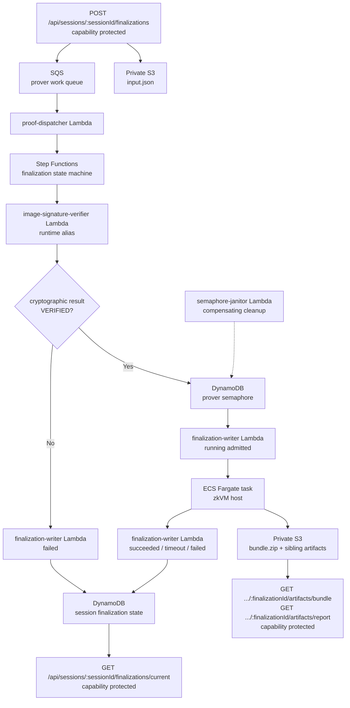
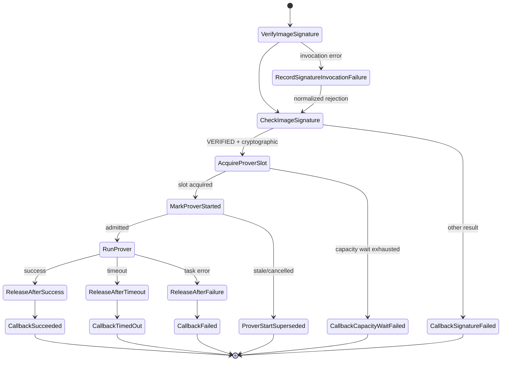
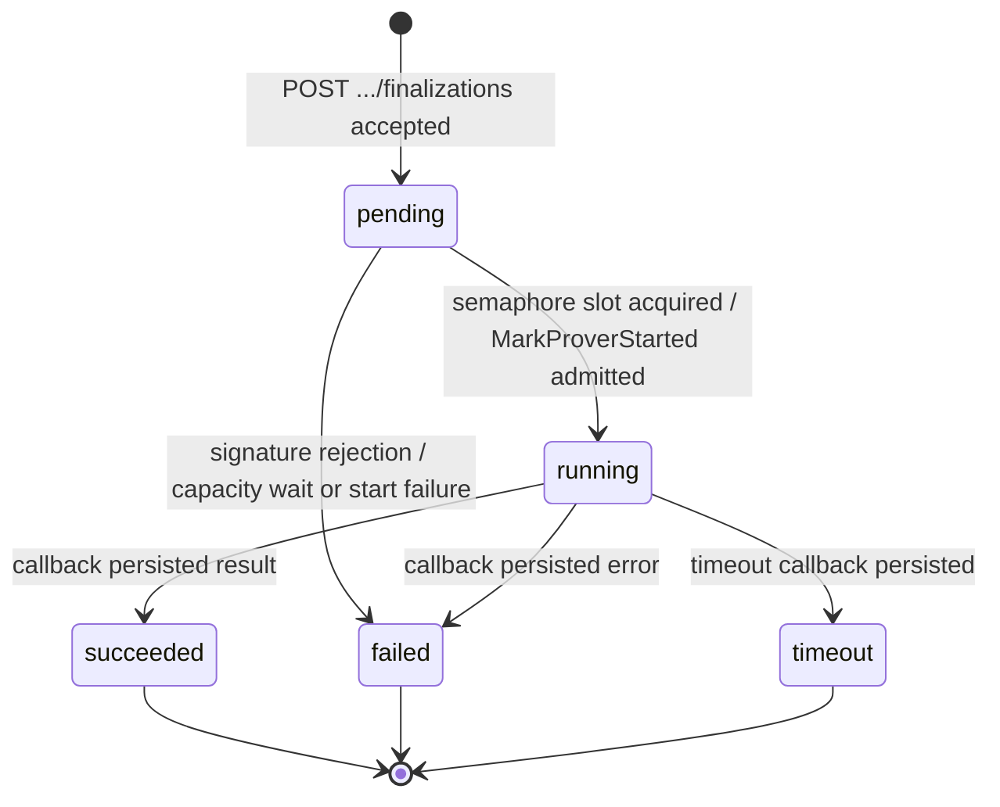

# 非同期プローバー

このページは、AWS runtime で STARK 証明生成を HTTP リクエストから分離する非同期プローバー経路を説明します。
対象は `RUNTIME_PROFILE=target-aws-async` の経路です。

STARK 証明生成はブラウザ操作や API Gateway / Lambda の短い応答時間より長くかかります。
そのため、`POST /api/sessions/:sessionId/finalizations` は作業を受理してすぐ返し、証明生成は SQS、Step Functions、ECS Fargate に委ねます。
ブラウザは capability token 付きの current finalization API をポーリングし、完了後に bundle / report を取得します（[Bundle / report delivery](#bundle--report-delivery)。`public` の分類は [公開境界](../verification/public-boundary.md) の定義に従います）。

## 実行リソースと mode 境界

target の prover task は ARM64 Linux の CPU-only ECS Fargate task で、現行 IaC
default は 16 vCPU / 32 GiB です。`target-aws-async` profile は production proof
evidence と async finalization だけを許可し、mock / development receipt や同期
execution を選べません。

local/test profile は同じ target topology を模倣するものではありません。
`local-demo` と `static-mock-e2e` は mock evidence、
`local-proof-development` は development-only receipt、
`local-proof-production` は production proof をそれぞれ同期実行します。profile
全体の対応表は [AWS runtime 境界 > Semantic runtime profiles](runtime-boundary.md#semantic-runtime-profiles)
を参照してください。

この分離により、短い Web/API request lifecycle は work acceptance と status
取得に集中し、数分規模・高 resource の proof lifecycle は queue、retry、
capacity control、artifact publication を独立して扱えます。CPU/GPU や task
resource を変更する場合は、この非同期境界を保ったまま proof-time と cost の
evidence を取り直す必要があります。

## 全体像

主要な責務は次のとおりです。

| コンポーネント             | 責務                                                                                                                                  |
| -------------------------- | ------------------------------------------------------------------------------------------------------------------------------------- |
| API handler                | セッション capability、Turnstile、rate limit、finalize 前提条件を検証し、`input.json` を private S3 に保存して非同期 work item を作る |
| SQS work queue             | finalize 要求を durable な dispatch 単位として保持し、dispatcher の再試行と DLQ 移動を担う                                            |
| proof-dispatcher Lambda    | work item、artifact key、session の `pending` state を検証し、Step Functions execution を開始する                                     |
| Step Functions             | cryptographic image verifier、prover semaphore、ECS Fargate `runTask.sync`、成功、失敗、timeout の callback を順序づける              |
| image-signature-verifier   | 選択された digest-pinned prover image を固定された trust policy と verifier asset で暗号学的に検証する                                |
| prover semaphore           | DynamoDB の単一 lock item で `RunProver` への同時進入数を制限し、capacity 待ちを Step Functions 内に閉じ込める                        |
| semaphore-janitor Lambda   | terminal execution event と定期 sweep を使い、通常の release 経路で残った semaphore owner を補償的に解放する                          |
| ECS Fargate task           | zkVM host を実行し、公開可能 artifact と private sibling artifact を private S3 に保存する                                            |
| finalization-writer Lambda | callback payload と S3 bundle key を検証し、DynamoDB の session finalization state を更新する                                         |
| bundle/report API          | capability 保護の bundle / report 配信（[Bundle / report delivery](#bundle--report-delivery)）                                        |

## Finalize 受付

`POST /api/sessions/:sessionId/finalizations` は session-scoped な操作であり、path の `sessionId` と `X-Session-Capability` の検証を通過した場合だけ処理されます（契約は [API リファレンス > セッション capability](../api/endpoints.md#セッション-capability)）。

非同期モードでは、API handler は同期的に証明を作らず、次の処理を行います。

1. セッションが finalize 可能な状態か検証する。
2. zkVM 入力を構築し、finalization state を `pending` として保存する。
3. target AWS runtime では `sessions/{sessionId}/{finalizationId}/input.json` に zkVM 入力を保存する。
4. SQS work queue に、正準 S3 key を含む prover work message を送る。
5. `202 Accepted` と `pending` の `FinalizationResource` を返す。現行 resource は status URL を含まない。

返却後のクライアントのポーリングと status の判定境界は [Client polling と判定境界](#client-polling-と判定境界) を参照してください。

## Dispatch 処理

`proof-dispatcher` Lambda は SQS message を 1 件ずつ処理します。
SQS は長時間の証明生成を直接抱えるのではなく、Step Functions execution を開始するための durable dispatch queue です。

dispatcher は次を検証します。

- strict な message shape と `recordType`、session ID、finalization ID
- `input.json`、output prefix、`bundle.zip` の S3 key が session / finalization scope の正準 layout に一致すること
- AWS runtime に必要な環境設定が存在すること

検証後、dispatcher は Step Functions を `StartExecution` で開始します。
dispatcher は `input.json` を保存せず、`StartExecution` 成功だけで finalization state を `running` にもしません（`running` へ遷移する条件は [Step Functions](#step-functions)）。

session の current finalization record が存在しない、または message の `finalizationId` に対する `pending` state ではない場合、dispatcher は stale work として drop します。
message shape や artifact key の不整合、または一時的な AWS 呼び出し失敗は SQS retry / DLQ の対象です。

### DynamoDB recovery phase と quiesce

DynamoDB recovery の phase 定義と切替契約は [Terraform](terraform.md) を参照してください。
quiesced phase では新規の public session admission と prover / verification work queue の SQS event-source mapping が無効になるため、未消費の prover work は SQS に残り、finalization state は `pending` のままになることがあります。
event-source consumption を再開するのは active phase だけです。

## Step Functions

Step Functions state machine は、証明生成の順序と callback を管理します。

`VerifyImageSignature` は `image-signature-verifier` Lambda の qualified `runtime` alias を呼び出し、ECS で実行する digest-pinned prover image を暗号学的に検証します。
固定された trust root と verifier asset を使った検証結果が `result = VERIFIED` かつ `mode = cryptographic` の場合だけ semaphore 取得に進みます。
それ以外（署名未完了、profile 不整合、trust policy 不整合、検証失敗、timeout、verifier error）は rejected result として fail-closed に扱います。
Lambda invocation 自体が bounded retry 後も失敗した場合は `RecordSignatureInvocationFailure` が cryptographic rejection に正規化し、`CallbackSignatureFailed` に進みます。
signing status の readiness と暗号学的検証の区別を含む考え方は [イメージ署名](image-signing.md) を参照してください。

`AcquireProverSlot` は DynamoDB-backed semaphore で `RunProver` への同時進入数を制限します。
capacity 競合は Step Functions 内で待機 / retry され、この間の user-visible finalization state は `pending` のままです。
slot 取得後、`MarkProverStarted` が `finalization-writer` Lambda を呼び、store guard を通過した場合だけ `running` と `startedAt` を記録します。
この guard により、cancel 済みまたは superseded された execution は `RunProver` に進まず slot を解放して終了します。

`RunProver` は ECS Fargate task を `ecs:runTask.sync` で起動します。
Step Functions は task の完了を待ち、slot を解放したうえで成功、timeout、その他の失敗を `finalization-writer` Lambda に callback します。

通常の slot 解放は state machine 内の `ReleaseAfterSuccess` / `ReleaseAfterTimeout` / `ReleaseAfterFailure` が担います。
`semaphore-janitor` Lambda はその補償経路です。
Step Functions の terminal status event で owner 解放を試み、さらに 30 分ごとの sweep で prover task timeout に 15 分を加えた期間より古い owner を確認します。
sweep は Step Functions execution がまだ `RUNNING` なら owner を保持し、terminal または存在しない execution だけを条件付き更新で解放します。

## ECS Fargate task

ECS Fargate task は一回限りの証明生成 job です。
ブラウザや外部利用者に直接公開される endpoint ではありません。

task には Step Functions から次のような session 固有の入力が渡されます。

| 環境変数                                | 説明                                     |
| --------------------------------------- | ---------------------------------------- |
| `INPUT_S3_BUCKET` / `INPUT_S3_KEY`      | API handler が保存した zkVM 入力の場所   |
| `OUTPUT_S3_BUCKET` / `OUTPUT_S3_PREFIX` | bundle と sibling artifact の保存先      |
| `EXPECTED_IMAGE_ID`                     | 実行する guest image と照合する Image ID |

コンテナの entrypoint は次の順序で処理します。

1. private S3 から `input.json` を取得する。
2. 入力 JSON の必須フィールドを検証する。
3. zkVM host binary を実行する。
4. host output から `journal.json` を構築する。
5. `public-input.json`、`election-manifest.json`、`close-statement.json` を構築する。
6. `journal.json` と公開監査アーティファクト の method version、input commitment、選挙情報が一致することを検証する。
7. `receipt.json`、`journal.json`、`public-input.json`、`election-manifest.json`、`close-statement.json` だけを含む `bundle.zip` を作る。
8. `bundle.zip` と sibling artifacts を private S3 にアップロードする。

処理が非ゼロ終了した場合、entrypoint は `failure-marker.json` を best-effort で保存します（契約の詳細は [Artifact 境界](#artifact-境界)）。

`target-aws-async` と prover container は production proof evidence だけを許可します。container entrypoint は retired development-mode variable を host process に渡さず、development receipt を成功証明として扱いません。

## Artifact 境界

非同期プローバーの S3 bucket は private proof artifact storage です。
ブラウザは S3 に直接アクセスしません。

公開可能 member と除外 artifact の普遍的なポリシーは [公開境界](../verification/public-boundary.md) を、モード別の bundle allowlist と S3 レイアウトは [バンドル構造](../verification/bundle-structure.md) を参照してください。
mode 非依存の保護 4 アーティファクトの除外は、非同期モードでも [公開境界 > bundle.zip に入れないファイル](../verification/public-boundary.md#bundlezip-に入れないファイル) と同一です。
そのうえで、非同期経路に固有の点は次のとおりです。

- `included-bitmap.json` と `seen-bitmap.json` は、生成された場合に `bundle.zip` 外の sibling object として同じ finalization prefix に保存されます。S3 object の存在だけでは利用可能とせず、callback が内容を検証して finalization に admit した結果を artifact availability に反映します。
- `verification.json` は finalize callback 時点で常に存在する artifact ではなく、後続の verification run が report を保存した後にのみ、`/api/sessions/:sessionId/finalizations/:finalizationId/artifacts/report` の capability 保護 API から取得できます。
- `failure-marker.json` は非同期経路だけに現れる private diagnostic です。契約は次のとおりです。

### failure-marker.json の契約

`failure-marker.json` は、prover が非ゼロ終了した場合に entrypoint が作る、`category` だけを持つ小さな private sibling object です。

- `category` の値は `configuration`、`input`、`prover_execution`、`infrastructure_interruption`、`artifact`、`upload`、`timeout`、`unknown` の閉じた集合に制限され、raw error、session ID、artifact path、image authority、credential は含めません。
- 同じ finalization scope の private S3 prefix へ create-only で保存し、既存 marker と異なる内容を上書きしません。
- `finalization-writer` は消費前に marker を契約と照合し、認識できる category があるときだけ failure detail に保存します。
- marker が存在しない、または契約に一致しない場合は、raw error を公開せず generic な task failure として扱います。
- 公開 bundle や report には含まれず、ブラウザ向け download endpoint からも配信されません。

## Callback と session state

`finalization-writer` Lambda は Step Functions から受け取った callback を session state に反映します。

成功 callback では、writer は S3 上の `bundle.zip` key が `sessions/{sessionId}/{finalizationId}/bundle.zip` の正準 layout と一致することを確認します。
その後、bundle から receipt、journal、公開監査アーティファクトを復元し、存在する sibling bitmap artifact を
[bitmap Merkle 契約](../protocol/bitmap-merkle.md)に照らして検証します。terminal result と bitmap availability、
利用可能と宣言する sidecar は一つの transaction で保存し、commit 前の失敗では `succeeded` を公開せず bounded callback retry に委ねます。

失敗 callback では、署名検証失敗、ECS task 失敗、timeout などの理由を finalization state に保存します。
`PROVER_TASK_FAILED` の場合、writer は許可された finalization scope の `failure-marker.json` を契約に従って消費します（詳細は [Artifact 境界](#artifact-境界)）。
callback delivery 自体が失敗した場合は Step Functions の bounded retry / failure state に従います。

## Client polling と判定境界

クライアントは `GET /api/sessions/:sessionId/finalizations/current` を capability 付きで呼び出し、current `FinalizationResource` の進捗を確認します。

| ステータス  | 説明                                                                                                           |
| ----------- | -------------------------------------------------------------------------------------------------------------- |
| `pending`   | finalize request は受理済みで、SQS dispatch、Step Functions setup、または semaphore capacity wait を待っている |
| `running`   | semaphore slot 取得後に prover 開始が admitted され、ECS task または task-start retry が進行中                 |
| `succeeded` | bundle の復元後、terminal result と bitmap availability、存在する admitted sidecar が原子的に保存された        |
| `failed`    | 署名検証失敗、prover task 失敗、artifact 復元失敗などで fail-closed に保存された                               |
| `timeout`   | ECS task timeout が callback として保存された                                                                  |

status response は finalization の進捗を示すものです。
検証 UI の最終的な「Verified」判定は、bundle、receipt、journal、公開監査アーティファクト、必要な検証チェックを別途評価して決まります。

## Bundle / report delivery

通常の browser / CLI 経路では、bundle と report は capability 保護 API から取得します（endpoint 一覧とアクセスポリシーは [公開境界 > bundle と report の取得経路](../verification/public-boundary.md#bundle-と-report-の取得経路)、wire 契約は [API リファレンス > Artifact 取得 API](../api/endpoints.md#artifact-取得-api)）。

非同期 / S3 実行に固有の挙動は次のとおりです。

- 大きい `bundle.zip` は bundle endpoint の range response で配信できます。
- S3 key が正準 layout と一致しない場合や、許可された finalization scope に属さない場合、API は fail-closed に扱います。
- raw S3 URL や presigned URL は通常の browser / CLI contract ではありません。

## 関連する章

- [AWS runtime 境界](runtime-boundary.md)：AWS 章全体の runtime 境界
- [バンドル構造](../verification/bundle-structure.md)：`bundle.zip` と private artifact の境界
- [可観測性設計](observability.md)：queue、Step Functions、ECS、writer を横断する相関と検出
- [イメージ署名](image-signing.md)：Step Functions 内の署名確認
- [Image ID](../zkvm/image-id.md)：prover image と guest Image ID の対応

<!-- source: packages/api-contract/src/routes/inventory.ts, packages/api-contract/src/schemas/finalizations.ts, packages/runtime-config/src/env/runtimeProfile.ts, apps/api/src/server/api/handlers/finalize.ts, apps/api/src/server/api/handlers/currentFinalization.ts, apps/api/src/server/api/handlers/verificationBundles.ts, packages/application/src/finalize/usecases/finalize-async.ts, packages/aws-adapters/src/finalize/async-prover-artifacts.ts, infra/docker/entrypoint.sh, infra/docker/prover-failure-marker-contract.json, infra/image-signature-verifier, infra/lambdas/image-signature-verifier, infra/lambdas/proof-dispatcher, infra/lambdas/finalization-writer, infra/lambdas/semaphore-janitor, infra/terraform/app -->
