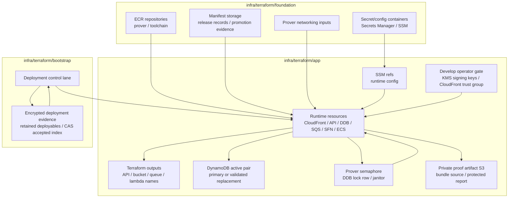

# 現行構成とサービス一覧

AWS runtime の管理境界、環境分離、主要サービスの責務を公開仕様として整理します。
個別デプロイの承認記録や内部運用証跡は扱いません（除外範囲は [AWS runtime boundary > このページで扱わないもの](runtime-boundary.md#このページで扱わないもの) と同じです）。
前提となる公開境界は [AWS runtime boundary](runtime-boundary.md) を参照してください。

## Terraform root ごとの管理境界

AWS runtime は Terraform の root ごとに責務を分けて管理します。
各 root の管理対象と境界は次のとおりです（root ownership の詳細は [Terraform](terraform.md)）。

| 管理系                       | 公開仕様上の役割                                                                                                                                      | 境界                                                                                           |
| ---------------------------- | ----------------------------------------------------------------------------------------------------------------------------------------------------- | ---------------------------------------------------------------------------------------------- |
| `infra/terraform/foundation` | ECR repository、versioned manifest storage、Secrets Manager container、non-secret SSM config、prover networking                                       | API、Lambda、DynamoDB、SQS、Step Functions、ECS task、CloudFront、proof artifact S3 は作らない |
| `infra/terraform/app`        | CloudFront + private S3 frontend、develop operator gate、API Gateway + `public-api`、DynamoDB、target Lambdas、SQS/SFN/ECS/S3、logs、runtime SSM refs | ECR repository や image publication は所有せず、digest 固定の prover image URI を消費する      |
| `infra/terraform/bootstrap`  | Terraform state backend、deployment control lane、暗号化された deployment artifact / acceptance evidence storage                                      | Runtime workload resource は所有しない                                                         |
| `infra/terraform/legacy`     | retained historical context                                                                                                                           | 現行 runtime の authority ではない                                                             |

## 環境分離

`develop` と `main` は source branch / account alias / deployment environment / state scope を分けて扱います。
現在の live target app lane は `stark-dev/develop/app` です。
`stark-prod/main/app` は protected production contract の repository evidence として render されますが、非変更 evidence であり live production deployment はまだ承認しません。
証明モードは実 STARK 証明を前提にし、`RISC0_DEV_MODE=1` / `USE_MOCK_ZKVM=true` はローカル同期実行用の設定です。

| 項目                                                     | 現在の app runtime default                                              |
| -------------------------------------------------------- | ----------------------------------------------------------------------- |
| private proof artifact S3 lifecycle                      | `proof_artifact_lifecycle_days = 7`                                     |
| Lambda / API access / Step Functions / ECS log retention | 30 日                                                                   |
| CloudTrail                                               | app / foundation / bootstrap runtime root の workload resource ではない |

環境別に分かれるものは、app runtime state、proof artifact storage、DynamoDB と選択された recovery pair、queue / worker、Step Functions、ECS task definition、runtime SSM refs、CloudWatch logs / alarms、develop operator gate の trust resources などです。
ECR repository や manifest storage など、app 実行の前提になるリソースは foundation root の責務として扱います。

## 全体構成図

_図: STARK Ballot Simulator の AWS 全体構成（クリックで拡大）。_

## サービス一覧

この runtime が使う主要な AWS サービスと役割です。

### App runtime

| サービス               | リソース                          | 役割                                                                                        |
| ---------------------- | --------------------------------- | ------------------------------------------------------------------------------------------- |
| CloudFront + S3        | static frontend / operator gate   | Vite/React の静的配信、`/api/*` origin routing、SPA fallback、develop の signed-cookie gate |
| API Gateway (HTTP API) | `/api/{proxy+}`                   | capability 保護 API の公開入口                                                              |
| Lambda                 | `public-api`                      | Hono route inventory を実行する API runtime                                                 |
| DynamoDB               | sessions / votes                  | primary または検証済み replacement pair を選択し、セッション、投票、集計結果を永続化        |
| DynamoDB               | rate-limit events / counters      | API rate limit state                                                                        |
| DynamoDB               | prover semaphore                  | Step Functions が `RunProver` 前に取得する concurrency slot                                 |
| Lambda                 | `proof-dispatcher`                | SQS 受信 → artifact key / pending state 検証 → Step Functions 起動                          |
| Lambda                 | `finalization-writer`             | Step Functions 結果を session state に反映                                                  |
| Lambda                 | `verification-worker`             | S3 bundle locator を受け取り `verifier-service` で STARK レシート検証を実行                 |
| Lambda                 | `image-signature-gate`            | ECR イメージ署名ステータスの実行前確認                                                      |
| Lambda                 | `semaphore-janitor`               | terminal execution event と定期 sweep による semaphore slot cleanup                         |
| SQS                    | `prover-work` + DLQ               | 非同期証明リクエストのバッファリング                                                        |
| SQS                    | `verification-work` + DLQ         | durable verification run のバッファリング                                                   |
| Step Functions         | `finalization`                    | 署名ゲート → semaphore 取得 → ECS 実行 → slot release / finalization writer                 |
| ECS Fargate            | prover task                       | zkVM host binary による STARK 証明生成                                                      |
| S3                     | proof artifacts / static frontend | private proof artifacts、public bundle の読み出し元、frontend artifacts                     |
| SSM Parameter Store    | runtime refs                      | non-secret runtime wiring と secret/config reference name の保持                            |
| EventBridge            | semaphore janitor triggers        | Step Functions terminal status event と 30 分 sweep                                         |
| CloudWatch             | logs / alarms                     | runtime logs、access logs、DLQ / Step Functions / Lambda / Fargate alarms                   |
| KMS + CloudFront       | develop operator-gate keyset      | versioned asymmetric signing keys と CloudFront trusted public-key group を管理             |

`public` の分類は [公開境界](../verification/public-boundary.md) の定義に従います。
`input.json`、`verification.json`、`included-bitmap.json`、`seen-bitmap.json` は `bundle.zip` に含めず、`verification.json` は capability 保護 API の report endpoint から扱います。

DynamoDB recovery は `primary_active`、`primary_quiesced`、`replacement_quiesced`、`replacement_active` の 4 phase です。
transition phase は検証済み recovery manifest が指定する sessions / votes の replacement pair を primary pair とともに認可し、`replacement_*` phase が runtime の参照先を切り替えます。
quiesced phase では新規 session admission と prover / verifier の queue consumption を止め、切替中の書き込みや非同期処理を fail-closed に抑止します。

Develop operator gate は追跡対象の keyset manifest を authority とし、KMS の private signing material を Terraform state、pipeline artifact、runtime role に渡しません。
KMS から導出した public key だけを CloudFront trust group に登録し、署名権限は target runtime の責務外に保ちます。

### Foundation resources

| サービス            | リソース                     | 役割                                                              |
| ------------------- | ---------------------------- | ----------------------------------------------------------------- |
| ECR                 | prover / RISC Zero toolchain | プローバーコンテナと RISC Zero toolchain image の repository 管理 |
| S3                  | versioned manifest storage   | image / deployment manifest 系メタデータの非公開保存              |
| Secrets Manager     | runtime secret containers    | app runtime が参照する secret container の作成                    |
| SSM Parameter Store | non-secret config records    | Turnstile site key など、app runtime が参照する non-secret config |
| VPC / subnet / SG   | prover networking inputs     | ECS prover task が利用する networking input                       |

Prover image metadata、promotion evidence、release record / accepted pointer は proof artifact bucket ではなく、image build / signing と runtime wiring の境界に属します。
旧構成の SSM current pointer は候補 metadata lookup であり、target topology の release authority ではありません。
このページでは責務帰属だけを扱います。
Image build、digest 固定、署名ステータス確認、ImageID との関係は [イメージ署名](image-signing.md) に集約します。

### Deployment control

| サービス     | リソース                            | 役割                                                                                                                   |
| ------------ | ----------------------------------- | ---------------------------------------------------------------------------------------------------------------------- |
| S3 + KMS     | state / deployment evidence storage | Terraform state と lockfile、暗号化された pipeline artifact、retained deployable、immutable acceptance evidence の保護 |
| CodePipeline | deployment lanes                    | app の normal / rollback と foundation root の制御された実行経路                                                       |
| CodeBuild    | app build / deploy jobs             | authority selection、frontend / Lambda artifact、Terraform saved plan/apply、smoke / acceptance job                    |
| CodeBuild    | image release jobs                  | toolchain / prover candidate build、ImageID/signing/scan evidence、promotion evidence                                  |
| IAM          | deploy roles                        | root ごとの最小権限実行                                                                                                |

_図: GitHub から CodePipeline deployment lanes を経て app runtime に到達するデプロイ制御フロー（クリックで拡大）。_

個別の承認手順、証跡、昇格判断の詳細は公開仕様の範囲外です。
Normal mode は accepted toolchain / prover authority から immutable app deployment record を組み立てます。
Rollback mode は、過去に受理された deployment record と retained Lambda / frontend artifacts を immutable key / version / digest で選びます。
選んだ内容は、現在の control source から reviewed forward deployment として実行します。
Rollback は Terraform plan が空でも approval を必須とします。
approval を省略できるのは、normal mode で saved plan に変更がないと機械的に証明された場合だけです。
Post-apply smoke の成功後、lane は reviewed plan / apply、release authority、任意の recovery selection、retained deployable を immutable acceptance evidence として保存します。
accepted-deployment index の更新は compare-and-swap で行います。

## Runtime wiring

Runtime の連携は Terraform output、SSM reference、Lambda environment、S3 / SQS / Step Functions locator によって行われます。

`public-api`、`proof-dispatcher`、`finalization-writer`、`verification-worker`、`image-signature-gate`、`semaphore-janitor` は canonical runtime component names です。
`hono-api`、`prover-dispatch-proxy`、`finalize-callback-runner`、`verifier-service-runner`、`check-image-signature` は legacy/historical names としてのみ扱います。

## 関連する章

- [トポロジー](topology.md)：リクエスト経路とコンポーネント間の通信フロー
- [非同期プローバー](async-prover.md)：SQS → Step Functions → ECS の実行時フロー
- [Terraform](terraform.md)：target app/bootstrap state と runtime wiring
- [設計ふりかえり § Amplify 単独構成からハイブリッド構成への移行](../decisions/design-retrospective.md#6-amplify-単独構成からハイブリッド構成への移行)：現行構成に至った設計判断

<!-- source: infra/terraform/, infra/lambdas/, infra/docker/ -->
