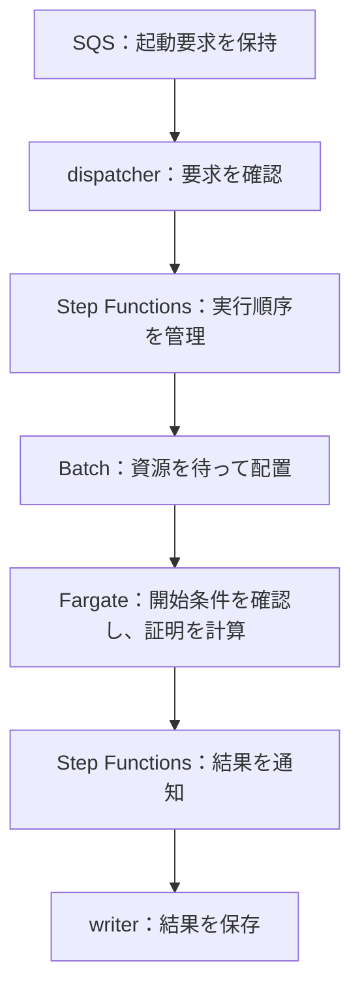

# AWS サービスの役割分担

投票受付は入力を検証・保存してレシートを返し、証明生成は保存済みの入力を使って長時間の計算を実行します。必要な資源と失敗時の対応が異なるため、それぞれ別の AWS サービスで処理します。

## Lambda による API 処理

`public-api` Lambda は、投票、集計の受付、進捗の取得、証拠の配信を担当します。DynamoDB がセッションと投票の状態を保持するので、次の要求を処理する Lambda が前回と同じ実行個体である必要はありません。

証明生成を始める要求に対しては、API が入力と作業状態を保存し、SQS に作業を登録して `202 Accepted` を返します。この応答は要求の受付を示し、計算や検証の成功を示すものではありません。

## Fargate による証明生成

プローバーは ARM64 Linux の CPU 用コンテナです。現行 IaC の既定値は 16 vCPU / 32 GiB で、AWS Batch が ECS Fargate 上に配置し、一回限りのタスクとして実行します。ブラウザ向けのサーバーではなく、S3 から入力を読み、証明と関連ファイルを書き出して終了します。

SQS は、起動要求を一時的な障害で失わないためのキューです。`proof-dispatcher` が要求を確認して Step Functions を開始すると、SQS 側の処理は完了します。Step Functions は署名確認、Batch への投入、終了後の結果保存を管理します。Batch は共通の同時実行枠を管理し、資源が空くまで待ってコンテナを起動します。

この分担により、計算資源が埋まっていても API は進捗を返せます。待機中は `pending` のままで、起動したコンテナが入力取得前に writer の開始許可を得ると `running` に変わります。取消や重複配送も含む正確な遷移は[非同期プローバー](async-prover.md)で説明します。

## 検証ワーカーによるレシート検証

証明を作れたことと、その証明を期待する Image ID で検証できたことは別です。検証要求はもう一つの SQS キュー `verification-work` に入り、`verification-worker` Lambda が Rust の `verifier-service` を呼び出します。

このワーカーは保存済みバンドルを読み、STARK レシートを検証し、保護された検証レポートを保存します。証明生成のキューを使い回さないため、計算を待つ作業と、できあがった証拠を検証する作業の滞留を分けて調べられます。ブラウザは引き続き通常の API から結果を取得します。

## Terraform の管理単位

稼働アプリ、実行の前提となる資源、デプロイの仕組みは、それぞれ App、Foundation、Bootstrap という Terraform の管理単位に分かれています。この分担により、API の修正のたびに証明生成用のネットワークやコンテナのビルド環境まで作り直す必要はありません。

App は選ばれたコンテナを使い、Foundation はイメージ保管庫や署名設定を用意し、Bootstrap は計画・承認・適用の経路を管理します。どの変更がどの承認を必要とするかは、この単位で決まります。[Terraform](terraform.md)では、その分担を保存済み計画と受入記録へどう結び付けるかを説明します。

<!-- source: infra/terraform/app, infra/terraform/foundation, infra/terraform/bootstrap, infra/lambdas/proof-dispatcher, infra/lambdas/verification-worker, packages/application/src/finalize/usecases/finalize-async.ts, infra/docker/entrypoint.sh -->
