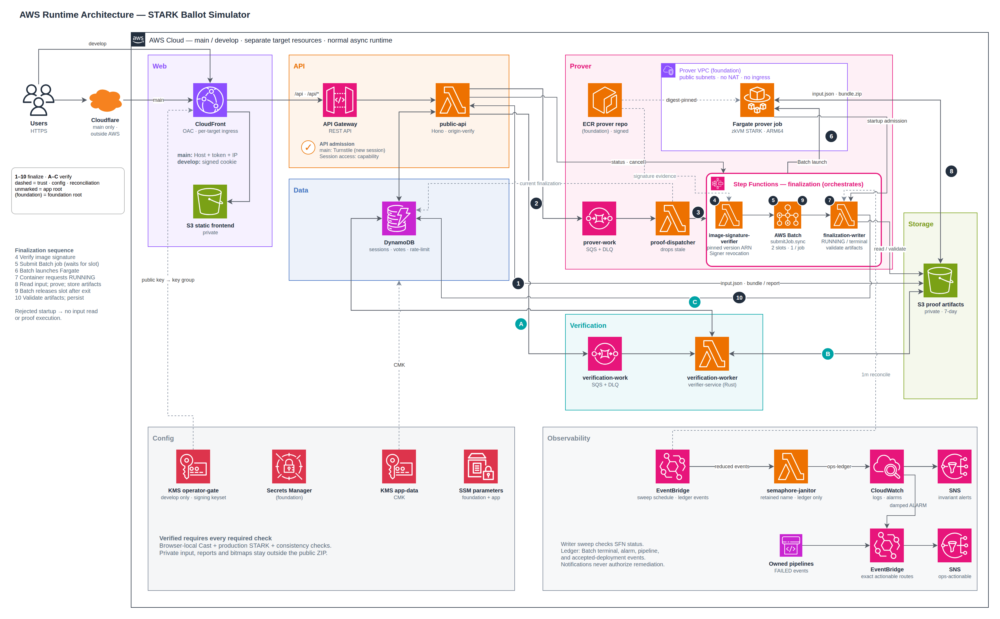
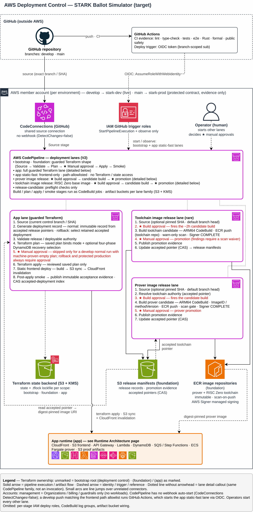
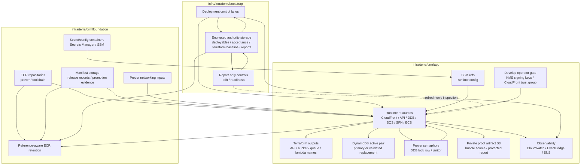

# 現行構成とサービス一覧

AWS runtime の管理境界、環境分離、主要サービスの責務を公開仕様として整理します。
前提となる公開境界と、個別デプロイの承認記録・内部運用証跡など扱わない範囲は [AWS runtime 境界](runtime-boundary.md) を参照してください。

## Terraform root ごとの管理境界

AWS runtime は Terraform の root ごとに責務を分けて管理します。
root ごとの管理対象と所有しない範囲の正本は [Terraform > Root ownership](terraform.md#root-ownership) です。要約は次のとおりです。

- `infra/terraform/app`：target application runtime（CloudFront + frontend、API、DynamoDB、queue / SFN / ECS / S3、observability）。ECR repository や image publication は所有せず、digest 固定の prover image URI を消費する
- `infra/terraform/foundation`：app 実行の前提リソース（ECR、ECR retention controller、manifest storage、secret / config container、prover networking）。app runtime resource は作らない
- `infra/terraform/bootstrap`：Terraform state backend と deployment-control lane、report-only controls、暗号化された authority storage。runtime workload resource は所有しない
- `infra/terraform/legacy`：retained historical context。現行 runtime の authority ではない

## 環境分離

`develop` と `main` は source branch / account alias / deployment environment / state scope を分けて扱います。
現在の live target app lane は `stark-dev/develop/app` です。
`stark-prod/main/app` は protected production contract の repository evidence として render されます。
これは非変更 evidence であり、live production deployment はまだ承認しません。
Target は `target-aws-async` profile による production STARK 証明を前提にします。Local 実行意図の authority は semantic `RUNTIME_PROFILE`（`local-demo`、`static-mock-e2e`、`local-proof-development`、`local-proof-production`）であり、置き換え済みの `RISC0_DEV_MODE` / `USE_MOCK_ZKVM` selector は拒否します。

| 項目                                                                  | `develop`                                                                                    | `main`                                                                  |
| --------------------------------------------------------------------- | -------------------------------------------------------------------------------------------- | ----------------------------------------------------------------------- |
| private proof artifact S3 lifecycle                                   | 7 日                                                                                         | 7 日                                                                    |
| CloudWatch log retention（runtime / Container Insights / ops-ledger） | 90〜365 日（値は [トポロジー > 主な CloudWatch ログ群](topology.md#主な-cloudwatch-ログ群)） | 180〜731 日（同左）                                                     |
| CloudTrail                                                            | app / foundation / bootstrap runtime root の workload resource ではない                      | app / foundation / bootstrap runtime root の workload resource ではない |

環境別に分かれるものは次のとおりです。

- app runtime state、proof artifact storage
- DynamoDB と選択された recovery pair
- queue / worker、Step Functions、ECS task definition
- runtime SSM refs
- CloudWatch logs / metrics / alarms / ledger
- develop operator gate の trust resources

ECR repository や manifest storage など、app 実行の前提になるリソースは foundation root の責務として扱います。

## 全体構成図

_図: STARK Ballot Simulator の AWS 全体構成（クリックで拡大）。_

## サービス一覧

この runtime が使う主要な AWS サービスと役割です。

### App runtime

| サービス               | リソース                          | 役割                                                                                        |
| ---------------------- | --------------------------------- | ------------------------------------------------------------------------------------------- |
| CloudFront + S3        | static frontend / operator gate   | Vite/React の静的配信、`/api/*` origin routing、SPA fallback、develop の signed-cookie gate |
| API Gateway (HTTP API) | `/api/{proxy+}`                   | capability 保護 API の公開入口                                                              |
| Lambda                 | `public-api`                      | Hono route inventory を実行する API runtime                                                 |
| DynamoDB               | sessions / votes                  | primary または検証済み replacement pair を選択し、セッション、投票、集計結果を永続化        |
| DynamoDB               | rate-limit events / counters      | API rate limit state                                                                        |
| DynamoDB               | prover semaphore                  | Step Functions が `RunProver` 前に取得する concurrency slot                                 |
| Lambda                 | `proof-dispatcher`                | SQS 受信 → artifact key / pending state 検証 → Step Functions 起動                          |
| Lambda                 | `finalization-writer`             | Step Functions 結果を session state に反映                                                  |
| Lambda                 | `verification-worker`             | S3 bundle locator を受け取り `verifier-service` で STARK レシート検証を実行                 |
| Lambda                 | `image-signature-verifier`        | 選択された digest-pinned prover image と signing profile の暗号学的署名検証                 |
| Lambda                 | `semaphore-janitor`               | semaphore slot cleanup と、検証済み EventBridge event の normalized operations ledger 記録  |
| SQS                    | `prover-work` + DLQ               | 非同期証明リクエストのバッファリング                                                        |
| SQS                    | `verification-work` + DLQ         | durable verification run のバッファリング                                                   |
| Step Functions         | `finalization`                    | 暗号学的署名検証 → semaphore 取得 → ECS 実行 → slot release / finalization writer           |
| ECS Fargate            | prover task                       | zkVM host binary による STARK 証明生成                                                      |
| S3                     | proof artifacts / static frontend | private proof artifacts、public `bundle.zip` の読み出し元、frontend artifacts               |
| SSM Parameter Store    | runtime refs                      | non-secret runtime wiring と secret/config reference name の保持                            |
| EventBridge            | janitor / operations-ledger rules | terminal status / 定期 sweep と、alarm / ECS / pipeline / deployment event の正規化         |
| CloudWatch             | logs / metrics / dashboard        | runtime / access logs、metric filters、passive / damped actionable alarm、ledger / query    |
| SNS                    | invariant / `ops-actionable`      | verification verdict invariant の矛盾と、限定された持続的な運用 signal の通知               |
| KMS + CloudFront       | develop operator-gate keyset      | versioned asymmetric signing keys と CloudFront trusted public-key group を管理             |

サービス表の補足は次のとおりです。

- Observability：telemetry は verification verdict を変更せず、自動 remediation も起動しません。Verification invariant の直接通知と、隔離された `ops-actionable` 経路の routing 対象（damped alarm と exact owned-pipeline failure）は [可観測性設計 > 通知の境界](observability.md#通知の境界) が正本です。その他の調査用 alarm は passive です。
- Artifact 境界：`public` の分類、`bundle.zip` の除外 artifact、`verification.json` の capability 保護配信は [公開境界](../verification/public-boundary.md) の定義に従います。
- DynamoDB recovery：4 phase の定義と quiesce を含む切替契約は [Terraform](terraform.md) を参照してください。
- Develop operator gate：追跡対象の keyset manifest を authority とし、KMS の private signing material を Terraform state、pipeline artifact、runtime role に渡しません。KMS から導出した public key だけを CloudFront trust group に登録し、署名権限は target runtime の責務外に保ちます。

### Foundation resources

| サービス                          | リソース                     | 役割                                                                                                                     |
| --------------------------------- | ---------------------------- | ------------------------------------------------------------------------------------------------------------------------ |
| ECR                               | prover / RISC Zero toolchain | プローバーコンテナと RISC Zero toolchain image の repository 管理                                                        |
| Lambda + EventBridge + CloudWatch | ECR retention controller     | accepted / rollback / running / in-progress reference を保護する reference-aware retention を日次実行し、専用 log に記録 |
| S3                                | versioned manifest storage   | image / deployment manifest 系メタデータの非公開保存                                                                     |
| Secrets Manager                   | runtime secret containers    | app runtime が参照する secret container の作成                                                                           |
| SSM Parameter Store               | non-secret config records    | Turnstile site key など、app runtime が参照する non-secret config                                                        |
| VPC / subnet / security group     | prover networking inputs     | ECS prover task が利用する networking input                                                                              |

Prover image metadata、promotion evidence、release record / accepted pointer は proof artifact bucket ではなく image build / signing と runtime wiring の境界に属し、旧構成の SSM current pointer は候補 metadata lookup にとどまります（target topology の release authority ではありません）。
Image build、digest 固定、署名ステータス確認、Image ID との関係は [イメージ署名](image-signing.md) に集約します。
ECR retention は count / age ベースの native lifecycle expiry ではなく、Foundation-owned の reference-aware retention controller が担います（保護対象と動作の正本は [Terraform > Retention authority](terraform.md#retention-authority)）。

### Deployment control

| サービス                    | リソース                                       | 役割                                                                                                                                                           |
| --------------------------- | ---------------------------------------------- | -------------------------------------------------------------------------------------------------------------------------------------------------------------- |
| S3 + KMS                    | state / execution / retained authority storage | Terraform state / lockfile、lane ごとの暗号化された execution artifact、retained deployable / acceptance evidence、accepted Terraform baseline / report の保護 |
| CodePipeline                | controlled lanes                               | Bootstrap / Foundation saved-plan、Toolchain / Prover release、App full（normal / rollback）、App static-fast の分離された実行経路                             |
| CodeBuild                   | root / app build and deploy jobs               | Bootstrap / Foundation / App の validation、saved plan / review / apply / smoke、App artifact build / deploy / acceptance                                      |
| CodeBuild                   | image release jobs                             | Toolchain / Prover candidate build、Image ID / signing / scan evidence、accepted pointer promotion                                                             |
| CodeBuild                   | report-only jobs                               | weekly / on-demand drift coordinator、Bootstrap / Foundation / App runner、on-demand rollback / recovery readiness                                             |
| EventBridge Scheduler + SQS | drift schedule / missed-run queue              | weekly drift coordinator の起動と、起動できなかった run の暗号化済み queue への隔離                                                                            |
| IAM                         | control-plane roles                            | root、lane、report-only project ごとの最小権限実行                                                                                                             |

Report-only drift は accepted Terraform baseline と exact historical source を使って refresh-enabled plan を実行し、redacted report だけを保存します。Rollback / recovery readiness も同じ隔離された App planning 境界を使います。どちらも Apply、state / pointer write、remediation、rollback / recovery exercise を起動せず、その結果は saved plan や mutation の authority になりません。

_図: GitHub から CodePipeline deployment lanes を経て app runtime に到達するデプロイ制御フロー（クリックで拡大）。_

個別の承認手順、証跡、昇格判断の詳細は公開仕様の範囲外です。

| Mode     | 内容                                                                                                                                                                                         |
| -------- | -------------------------------------------------------------------------------------------------------------------------------------------------------------------------------------------- |
| Normal   | accepted toolchain / prover authority から immutable app deployment record を組み立てる                                                                                                      |
| Rollback | 過去に受理された deployment record と retained Lambda / frontend artifacts を immutable key / version / digest で選び、現在の control source から reviewed forward deployment として実行する |

Approval の条件は次のとおりです。

- approval を省略できるのは、normal mode で saved plan に変更がないと機械的に証明された場合だけです。
- Rollback は Terraform plan が空でも approval を必須とします。

Post-apply smoke 後の immutable acceptance evidence 保存と accepted-deployment index の compare-and-swap 更新を含め、詳細は [Terraform](terraform.md) を参照してください。

## Runtime wiring

Runtime の連携は Terraform output、SSM reference、Lambda environment、S3 / SQS / Step Functions locator によって行われます。

canonical runtime component name と legacy/historical name の対応は次のとおりです。legacy 名は historical context としてのみ扱います。

| Canonical name             | Legacy/historical name     |
| -------------------------- | -------------------------- |
| `public-api`               | `hono-api`                 |
| `proof-dispatcher`         | `prover-dispatch-proxy`    |
| `finalization-writer`      | `finalize-callback-runner` |
| `verification-worker`      | `verifier-service-runner`  |
| `image-signature-verifier` | `check-image-signature`    |
| `semaphore-janitor`        | —（legacy 名なし）         |

## 現行アーキテクチャの責務分離

現行構成は、一つの hosting/backend lifecycle にすべての責務を集約しません。
短い user-facing Web/API request と数分規模の proof work を分ける理由は
[非同期プローバー > 実行リソースと mode 境界](async-prover.md#実行リソースと-mode-境界)、
runtime、前提 resource、deployment control を Terraform root ごとに分ける理由は
[Terraform > Root ownership](terraform.md#root-ownership) が現在の参照先です。

この分離により、proof capacity や image authority の変更を API request lifecycle
から切り離し、IaC の plan、権限、review、rollback 判断を change lifecycle ごとに
限定できます。過去の Amplify / AppSync / Next.js 構成や手動 handoff は現行 runtime
contract ではありません。

## 関連する章

- [トポロジー](topology.md)：リクエスト経路とコンポーネント間の通信フロー
- [非同期プローバー](async-prover.md)：SQS → Step Functions → ECS の実行時フロー
- [可観測性設計](observability.md)：CloudWatch / EventBridge / SNS のシグナルと authority 境界
- [Terraform](terraform.md)：target app/bootstrap state と runtime wiring

<!-- source: infra/terraform/, infra/lambdas/, infra/docker/ -->
