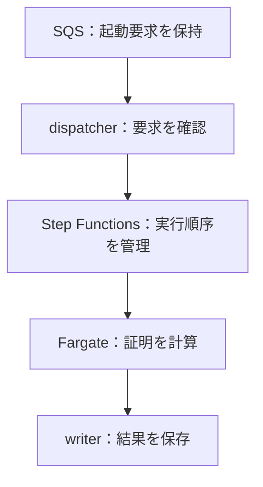

# 処理を分けて待ち時間を引き受ける

投票受付と証明生成では、使う資源も失敗したときの対応も異なります。投票受付は、その場で入力を確かめて保存し、レシートを返す処理です。証明生成は、保存した入力を使って長時間計算する作業です。AWS のサービスは、この違いに合わせて分担しています。

## 短い処理はLambdaで返す

`public-api` Lambda は、投票、集計の受付、進捗の取得、証拠の配信を担当します。DynamoDB がセッションと投票の状態を保持するので、次の要求を処理する Lambda が前回と同じ実行個体である必要はありません。

証明生成を始める要求に対しては、API が入力と作業状態を保存し、SQS に作業を登録して `202 Accepted` を返します。この応答が示すのは受付までです。計算の成功や検証の成功を先取りしません。

## 長い計算はFargateの一回限りのジョブへ渡す

プローバーは ARM64 Linux の CPU 用コンテナです。現行 IaC の既定値は 16 vCPU / 32 GiB で、ECS Fargate が一回限りのタスクとして実行します。ブラウザ向けのサーバーではなく、S3 から入力を読み、証明と関連ファイルを書き出して終了します。

SQS と Step Functions は別の待ち時間を受け持ちます。SQS は、起動要求を一時的な障害で失わないためのキューです。`proof-dispatcher` が要求を確認して Step Functions を開始すると、SQS 側の仕事は終わります。その後の署名確認、同時実行枠の待機、タスクの実行、結果保存は Step Functions が順序を管理します。

この分担により、計算資源が埋まっていても API は進捗を返せます。同時実行枠を待っている間は `pending` のままで、実際に開始を許可した時点で `running` に変えます。取消や重複配送も含む正確な遷移は[非同期プローバー](async-prover.md)で説明します。

## 証明の検証も独立した作業にする

証明を作れたことと、その証明を期待する Image ID で検証できたことは別です。検証要求はもう一つの SQS キュー `verification-work` に入り、`verification-worker` Lambda が Rust の `verifier-service` を呼び出します。

このワーカーは保存済みバンドルを読み、STARK レシートを検証し、保護された検証レポートを保存します。証明生成のキューを使い回さないため、計算を待つ作業と、できあがった証拠を検証する作業の滞留を分けて調べられます。ブラウザは引き続き通常の API から結果を取得します。

## 変更の周期も分ける

API の修正のたびに、証明生成用のネットワークやコンテナのビルド環境まで作り直す必要はありません。そこで稼働アプリ、実行の前提となる資源、デプロイの仕組みを、それぞれ App、Foundation、Bootstrap という Terraform の管理単位に分けます。

App は選ばれたコンテナを使い、Foundation はイメージ保管庫や署名設定を用意し、Bootstrap は計画・承認・適用の経路を管理します。どの変更がどの承認を必要とするかは、この単位で決まります。[Terraform](terraform.md)では、その分担を保存済み計画と受入記録へどう結び付けるかを説明します。

<!-- source: infra/terraform/app, infra/terraform/foundation, infra/terraform/bootstrap, infra/lambdas/proof-dispatcher, infra/lambdas/verification-worker, packages/application/src/finalize/usecases/finalize-async.ts -->
