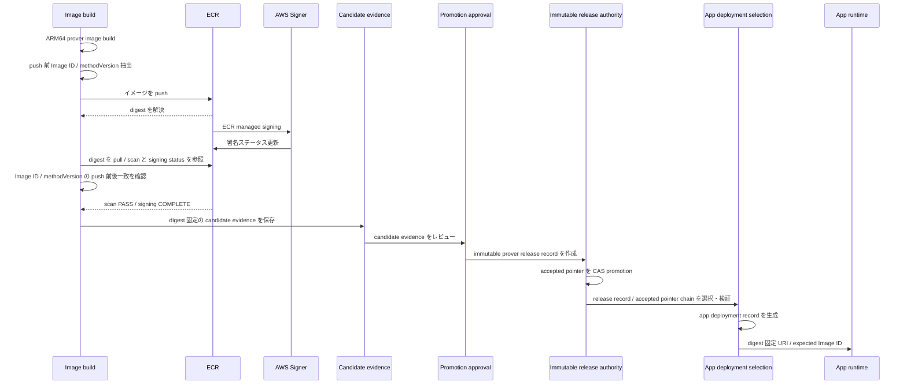
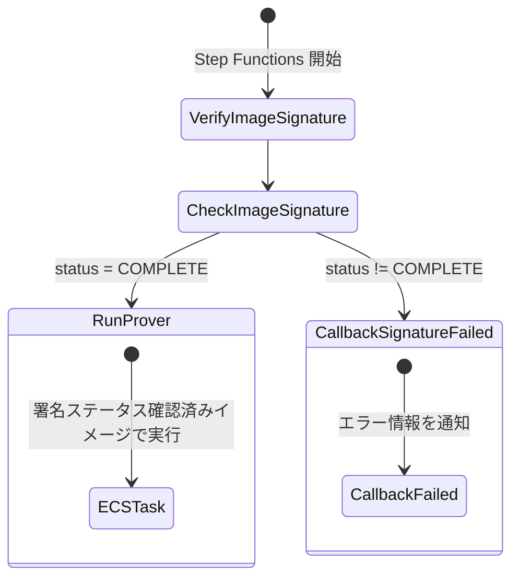
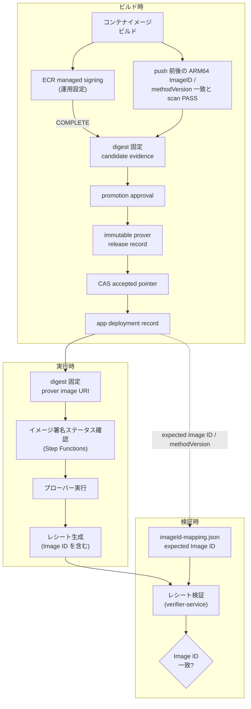

# イメージ署名

AWS Signer でプローバーイメージを署名し、ECS 実行前にゲートとして検証する仕組みを扱う章です。

STARK 証明は「特定のゲストプログラムが正しく実行された」ことを保証します。
ただし、そのゲストプログラムを含むコンテナイメージ自体が改ざんされていないことも確認する必要があります。
イメージ署名は、信頼されたビルド手順で生成されたイメージだけを証明生成に使うためのセキュリティゲートです。

## 脅威モデル

署名なしの場合、未承認イメージへの差し替えは検証段階の Image ID 照合や STARK レシート検証で拒否され得ます。
しかし、証明生成インフラ上で未承認イメージが実行されること自体は起動前に止められません。
署名ありの場合、Step Functions が起動前に署名ステータスを確認し、署名なしまたは未完了であればタスク起動を拒否します。

イメージ署名は、STARK 証明が紐づく Image ID（ゲストバイナリの暗号的識別子）とは別レイヤの防御です（両者の関係は [Image ID との関係](#image-id-との関係) を参照）。

| 保証の種類               | メカニズム            | 検出対象                                 |
| ------------------------ | --------------------- | ---------------------------------------- |
| ゲストプログラムの同一性 | Image ID（RISC Zero） | ゲストバイナリの改変                     |
| イメージ実行許可         | AWS Signer            | 未承認または署名未完了のコンテナイメージ |

## 署名、メタデータ、実行時ゲート

### 責務境界

イメージ署名では、プローバーコンテナのビルド、ECR 上の digest、AWS Signer の署名ステータス、Image ID、runtime 設定を別々の責務として扱います。
公開仕様では、個別の承認手順や内部証跡ではなく、どの情報がどの境界で使われるかを説明します。

| 領域                             | 責務                                                                                                                                                     |
| -------------------------------- | -------------------------------------------------------------------------------------------------------------------------------------------------------- |
| ECR repository                   | プローバーイメージと RISC Zero toolchain image を保持し、scan 結果と署名ステータスを digest 単位で参照できるようにする                                   |
| Candidate evidence               | digest 固定 URI、Image ID / `methodVersion` の push 前後の一致、scan `PASS`、signing `COMPLETE`、ソースと toolchain authority を結び付ける               |
| Prover release authority         | 承認済み candidate を immutable prover release record として保存し、CAS で更新する accepted prover pointer によって受理する                              |
| App deployment selection         | accepted toolchain / prover pointer chain を検証し、app deployment record に digest 固定 URI、expected Image ID、承認・scan・signing evidence を固定する |
| Non-authoritative metadata paths | 直接の CodeBuild output、`latest.json`、legacy SSM current pointer は候補 lookup にとどまり、target topology の release authority としては使わない       |
| App runtime                      | app deployment record から生成された digest 固定 prover image URI と expected Image ID を入力とし、実行前に署名ステータスを再確認する                    |
| verifier-service / UI            | STARK レシート内の Image ID と公開 trust material を照合し、検証結果を fail-closed に表示する                                                            |

Candidate evidence は release record の作成と promotion に必要ですが、それ単独では release authority ではありません。
受理された release authority は、承認済み prover release record、それを選択する accepted pointer、その pointer chain から生成された app deployment record、および必要な承認・scan・signing evidence で構成されます。
Candidate evidence、release record、pointer、app deployment record は public proof bundle の構成要素ではありません。

### ビルドと署名の概念

プローバーイメージのビルドでは、ARM64 用のコンテナを作成し、guest Image ID と `methodVersion` を抽出します。
イメージを ECR に push して digest 固定 URI を解決した後、その digest を pull し直して Image ID と `methodVersion` を再抽出し、push 前後の一致を確認します。
候補は ECR scan が `PASS`、対象 digest の ECR managed signing status が `COMPLETE` になるまで fail-closed です。
それらの AWS 由来の観測値とソース識別子、digest 固定 toolchain image を candidate evidence に記録します。
ECR managed signing の authority は、foundation Terraform が Signer profile と registry signing configuration として管理します。
個別 digest が署名済みかどうかは、build / release / runtime の各境界で `COMPLETE` ステータスとして確認します。

Build/push では運用上のタグを使う場合があります。
ただし、app runtime が参照する `prover_image_uri` と署名ステータス確認の対象は常に digest 固定（`@sha256:<64-hex>`）です。
これにより、タグの上書きによるイメージのすり替えを防止します。
ベースとなる RISC Zero toolchain image も digest 固定で扱い、プローバーイメージの再現性と metadata の整合性を保ちます。

### 実行前確認

Step Functions ステートマシンの最初のステートで、`image-signature-gate` Lambda がイメージの署名ステータスを確認します。

`image-signature-gate` Lambda は以下の処理を行います。

1. ECR の `DescribeImageSigningStatus` API を呼び出す
2. 指定されたリポジトリ名とイメージダイジェストに対する署名ステータスを取得する
3. 取得した `status`（`COMPLETE` / それ以外）を Step Functions に返す

署名ステータスが `COMPLETE` でない場合、Step Functions の Choice ステートは失敗経路に遷移し、finalization writer に署名ゲート失敗を通知します。
ECS タスクは起動されません。

> **ステータス確認と暗号学的検証の違い**
> 本システムの実行前チェックは ECR の `DescribeImageSigningStatus` が返すステータス参照です。
> 署名値そのものの暗号学的検証（証明書チェーン検証など）は行いません。
> 独立検証が必要な場合は [Notation](https://notaryproject.dev/) などの外部ツールを併用してください。

## ECR リポジトリと digest 固定

### リポジトリ構成

| リポジトリ種別                 | 用途                                      | 所有境界                                |
| ------------------------------ | ----------------------------------------- | --------------------------------------- |
| Prover image repository        | ECS Fargate で実行するプローバーイメージ  | foundation resource / app runtime input |
| RISC Zero toolchain repository | プローバーイメージの base toolchain image | foundation resource / build input       |

ECR repository は app runtime の前提リソースです。
app root は repository を作成したり image publication を所有したりせず、digest 固定の prover image URI を入力として消費します。

### ダイジェスト固定

Terraform の prover image URI 変数には、digest 固定 URI のみが許可されます。
バリデーションルールにより `@sha256:<64-hex>` 形式が強制されます。

Step Functions の定義に含まれるイメージダイジェストは、Terraform の変数から以下のように抽出されます。

- **リポジトリ名**: URI の `@` より前の部分からレジストリホストを除去
- **ダイジェスト**: URI の `@` より後の部分（`sha256:...`）

この分解により、`image-signature-gate` Lambda は正確なリポジトリとダイジェストの組み合わせで署名ステータスを確認できます。

## Image ID との関係

イメージ署名と [Image ID](../zkvm/image-id.md) は異なるレイヤのセキュリティメカニズムです。
両者は共に「正しいプログラムが実行されたこと」の信頼チェーンを構成します。

Candidate evidence から承認済み release record、accepted pointer、app deployment record までの chain が、digest 固定 URI と Image ID / `methodVersion` の対応関係を保持します。
公開検証で「正しいゲストが実行された」と判断する authority は、STARK レシート検証と expected Image ID の照合です。
イメージ署名はその前段で、未承認または署名未完了のコンテナイメージを実行させないための runtime gate として機能します。

| 検証ポイント  | タイミング | 検証主体                | 失敗時の動作         |
| ------------- | ---------- | ----------------------- | -------------------- |
| イメージ署名  | 証明生成前 | Step Functions + Lambda | ECS タスクの起動拒否 |
| Image ID 照合 | 検証時     | verifier-service        | 検証失敗の報告       |

<!-- source: buildspec.yml, infra/terraform/bootstrap/foundation_pipeline_prover_release_codebuild.tf, infra/terraform/bootstrap/foundation_pipeline_prover_release_codepipeline.tf, infra/terraform/foundation/ecr_signing.tf, infra/terraform/foundation/manifest_storage.tf, infra/terraform/app/step_functions.tf, infra/terraform/app/target_lambda_iam.tf, infra/lambdas/image-signature-gate/index.mjs -->
