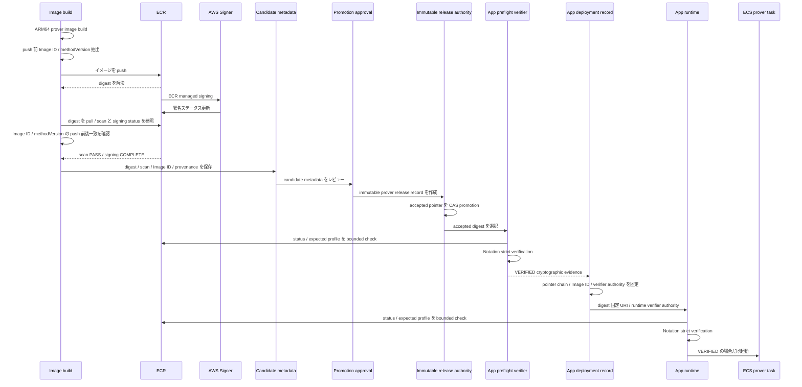
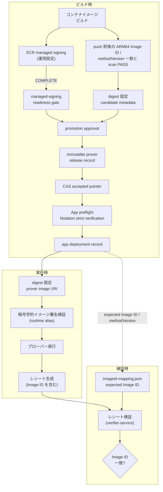

# イメージ署名

AWS Signer でプローバーイメージを managed signing し、App deployment の preflight と ECS 実行前の両方で暗号学的に検証する仕組みを扱う章です。

STARK 証明は「特定のゲストプログラムが正しく実行された」ことを保証します。
ただし、そのゲストプログラムを含むコンテナイメージ自体が改ざんされていないことも確認する必要があります。
イメージ署名は、期待する signing profile と trust root で検証できる digest 固定のプローバーイメージだけを証明生成に使うためのセキュリティゲートです。

## 脅威モデル

署名なしの場合、未承認イメージへの差し替えは検証段階の Image ID 照合や STARK レシート検証で拒否され得ます。
しかし、証明生成インフラ上で未承認イメージが実行されること自体は起動前に止められません。
現在の App は、選択された digest 固定のプローバーイメージに対して、normal App lane の preflight と Step Functions の実行前 gate で同じ暗号学的 verifier contract を適用します。
ECR signing status の `COMPLETE` は readiness にとどまり、App による受理には Notation 検証の成功が必要です（後述の引用ブロックを参照）。

イメージ署名は、STARK 証明が紐づく Image ID（ゲストバイナリの暗号的識別子）とは別レイヤの防御です（両者の関係は [Image ID との関係](#image-id-との関係) を参照）。

| 保証の種類                   | メカニズム                                         | 検出対象                                                    |
| ---------------------------- | -------------------------------------------------- | ----------------------------------------------------------- |
| ゲストプログラムの同一性     | Image ID（RISC Zero）                              | STARK レシートが示すゲストバイナリと期待値の不一致          |
| プローバーイメージの署名検証 | Notation + AWS Signer plugin + strict trust policy | 期待する signing profile / trust root で検証できない digest |
| 署名処理の readiness         | ECR managed-signing status                         | 署名の欠落、失敗、処理中、予期しない profile                |

## 責務境界、ビルドと署名、実行時ゲート

### 責務境界

イメージ署名では、プローバーコンテナのビルド、ECR 上の digest、AWS Signer の readiness、暗号学的 verifier、Image ID、runtime 設定を別々の責務として扱います。
公開仕様では、個別の承認手順や内部証跡ではなく、どの情報がどの境界で使われるかを説明します。

| 領域                             | 責務                                                                                                                 |
| -------------------------------- | -------------------------------------------------------------------------------------------------------------------- |
| Foundation                       | Prover / Toolchain repository の保持と、Prover repository 限定の Signer profile / ECR registry signing configuration |
| Toolchain release                | digest 固定 image、scan、provenance（署名・暗号学的署名検証なし）                                                    |
| Prover candidate build           | digest 固定 URI、Image ID / `methodVersion` の push 前後一致、scan `PASS`、managed-signing readiness の記録・確認    |
| Prover release authority         | 承認済み candidate の immutable prover release record 保存と、CAS で更新する accepted prover pointer による選択      |
| App verifier preflight           | immutable verifier version の `preflight` alias による、選択した Prover digest の暗号学的検証                        |
| App deployment selection         | accepted pointer chain / preflight evidence の検証と、digest 固定 URI・expected Image ID・verifier authority の固定  |
| Non-authoritative metadata paths | 直接の CodeBuild output、`latest.json`、legacy SSM current pointer（候補 lookup のみ）                               |
| App runtime                      | digest 固定 Prover image の `runtime` alias による実行前の再検証                                                     |
| verifier-service / UI            | STARK レシートの Image ID と公開 trust material の照合、fail-closed な結果表示                                       |

表の各領域について、次の条件が成り立ちます。

- Prover candidate build は、metadata を出力する前に対象 profile の managed-signing readiness が `COMPLETE` か確認しますが、release lane の semantic image record に署名検証結果を埋め込みません。
- Non-authoritative metadata paths は候補 lookup にとどまり、target topology の release authority としては使いません。
- 暗号学的検証は Toolchain / Prover release lane ではなく、App verifier preflight と App runtime の 2 境界で行います。App runtime が再検証するのは、app deployment record に結び付く digest 固定 Prover image です。
- App deployment selection では、normal deployment の app deployment record が preflight の immutable evidence と verifier authority を保持します。rollback は新しい verifier を変更せず、選択した accepted deployment に保持された cryptographic authority を再検証して再利用します。
- Candidate metadata、release record、pointer、preflight evidence、app deployment record は public proof bundle の構成要素ではありません。公開検証での最終的な authority は、後述する STARK レシート検証と expected Image ID の照合です。

### ビルドと署名の概念

プローバーイメージのビルドでは、ARM64 用のコンテナを作成し、guest Image ID と `methodVersion` を抽出します。
イメージを ECR に push して digest 固定 URI を解決した後、その digest を pull し直して Image ID と `methodVersion` を再抽出し、push 前後の一致を確認します。
候補は ECR scan が `PASS`、対象 digest の ECR managed signing status が `COMPLETE` になるまで fail-closed です。
candidate metadata は digest 固定 URI、scan 結果、Image ID / `methodVersion`、ソース識別子、digest 固定 Toolchain authority を記録します。
`COMPLETE` は metadata 作成の前提ですが、`signingStatus` フィールドとして semantic record に持ち越しません（readiness と受理の区別は後述の引用ブロックを参照）。
ECR managed signing の authority は、foundation Terraform が Signer profile と registry signing configuration として管理します。
registry signing configuration の対象は Prover repository のみです。

Build/push で運用上のタグを使う場合でも、App preflight と runtime の検証対象は常に digest 固定です（[ダイジェスト固定](#ダイジェスト固定)）。

### App preflight と実行前確認

App-owned の `image-signature-verifier` Lambda は、checksum 固定の Notation、AWS Signer plugin、ECR credential helper、trust root を同じ ZIP に含めます。
normal App deployment は verifier-only plan をレビューして immutable Lambda version と `preflight` alias を用意し、その alias が選択した Prover digest を検証してから app deployment record を生成します。

runtime では、Step Functions ステートマシンの最初のステートが同じ immutable version に結び付く `runtime` alias を呼びます。
`VerifyImageSignature` から semaphore 取得、ECS 起動までの state machine 上の流れは [非同期プローバー](async-prover.md) を参照してください。

`image-signature-verifier` は以下の処理を fail-closed に行います。

1. 呼び出しの account、region、repository、digest、image URI、signing profile が互いに整合することを確認する
2. ECR の `DescribeImageSigningStatus` を bounded retry / timeout で呼び、期待する profile が一意かつ `COMPLETE` であることを確認する
3. packaged asset の allowlist、type、size、mode、checksum と、deployment が期待する asset manifest / trust root を検証する
4. 対象 repository と signing profile に限定した strict trust policy を一時 workspace に作る
5. `notation verify <digest-pinned-image-uri>` を bounded process として実行する
6. 成功時は `result = VERIFIED`、`mode = cryptographic`、verifier version、trust-policy hash だけを caller に返す。失敗時は bounded reason code で拒否する

Step Functions は `result = VERIFIED` と `mode = cryptographic` の両方がある場合だけ semaphore 取得へ進みます。
readiness、asset authority、trust policy、Notation、timeout、Lambda invocation のいずれかが失敗した場合は署名ゲート失敗を通知します。
ECS タスクは起動されません。

> **ステータス確認と暗号学的検証の違い**
> `DescribeImageSigningStatus` は expected profile の readiness を確認する前段です。
> App による受理には、packaged Notation と AWS Signer plugin が strict trust policy の下で返す暗号学的検証成功も必要です。

## ECR リポジトリと digest 固定

### リポジトリ構成

| リポジトリ種別                 | 用途                                      | signing / verification contract                                        |
| ------------------------------ | ----------------------------------------- | ---------------------------------------------------------------------- |
| Prover image repository        | ECS Fargate で実行するプローバーイメージ  | ECR managed signing + App preflight/runtime cryptographic verification |
| RISC Zero Toolchain repository | プローバーイメージの base Toolchain image | 署名なし。digest-bound scan / provenance のみ                          |

ECR repository は app runtime の前提リソースです。
app root は repository を作成したり image publication を所有したりせず、digest 固定の prover image URI を入力として消費します。

### ダイジェスト固定

Terraform の prover image URI 変数には、digest 固定 URI のみが許可されます。
バリデーションルールにより `@sha256:<64-hex>` 形式が強制されます。
Build/push では運用上のタグを使う場合がありますが、App preflight と runtime が参照する `prover_image_uri`、readiness 確認、Notation 検証の対象は常に digest 固定であり、タグの上書きによるイメージのすり替えを防止します。
ベースとなる RISC Zero Toolchain image も digest 固定で扱い、プローバーイメージの provenance と metadata の整合性を保ちますが、Toolchain image 自体は signing 対象ではありません。

Step Functions の定義に含まれるイメージダイジェストは、Terraform の変数から以下のように抽出されます。

- **リポジトリ名**: URI の `@` より前の部分からレジストリホストを除去
- **ダイジェスト**: URI の `@` より後の部分（`sha256:...`）

この分解により、`image-signature-verifier` Lambda は正確な registry、repository、digest、signing profile の組み合わせで readiness と暗号学的署名を検証できます。

## Image ID との関係

イメージ署名と [Image ID](../zkvm/image-id.md) は異なるレイヤのセキュリティメカニズムです。
両者は共に「正しいプログラムが実行されたこと」の信頼チェーンを構成します。

Candidate metadata から承認済み release record、accepted pointer、preflight evidence、app deployment record までの chain が、digest 固定 URI と Image ID / `methodVersion` の対応関係を保持します。
公開検証で「正しいゲストが実行された」と判断する authority は、STARK レシート検証と expected Image ID の照合です。
イメージ署名はその前段で、期待する signing identity で暗号学的に検証できないコンテナイメージを App が選択または実行しないための deployment/runtime gate として機能します。

| 検証ポイント              | タイミング             | 検証主体                           | 失敗時の動作                    |
| ------------------------- | ---------------------- | ---------------------------------- | ------------------------------- |
| managed-signing readiness | Prover candidate build | CodeBuild + ECR                    | candidate metadata を出力しない |
| cryptographic signature   | normal App deployment  | App preflight verifier alias       | App lane を継続しない           |
| cryptographic signature   | 証明生成直前           | Step Functions + runtime alias     | ECS タスクの起動拒否            |
| STARK receipt / Image ID  | 公開検証時             | verifier-service / verification UI | 検証失敗の報告                  |

## PoC としての境界

この gate は、AWS Signer profile、ECR signing configuration、App pipeline の権限分離、checksum 固定の verifier assets、保持された deployment authority を信頼します。
コンテナの再現可能ビルドを第三者が独立に証明する仕組みでも、Toolchain image を署名する仕組みでもありません。
また、public proof bundle に image-signature preflight evidence を追加するものではありません。

この構成は教育用 PoC の defense in depth です。
本番の投票システムに必要な supply-chain governance、鍵運用、独立監査、incident response を満たすという主張ではありません。

<!-- source: buildspec.yml, infra/image-signature-verifier/asset-manifest.json, infra/image-signature-verifier/verifier.mjs, infra/lambdas/image-signature-verifier/index.mjs, infra/terraform/bootstrap/app_pipeline_codepipeline.tf, infra/terraform/bootstrap/app-signature-preflight-scripts/invoke-preflight.mjs, infra/terraform/foundation/ecr_signing.tf, infra/terraform/foundation/locals.tf, infra/terraform/app/image_signature_verifier.tf, infra/terraform/app/step_functions.tf, scripts/__tests__/bootstrap-terraform-policy.release-signature-verification.test.ts -->
