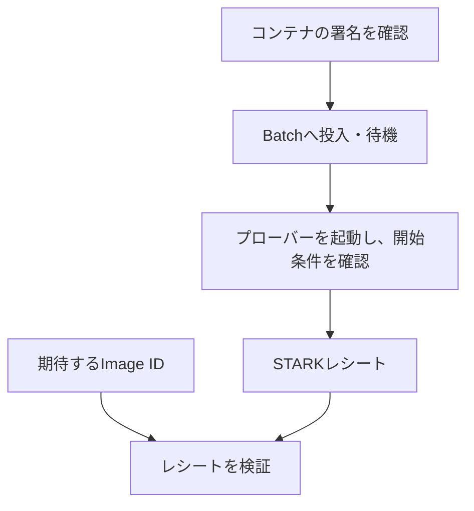
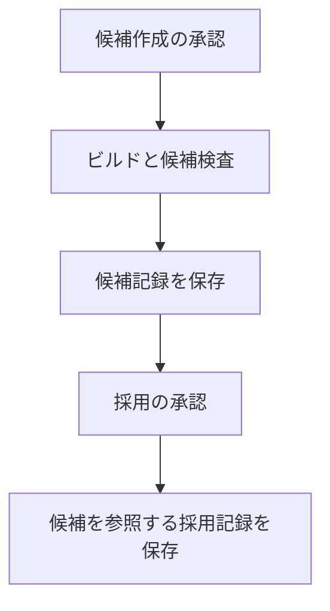

# コンテナイメージの署名検証

AWS では、プローバーコンテナの採用前と Batch へのジョブ投入前に署名を検証します。承認された内容のダイジェストを選び、期待する署名者による署名であることを確認します。

計算後には、期待する Image ID に対して STARK レシートを検証し、ゲストプログラムの実行を確認します。この事後の検証は、未承認コンテナの起動や入力・実行権限へのアクセスを防ぐものではありません。

## Image ID との関係

コンテナイメージと zkVM ゲストの Image ID は、識別する対象と確認方法が異なります。

| 識別対象     | 確認方法                                                       | 確認する内容                                             |
| ------------ | -------------------------------------------------------------- | -------------------------------------------------------- |
| コンテナ全体 | ECR の内容ダイジェストと、Notation / AWS Signer による署名検証 | 選択・起動対象のコンテナを期待する署名者で検証できること |
| zkVM ゲスト  | 期待する Image ID を指定した STARK レシート検証                | 期待するゲストが計算を行ったこと                         |

コンテナの署名検証、ゲストの同一性、投票結果の総合判定は、それぞれ確認対象が異なります。ゲストの同一性は[期待する Image ID](../zkvm/image-id.md)に対する STARK レシート検証で、得票表示や投票の包含は他の必須チェックで確認します。

この署名方式は AWS Signer のプロファイル、ECR の署名設定、検証ツールと信頼ルート、デプロイ権限の分離を信頼します。第三者がコンテナの再現可能ビルドを独立に証明する仕組みではありません。署名の事前確認や採用記録は運用側の記録で、公開証拠 ZIP には入りません。

## ダイジェスト固定

タグは別のイメージへ付け替えられます。そこで、アプリが使う `prover_image_uri` は `@sha256:<64-hex>` で終わる URI に限定します。ビルドや push でタグを使っても、事前確認と実行時確認は常にこの内容ダイジェストを対象にします。

ベースとなる RISC Zero Toolchain もダイジェストで固定します。ただし、署名の扱いは二つのリポジトリで異なります。

| リポジトリ | 採用時の根拠                                                                                         |
| ---------- | ---------------------------------------------------------------------------------------------------- |
| Prover     | ダイジェスト、スキャン、生成元の記録、署名処理完了。アプリ採用前と実行前に暗号学的署名検証を追加する |
| Toolchain  | ダイジェストに結び付くスキャンと生成元の記録。署名と暗号学的署名検証は行わない                       |

Foundation が両リポジトリを管理し、Signer プロファイルと ECR managed signing の対象は Prover に限定します。App はリポジトリやイメージを作らず、採用済みのダイジェスト固定 URI を受け取ります。

## 候補のビルド・署名と採用記録

新しいプローバー候補は ARM64 用にビルドします。まず Image ID と `methodVersion` を取り出し、ECR へ push した後、そのダイジェストを指定して pull し直します。再取得したコンテナから同じ二値を取り出して比較し、手元で確認したものと登録したものの一致を確かめます。

候補のメタデータを出す前に、ECR scan が `PASS`、期待する署名プロファイルの managed-signing status が `COMPLETE` であることを要求します。記録にはコンテナのダイジェスト、スキャン、Image ID / `methodVersion`、ソース、固定した Toolchain の参照、`managedSigningStatus: COMPLETE` を結び付けます。

`COMPLETE` は署名処理の完了を示し、信頼ポリシーに照らした署名検証の成功は示しません。暗号学的検証は App 事前確認と実行前確認で行います。

候補を作る承認と、その候補を採用する承認は別です。候補記録は内容ハッシュを含むキーで保存し、採用記録にはそのキー・S3 VersionId・SHA-256 と採用時の再確認結果を結び付けます。採用記録は更新ごとの版を残し、初回作成または比較後の条件付き更新で公開することで、別の更新を上書きしません。

保持済み候補を選ぶ `existing` でも、この二つの承認を分けます。入力は内容ハッシュで特定する候補キー一つだけです。Toolchain との結び付き、ECR 上のダイジェスト、HIGH / CRITICAL の検出が0件であること、署名処理完了を改めて確認します。この経路の候補確認は読み取りのみで、ビルド、push、スキャン・署名要求、候補の書き換え、ECR の変更は行いません。

## App 配備前とプローバー起動前の検証

通常の App デプロイは、呼び出し元が先に固定した対象環境について、現在の Foundation と Toolchain / Prover の採用先を一度だけ解決します。現在の Foundation が選択ソースの資源・consumer 要件を満たし、Prover の記録が要求するゲスト契約と対応することを確認した選択を、後続処理へ引き継ぎます。

準備工程では、チェックサムで固定した Notation、AWS Signer plugin、ECR credential helper、信頼ルートを CodeBuild で使い、選択した digest を native CLI で検証します。同じ assets を runtime Lambda の ZIP にまとめ、成功証跡と正確な S3 VersionId・SHA-256 を完全な App 計画へ結びます。拒否、失効、timeout や不一致では配備へ進みません。

通常の App 計画を一度承認し、Apply が verifier のコード・設定と変更不能バージョンを配備します。Step Functions はその qualified ARN を直接呼び、Batch へのジョブ投入前に署名を再検証します。事前配備、preflight/runtime alias、別承認はありません。

投入後は Batch で待機することがあります。コンテナ起動時には、入力を取得する前に現在の集計を開始してよいか確認します。この[起動時の admission](async-prover.md#batch-の待機とコンテナの開始条件)は集計状態の確認であり、署名を再検証する処理ではありません。

### 署名検証の手順

verifier は次の六段階を実行します。

1. アカウント、リージョン、リポジトリ、ダイジェスト、URI、署名プロファイルの整合を確認する。
2. `DescribeImageSigningStatus` を時間と回数を制限して呼び、期待するプロファイルが一意で `COMPLETE` であることを確認する。
3. 同梱ファイルの許可一覧、種類、サイズ、モード、チェックサムを確認し、期待する資産マニフェストと信頼ルートに照合する。
4. 対象リポジトリと署名プロファイルに限った strict trust policy を一時作業領域に作る。
5. `notation verify <digest-pinned-image-uri>` を、実行時間を制限して呼び出す。
6. 成功時は `result = VERIFIED`、`mode = cryptographic`、verifier version、trust-policy hash を返す。失敗は定義済みの理由コードへ絞って返す。

Step Functions が Batch へ投入するのは `VERIFIED` と `cryptographic` の両方があるときだけです。署名の準備不足、資産やポリシーの不一致、Notation の失敗、時間切れ、Lambda 呼び出し失敗では、ジョブを投入しません。

### 配備済み検証器の照合

Apply と Smoke は、配備された Lambda の変更不能バージョンを取得し、そのコードハッシュと設定を計画時の情報に照合します。実行ロールの信頼ポリシー・権限・permissions boundary と、Step Functions がそのバージョンを呼ぶことも確認します。

必要な情報の欠落や不一致があれば、[受入記録](terraform.md#受入記録の公開と非同期ステータス配信)を公開しません。修正した現在ソースを新しい計画と承認で配備し、過去の App 受入記録による再構成は行いません。

<!-- source: buildspec.yml, packages/deployment-authority/src/release-ledger.js, infra/terraform/bootstrap/foundation-pipeline-scripts/prover-release-ledger-adapter.mjs, infra/image-signature-verifier/verifier.mjs, infra/image-signature-verifier/asset-manifest.json, infra/lambdas/image-signature-verifier/index.mjs, infra/terraform/bootstrap/app-pipeline-scripts, infra/terraform/foundation/ecr_signing.tf, infra/terraform/app/image_signature_verifier.tf, infra/terraform/app/step_functions.tf, infra/docker/entrypoint.sh -->
