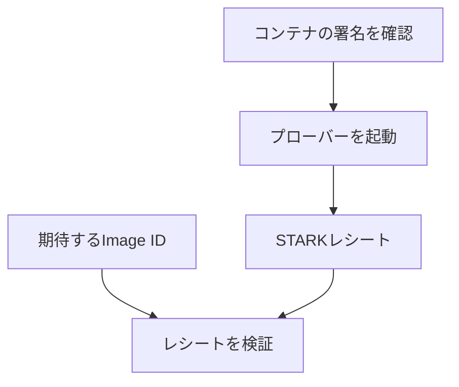
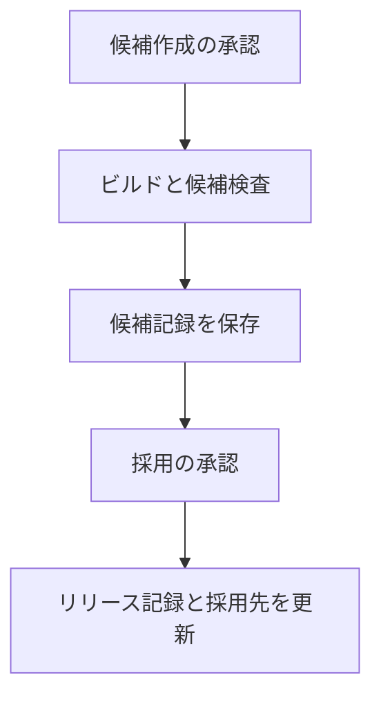

# 起動するコンテナを確かめる

STARK レシートを期待する Image ID で検証すれば、計算を行ったゲストプログラムを確かめられます。しかし、その検証は計算の後です。未承認のコンテナが先に起動し、入力や実行権限へ触れてしまうことは防げません。

そこで AWS では、起動するプローバーコンテナ自体にも署名を要求します。承認された内容のダイジェストを選び、期待する署名者で検証できることを、アプリへの採用前と証明生成の直前に確かめます。

## Image ID との関係

二つの「イメージ」は対象が異なります。

| 識別するもの | 確認方法                                                       | 答えられる問い                                                   |
| ------------ | -------------------------------------------------------------- | ---------------------------------------------------------------- |
| コンテナ全体 | ECR の内容ダイジェストと、Notation / AWS Signer による署名検証 | 期待する署名者で検証できるコンテナを選び、起動しようとしているか |
| zkVM ゲスト  | 期待する Image ID を指定した STARK レシート検証                | 期待するゲストがこの計算を行ったか                               |

コンテナの署名が正しくても、得票表示や投票の包含まで正しいとは言えません。公開検証でゲストの同一性を判断する根拠は、[期待する Image ID](../zkvm/image-id.md)と STARK レシート検証です。さらに総合判定には他の必須チェックも必要です。

この署名方式は AWS Signer のプロファイル、ECR の署名設定、検証ツールと信頼ルート、デプロイ権限の分離を信頼します。第三者がコンテナの再現可能ビルドを独立に証明する仕組みではありません。署名の事前確認や採用記録は運用側の記録で、公開証拠 ZIP には入りません。

## ダイジェスト固定

タグは別のイメージへ付け替えられます。そこで、アプリが使う `prover_image_uri` は `@sha256:<64-hex>` で終わる URI に限定します。ビルドや push でタグを使っても、事前確認と実行時確認は常にこの内容ダイジェストを対象にします。

ベースとなる RISC Zero Toolchain もダイジェストで固定します。ただし、署名の扱いは二つのリポジトリで異なります。

| リポジトリ | 採用時の根拠                                                                                         |
| ---------- | ---------------------------------------------------------------------------------------------------- |
| Prover     | ダイジェスト、スキャン、生成元の記録、署名処理完了。アプリ採用前と実行前に暗号学的署名検証を追加する |
| Toolchain  | ダイジェストに結び付くスキャンと生成元の記録。署名と暗号学的署名検証は行わない                       |

Foundation が両リポジトリを管理し、Signer プロファイルと ECR managed signing の対象は Prover に限定します。App はリポジトリやイメージを作らず、採用済みのダイジェスト固定 URI を受け取ります。

## ビルドと署名の概念

新しいプローバー候補は ARM64 用にビルドします。まず Image ID と `methodVersion` を取り出し、ECR へ push した後、そのダイジェストを指定して pull し直します。再取得したコンテナから同じ二値を取り出して比較し、手元で確認したものと登録したものの一致を確かめます。

候補のメタデータを出す前に、ECR scan が `PASS`、期待する署名プロファイルの managed-signing status が `COMPLETE` であることを要求します。記録にはコンテナのダイジェスト、スキャン、Image ID / `methodVersion`、ソース、固定した Toolchain の参照、`managedSigningStatus: COMPLETE` を結び付けます。

ここで `COMPLETE` が示すのは署名処理の完了です。実際の署名を信頼ポリシーに照らして検証できたことは、まだ示していません。暗号学的検証は後述の App 事前確認と実行前確認で行います。

候補を作る承認と、その候補を採用する承認は別です。候補・リリースの記録は内容のハッシュを含むキーで保存し、採用先を指すポインターにはリリース記録のキーだけを置きます。ポインターは初回作成または比較してからの条件付き更新で進め、別の更新を上書きしません。

保持済み候補を選ぶ `existing` でも、この二つの承認を分けます。入力は内容ハッシュで特定する候補キー一つだけです。Toolchain との結び付き、ECR 上のダイジェスト、HIGH / CRITICAL の検出が0件であること、署名処理完了を改めて確認します。この経路の候補確認は読み取りのみで、ビルド、push、スキャン・署名要求、候補の書き換え、ECR の変更は行いません。

## App の変更前と起動前に確認する

通常の App デプロイは、呼び出し元が先に固定した対象環境について、現在の Foundation と Toolchain / Prover の採用先を一度だけ解決します。Foundation の構成契約と選択ソースが一致し、Prover の記録が要求するゲスト契約と対応することを確認した選択を、後続処理へ引き継ぎます。

事前確認の `image-signature-verifier` Lambda には、チェックサムで固定した Notation、AWS Signer plugin、ECR credential helper、信頼ルートを同じ ZIP に同梱します。verifier 専用の Terraform 計画を承認・適用し、変更不能な Lambda バージョンと `preflight` alias を用意して、選択した Prover を検証します。

成功した事前確認の記録、対象ダイジェスト、期待する Image ID、使った verifier は、その App 実行の固定入力になります。適用後の確認も成功したとき、これらを[App の受入記録](terraform.md#acceptance-evidence)に保持します。

main の初回構築では、まず verifier とその依存資源だけを作り、別の実行で初回 App の事前確認と配備へ進みます。それぞれの保存済み計画に承認が必要です。受入記録がないことを理由に自動で初期化はせず、[初回構築の経路](terraform.md#initial-app-acceptance)を明示的に選びます。

実際の証明生成では、Step Functions の最初の処理が同じ変更不能バージョンに結び付く `runtime` alias を呼びます。デプロイ時の成功結果をそのまま流用せず、起動直前に署名を再検証します。

### 検証する順序

verifier は次の六段階を実行します。

1. アカウント、リージョン、リポジトリ、ダイジェスト、URI、署名プロファイルの整合を確認する。
2. `DescribeImageSigningStatus` を時間と回数を制限して呼び、期待するプロファイルが一意で `COMPLETE` であることを確認する。
3. 同梱ファイルの許可一覧、種類、サイズ、モード、チェックサムを確認し、期待する資産マニフェストと信頼ルートに照合する。
4. 対象リポジトリと署名プロファイルに限った strict trust policy を一時作業領域に作る。
5. `notation verify <digest-pinned-image-uri>` を、実行時間を制限して呼び出す。
6. 成功時は `result = VERIFIED`、`mode = cryptographic`、verifier version、trust-policy hash を返す。失敗は定義済みの理由コードへ絞って返す。

Step Functions が次へ進むのは `VERIFIED` と `cryptographic` の両方があるときだけです。署名の準備不足、資産やポリシーの不一致、Notation の失敗、時間切れ、Lambda 呼び出し失敗では、同時実行枠の取得も ECS 起動も行いません。

### 検証器自体の取り違えを防ぐ

デプロイ時には Lambda のコードハッシュと、設定を正規化して計算したハッシュを必ず照合します。AWS の COPY モードの応答がネイティブの `ConfigSha256` や `ResolvedS3Object` を省略した場合は `null` のまま保持し、値を補作しません。AWS が返した場合はそのハッシュや S3 座標も照合します。部分的に壊れた S3 座標は拒否し、期限付きのダウンロードURL `Code.Location` は保持しません。

VPC を使わない関数では、VPC 設定全体の省略、または VPC ID が空・セキュリティグループが空・IPv6 dual stack が明示的に false の場合に限る subnet ID の省略を、VPC なしの設定として正規化します。それ以外の不完全な応答を VPC なしと推定しません。

保持したバージョン、またはそれより古い稼働中 alias が指すバージョンを起点に、後続の変更不能バージョンを漏れなく列挙・検証します。その範囲の、実行許可に関わる設定を正規化して比較します。古い未選択の設定を現在の期待値にはしません。期待する ZIP の S3 bucket / key / VersionId は Terraform state と App 受入記録に保持された値を使います。

rollback は、新しいリリースや verifier を選ぶ操作ではありません。到達可能な App 履歴から選んだ受入記録に保持されたイメージと verifier の根拠を再検証して使い、現在のリリースポインターの解決や verifier の事前変更は行いません。

<!-- source: buildspec.yml, packages/deployment-authority/src/release-ledger.js, infra/terraform/bootstrap/foundation-pipeline-scripts/prover-release-ledger-adapter.mjs, infra/image-signature-verifier/verifier.mjs, infra/image-signature-verifier/asset-manifest.json, infra/lambdas/image-signature-verifier/index.mjs, infra/terraform/bootstrap/app-signature-preflight-scripts, infra/terraform/foundation/ecr_signing.tf, infra/terraform/app/image_signature_verifier.tf, infra/terraform/app/step_functions.tf -->
