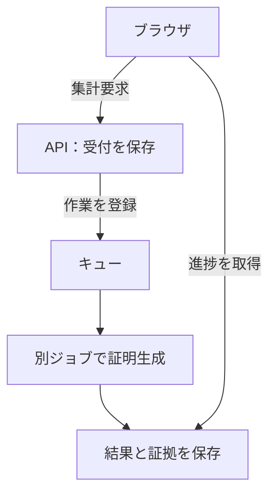

# AWS で証明生成を動かす

「集計する」を押してから STARK 証明ができるまで、ブラウザをサーバーにつなぎ続ける必要はありません。API は集計要求を保存して受付結果を返し、別の計算ジョブが証明を作ります。ブラウザは途中経過を取得し、できあがった証拠を使って検証へ進みます。

この時間の差が、AWS 構成を分ける出発点です。ページ配信と投票受付には短い応答が必要です。一方、証明生成には多くの CPU とメモリが必要で、同時に起動できる数も制限します。両方を同じ処理にすると、証明の待ち時間や再試行が利用者への応答を巻き込みます。

処理を分けると、今度は「同じ作業が届いた」「待っている間に取り消された」「証明はできたが結果の保存に失敗した」という問題が生まれます。非同期プローバーは、作業の識別子と保存済みの状態を照合し、古い作業が現在の結果を書き換えないようにします。

さらに、実行するコンテナと変更手順にも根拠が必要です。承認したイメージを内容のダイジェストで固定し、起動前に署名を確かめます。インフラの変更は保存した Terraform 計画を承認して適用し、適用後の確認結果を受入記録に結び付けます。ログと監視は、これらの処理のどこで止まったかを調べるために使います。

本番環境の `stark-prod/main` は、Cloudflare と CloudFront を経由して公開デモを提供します。開発環境の `stark-dev/develop` は、運用者向けの署名付き Cookie で入口を制限します。[ブラウザから AWS へ入る](runtime-boundary.md)では、この入口とセッションの操作権限を説明します。

次の構成図は、通常稼働時の入口、証明生成、検証と保存先をまとめたものです。本番と開発は別々の資源を持ち、図の入口部分に環境ごとの違いを示しています。図を選ぶと拡大して確認できます。

AWS で証明生成が完了しただけでは「Verified」にはなりません。表示には、投票・掲示板・集計結果を含む[すべての必須確認](../verification/gating-logic.md)が必要です。

<!-- source: packages/runtime-config/src/env/runtimeProfile.ts, packages/deployment-authority/deployment-targets.json, packages/application/src/finalize/usecases/finalize-async.ts, infra/terraform/app/step_functions.tf -->
