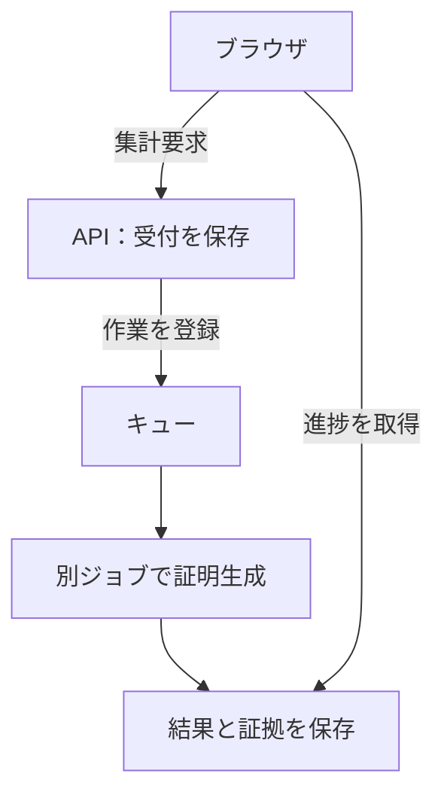

# AWS 実行基盤

API は集計要求を保存して受付結果を返し、別の計算ジョブが STARK 証明を生成します。ブラウザはサーバーとの接続を維持する必要はなく、進捗を取得し、生成された証拠を使って検証へ進みます。

ページ配信と投票受付には短い応答が必要です。一方、証明生成には多くの CPU とメモリが必要で、同時に起動できる数も制限します。証明の待ち時間や再試行が利用者への応答に影響しないよう、処理を分けています。

非同期処理では、重複配送、待機中の取消、証明生成後の結果保存失敗が起こり得ます。非同期プローバーは、作業の識別子と保存済みの状態を照合し、古い作業が現在の結果を書き換えないようにします。

実行するコンテナは、承認したイメージの内容ダイジェストで固定し、起動前に署名を検証します。インフラの変更は保存した Terraform 計画を承認して適用し、適用後の確認結果を受入記録に結び付けます。ログと監視は、これらの処理のどこで止まったかを調べるために使います。

本番環境の `stark-prod/main` は、Cloudflare と CloudFront を経由して公開デモを提供します。開発環境の `stark-dev/develop` は、運用者向けの署名付き Cookie で入口を制限します。認証とセッションの操作権限は[実行環境とリクエスト境界](runtime-boundary.md)に定義しています。

次の構成図は、通常稼働時の入口、証明生成、検証と保存先をまとめたものです。本番と開発は別々の資源を持ち、図の入口部分に環境ごとの違いを示しています。図を選ぶと拡大して確認できます。

証明生成後は、投票・掲示板・集計結果を含む[すべての必須確認](../verification/gating-logic.md)を行い、「Verified」の表示可否を決めます。

<!-- source: packages/runtime-config/src/env/runtimeProfile.ts, packages/deployment-authority/deployment-targets.json, packages/application/src/finalize/usecases/finalize-async.ts, infra/terraform/app/step_functions.tf -->
