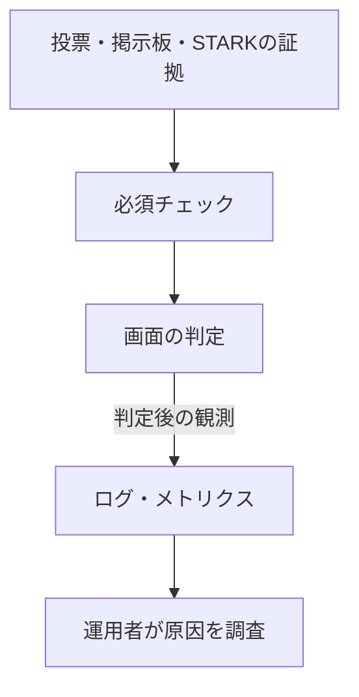

# 待ち時間と失敗の原因を調べる

集計画面が `pending` のままなら、まだ配送されていないのか、計算枠が埋まっているのか、それとも処理が止まったのかを知りたくなります。同じ画面上の状態でも原因は違います。ログと監視は、要求がどこまで進み、どの種類の失敗で止まり、どのデプロイの前後に起きたかを調べるために使います。

一方、CloudWatch のグラフが平坦でも、投票や集計の正しさは分かりません。利用がなかっただけかもしれません。画面の「Verified」は証拠と必須チェックから決め、ログ保存や通知の成功・失敗で変更しません。

<a id="検証プレーンと運用プレーン"></a>

## 投票の検証と運用の観測を分ける



観測送信の失敗、logger の例外、CloudWatch の一時的な停止は、導出済みの判定を変えません。監視から検証へ判定を戻す経路はありません。表示条件は[検証の判定規則](../verification/gating-logic.md)で決まります。

## 観測対象とシグナル

まず、利用者の待ち時間をどの処理が引き受けているかを調べます。

| 調べる対象     | 使う観測                                | 分かること                                       |
| -------------- | --------------------------------------- | ------------------------------------------------ |
| API Gateway    | 要求数、5xx、遅延、アクセスログ         | API への接続で失敗していないか                   |
| Lambda         | errors、throttles、アプリのイベント     | 処理が失敗したか、開始前に制限されたか           |
| DynamoDB       | 読取・書込の throttle                   | 状態の保存や取得が制限されていないか             |
| SQS            | 最古メッセージの経過時間、DLQ 件数      | 作業が滞留しているか、再試行を終えて隔離されたか |
| Step Functions | failed、timed out、実行履歴             | 一連の集計処理がどこで終了したか                 |
| Fargate        | タスク終了、vCPU 上限、`prover_summary` | 計算が始まり、どの結果で終わったか               |
| 検証           | 失敗分類、必須チェックとの矛盾          | 証拠の不一致か、判定処理自体の矛盾か             |
| デプロイ       | パイプラインの変化、受入記録            | 症状が変更の前後に現れたか                       |

ダッシュボードは調査の入口です。一回の投票操作を追うには、アプリのイベント、AWS の観測、デプロイの記録を照合します。X-Ray / OpenTelemetry の分散トレースやブラウザ RUM は構成していないため、一つの trace で全経路を復元できるわけではありません。

## 構造化ログと安全な相関

<a id="producer-ごとの形"></a>

### 出力元ごとのログ形式

ログは自由文を全文検索して処理結果を推測するのではなく、定義済みイベントと値の集合を使います。TypeScript の discriminated union と実行時の許可リストが、受け入れる項目を決めます。

代表的なイベントは、受付後の `finalization_admitted`、古い配送などの `dispatch_dropped`、状態変化の `finalize_state_transition`、`queue_publish`、検証結果の `verification_run_summary`、`bundle_download_failed` です。

特に受付数を数える `finalization_admitted` は、共通の保存結果を観測する処理が、新しい `none → pending` を実際に保存した後だけ出します。固有フィールドは長さと形式を制限した `finalization_id` です。保存失敗、冪等な再要求、競合で負けた更新を新規受付へ数えません。ただしログの配送は重複し得るため、集計側でも同じ ID を除きます。

出力元によって JSON の包み方は違います。

| 出力元                     | 形式                                                                     |
| -------------------------- | ------------------------------------------------------------------------ |
| 共通 logger を使う Lambda  | Lambda の JSON envelope の `message` オブジェクト内にアプリの記録を置く  |
| `image-signature-verifier` | 署名対象や認証情報を含めず、定義済みの結果・所要時間区分を出す           |
| API Gateway                | request ID、route key、status、latency、integration error のアクセス記録 |
| Step Functions             | 実行データを含めない処理ログ                                             |
| ECS prover                 | 開始・終了、結果、失敗分類、所要時間を持つ平坦な JSON                    |
| operations ledger          | 必要項目へ絞り、再検証した平坦な JSON                                    |

Lambda の metric filter は `$.message.*` の正確なフィールドを見ます。ECS と台帳には外側の envelope がないので、検索でもこの違いを明示します。

### 相関キー

非同期処理では最初の HTTP 接続はすでに終わっています。そのため、ブラウザが付けた request ID を最後まで信頼して引き回すのではなく、保存した集計の識別子を使います。

| キー                | 用途                                                                      |
| ------------------- | ------------------------------------------------------------------------- |
| `request_id`        | API Gateway が与えた、同じ同期要求内の識別子                              |
| `client_request_id` | 形式を制限した利用者入力。上記の信頼する ID と分離する                    |
| `session_id_hash`   | 生の session ID を保存せず、salt と用途別の区別を付けたハッシュで照合する |
| `finalization_id`   | キュー、Step Functions、Fargate、writer、検証 worker をつなぐ             |
| `deployment_id`     | 受入済みデプロイと稼働ログ・運用台帳をつなぐ                              |
| `app_source_sha`    | 制限された運用ログで、デプロイ証拠のソースに照合する                      |

非同期処理の主な照合キーは `session_id_hash` と `finalization_id` です。IP や保存接頭辞の照合が必要な場合も、実行時参照から解決した salt と用途ごとのドメイン分離を使います。salt の変更をまたいで同じハッシュになるとは仮定しません。

<a id="canonical-event-と-ledger-に記録しない情報"></a>

### 観測イベントと台帳の情報を絞る

観測のために、秘密や個別資源へのアクセス手掛かりを増やさないようにします。アプリの定型イベント、prover の要約、運用台帳では、出力元ごとの検証で次の値を除外します。

- 生の session ID、IP、選択肢と乱数、要求本文
- capability、Cookie、秘密値・設定値、署名鍵
- S3 bucket、完全な key / URI、署名付き URL、非公開のローカルパス
- アカウント ID、ARN、ダイジェスト付きイメージ URI
- 生の例外、AWS `Cause`、CloudWatch の state reason、ECS の stopped reason

共通 sanitizer は既知の秘密フィールドや値の形式を拒否し、深さとバイト数を制限します。ただし、任意の文章からすべての機密情報を見つける仕組みではありません。出力元が外部エラーを生で渡さず、定義済みの理由・分類へ変換することが必要です。AWS 管理ログや実行履歴に残る資源識別子はアクセスを制限した運用証拠として扱い、このイベントや台帳へコピーしません。

<a id="verification-observation"></a>

## ブラウザの観測を受け取る

投票時の選択肢と乱数を使う確認の一部は、ブラウザ内で行います。サーバーだけでは、その確認結果まで含む画面の最終判定を観測できません。

判定後、ブラウザは capability 付きで `POST /api/sessions/:sessionId/finalizations/:finalizationId/verification/observations` へ、ブラウザ内の Cast チェック四つの状態だけを `castChecks` として送ります。セッションと集計の識別は URL から取り、本文の `finalizationId`、利用者が指定する総合判定、サーバー側チェック、秘密値、自由記述は受け入れません。

サーバーは現在の集計との一致、終了済み検証結果、保存済みシナリオ、サーバー側チェック、STH の実行時条件を確認し直します。一回の集計につき最初の一件だけを条件付きで記録し、同じ fingerprint の再送は冪等に扱います。異なる内容や、現在の集計と違う URL は conflict です。

記録後、総合状態とは独立に、必須チェックのうち `success` でない数を数え、`verification_run_summary` を可能なら出力します。この観測は画面判定の記録を補うもので、表示を書き換えたり、検証を再試行させたりする入口ではありません。

## 証拠レベルの読み分け

アラームを定義しただけでは通知できたとは言えません。確認結果は次の四つを分けます。

| 状態       | 確認したこと                                                     |
| ---------- | ---------------------------------------------------------------- |
| Defined    | コード・Terraform に形式、filter、alarm、subscription がある     |
| Configured | 対象の AWS 環境に構成された                                      |
| Matched    | 実際の適切なイベントが filter に一致し、想定した metric を作った |
| Delivered  | 意図した宛先まで通知が届いた                                     |

アラームの `OK` は、対象期間にしきい値超過が観測されなかったという意味です。利用の少ないデモでは、正常な操作も失敗した操作もなく `OK` のままであることがあります。ダッシュボード、適用後 Smoke、入口の確認、投票から検証までの実行、受入記録も、それぞれ確かめる事実が違います。

## メトリクスと検出レイヤ

<a id="aws-native-metrics"></a>

### AWS が提供する測定値

Terraform は、一期間で検出する調査用アラーム、検証判定の矛盾を直接通知するアラーム、異常の持続を確認して通知するアラームを分けて定義します。

| 分類                            | 調査用 | 持続時に運用通知 | 調べる異常                         |
| ------------------------------- | -----: | ---------------: | ---------------------------------- |
| DynamoDB read / write throttle  |     10 |                0 | 五つのテーブルの読み書き制限       |
| SQS DLQ depth                   |      2 |                2 | prover / verification の再試行終了 |
| Step Functions failed / timeout |      2 |                0 | 集計処理の失敗・時間切れ           |
| Lambda errors / throttles       |     12 |                0 | 六つの Lambda の失敗・実行制限     |
| API Gateway 5xx                 |      1 |                1 | API 接続の失敗                     |
| work queue age                  |      2 |                2 | 二つの作業キューの滞留             |
| Fargate on-demand vCPU quota    |      1 |                0 | 計算資源の上限                     |

調査用アラームは通知アクションを持ちません。データ欠落は `notBreaching` として扱い、利用のない時間を障害に数えません。通知する五つは、一度の急増で反応せず、次の状態が続いたときに `ALARM` へ移ります。

| アラーム         | 条件                                      | 評価          |
| ---------------- | ----------------------------------------- | ------------- |
| 二つの DLQ       | depth `> 0`                               | 5分 × 3回連続 |
| 二つの作業キュー | 最古メッセージ `> 900` 秒                 | 5分 × 3回連続 |
| API 5xx          | 要求20件以上、5xx が5件以上、5xx 比率5%超 | 5分 × 3回連続 |

<a id="exact-field-metric-filters"></a>

### ログの決まった値から測定する

アプリの判断は、ログの定義済みフィールドから測定値へ変換します。

| イベント・条件                                    | 数えるもの                   | dimension                   |
| ------------------------------------------------- | ---------------------------- | --------------------------- |
| `dispatch_dropped`                                | 配送を破棄した件数           | 定義済み `reason`           |
| 終了時の `finalize_state_transition`              | 集計の終了結果               | 定義済み `reason`           |
| `finalization_admitted`                           | 新規集計の受付               | なし                        |
| `verification_run_summary`                        | 検証結果の失敗分類           | 定義済み `failure_category` |
| `fully_verified` かつ `failed_required_count > 0` | 必須チェックと総合状態の矛盾 | なし                        |

session、finalization、request、IP、保存キーは dimension に使いません。秘密を守ると同時に、custom metric の種類が利用数に応じて無制限に増えることも防ぎます。

<a id="dashboard"></a>

### ダッシュボード

ダッシュボードは直近24時間の API 要求・5xx・p99 遅延、Lambda の errors / throttles、キューの経過時間・DLQ、集計の破棄・終了、検証失敗分類、通常は0である判定矛盾を並べます。さらに28日分の API 成功率と集計受付・終了の件数を表示します。

割合には必ず標本数を添えます。一回成功した100%と、多くの要求が成功した100%を同じ根拠にしないためです。p99 は調査用の表示で、遅延 SLO のアラームは定義していません。

<a id="measurement-only-reliability-view"></a>

### 時間内に終わった作業の割合を測る

28日間の API 指標は API Gateway `Count` を全件、`Count - 5xx` を good、`5xx` を bad とします。認証、capability、origin、レート制限、入力不正などの想定内4xxも non-5xx として good に含むため、これは投票完了率ではありません。`Count = 0` は100%とせず `insufficient_evidence` です。

非同期集計は、保存成功後の `finalization_admitted` を起点に、同じ `finalization_id` の受付と最初の確定した終了遷移を重複排除します。完了期限は受付から75分。ログが遅れて届くための猶予を、その後に別の5分置きます。猶予は完了期限を80分へ延ばすものではありません。

| 結果                                                                                                    | 分類                                |
| ------------------------------------------------------------------------------------------------------- | ----------------------------------- |
| 75分以内の `succeeded`                                                                                  | good                                |
| 75分以内に `FINALIZATION_RESULT_INVALID`、`USER_CANCELLED`、`INVALID_FINALIZATION_ARTIFACT` で `failed` | 想定内の終了として分けたうえで good |
| 基盤障害・timeout、75分を超えた終了、期限までの終了がない評価対象                                       | bad                                 |
| 期限と配送猶予がまだ終わらない作業                                                                      | `inside_window`                     |
| 評価対象が0件                                                                                           | `insufficient_evidence`             |

この「good」は、集計値の正しさを意味しません。利用者の取消や不正な成果物の拒否を、基盤が正常に処理できた場合も含みます。想定内理由の定義は `packages/diagnostics/src/canonicalEvents.ts`、期限と集計は `scripts/aws/lib/finalization-sli.ts` に集約しています。

これらは調整中の測定値です。burn-rate アラームや error budget によるデプロイ制限は設けておらず、測定結果は Apply、rollback、復旧、キュー再投入の許可になりません。

### 通知の境界

検証の矛盾を知らせる専用アラームは、次の組み合わせだけを検出します。

```text
outcome == fully_verified
AND independently_counted_failed_required_checks > 0
```

これは票の改ざんを検出したという通知ではありません。「必須チェックが満たされないのに完全検証と記録された」という判定処理自体の矛盾を疑う通知です。証拠の保全と調査を促し、判定は変更しません。

別の `ops-actionable` SNS topic には、上記の持続条件を持つ五つのアラームと、管理対象 CodePipeline の正確な `FAILED` イベントだけを送ります。アラームは EventBridge が対象名と `ALARM` 状態を確認して中継し、パイプライン失敗は別のイベント経路として扱います。

通知本文は、定義済みの環境、資源またはパイプライン、時刻、状態、dashboard、runbook ID と、パイプライン通知だけに必要な制限済み execution ID に絞ります。source SHA、ARN、アカウント、セッション、生の理由、秘密、成果物の場所は含めません。通知は調査を始めるもので、Apply、rollback、復旧、再投入、削除、ポインター変更を自動実行しません。

二つの通知経路のメール購読は独立した任意設定です。それぞれ専用の固定 SSM `SecureString` が契約どおり存在するときだけ構成し、topic、policy、宛先を共有しません。宛先は公開文書、追跡する tfvars、Terraform output、パイプライン証拠、ログに出しません。構成されたこと、受信者の確認、テスト通知の配送は経路ごとに別々に確認します。

<a id="normalized-operations-ledger"></a>

## 運用台帳へ記録する

障害とデプロイの前後関係を長い期間で見るため、運用台帳へ四種類のイベントを記録します。EventBridge が必要項目の候補を取り出し、normalizer がイベントごとの正確なキー集合と値を再検証してから保存します。

共通項目は `ts`、`event_type`、`env`、`resource_name`、`state` です。追加する項目は次に限ります。

| `event_type`                 | 追加項目                                                                        |
| ---------------------------- | ------------------------------------------------------------------------------- |
| `alarm_state_changed`        | なし                                                                            |
| `ecs_task_stopped`           | `deployment_id`                                                                 |
| `pipeline_execution_changed` | `pipeline_execution_id`                                                         |
| `deployment_accepted`        | `deployment_id`、`pipeline_execution_id`、`deployment_mode`、`plan_disposition` |

`pipeline_execution_id` は管理対象のパイプラインと対応する受入イベントの小文字 UUID、`deployment_mode` は `normal` / `rollback`、`plan_disposition` は `changed` / `empty` だけです。キーの欠落・追加や別名を許可しません。

元イベントや event ID、source SHA、repository / branch、アカウント、ARN、タスク・コンテナ・イメージの詳細、自由文の理由は台帳に残しません。例えばソースの正確な SHA を調べる場合は、台帳の `deployment_id` を受入証拠へ照合します。

EventBridge の配送は重複し得るため、この台帳も exactly-once の監査ログではありません。変更後の状態を見る query は `pipeline_execution_id` と定義済み状態で重複を除き、受入数、開始から受入まで、パイプライン終了、次の受入までの経過、再開・置換・再試行の手間を project 単位の代理指標として表示します。

## 保持期間

長期の前後関係を見る台帳と、詳しい診断ログでは寿命を分けます。開発環境と本番環境の保持期間は、Terraform で次のように管理します。

| ログ                                                | develop | 本番（main） |
| --------------------------------------------------- | ------- | ------------ |
| Fargate、Step Functions、六つの Lambda、API Gateway | 90日    | 180日        |
| ECS Container Insights                              | 7日     | 30日         |
| operations ledger                                   | 365日   | 731日        |
| Bootstrap の CodeBuild                              | 30日    | 365日        |
| App の CodeBuild                                    | 180日   | 365日        |
| Foundation / image release の CodeBuild             | 365日   | 365日        |

runtime のログ名は Terraform が管理する物理名とコンポーネントの接尾辞に合わせ、image-signature-verifier だけは `stark-ballot-sim-` を名前接頭辞に使います。CodeBuild のログは Bootstrap が管理します。

CloudTrail は App / Foundation / Bootstrap の稼働構成には含めず、アカウントや組織側で別途管理される場合があります。CloudFront のアクセスログも App では構成しません。これらを運用台帳と同じ記録として扱いません。

監視のためにセッション、票、非公開証拠の TTL やライフサイクルを延ばすことはありません。また、定期的な実証明 E2E を実行する CloudWatch Synthetics は構成していないため、監視画面だけで利用者の一連の操作が正常だったとは結論しません。

<!-- source: packages/diagnostics/src/canonicalEvents.ts, packages/diagnostics/src/logger.ts, packages/diagnostics/src/safeLogPayload.ts, apps/api/src/server/http/requestLogging.ts, apps/api/src/server/api/handlers/verificationObservation.ts, apps/api/src/server/api/handlers/verificationObservability.ts, apps/web/src/routes/verify/hooks/useVerificationObservation.ts, scripts/aws/lib/finalization-sli.ts, scripts/aws/observability-query-pack.ts, infra/lambdas, infra/docker/entrypoint.sh, infra/terraform/app/monitoring.tf, infra/terraform/app/observability_detection.tf, infra/terraform/app/ops_ledger.tf, infra/terraform/app/runtime_logs.tf, infra/terraform/app/storage_retention.tf -->
