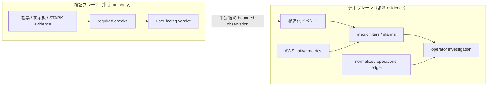

# 可観測性設計

このページは、AWS target runtime の可観測性を公開仕様として説明します。
対象は、API、非同期 finalization、検証 worker、zkVM prover、deployment を横断して、
障害や予期しない結果を事後に説明するためのログ、メトリクス、検出、相関です。

最も重要な境界は、**可観測性は検証判定の authority ではない**ことです。
ログ、メトリクス、alarm、notification の成否は検証チェックや user-facing verdict を変更せず、可観測性は判定後の事実と runtime の状態を調査するための evidence layer にとどまります。

## 目的と非目的

可観測性の目的は、「request / work はどこまで到達したか」「どの閉じた reason / category で停止したか」「症状はどの accepted deployment と相関するか」といった問いに、bounded な証拠で答えることです。
surface ごとの具体的な問いは [観測対象とシグナル](#観測対象とシグナル) の表に整理します。

一方で、次を目的にしません。

- alarm の状態だけによる正常性や暗号学的正しさの証明
- production 運用の提供（on-call、SLO）や、alarm からの自動介入（retry、redrive、rollback）
- raw AWS event、private artifact、秘密値の長期監査 archive

採用していない仕組みの一覧は [現在保証しないもの](#現在保証しないもの) を参照してください。

## 検証プレーンと運用プレーン

検証プレーンは evidence を required check として評価し、verdict を導出します。
運用プレーンは、その完了後に構造化された observation を受け取れますが、検証プレーンへ判定を返しません。



`POST /api/verification/observation` の送信失敗、logging exception、CloudWatch の一時的な利用不能は、
すでに導出された verdict を成功にも失敗にも変更しません。
`Verified` を表示できる条件は、引き続き [ゲーティングロジック](../verification/gating-logic.md) の required check だけです。

## 観測対象とシグナル

| Surface        | 主なシグナル                                       | 答えたい問い                                              |
| -------------- | -------------------------------------------------- | --------------------------------------------------------- |
| API Gateway    | request count、5xx、latency、access log            | edge から API integration まで到達したか                  |
| Lambda         | errors、throttles、closed application event        | handler が失敗したか、実行前に抑制されたか                |
| DynamoDB       | read / write throttle                              | session、vote、rate limit、semaphore の永続化が律速したか |
| SQS            | oldest-message age、DLQ depth                      | prover / verification work が滞留または隔離されたか       |
| Step Functions | failed、timed out、execution history               | finalization orchestration が terminal failure になったか |
| ECS prover     | task stop、Fargate quota、bounded `prover_summary` | 証明生成が開始・終了し、どの failure category になったか  |
| Verification   | failure category、required-check contradiction     | 通常の検証失敗か、verdict pipeline 自体の矛盾か           |
| Deployment     | pipeline state change、accepted deployment         | runtime の症状が変更時点と相関するか                      |

Dashboard はこれらの入口をまとめますが、個々の user journey を一枚の graph だけで説明するものではありません。
調査では application event、AWS native metric、deployment evidence をそれぞれ確認します。

## 構造化ログと安全な相関

### Producer ごとの形

Target runtime は producer ごとの実行環境を保ちながら、閉じた event と bounded field を使います。

| Producer                                   | Log shape                                                                       |
| ------------------------------------------ | ------------------------------------------------------------------------------- |
| `public-api` など共通 logger を使う Lambda | Lambda JSON envelope の object-valued `message` 内に application record を格納  |
| `image-signature-verifier`                 | 署名対象や credential を含まない closed result / duration bucket                |
| API Gateway                                | request ID、route key、status、latency、integration error の access record      |
| Step Functions                             | execution data を含めない orchestration log                                     |
| ECS prover                                 | start / end、result、closed failure category、duration を持つ flat JSON summary |
| normalized operations ledger               | source event を縮約・再検証した flat JSON                                       |

CloudWatch Logs metric filter は Lambda の outer envelope に合わせ、application field を
`$.message.*` で exact-field matching します。
ECS prover と operations ledger は flat field を使うため、query 側では producer shape の違いを明示的に扱います。

Canonical event は自由記述の `message` から推測せず、TypeScript の discriminated union と runtime allowlist を authority にします。
代表例は `dispatch_dropped`、`finalize_state_transition`、`queue_publish`、
`verification_run_summary`、`bundle_download_failed` です。

### 相関キー

| Key                 | Authority / 用途                                                                 |
| ------------------- | -------------------------------------------------------------------------------- |
| `request_id`        | API Gateway payload の request ID。同期 request 内の trusted correlation         |
| `client_request_id` | 制限された client input。trusted `request_id` とは分離                           |
| `session_id_hash`   | raw session ID を保存せず、runtime salt と domain separation を使う相関値        |
| `execution_id`      | SQS、Step Functions、ECS、writer、verification worker を結ぶ async correlation   |
| `deployment_id`     | accepted deployment と runtime / operations ledger を結ぶ immutable correlation  |
| `app_source_sha`    | restricted operational log 内で deployment evidence と照合する source identifier |

同期 HTTP request の外では、client-provided request ID を無理に引き回しません。
非同期処理へ移った後は `session_id_hash` と `execution_id` を主な join key にします。

### Canonical event と ledger に記録しない情報

Canonical application event、producer summary、normalized operations ledger は、
producer 固有の validator と field allowlist により、次の情報を structured field や相関キーとして定義しません。

- raw session ID、raw source IP、vote choice / random、request body
- capability token、Cookie、secret / config value、署名鍵
- S3 bucket、full key / URI、presigned URL、local private path
- account ID、ARN、digest-pinned image URI
- raw exception object、AWS `Cause`、CloudWatch state reason、ECS stopped reason

IP、session ID、storage prefix を相関させる必要がある場合は、runtime reference から解決した salt と
用途別 domain separation を使った hash だけを保存します。
Salt rotation をまたいで同じ hash が維持されるとは仮定しません。

共通 sanitizer は、既知の機密 field / value shape を拒否し、payload の深さと byte 数を制限する defense-in-depth です。
任意の文字列からすべての account ID、ARN、resource locator を識別する DLP ではないため、producer は raw external error を渡さず、closed reason / category へ分類します。
AWS-managed service log や execution history に resource identifier が残る可能性は排除せず、restricted operational evidence として扱い、canonical event、ledger、public docs へコピーしません。

## Verification observation

Cast-as-Intended の一部はブラウザだけが保持する opening に依存します。
そのため、server-only の `GET /api/verify` だけでは、最終的な 4 段階 verdict をそのまま observability event にできません。

判定完了後、capability を持つブラウザが `POST /api/verification/observation` に送るのは、current `verificationExecutionId` と、browser-local な cast check 4 個の status だけです。
client-supplied overall verdict や server-side check、秘密値、自由記述は受理しません（payload と error の契約は [API リファレンス](../api/endpoints.md#post-apiverificationobservation)）。

Server は current execution、terminal verification result、保存済み scenario、server-side checks、STH runtime context を再構築し、observation は current execution ごとに最初の一件だけを条件付きで記録します（同じ fingerprint の再送は idempotent、異なる内容や stale execution は conflict）。
記録後、server は required check のうち `success` でない件数を summary status とは独立に数え、
bounded な `verification_run_summary` を best-effort で出力します。

この endpoint は telemetry の completeness を補うものであり、verdict の再計算、gate、retry、修正には使いません。

## 証拠レベルの読み分け

この公開ページは repository-defined design を説明します。
個別 account の live state、日付付き受入証拠、private query、incident response command は扱いません。

そのうえで、可観測性の受入では次の状態を同一視しません。

1. **Defined**：code / Terraform に schema、filter、alarm、subscription が定義されている
2. **Configured**：対象 AWS environment に resource が構成されている
3. **Matched**：実際の bounded event が deployed filter に一致し、想定 metric を生成した
4. **Delivered**：notification が intended recipient まで配送された

Alarm が `OK` であることは、対象期間に threshold breach が観測されなかったことを示すだけです。
低トラフィック時の平坦な graph や metric absence も同様で、正常な user journey、metric filter の一致、notification delivery をまとめて証明するものではありません。
同様に、dashboard、post-apply smoke、operator-gate probe、full gated journey、
accepted deployment evidence は、それぞれ別の問いへ答える証拠です。

## メトリクスと検出レイヤ

### AWS native metrics

現在の Terraform target design の alarm は、platform が直接提供する metric への passive alarm 群と、application invariant 用の 1 個で構成されます。
内訳は次の表のとおりです。

| Class                           | Count | Action  | 主な意味                                       |
| ------------------------------- | ----: | ------- | ---------------------------------------------- |
| DynamoDB read / write throttle  |    10 | passive | 5 table の read / write capacity pressure      |
| SQS DLQ depth                   |     2 | passive | prover / verification work の隔離              |
| Step Functions failed / timeout |     2 | passive | finalization orchestration の terminal failure |
| Lambda errors                   |     6 | passive | 6 Lambda の handler failure                    |
| Lambda throttles                |     6 | passive | handler 実行前の throttle                      |
| API Gateway 5xx                 |     1 | passive | HTTP API integration failure                   |
| Work queue oldest-message age   |     2 | passive | prover / verification work の滞留              |
| Fargate on-demand vCPU quota    |     1 | passive | prover task capacity pressure                  |
| Verification invariant          |     1 | SNS     | verdict pipeline の矛盾                        |

Passive alarm は調査開始点であり、alarm action や自動 remediation を持ちません。
Missing metric data は、低トラフィックの demo runtime で障害と誤認しないよう `notBreaching` として扱います。

### Exact-field metric filters

Application decision は、自由記述ログの全文検索ではなく閉じた field から metric に変換します。
論理シグナルは次のとおりで、log group ごとの物理 filter は計 6 個です。

| Event / condition                                 | Metric                                | Dimension                 |
| ------------------------------------------------- | ------------------------------------- | ------------------------- |
| `dispatch_dropped`                                | dispatcher drop count                 | closed `reason`           |
| terminal `finalize_state_transition`              | finalization terminal outcome         | closed `reason`           |
| `verification_run_summary`                        | verification runs by failure category | closed `failure_category` |
| `fully_verified` かつ `failed_required_count > 0` | verification invariant contradiction  | なし                      |

Session、execution、request、IP、storage key は metric dimension に使いません。
これにより、機密性だけでなく custom metric の cardinality も閉じた集合に制限します。

### Dashboard

Compact dashboard は直近 24 時間を入口として、次を表示します。

- API request count、5xx、inspect-only の p99 latency
- 全 Lambda の errors / throttles
- prover / verification queue の oldest-message age と DLQ depth
- dispatcher drop、terminal finalization、verification failure category
- expected zero の verification invariant contradiction

p99 latency は表示用で、現在の target design は latency SLO alarm を定義しません。

### 通知の境界

Notification action を持つのは、次の verification invariant contradiction だけです。

```text
outcome == fully_verified
AND independently_counted_failed_required_checks > 0
```

これは選挙改ざんの検出結果ではありません。
Required check を満たさないのに `fully_verified` と観測された、verdict pipeline の実装矛盾を疑う canary です。
Alarm は evidence の保全と調査開始を促すだけで、verdict は変更しません。

Email subscription は任意です。
固定された SSM `SecureString` endpoint が契約どおり存在する場合だけ構成されます。
Endpoint は public docs、tracked tfvars、Terraform output、pipeline evidence、log に出しません。
Subscription の構成済み状態と実際の test notification delivery は、別の受入証拠として扱います。

## Normalized operations ledger

CloudWatch alarm、ECS task、deployment pipeline は、それぞれ異なる event shape と retention を持ちます。
Operations ledger は次の event type を共通の時間軸へ縮約します。

- `alarm_state_changed`
- `ecs_task_stopped`
- `pipeline_execution_changed`
- `deployment_accepted`

EventBridge rule は source event から必要な候補 field だけを取り出し、typed normalizer が exact key set と
closed value を再検証してから専用 log group に保存します。
保存する共通 schema は次の形です。

```json
{
  "ts": "2026-01-01T00:00:00.000Z",
  "event_type": "deployment_accepted",
  "env": "develop",
  "deployment_id": "dep_<bounded-id>",
  "resource_name": "app",
  "state": "ACCEPTED"
}
```

Ledger 固有の除外として、raw source event、event ID、pipeline execution ID、task ARN、image field、free-form reason は保存しません（共通の除外は [記録しない情報](#canonical-event-と-ledger-に記録しない情報) を参照）。
EventBridge は at-least-once delivery であるため、同じ common-schema row が重複する可能性があります。
Ledger は exactly-once audit log ではなく、alarm、task stop、deployment を長い時間軸で相関させる診断 evidence です。

## 保持期間

保持期間の実際の値と log group の物理配置は [トポロジー > 主な CloudWatch ログ群](topology.md#主な-cloudwatch-ログ群) を参照してください。
これらは Terraform が環境別に定義する target policy であり、`main` の値は repository-defined target であって live production deployment の主張ではありません。

設計方針は次のとおりです。

- 診断に必要な detailed log と、変更相関に必要な bounded ledger の寿命を分ける
- 可観測性のために session、vote、private proof artifact の TTL / lifecycle を延長しない
- CloudWatch alarm history や account / organization level の CloudTrail は、operations ledger と同一の authority として扱わない

## 現在保証しないもの

- X-Ray / OpenTelemetry による end-to-end distributed tracing
- browser RUM、frontend error / performance collection
- CloudWatch Synthetics による定期 E2E / real-proof journey
- latency SLO、burn-rate、composite alarm、anomaly detection
- alarm からの自動 redrive、retry、rollback、recovery
- Slack / PagerDuty などの通知経路
- CloudFront access log や app root 所有の CloudTrail
- production environment の運用 readiness

これらを採用していないことは、既存の bounded logging / detection contract を弱める理由にはしません。
将来追加する場合も、機密情報保護、closed cardinality、verdict authority との分離を維持する必要があります。

## 関連する章

- [AWS runtime boundary](runtime-boundary.md)：公開仕様として扱う runtime と情報の境界
- [現行構成とサービス一覧](design-and-services.md)：CloudWatch / EventBridge / SNS を含むサービス責務
- [トポロジー](topology.md)：ログ producer と AWS service の配置
- [非同期プローバー](async-prover.md)：SQS / Step Functions / ECS の処理フロー
- [検証パイプライン](../verification/index.md)：verdict authority と判定後 observation
- [API リファレンス](../api/endpoints.md)：verification observation の request / response 契約
- [Terraform](terraform.md)：app root による observability resource ownership

<!-- source: packages/diagnostics/src/canonicalEvents.ts, packages/diagnostics/src/logger.ts, packages/diagnostics/src/safeLogPayload.ts, apps/api/src/server/http/requestLogging.ts, apps/api/src/server/api/handlers/verificationObservation.ts, apps/api/src/server/api/handlers/verificationObservability.ts, apps/web/src/routes/verify/hooks/useVerificationObservation.ts, infra/lambdas/, infra/docker/entrypoint.sh, infra/terraform/app/monitoring.tf, infra/terraform/app/observability_detection.tf, infra/terraform/app/ops_ledger.tf, infra/terraform/app/runtime_logs.tf, infra/terraform/app/storage_retention.tf -->
