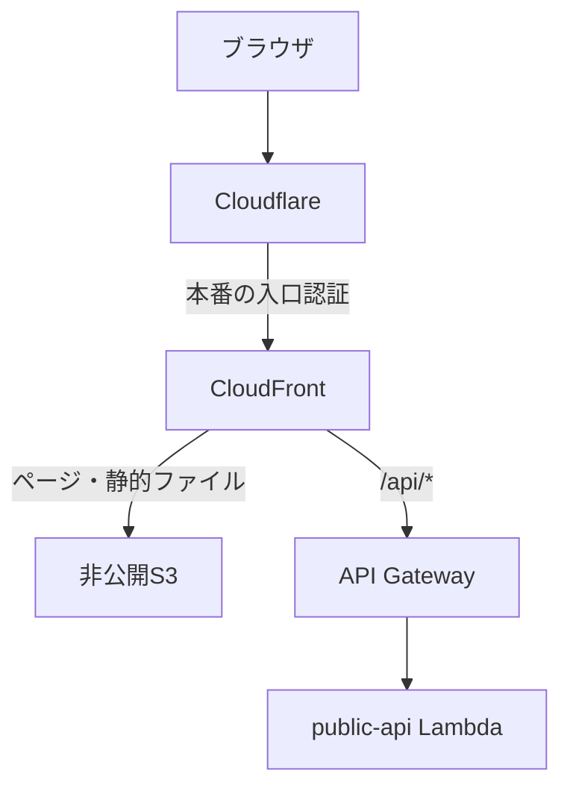

# 実行環境とリクエスト境界

本番環境（main）のページ表示と投票は、同じ公開ホスト名から Cloudflare を経由して CloudFront に接続します。CloudFront は静的ファイルを S3 から配信し、`/api/*` の要求を API Gateway へ転送します。S3 への読み取りは CloudFront の OAC（Origin Access Control）で許可し、バケットを直接公開しません。ブラウザは保存先のバケットや内部のワーカーを選びません。

拡張子のない画面URLは `index.html` へ解決し、その後の画面遷移を React Router が処理します。API Gateway の先では、Hono がルート定義に従ってハンドラーを呼び出します。外部向けのパスと応答形式は `packages/api-contract/src/routes/inventory.ts` が定義し、`apps/api/src/server/api/routes/definitions.ts` が実行環境へ接続します。

## 接続経路の認証とセッション権限

本番の経路には二つの認証があります。CloudFront は、ページ・静的ファイル・API のいずれでも、公開ホスト名と Cloudflare が付ける専用トークンを確認し、入口の迂回を拒否します。トークンはハッシュで照合し、転送前に取り除きます。さらに CloudFront は API へ専用の origin-verification header を付け、API はその値が欠落・不一致なら拒否します。API Gateway の直接URLも、この確認を通過しなければ利用できません。

利用者の IP も、この認証済み経路を前提に扱います。CloudFront は単一の `CF-Connecting-IP` があり、形式条件を満たすことを確認します。API は `TRUSTED_PROXY=cloudflare` でその値を有効な IPv4 / IPv6 アドレスとして検証し、欠落・不正な値を別の転送ヘッダーやプロキシの IP で補いません。

main では公開セッションの作成時に、サーバーで Turnstile を検証します。token がない場合、検証に失敗した場合、用途やホスト名が一致しない場合は作成しません。

開発環境（develop）は Cloudflare を経由せず、CloudFront の署名付き Cookie で運用者向けに入口を制限します。対象はページ、静的ファイル、`/api`、`/api/*` です。CloudFront へ登録するのは公開鍵だけで、署名用の秘密鍵は KMS 内に残ります。この Cookie による制限は main にはありません。

どちらの環境でも、特定のセッションを操作する権限は別に確かめます。セッションに属する API は、URL の `sessionId` と `X-Session-Capability` を照合します。入口を通過しても、別の人のセッションを操作できるわけではありません。各ルートでは、必要な capability、Turnstile、レート制限、入力検証を定められた順序で適用します。

証拠のダウンロードにも同じセッション権限が必要です。「公開可能なバンドル」は再配布できる内容の分類であり、保存バケットを誰でも読めるという意味ではありません。ブラウザと CLI は capability で保護された API から取得し、S3 の直接URLや署名付きURLを通常の取得経路にしません。具体的な配布条件は[公開境界](../verification/public-boundary.md)に定義しています。

## 実行プロファイル

ローカルの画面確認には、本物の証明生成を待たずに使える模擬証拠があります。模擬証拠と AWS の証明を区別するため、保存方式や証明方式を独立したフラグで組み合わせず、実行プロファイルを一つ選びます。

サーバーは `RUNTIME_PROFILE`、ブラウザのビルドは `VITE_RUNTIME_PROFILE` を使います。サーバーはアダプターを作る前に選択を解決し、保存先、証明方式、集計方式、証拠配信、レート制限、Turnstile の設定を一組として検証・固定します。

| プロファイル                | 保存先   | 証明の種類         | 集計・証拠保存                                             |
| --------------------------- | -------- | ------------------ | ---------------------------------------------------------- |
| `local-demo`                | メモリ   | 模擬証拠           | 同期・ローカル。ブラウザの模擬APIで画面を試す              |
| `static-mock-e2e`           | ファイル | 模擬証拠           | 同期・ローカル。静的ビルドと Hono で E2E を行う            |
| `local-proof-development`   | メモリ   | 開発用の偽レシート | 同期・ローカル。Rust host との接続を確かめる               |
| `local-proof-production`    | メモリ   | 本物の STARK 証明  | 同期・ローカル                                             |
| `target-aws-async`          | DynamoDB | 本物の STARK 証明  | 非同期・S3                                                 |
| `target-aws-async-quiesced` | DynamoDB | 本物の STARK 証明  | 非同期・S3。develop の復旧時に新規公開セッションを拒否する |

AWS 用プロファイルは DynamoDB、S3、非同期処理、DynamoDB のレート制限、Turnstile の迂回禁止をまとめて選びます。模擬証拠や開発用レシートへ切り替えることはできません。休止用の `target-aws-async-quiesced` はサーバー専用で、ブラウザには対応する値を公開しません。復旧時のキュー消費と定期整合処理の停止は、[停止して復旧先を切り替える手順](terraform.md#dynamodb-復旧先の切替)で明示的に制御します。

AWS のデプロイ先は `RUNTIME_DEPLOYMENT_ENV=develop|main` で指定し、アカウント、リージョン、テーブル、キューなどの識別子を別途検証します。秘密値はプロファイルへ直接渡さず、許可された参照先から解決します。参照を解決する処理も、最初に確定したアカウント・リージョン・環境に固定されます。

<!-- source: packages/runtime-config/src/env/runtimeProfile.ts, packages/runtime-config/src/env/public-runtime-config.ts, packages/api-contract/src/routes/inventory.ts, apps/api/src/server/api/routes/definitions.ts, apps/api/src/server/api/security/turnstile.ts, infra/terraform/app/frontend_static.tf, infra/terraform/app/frontend-viewer-request.test.ts, infra/terraform/app/target_lambdas.tf -->

## REST Gateway の入力境界

リポジトリの構成は Regional REST API と `live` stage を使います。CloudFront が
stage を origin path に加えるため、公開 URL は変わりません。共有 request schema
から生成したモデルで、投票、finalization 作成・cancel、verification 開始・観測の
POST 本文を Lambda より先に検査します。session 作成の本文省略は維持します。
Gateway の拒否は capability 認証を済ませた証拠ではなく、本文と認証が両方不正なら
400 が先になる場合があります。Hono の認証・本文上限・意味の検証は残ります。

相関には利用者が上書きできない `extendedRequestId` を使い、ログには resource
template と固定分類だけを記録します。共通 CloudWatch role は App から変更しません。
JSON 本文をバイナリ扱いしないよう binary media type は指定せず、応答には Lambda の
レスポンスストリーミングを使います。Hono の応答を元の bytes に戻して送るため、ZIP は
Accept の順序に依存しません。artifact の読み出し上限は維持し、API cache は無効です。
開発環境では2026年9月22日に、モデル拒否、CORS、バイナリ配信と主要メトリクスを実測しました。
これはその時点の確認記録であり、この章のソース記述が現在の配備状態を保証するものではありません。
