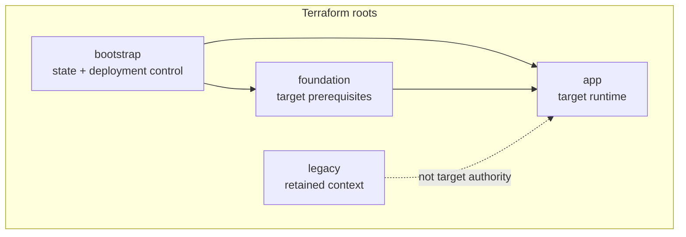
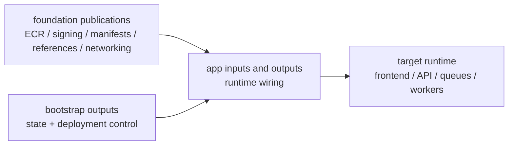

# Terraform

Target AWS runtime の Infrastructure as Code は、application runtime、前提リソース、deployment-control リソースを root 単位に分けて管理します。

公開仕様としての対象は IaC ownership model です。
移行作業記録や個別の承認証跡、環境切り替えの進捗は扱いません（[AWS アーキテクチャ > 本章で扱わないもの](index.md#本章で扱わないもの)）。

## Root ownership

Terraform source は `infra/terraform/` 配下にあります。
Target 構成では root ごとに state scope を分け、ひとつの root が別 root の runtime resource を暗黙に作成しないようにします。

| パス                          | State scope  | 管理対象                                                                                                                                           |
| ----------------------------- | ------------ | -------------------------------------------------------------------------------------------------------------------------------------------------- |
| `infra/terraform/app/`        | `app`        | static frontend、Hono/API、DynamoDB、Lambda、SQS、Step Functions、ECS prover task、semaphore、artifact S3、observability、develop operator gate    |
| `infra/terraform/foundation/` | `foundation` | ECR、Prover の ECR managed signing authority、release authority storage、runtime reference containers、prover networking / public-hostname handoff |
| `infra/terraform/bootstrap/`  | `bootstrap`  | remote state bucket、deployment-control roles、CodePipeline/CodeBuild lanes、deployment / verifier-preflight evidence storage、backend grant       |
| `infra/terraform/legacy/`     | legacy       | retained legacy/root context（Target runtime authority ではありません）                                                                            |

`infra/lambdas/` と `infra/docker/` は Terraform root ではなく、Lambda handler と prover container の source です。
Terraform root は、それらから作られた artifact や image reference を入力として扱います。



## State identity

Target state identity は `account_alias`、`deployment_environment`、`state_scope`、`state_backend_key` の組み合わせで表します。
Tracked `backend.tf` は partial backend として `backend "s3" {}` だけを持ち、bucket、region、key、lockfile 設定は root ごとの backend config から与えます。

State key は bare `terraform.tfstate` ではなく、project / account / environment / scope を含む key にします。

| Root       | 例示 state identity            | 例示 backend key                                                        |
| ---------- | ------------------------------ | ----------------------------------------------------------------------- |
| app        | `stark-dev/develop/app`        | `stark-ballot-simulator/stark-dev/develop/app/terraform.tfstate`        |
| foundation | `stark-dev/develop/foundation` | `stark-ballot-simulator/stark-dev/develop/foundation/terraform.tfstate` |
| bootstrap  | `stark-dev/develop/bootstrap`  | `stark-ballot-simulator/stark-dev/develop/bootstrap/terraform.tfstate`  |

State object と lockfile は S3 backend で保護します。
Root ごとの guard と Terraform validation は、意図しない account、environment、state scope への実行を fail-closed にするための境界です。

Local operator workflow は、private handoff record から root ごとの `backend.local.hcl` と sanitize 済みの local values を render します。
公開ドキュメントではこれを backend / tfvars の handoff として扱い、追跡された具体的な account 設定としては扱いません。
guarded app lane は deployment-control role identity のもとで `scripts/terraform/terraform-guarded.sh` を通す必要があります。
local での app `plan` / `apply` は runtime deployment evidence として受理されません。

## App root

`infra/terraform/app/` は target application runtime を所有します。
主な責務は、ブラウザと API が実際に使う runtime resource を宣言することです。

App root が管理するもの:

- private static frontend bucket、CloudFront distribution、OAC、cache/origin/response policy
- develop-only operator gate の asymmetric KMS signing key、alias、CloudFront public key / key group
- API Gateway HTTP API と Hono `public-api` Lambda
- session、vote、rate-limit、prover semaphore 用 DynamoDB table、app data KMS key、validated recovery table selection
- finalization writer、proof dispatcher、verification worker、cryptographic image-signature verifier、semaphore janitor Lambda
- prover work queue、verification work queue、Step Functions、ECS/Fargate prover task
- Step Functions terminal event と 30 分 sweep による semaphore janitor EventBridge trigger
- protected proof/report artifact bucket と lifecycle
- CloudWatch alarms、closed-field metric filter、dashboard、normalized operations ledger / query definition
- verification invariant 専用 SNS topic と optional email subscription（構成条件は [可観測性設計](observability.md)）
- runtime wiring に必要な non-secret SSM String、Lambda env、Terraform outputs

App root が所有しないもの:

- ECR repository creation、prover image build、image publication
- runtime secret value そのもの
- DNS zone ownership、Route 53 zone、ACM certificate issuance
- production deployment authorization や legacy AWS account resource

App root は foundation root が用意した repository name、manifest storage、secret/config reference、networking input などを参照します。
参照先を app root が作り直したり、別 account の値へ暗黙に fallback したりしないことが境界です。

### Develop operator gate

Develop の operator/tester gate は tracked keyset manifest で generation と lifecycle を管理します。
App root は generation ごとに `RSA_2048` / `SIGN_VERIFY` KMS key を作成し、導出した public key だけを CloudFront の trusted key group に公開します。
Keyset は issuer を必ず 1 つにし、trusted-retiring と detached を使って overlap と失効を明示します。

KMS private key material は export しません。
Terraform state、repository、pipeline artifact、smoke evidence に private signing material を含めず、plan/apply、post-apply smoke、target runtime の role に `kms:Sign` を与えないことが境界です。
Cookie issuance は Terraform とは分離した operator authority のみが KMS signing を実行します。

### DynamoDB recovery selection

App saved-plan lane は session / vote table pair の recovery を次の 4 phase で明示します。

| Phase                  | Served table pair | Public admission / async consumption                  |
| ---------------------- | ----------------- | ----------------------------------------------------- |
| `primary_active`       | primary           | 通常状態                                              |
| `primary_quiesced`     | primary           | session create と prover/verifier event source を停止 |
| `replacement_quiesced` | replacement       | session create と prover/verifier event source を停止 |
| `replacement_active`   | replacement       | 通常状態                                              |

`primary_active` 以外は、target account / region、recovery point、table pair、schema、KMS key を検証済みの immutable recovery manifest に結びます。
Plan は exact manifest selection と checksum を evidence に残し、apply と post-apply smoke はその選択からの変更を拒否します。

Terraform の phase switch が行うのは runtime が参照する table pair の切り替えのみで、table の restore、record の copy、primary / replacement 間の reconciliation は別作業です。
Activation と switch-back は、対象 data が意図した resume state であることを別途検証した上で行います。

## Foundation root

`infra/terraform/foundation/` は独立した公開ページにはせず、この Terraform ページ内で target prerequisite ownership として扱います。

Foundation root は、app runtime の前に存在している必要がある authority を所有します。
対象は次の resource です。

- RISC Zero toolchain image と prover image の ECR repository
- Prover repository だけを対象とする ECR managed signing の Signer profile と registry signing configuration
- encrypted / versioned release authority storage
- Secrets Manager secret container と non-secret SSM config record
- prover networking input
- public hostname disposition record

Foundation root は、[App root](#app-root) が管理する runtime resource を作りません。

Release authority storage の規則は、immutable record と versioned mutable pointer の 2 分類で表せます。

- Immutable record（artifact、promotion、deployment、rollback record）
  - create-only write を必須とし、object と version の削除を bucket policy で拒否します。
  - Prover の signing configuration は immutable かつ execution-bound な image-signing authority object として公開します。
  - Toolchain repository は signing filter の対象外であり、その image は署名も cryptographic verification も行わず、digest-bound scan と immutable provenance を release authority として扱います。
- Versioned mutable pointer（Toolchain / Prover の accepted-channel pointer、Foundation の固定 key の networking handoff）
  - versioned mutable object として扱います。ただし、初回作成または compare-and-swap 条件を伴わない書き込みは拒否します。
  - networking handoff は固定 key の exact `VersionId` と body checksum を sidecar に記録し、app lane はこの exact publication を選択します（unversioned な latest object や再構築した networking facts は使いません）。

Foundation saved-plan lane の smoke は、Terraform output をそのまま downstream authority にはしません。
app lane は mutable tag や最新 object の暗黙の検索ではなく、accepted pointer または retained deployment record の versioned coordinates と checksum を release authority として使います。

## Bootstrap root

`infra/terraform/bootstrap/` は target account の Terraform state と deployment-control resource を所有します。
App runtime や foundation workload ではなく、それらを安全に plan/apply するための control plane を管理します。

Bootstrap root が管理するもの:

- Terraform remote state bucket、state KMS key、bucket policy、lockfile access
- app / foundation root 用の backend access grant
- CodePipeline / CodeBuild project、deployment role、artifact bucket、log group
- reviewed saved plan、approval、apply、smoke、acceptance を結びつける deployment evidence
- GitHub trigger role など deployment-control に必要な IAM

Bootstrap root が所有しないもの:

- app runtime resource
- ECR repository、manifest storage、secret container、prover networking など foundation workload
- production bootstrap resource
- legacy AWS account resource や legacy state import

### App saved-plan authority

App full lane は `normal` と `rollback` を明示的に分けます。
通常の App saved plan より前に、cryptographic image-signature verifier 専用の fail-closed 境界があります。

```text
Source
  -> conditional verifier state-refresh plan / approval / apply
  -> verifier preflight plan / approval / apply
  -> selected Prover digest の cryptographic verification
  -> app deployment record / validation
  -> App saved plan / conditional approval / exact-plan apply
  -> static deploy / smoke / acceptance evidence
```

State refresh は中断された verifier publication、alias、provider state の allowlist 済み reconciliation だけを扱い、non-empty plan には独立した approval を要求します。
続く target-limited preflight は exact saved plan を適用し、選択された digest 固定 Prover を cryptographically verify できなければ App plan へ進みません。

#### Normal

- 新しい source SHA の `normal` 実行では、同じ control SHA の Foundation publication を先に完成させる必要があります。
- App lane は contract-compatible な accepted Prover と、その record が exact-link する Toolchain authority を選択します。
- `normal` は current control source から immutable application artifact と deployment record を作り、検証済みの Foundation / Toolchain / Prover authority に結びます。

#### Rollback

- `rollback` は過去に accepted となった deployment record の exact key、version、checksum を必須とします。
- verifier state reconciliation と preflight mutation は行わず、その record に結びつく historical approval、release authority、verifier authority、retained Lambda package 6 個 / static artifact を再検証して再利用します。
- Pipeline の current source は control source のままで、selected record が deployable source を与えます。
- Terraform plan が empty でも deployable artifact が変わる可能性があるため、`rollback` は常に approval を必要とします。

#### Approval

- Apply は plan stage が作成した exact saved plan だけを消費します。
- Develop の `normal` では、plan JSON が resource / output change、move、import のいずれもないことを machine-proven に確認できた場合だけ manual approval を skip できます。
- Parse failure、未解決の判定、non-empty plan は approval へ fail closed します。
- protected production の apply は無条件に approval-gated です。

#### Acceptance evidence

- Post-apply smoke が成功した後、app lane は pipeline execution と acceptance attempt に結びつく immutable evidence を保存します。
- Evidence は approval または許可された empty-plan skip、verifier preflight、saved-plan / apply、release authority、recovery selection、retained deployable coordinates を結びます。
- Immutable evidence は create-only とし、current accepted deployment pointer の `accepted-deployments/stark-dev/develop/app/current.json` だけを conditional first-create / compare-and-swap で更新します。
- retired `index.json` は authority として読み取りも変換も行いません。

## Runtime wiring

Root 間の接続は、Terraform outputs、SSM reference name、artifact locator、image URI などの明示的な入力で表します。
公開仕様では、これらを「どの root が所有し、どの root が参照するか」という責務境界として扱います。



| Producer   | Consumer       | 情報例                                                                                                                                                           |
| ---------- | -------------- | ---------------------------------------------------------------------------------------------------------------------------------------------------------------- |
| foundation | app pipeline   | ECR repository identity、Prover signing authority publication、versioned release records / accepted pointers、secret/config references、exact networking handoff |
| bootstrap  | managed lanes  | backend config、deployment-control roles、saved-plan / artifact / verifier-preflight / acceptance evidence storage                                               |
| app lane   | target runtime | API URL、DynamoDB/S3/SQS/SFN/Lambda locator、frontend trust metadata、selected recovery phase                                                                    |

Foundation release authority と bootstrap/app deployment evidence は同じものではありません。
Foundation は「どの image / application artifact と release record を選択できるか」を保持し、bootstrap-managed lane は「どの saved plan と approval で apply し、smoke と acceptance がどの結果になったか」を保持します。
App deployment は両方を checksum と versioned reference で結びます。

Secrets の値は public docs や tracked tfvars に置きません。
Public docs では account-specific ID、ARN、bucket name、digest-pinned image URI、secret value を placeholder または概念として扱います。

## Retention authority

App と Bootstrap の retention はそれぞれの `storage_retention.tf` に固定し、pipeline input や operator の任意入力にはしません。

- App root：queue / DLQ message、proof/report object、static noncurrent version、runtime / Container Insights / operations-ledger log、全 5 DynamoDB table の point-in-time recovery を環境別 policy で管理します。
- Bootstrap root：state の noncurrent version、lane の execution artifact、App build cache、CodeBuild log group の retention を管理します。lifecycle filter の例外として、accepted App authority、retained deployable、approval / recovery manifest、signature-preflight evidence は execution-artifact の lifecycle filter の外に置きます。
- Foundation release storage：immutable record と accepted pointer は deletion を拒否し、retired `reissue/*` namespace は新しい write も拒否します。
- ECR image：自動 lifecycle policy を設定しません。image の count や age だけでは accepted、rollback、running task、in-progress reference から外れたことを証明できないためです。

## IAM and guards

Terraform root は最小権限を前提に分離されています。

| 領域               | 境界                                                                          |
| ------------------ | ----------------------------------------------------------------------------- |
| State access       | root ごとの backend key と lockfile object に限定                             |
| App runtime Lambda | `public-api`、writer、dispatcher、worker、image-signature verifier ごとに分離 |
| Prover task        | proof artifact prefix、ECR pull、CloudWatch Logs に限定                       |
| Step Functions     | 特定 ECS task definition、Lambda、logs、managed EventBridge rule に限定       |
| Deployment control | root と command class ごとの role に分離                                      |
| Operator gate      | Public key metadata のみ deployment から参照可能。signing authority は分離    |

Guard は、source branch、account alias、deployment environment、state scope、caller role、backend key の取り違えを検出するためのものです。
Public specs では guard の詳細な承認手順ではなく、責務分離と fail-closed 境界を説明します。

## Version constraints

| ツール           | バージョン                                                                                              |
| ---------------- | ------------------------------------------------------------------------------------------------------- |
| Terraform        | >= 1.10.0                                                                                               |
| AWS provider     | ~> 6.0                                                                                                  |
| Archive provider | target app / foundation / bootstrap roots では未使用。retained legacy root のみ `archive_file` 用に解決 |

## 関連する章

- [現行構成とサービス一覧](design-and-services.md)：root ごとの管理対象と runtime 構成
- [可観測性設計](observability.md)：app root が所有するログ、metric filter、alarm、ledger、notification
- [イメージ署名](image-signing.md)：release authority と digest 固定イメージの関係
- [AWS runtime boundary](runtime-boundary.md)：公開仕様として扱う runtime 境界

<!-- source: infra/terraform/app, infra/terraform/bootstrap, infra/terraform/foundation, docs/infrastructure/terraform.md -->
