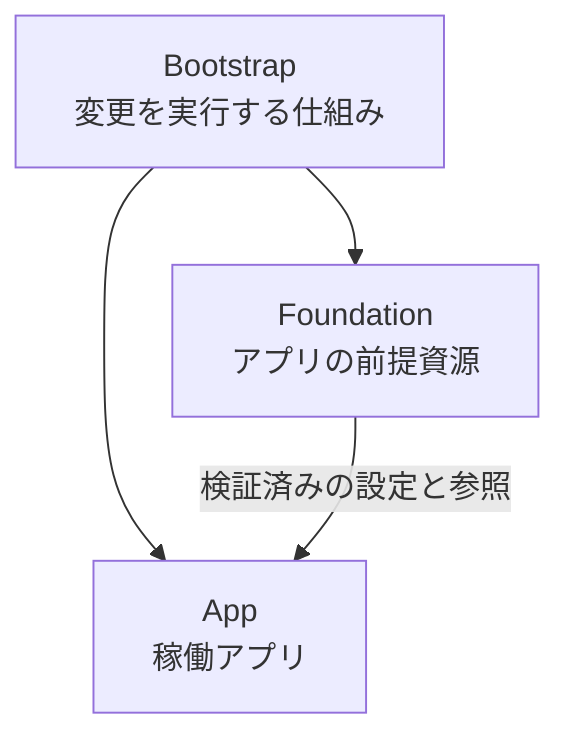

# 変更する内容を計画と承認に結び付ける

デプロイの途中でソースやイメージが変わると、レビューした内容と実際に動かした内容が食い違います。この構成では、変更前に Terraform の計画を保存し、対象ソース、入力、実行環境、計画のチェックサムをまとめて承認します。Apply は、その保存済み計画を作り直さずに適用します。

適用できたことだけでも十分ではありません。適用後の動作・構成確認である Smoke が成功してから、何を受け入れたかを記録します。この「受入記録（acceptance）」が、後の差分調査や rollback で参照する具体的な構成と成果物を定めます。

受入記録には内容のハッシュを付け、同じ保存先へは新規作成だけを許可します。過去の記録を書き換えて「その構成を受け入れていた」ことにできないようにするためです。一方、「今使う記録」を指すポインターは更新できます。ただし、読んだ時点から他の処理が更新していないことを確認してから動かします。記録の保存と、現在の選択の更新を分けるのが基本です。

次の構成図は、受入記録がある継続運用のデプロイ経路と承認、成果物の保存先を示します。本番は5経路、開発は専用の static-fast を加えた6経路を持ち、アカウントと権限・保存先は分離しています。初回構築は後述する別の手順です。図を選ぶと拡大して確認できます。

[](images/aws-deployment-control.png)

<a id="root-ownership"></a>

## 変更の単位を分ける

API、コンテナ保管庫、デプロイ権限は変更の周期が違います。そこで Terraform の root を分け、それぞれが独立した state、計画、実行権限を持ちます。アプリの修正計画へ、署名基盤やデプロイ制御の変更が紛れ込まないようにするためです。

| root                          | 保存する state の範囲 | 管理するもの                                                                                                                           |
| ----------------------------- | --------------------- | -------------------------------------------------------------------------------------------------------------------------------------- |
| `infra/terraform/app/`        | `app`                 | 静的配信、API、DynamoDB、キュー、Step Functions、Fargate タスク、証拠保存、監視、main の Cloudflare 経由の入口認証、develop の入口制限 |
| `infra/terraform/foundation/` | `foundation`          | ECR、署名設定、イメージ保持制御、リリース記録の保存先、秘密値・設定の参照先、プローバー用ネットワーク、公開ホスト名に関する設定        |
| `infra/terraform/bootstrap/`  | `bootstrap`           | state とロックの保存先、デプロイ権限、CodePipeline / CodeBuild、実行中と保持用の保存先、受入記録、差分調査の実行経路                   |



App と Foundation は module を使わない明示的な root です。Bootstrap だけは、CodeBuild ロググループの共通 module を四つの明示的な呼び出しで使います。これにより state やデプロイ経路が増えるわけではありません。既存ロググループのアドレス移動は宣言的な移動表に従い、state の手編集や import で迂回しません。

<a id="state-identity"></a>

## 変更対象と保存先を固定する

`packages/deployment-authority/deployment-targets.json` は、許可対象、各経路、state、backend、ポリシー、生成名の共通の定義です。三つの root は同じ JSON を読み、選択と root 入力の不一致を拒否します。対象全体のハッシュ `targetConfigurationSha256` は、共有名と閉じている経路も含む完全な設定を拘束します。

開発環境は `stark-dev/develop`、稼働中の本番環境は `stark-prod/main` です。dev は6経路、prod は static-fast を除く5経路を持ち、account・state・権限・採用記録を分離します。変更は、それぞれの環境の計画と承認を通して適用します。

state の識別には `account_alias`、`deployment_environment`、`state_scope`、`state_backend_key` を使います。S3 のキーにも範囲を含めます。

| root       | backend key の例                                                        |
| ---------- | ----------------------------------------------------------------------- |
| App        | `stark-ballot-simulator/stark-dev/develop/app/terraform.tfstate`        |
| Foundation | `stark-ballot-simulator/stark-dev/develop/foundation/terraform.tfstate` |
| Bootstrap  | `stark-ballot-simulator/stark-dev/develop/bootstrap/terraform.tfstate`  |

追跡する `backend.tf` は `backend "s3" {}` という部分設定で、bucket、region、key、lockfile 設定は root ごとの検証済み入力から与えます。呼び出し元のロール、ソースブランチ、アカウント、環境、state 範囲を合わせて確認し、別環境への取り違えを防ぎます。

日常の変更は AWS 管理の CodePipeline / CodeBuild を通します。ローカルで App の `plan` / `apply` を実行した結果は、このデプロイの証拠として受け入れません。名前、参照、ハッシュ、計画、承認、条件付き公開の検証は `@stark-ballot/deployment-authority` に集約し、各スクリプトが独自の命名規則や代替の参照先を作らない構成です。

<a id="bootstrap-root"></a>

## Bootstrap が変更の仕組みを管理する

Bootstrap は、変更を実行する側の権限も管理します。state bucket と KMS key、root ごとの backend grant、CodePipeline / CodeBuild、デプロイロール、ログ、成果物と受入記録の保存先がここに属します。

main の初回構築では、まだパイプライン自体がないため、専用の初期化手順で state の保存先（backend）、デプロイの制御基盤（control plane）の順に作ります。それぞれ範囲を限定した保存済み計画をレビュー・承認して適用します。その結果と入力をマニフェストに固定し、`BootstrapInputMode=initial` で AWS 管理のパイプラインへ引き継ぎます。そこで改めて Plan・承認・Apply・Smoke を経て、初めて Bootstrap の受入記録を公開します。

すべての現行 CodeBuild プロジェクトは、固定したソースからリポジトリにある buildspec を選びます。起動時には project、role、source、buildspec、計算資源、実行設定、特権実行の有無、解決済みソースを照合します。特権実行が可能なのは ARM Docker を作る Toolchain / Prover の候補 project だけです。

CodeBuild に設定されたマネージドイメージと、実際のビルドで観測したマネージドイメージは別々に確認して記録します。AWS が返す二つの識別子が等しいとは仮定しません。Plan が記録するのは、実際にその計画を作った環境です。

Full App と、develop に限定した static-fast の Source は `CODEBUILD_CLONE_REF` を渡します。後続の CodeBuild が Git の追跡ファイル、差分、祖先関係を検査できるようにするためです。接続の利用権限は、これを消費する CodeBuild ロールの、正確な CodeConnections ARN への `codeconnections:UseConnection` に限定します。

## 保存済み計画と承認

Plan は、入力と source だけでなく、解決した provider lock、Terraform / provider の識別、上記二つのビルドイメージ識別子、計画のチェックサムを対応記録へ保存します。Apply は同じ lock と計画を受け取り、その場で再計画しません。

計画の実行可否も意味のある差分と照合します。完全な計画が `applyable: false` になるのは、すべての resource、read、root output の action が no-op の場合だけです。差分があるのに実行不可、差分がないのに実行可能、あるいは move、import、deferred change、action invocation、不完全・不正な解析結果があれば拒否します。承認を付けてもその不整合は救済しません。

Apply は backend 初期化より前に、引き継いだ計画との対応、成功した承認アクション、VersionId で特定した新規作成専用の承認証拠が、同じ判断を示すことを確認します。そのチェックサムに結び付く承認内容だけを後段へ渡します。Bootstrap Smoke もこの引継ぎを使い、生の承認を読み直して選び直しません。

Bootstrap、Foundation、App rollback では no-op 計画にも承認が必要です。develop の通常 App だけには、後述する `EMPTY_PLAN_SKIP` があります。verifier の事前確認は独立した、承認の必要な変更です。main の App は空計画でも承認を要求します。初回 verifier の限定作成、続く preflight、Full App はそれぞれの計画と承認を使います。

Plan 用マネージドイメージを変更する場合は、適用した設定を読み取りで確認した後、同じソースで対象経路の新しい Plan を実行します。変更前の実行環境の記録を、変更後に作った計画の証拠として使わないためです。

<a id="foundation-root"></a>

## Foundation がアプリの前提を用意する

Foundation は、Prover / Toolchain の ECR とリリース保存先、Prover の署名設定、秘密値・設定の参照先、ネットワークを用意します。Bootstrap が作ったパイプラインで計画・承認・適用・Smoke を行い、アプリが使う前提を受入記録へ固定します。

main の初回もこの通常経路を使います。管理対象の資源を新規作成する完全な計画であり、既存の管理資源や drift がないことを確認します。refresh により計画の `prior_state` に出力が現れる場合は、値がすべて確定した非秘密の出力に限って許可します。その型・値・秘密指定が計画後の出力と完全に一致し、変更も `null` から同じ既知・非秘密の値を作る `create` であることが条件です。

さらに、state と受入ポインターに保存履歴がないことを版一覧から確かめます。計画時のロック履歴は state 本体と区別し、過去の版や削除マーカー、読み取り失敗を「未作成」とは扱いません。Apply 直前にも不在を確認し、承認した計画から最初の state を作ります。

受入記録には、非秘密入力、ネットワーク、リポジトリと署名設定に加え、対象ソースの関連ファイル集合と完全な契約ハッシュ `foundationContractHash` を保持します。CODE_ZIP の対象ファイルは安定した一覧で二度観測し、最後に読むバイト列も保持した SHA-256 と照合します。

通常の App と Prover は、この受入記録を一度だけ読み、選んだソースから再計算した契約との一致を確認します。App はさらに、Prover の候補が同じ Foundation 契約に基づき、promotion が現在の受入記録に結び付くことを要求します。契約が変われば証明生成のコードが同じでも Prover の再ビルドが必要ですが、ソース SHA の違いだけでは作り直しません。候補の再利用と署名確認は[イメージ署名](image-signing.md)で説明します。rollback は、選んだ過去の App 受入記録に保持された Foundation を使います。

<a id="app-saved-plan-authority"></a>

## App の計画から受入記録まで

App は、同じ Terraform を適用する場合でも `normal` と `rollback` を区別します。前者は現在の採用済みリリースを選び、後者は保持した一回の App 受入記録を復元元にするからです。

以下は受入記録がある継続運用の流れです。main では入力モードに `AppInputMode=accepted` を指定します。[main の初回構築](#initial-app-acceptance)は、二つの実行に分かれます。

```text
Source
  → ResolveRelease
  → verifier 事前確認の計画・承認・適用（normal）
  → 選択した Prover の署名検証
  → TerraformPlan
  → 承認（develop の normal だけは条件を証明した EMPTY_PLAN_SKIP も可）
  → 保存済み計画の適用
  → 静的ファイル公開・Smoke・受入記録の公開
  → PublishCurrentStatus
```

<a id="normal"></a>

### 通常の変更

`ResolveRelease` は現在の Foundation 受入記録と、Toolchain / Prover の採用ポインターをそれぞれ一度だけ解決し、内容ハッシュと保持参照を検証します。選択を verifier の事前確認と TerraformPlan へ引き継ぐため、途中のポインター更新で別のイメージへ切り替わりません。

verifier 専用の事前確認は、その関数を変更する唯一の限定された経路です。同じ Foundation のキー、ソース、関連ファイル集合、契約ハッシュを承認に結び、選んだ Prover の暗号学的署名検証が成功してから App の計画へ進みます。

TerraformPlan は `format:check`、`lint`、`type-system:verify`、`public-safety:scan`、`test:run` を実行し、アプリ成果物と実行の固定入力を `PlanOutput` へ作ります。復旧設定と現在構成の準備のため、現在の App ポインターと受入記録も別に一度だけ解決します。

通常計画の `prover_image_uri` と `image_signature_preflight_prover_image_uri` は、事前確認で選んだ同じ URI です。適用後に別の値を重ねません。

<a id="initial-app-acceptance"></a>

### 初回の受入記録を作る

main の初回構築は、管理者が入力モードを明示して起動します。まず `AppInputMode=verifier-prerequisite` で、署名検証器（verifier）と必要な依存資源だけを作ります。限定した計画を承認・適用すると、この実行は Full App へ進まずに終了します。

次に、別の実行を `AppInputMode=initial` で起動します。作成済みの verifier を使う事前確認と Full App は、それぞれの保存済み計画と承認を通します。この経路では既存の App 受入記録を読み込まず、Smoke 成功後に最初の受入記録と、一件から始まる履歴を公開します。

どちらも `normal` の実行ですが、継続運用の `accepted` とは明示的に分けています。受入記録の欠落や読み取り失敗から、初回構築へ自動で切り替わることはありません。

<a id="approval"></a>

### 承認が必要になる条件

通常の develop App が主承認を省略できるのは、完全な計画が `applyable: false`、すべての action が no-op、選択したリリースの連鎖と現在の受入済み連鎖が同一、という条件をすべて証明した場合だけです。これが `EMPTY_PLAN_SKIP` です。この場合も計画との対応と承認アクションが存在しないことを検証し、架空の承認記録を作りません。verifier 事前確認の承認は別途必要です。

App の主承認は `ManualApproval` / `ApproveTargetRuntimeApply`、事前確認は `VerifierPreflightApproval` / `ApproveVerifierPreflightApply` です。これらの対応、Plan アクション、`PlanOutput` を保つことで、承認がどの計画に対するものかを固定します。

<a id="rollback"></a>

### 過去の構成へ戻す

rollback の入力は、件数を制限した現在履歴から到達できる App 受入記録のキー一つです。記録の本文、VersionId、チェックサム、ソース、イメージ座標を運用者が転記して組み合わせません。

選んだ記録に保持された Foundation、Toolchain、Prover、過去の承認、verifier、六つの Lambda パッケージ、静的成果物を再検証して使います。現在の Foundation やリリースのポインターは解決せず、verifier の事前変更も行いません。事前確認用の selector は null のままです。パイプラインを制御するソースは現在のまま、配備するソースと成果物は選択した記録から得ます。

Terraform が no-op でも静的ファイルなどが変わり得るため、rollback は必ず新しい計画と人の承認を通します。実際の rollback、別の normal 実行による roll-forward、復旧と後片付けは、それぞれ個別に許可された操作です。保持ファイルやテストがあるだけでは、それらの実施成功を証明しません。

<a id="acceptance-evidence"></a>

### 動作確認後に受入記録を残す

Smoke が成功すると、検証に使ったロールは自分の識別を確認し、受入記録の公開専用ロールへ切り替えます。公開専用ロールには対象オブジェクトと KMS の限定権限だけを与え、バケット一覧取得は許可しません。構成を読み取る Smoke と記録を書く publisher の権限を混ぜません。

App の受入記録は、承認または許可された省略、実行入力、verifier の事前確認、計画と適用、採用リリース、復旧設定、保持した成果物と稼働構成の証拠を一つに結びます。候補作成時には先に試行証拠を保存し、引き継いだ変更不能な参照を Smoke の識別で VersionId を指定して読み直します。その読み取りは、定義された三つの試行ファイル、復旧・Lambda・静的成果物、Foundation 受入記録、Toolchain / Prover のポインター・候補・リリースの範囲に限ります。

App の適用後入力と Smoke レポートは、検査して開いた一つの通常ファイルから、完全なバイト列を二度読み、一致を確認します。ファイルの大きさや更新時刻だけで同じ内容だとは判断しません。

S3 の `VersionId` は保存した版の識別子、`ETag` は比較更新に使う値です。特定の版を読むことと、読み取り後の更新競合を避けることに使い分けます。

受入記録は内容ハッシュを含むキーに新規作成し、対象ごとに一つのポインターへ件数を制限した履歴を保持します。たとえば develop は `accepted-deployments/stark-dev/develop/app/current.json` を使い、main は別のキーを持ちます。最初に `If-None-Match: *` で作成を試し、明確な前提条件競合のときだけ、既存の正確な VersionId と ETag を観測して比較更新します。アクセス拒否を「存在しない」と扱いません。

`PublishCurrentStatus` の状態オブジェクトも削除禁止の条件付きポインターです。専用 publisher が完全な選択履歴から本文を計算し、初回作成、競合時の正確な読み取り、保持内容を使った `If-Match` 更新の順で扱います。受入記録とは違い、状態オブジェクトは変更可能です。

<a id="static-frontend-publication"></a>

### 静的ファイルの公開が競合しないようにする

複数のビルドが同時に静的ファイルを公開すると、新旧のファイルが混ざります。そこで、今どのビルドが公開中かを対象ごとに一つの S3 オブジェクトへ記録し、公開作業を排他的に進めます。これが **リース（lease）** です。

公開できる project は対象設定から決まり、develop は Full App と static-fast、main は Full App だけです。main でも別の Full App 実行との競合を同じリースで防ぎます。

| 確認すること                         | 正確な条件                                                                                                                                            |
| ------------------------------------ | ----------------------------------------------------------------------------------------------------------------------------------------------------- |
| 同じ公開作業を競合させない           | 対象設定の `staticFrontendArtifactPrefix` を使い、その対象で許可された project だけが保持者になれる                                                   |
| 保持者を識別する                     | 本文は build ID、固定のリース種別、publisher project 名だけ。本文の SHA-256 とアカウント・リージョン・partition から正確な CodeBuild ARN に結び付ける |
| 引き継いでよいか                     | `BatchGetBuilds` が正確な build の完了と許可された終了状態を返す。時間経過や `LastModified` は使わず、履歴の欠落・古さでも停止する                    |
| 公開の途中で保持者が変わっていないか | 各ファイルの変更前、キャッシュ無効化の前後、証拠公開の前後に、本文・SHA-256・ETag・VersionId を照合する                                               |
| リースを解放する                     | 保持する ETag による条件付き削除を行い、バージョン付き delete marker を確認する。過去の版を消す `DeleteObjectVersion` はバケットポリシーで拒否する    |

ETag は更新競合の確認に使い、内容のハッシュの代わりにはしません。

公開するファイル群の識別には、専用のドメイン分離をした形式で、整列したパス、正確なバイト数、SHA-256 を含めます。各ファイルを必ず同じチェックサムでアップロードしてから、不要なキーを削除します。S3 sync の時刻やサイズを内容の根拠にしません。rollback の配備元は、保持したアーカイブの SHA-256 と正確な VersionId です。

<a id="dynamodb-recovery-selection"></a>

## DynamoDB の復旧先を切り替える

develop では、アプリを休止させて DynamoDB の復旧先を切り替える経路を用意しています。参照する sessions / votes の組と新規作業の受付を、次の段階で切り替えます。この休止を伴うアプリ復旧経路は main では選択できません。

| 段階                   | 参照する組  | 新規セッション・キュー消費                            |
| ---------------------- | ----------- | ----------------------------------------------------- |
| `primary_active`       | primary     | 通常                                                  |
| `primary_quiesced`     | primary     | セッション作成と prover / verifier のキュー消費を停止 |
| `replacement_quiesced` | replacement | 同じく停止                                            |
| `replacement_active`   | replacement | 通常                                                  |

`primary_active` 以外は、アカウント、リージョン、復旧時点、テーブルの組、スキーマ、KMS key を検証した同じ変更不能マニフェストに結びます。遷移は隣接段階ごとに一つの実行・計画・承認で行い、Plan が選んだマニフェストとチェックサムを Apply / Smoke が変えることはできません。

Terraform が切り替えるのは参照先です。テーブルの restore、コピー、両方のデータの整合は別の作業です。再開や戻しには、データが意図する再開状態であることの確認が必要です。restore、activation、switch-back、RTO / RPO の計測、cleanup はそれぞれ独立した許可と条件付き手順で扱います。専用の readiness report を実行の前提にしません。

<a id="develop-operator-gate"></a>

## 開発環境の入口の鍵を管理する

develop の入口 Cookie の鍵は、追跡する keyset manifest で世代と状態を管理します。App は各世代に `RSA_2048` / `SIGN_VERIFY` の KMS key を作り、公開鍵だけを CloudFront trusted key group へ登録します。発行元は必ず一つとし、`trusted-retiring` と `detached` で鍵の重なりと失効を表します。Smoke は develop の鍵構成を照合し、main ではこの Cookie による入口制限が無効で、鍵や trusted key group を持たないことを確認します。

秘密鍵は KMS から取り出しません。state、リポジトリ、パイプライン成果物、Smoke 証拠には秘密の署名材料を入れず、Plan / Apply / Smoke / 稼働アプリのロールには `kms:Sign` を与えません。Cookie の発行は、それらから分離した運用者の署名権限で行います。

<a id="terraform-acceptance-and-report-only-controls"></a>

## 受入済みの構成との差分を調べる

Bootstrap と Foundation も、Smoke 成功後に内容ハッシュで特定する受入記録を作り、各 root の `current.json` を初回作成または ETag / VersionId による比較更新で進めます。記録は対象と backend、非秘密入力と秘密値の参照名、provider lock と実行環境、レビュー済み計画のチェックサム、root 固有の確認結果を保持します。state、保存済み計画本体、生の plan JSON、復号済み値は恒久記録へ含めません。

差分調査は三つの root ごとに、要求時に個別起動します。二つの要求制限ポリシーを付けた起動専用ロールが、選択した一つの project だけを起動します。運用者の一般的な AdministratorAccess と、この限定された起動権限は同じものではありません。

各 runner は次の順で、受け入れた構成と現在の AWS の差分を調べます。

1. インストール済みの controller のソースとハッシュ、project、role、buildspec、実行環境を確認する。設定されたイメージと実際に使ったイメージを別々に AWS 管理イメージとして検証する。
2. 対象 root の現在の受入記録を解決し、そこで採用した過去のソースを専用の一時領域へ展開する。
3. 対象、backend、入力、provider lock、実行環境、ソースを照合する。
4. refresh を有効にした `terraform plan -lock=false -detailed-exitcode` を実行する。
5. `0` は `no-drift`、`2` は `drift-detected`、それ以外の確認・実行失敗は `check-failed` として、検証済みの秘匿化した報告だけを保存する。

報告は確認済みの二つのビルドイメージ識別子を保持し、その確認前の失敗では `null` とします。一時的な state、計画、plan JSON は必ず片付けます。外部の準備・検証処理が失敗した場合も、新規作成専用の失敗報告を一度だけ試みます。

runner は構成を調査するための root 固有の読み取り権限を持ちますが、Apply、state や lock の書込み、受入ポインターの変更はできません。差分報告から自動修正へは進みません。修正する場合は、通常の担当経路で新しい計画を作り、改めて承認します。

## 記録と保存先を保護する

Foundation のリリース保存先、Bootstrap の Terraform 受入保存先、App 保持用保存先はバージョニングを有効にします。バケットポリシーでも、変更不能な記録は新規作成だけ、ポインターは初回作成または `If-Match` 付き更新だけを許可し、曖昧な条件ヘッダーと権限対象の削除を拒否します。クライアント側の条件チェックだけに任せません。

一つの SSE-KMS key を要求するポリシーは、alias ではなく正確な key ARN を比較します。書込み側が alias を解決する場合は、その定義済み alias への `kms:DescribeKey` で同じアカウント・リージョンの有効な鍵を確認し、S3 に ARN を渡します。この識別用の読取りと、S3 経由の暗号権限を分けます。

Full App の実行中の成果物は、対象ごとの非公開・バージョニング有効・KMS 暗号化バケットに置きます。develop の static-fast には別のバケットを用意し、両経路が互いのバケットへアクセスできないようにします。受入記録、配備用成果物、承認、verifier 証拠、キャッシュを置く App 保持用バケットとも区別します。短命な実行ファイルの失効で、rollback の根拠を失わないためです。

<a id="retention-authority"></a>

## 必要なイメージを残す

保存期間は App / Bootstrap の `storage_retention.tf` に固定し、実行ごとの任意入力にしません。App はキュー、証拠ファイル、静的ファイルの旧版、ログ、五つの DynamoDB テーブルの PITR を管理し、Bootstrap は state の旧版、実行成果物、キャッシュ、ビルドログ、秘匿化した調査報告を管理します。受入記録と採用ポインターは通常の実行成果物の失効から分離します。

イメージを古い順に消すと、現在使うものや rollback に必要なものを失う恐れがあります。そのため ECR の native lifecycle による削除は設定せず、Foundation の専用 controller が参照先を調べて削除します。

毎日18:00 UTC の `cron(0 18 * * ? *)` で、現在の Toolchain / Prover、保持する App 履歴と rollback 参照、稼働 Prover task definition、および各イメージに付随する署名などの参照オブジェクト（referrer）を保護対象として確認します。関連パイプライン、候補ビルド、集計、Prover タスクが動いている間は削除しません。

二回の観測が完全に一致してから、不要な referrer、対象イメージの順で削除し、結果を確認します。定義された両環境の目標保持数は10ですが、保護対象が優先し、10を超えて残り得ます。controller は選択した dev/prod のアカウントと参照に固定します。初回 App の採用記録がまだなければ削除しません。通常の Foundation Apply には ECR 削除権限を与えません。

controller 関連の七つの予定実行用 AWS 資源は恒久資源です。導入中に手動起動せず、Foundation の参照を更新する期間は、新しい Foundation に結び付く Prover が採用ポインターで保護されるまで予定実行が発生しない区間を確保します。同じ移行では、保持する App 履歴のポインター比較更新まで App 開始を停止します。

<a id="iam-and-guards"></a>

## 操作権限を限定する

ロールに与える権限には、操作を許可する identity policy と、その許可の上限を定める permissions boundary を使います。実際の許可は両者の共通部分に限られるので、上限側だけを見ても操作できるとは判断できません。

state は root ごとの key と lock に、Lambda は各担当処理に、Fargate は証拠接頭辞・ECR pull・ログに限定します。デプロイ、受入公開、差分調査、Cookie 発行も別のロールです。各 CodeBuild が自分を確認する `BatchGetProjects` と、静的公開が所有者を確認する `BatchGetBuilds` は、必要な project ARN だけが両ポリシーで許可されるようにします。

AWS provider の refresh が必要とする限定的な例外は、所有 root の調査ロールと対象に閉じます。たとえば App 調査の task definition 確認は `ecs:DescribeTaskDefinition` の AWS 全体の指定を必要としますが、それを ECS の一般権限へ広げません。EventBridge の名前系列を共有 boundary の上限に使う場合も、各 identity policy は現在の正確なルール一覧に限定します。

IAM の依存関係だけでは権限の反映完了を証明できないため、権限文書と管理対象のハッシュで起動する段階的な反映待ちを置きます。削除時にも順序を守り、古い Apply の再実行や手動の権限追加を代替にしません。

<a id="version-constraints"></a>

## ツールのバージョン条件

| ツール       | 現行の三つの root |
| ------------ | ----------------- |
| Terraform    | `= 1.15.8`        |
| AWS provider | `= 6.58.0`        |

各経路は公式 Terraform `linux_amd64` アーカイブのチェックサムを検証してから展開し、実際の version / platform を確認します。解決した provider lock は計画ごとの実行証拠で、追跡する root lockfile を正本にはしません。Bootstrap の共有 child module は互換性のある下限・範囲指定を持ちます。現行 root は Archive provider を使いません。

<!-- source: infra/terraform/app, infra/terraform/bootstrap, infra/terraform/foundation, infra/framework/terraform/modules/codebuild-log-groups, packages/deployment-authority, scripts/aws/bootstrap-initialize.ts, scripts/terraform/terraform-guarded.sh -->
