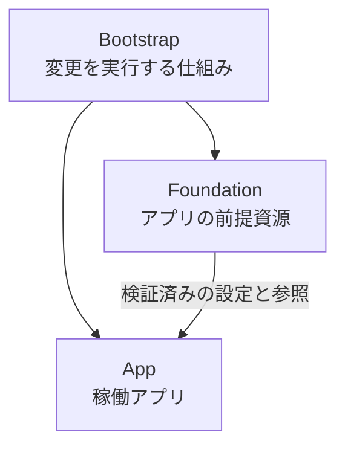

# Terraform とデプロイ管理

デプロイでは、変更前に Terraform の計画を保存し、対象ソース、入力、実行環境、計画のチェックサムをまとめて承認します。Apply は、その保存済み計画を作り直さずに適用します。途中でソースやイメージが変わり、レビューした内容と実際の配備内容が食い違うことを防ぐためです。

受入記録（acceptance）の公開には、適用の成功と、その後の動作・構成確認である Smoke の成功の両方が必要です。受入記録は、後の差分調査で参照する具体的な構成と成果物を定めます。

レビュー対象の plan package は変更不能な参照として保存します。成功した各 root の現在の受入記録は `checkpoint.json` に置き、Plan が観測した ETag に対する条件付き更新で進めます。初回作成は明示した不在条件に限ります。過去の版は S3 VersionId で特定でき、失敗した実行から成功記録を公開しません。

次の図はソースに定義された継続運用の経路です。Bootstrap はローカルのレビュー済み操作、Foundation・Toolchain・Prover・App は4本の管理パイプラインです。両環境のアカウント・権限・保存先を分離します。ソースの定義と各環境への導入状況は別であり、この図は本番への切替完了を表しません。図を選ぶと拡大して確認できます。

[](images/aws-deployment-control.png)

## Terraform root の管理範囲

API、コンテナ保管庫、デプロイ権限は変更の周期が異なるため、Terraform の root を分けています。各 root は独立した state、計画、実行権限を持ち、アプリの修正計画に署名基盤やデプロイ制御の変更が混在することを防ぎます。

| root                          | 保存する state の範囲 | 管理するもの                                                                                                                            |
| ----------------------------- | --------------------- | --------------------------------------------------------------------------------------------------------------------------------------- |
| `infra/terraform/app/`        | `app`                 | 静的配信、API、DynamoDB、キュー、Step Functions、Batch / Fargate、証拠保存、監視、main の Cloudflare 経由の入口認証、develop の入口制限 |
| `infra/terraform/foundation/` | `foundation`          | ECR、署名設定、イメージ保持制御、リリース記録の保存先、秘密値・設定の参照先、プローバー用ネットワーク、公開ホスト名に関する設定         |
| `infra/terraform/bootstrap/`  | `bootstrap`           | state とロックの保存先、デプロイ権限、CodePipeline / CodeBuild、実行中と保持用の保存先、受入記録、差分調査の実行経路                    |

App は Batch の計算環境とジョブキューを管理します。ジョブ定義と同時実行枠の共通資源は、App の Terraform が管理する CloudFormation スタック内に定義します。これらも同じ App 計画のレビュー・承認対象です。



App と Foundation は明示的な root です。Bootstrap は CodeBuild ロググループの共通 module を使います。共有化によって state やデプロイ経路を増やさず、既存の資源 identity と保持ログを保全します。通常の計画審査では move/import を拒否し、state の手編集で迂回しません。

## 変更対象と state の識別

`packages/deployment-authority/deployment-targets.json` は、許可対象、各経路、state、backend、ポリシー、生成名の共通の定義です。三つの root は同じ JSON を読み、選択と root 入力の不一致を拒否します。対象全体のハッシュ `targetConfigurationSha256` は、共有名と閉じている経路も含む完全な設定を拘束します。

対象は `stark-dev/develop` と `stark-prod/main` です。共通の root と target 設定を使いながら、account・state・権限・採用記録を分離します。検証済み source の変更を環境ごとの計画と承認で配布し、dev の計画や署名・採用記録を prod に流用しません。配置済み source の差と、採用構成からの drift は区別します。

state の識別には `account_alias`、`deployment_environment`、`state_scope`、`state_backend_key` を使います。S3 のキーにも範囲を含めます。

| root       | backend key の例                                                        |
| ---------- | ----------------------------------------------------------------------- |
| App        | `stark-ballot-simulator/stark-dev/develop/app/terraform.tfstate`        |
| Foundation | `stark-ballot-simulator/stark-dev/develop/foundation/terraform.tfstate` |
| Bootstrap  | `stark-ballot-simulator/stark-dev/develop/bootstrap/terraform.tfstate`  |

追跡する `backend.tf` は `backend "s3" {}` という部分設定で、bucket、region、key、lockfile 設定は root ごとの検証済み入力から与えます。呼び出し元のロール、ソースブランチ、アカウント、環境、state 範囲を合わせて確認し、別環境への取り違えを防ぎます。

Foundation と App の変更は AWS 管理の CodePipeline / CodeBuild を通し、Bootstrap と差分調査は別のローカル操作を使います。ローカルの App `apply` は通常の配備経路ではありません。名前、参照、ハッシュ、計画、承認、条件付き公開の検証は `@stark-ballot/deployment-authority` に集約します。

## Bootstrap のデプロイ制御

Bootstrap はデプロイの実行権限を管理します。state bucket と KMS key、root ごとの backend grant、CodePipeline / CodeBuild、デプロイロール、ログ、成果物と受入記録の保存先も管理対象です。

Bootstrap は Linux の固定実行環境、独立した管理者 identity、既存 backend、停止・drain 済みの管理処理を確認し、完全な保存計画をレビューします。対象・source・package hash を結び付けた承認後に Apply と Smoke を実行し、checkpoint を条件付き公開します。新しい対象に限り、backend と制御基盤を順に作る専用 initializer を使えます。既存環境で checkpoint がないことは初期化の根拠になりません。

すべての現行 CodeBuild プロジェクトは、固定したソースからリポジトリにある buildspec を選びます。起動時には project、role、source、buildspec、計算資源、実行設定、特権実行の有無、解決済みソースを照合します。特権実行が可能なのは ARM Docker を作る Toolchain / Prover の候補 project だけです。

実行中の `BatchGetBuilds` 応答を、ソースが所有する project inventory と照合します。buildspec、service role、compute type、environment type、privileged mode の不一致・欠落を拒否します。現在の project 設定を、その実行で使われた設定の証拠として代用しません。IAM による起動制限も別途維持します。

App の Source は `CODEBUILD_CLONE_REF` を渡します。後続の CodeBuild が Git の追跡ファイル、差分、祖先関係を検査できるようにするためです。接続の利用権限は、これを消費する CodeBuild ロールの、正確な CodeConnections ARN への `codeconnections:UseConnection` に限定します。

## 保存済み計画と承認

Plan は target、backend、source、実行、Terraform version とアーカイブ checksum、provider lock、非秘密入力、成果物・依存記録の正確な参照、保存 binary plan と plan JSON を一つの plan package に結びます。Apply は同じ lock と保存計画を使い、その場で再計画しません。

計画の実行可否も意味のある差分と照合します。完全な計画が `applyable: false` になるのは、すべての resource、read、root output の action が no-op の場合だけです。差分があるのに実行不可、差分がないのに実行可能、あるいは move、import、deferred change、action invocation、不完全・不正な解析結果があれば拒否します。承認を付けてもその不整合は救済しません。

Apply は plan package の正確な VersionId・SHA-256 と同じ実行の承認を検証します。変更前に Plan が固定した mutation owner を条件付きで引き継ぎ、execution/stage/action ごとの開始マーカーを新規作成します。再試行で build ID が変わっても同じ変更を再実行できません。後段は同じ owner と先行 action の成功を要求します。

Bootstrap、Foundation、すべての App デプロイでは no-op 計画にも承認が必要です。App の署名確認は準備工程で実行し、verifier を含む完全な計画を一度承認します。

Plan 用マネージドイメージを変更する場合は、適用した設定を読み取りで確認した後、同じソースで対象経路の新しい Plan を実行します。変更前の実行環境の記録を、変更後に作った計画の証拠として使わないためです。

## Foundation の基盤資源と受入条件

Foundation は、Prover / Toolchain の ECR とリリース保存先、Prover の署名設定、秘密値・設定の参照先、ネットワークを用意します。Bootstrap が作ったパイプラインで計画・承認・適用・Smoke を行い、アプリが使う前提を受入記録へ固定します。

新しい Foundation の初回構築も通常の Plan・承認・Apply・Smoke を使います。既存の本番環境は既存 state を保ち、契約切替として checkpoint の初回公開を明示します。新規 state の初回構築と checkpoint の初回公開は異なる条件です。

初回の不在条件は、正確な対象の完全な版一覧など、成功した読み取りで確かめます。アクセス拒否、timeout、不完全な一覧、削除マーカーを「未作成」と扱いません。過去の失敗が残した mutation owner も新しい計画で確認します。

Foundation checkpoint は plan package と実行・backend を結び、ネットワーク、image authority と明示的な consumer contract を公開します。利用側が必要とする資源の要件と、image 作成時の来歴を分けて検証します。

通常の App と Prover は現在の Foundation を一度選び、現在の source が要求する資源・契約への適合を確認します。image 作成時の Foundation ハッシュは不変の来歴です。digest、署名、ImageID、ゲスト契約などが適合し、実 image が存在すれば、無関係な IaC 変更や同じ digest の再昇格だけで再ビルドしません。[イメージ署名](image-signing.md)も参照してください。

## App の計画から受入記録まで

App は現在のソースと採用済み image を選び、四つの stage で配備します。

```text
Source
  → Prepare（release 解決・native 署名検証・完全な保存済み計画）
  → ManualApproval（空計画でも必須）
  → DeployApplication（Apply・静的配信・Smoke・checkpoint 公開）
```

最後の stage は QUEUED で順序を保ち、Smoke と checkpoint 公開までで App 配備を完了します。状態配信は、その成功後に別の処理として非同期に行います。配備はトランザクションではなく、失敗した部分配備は新しい計画で確認する必要があります。

### 通常の変更

`Prepare` は現在の Foundation と Toolchain / Prover を一度だけ選びます。Plan は source 検査と native 署名検証を実行し、使用した同じ固定 assets を Lambda ZIP にまとめます。対象、source、実行、digest、trust、S3 の正確な VersionId と SHA-256 を保存済み計画へ結びます。

通常の App Apply が verifier のコードと設定を更新し、変更不能なバージョンを公開します。Step Functions はその qualified ARN を直接呼びます。Apply は実際のコード、設定、IAM と呼出先を検証し、Smoke は同じバージョンを確認します。部分配備や不一致では新しい checkpoint を公開しません。

### 受入記録の初回公開

既存 target は現在の checkpoint を使います。欠落や読取り失敗から初期化へ切り替えません。初回公開は対象の実際の state・owner と不在条件を明示的に確認し、完全な計画、承認、Apply、静的公開、Smoke を通します。既存環境の修復に新規初期化を使いません。

### 承認条件

すべての action が no-op でも `ManualApproval` / `ApproveTargetRuntimeApply` は必須です。frontend だけの変更も同じ承認を通ります。Apply は保存済み計画、実行 ID、source、checksum に結び付く承認証跡を検証します。署名確認専用の別承認はありません。

### 修正ソースの再配備

過去の App 受入記録から構成と成果物を再構成する汎用 rollback は撤去しました。現在の契約に適合する修正 commit を用意し、新しい計画、承認、Apply、Smoke を通します。適合する採用済み image は再利用します。データ復元、state 修復、本番操作や削除には、それぞれ別の許可が必要です。

### 受入記録の公開と非同期ステータス配信

同じ execution/package の owning Smoke が成功してから、root の現在の記録 `deployment/{targetKey}/{root}/checkpoint.json` を公開します。source、実行、plan package の正確な参照、backend、再現用の入力を結び、App では配置した image・method と runtime identity も確認します。

Plan 前の ETag または明示的な初回不在条件を使って更新します。別の owner/checkpoint が進んでいれば拒否し、後続実行の値を読み直して古い結果を上書きしません。アクセス拒否は不在ではありません。応答不明や部分変更の後は実際の effects を確認し、新しい実行・計画・承認で進めます。

S3 の `VersionId` は保存版の特定、`ETag` は比較更新に使います。

App 成功後、EventBridge と Step Functions を経て、専用の CodeBuild が状態を非同期に配信します。配信する状態は成功した checkpoint から導くキャッシュであり、承認や投票結果の Verified を成立させる証拠ではありません。状態配信の遅延・失敗は、App 配備の成否と分けて扱います。

### 静的ファイルの公開順序

静的配信は両環境とも通常の App 経路で行います。Apply、静的配信、Smoke と checkpoint 公開を一つの `QUEUED` stage に置き、同じ対象への公開順序を守ります。専用の static-fast 経路と S3 リースは廃止しました。

この順序制御はトランザクションではありません。失敗すると一部のファイルが更新済みになることがありますが、失敗した公開から新しい受入記録は作りません。公開中の処理を止めて次の実行を先行させず、修正したソースで通常の計画・承認・配備をやり直します。

公開するファイル群の識別には、専用のドメイン分離をした形式で、整列したパス、正確なバイト数、SHA-256 を含めます。各ファイルを必ず同じチェックサムでアップロードしてから、不要なキーを削除します。S3 sync の時刻やサイズを内容の根拠にしません。静的配信も現在の選択ソースから作った成果物を使います。

## DynamoDB 復旧先の切替

PITR と元テーブルを保ち、停止期間を設けて別名の sessions / votes テーブルへ復元します。4 段階の復旧制御とマニフェストによる自動切替は廃止しました。復元先の二表の対応、スキーマ、索引、KMS、TTL、PITR、削除保護、IAM を検証してから、具体的な参照先の設定変更を新しいソースと保存 plan・承認・smoke で配備します。元テーブルを削除して同名へ復元する手順は使いません。

develop の `application_quiesced` はソースとしてレビューする保守設定です。新規セッションとキュー消費、集計状態の定期整合処理を止めますが、既存セッションへの書込みや実行中のジョブを自動停止しません。運用者が入口を閉じ、すべての書込み元の停止・処理完了を確認する必要があります。再開も新しい plan と承認で行います。旧表へ戻しても新表への書込みは同期されません。データ検証、RTO / RPO、停止許容時間、再開、後日の削除は個別の許可と証跡を要し、リポジトリのテスト成功だけでは復旧可能とは主張しません。

## 開発環境の Cookie 署名鍵

develop の入口 Cookie の鍵は、追跡する keyset manifest で世代と状態を管理します。App は各世代に `RSA_2048` / `SIGN_VERIFY` の KMS key を作り、公開鍵だけを CloudFront trusted key group へ登録します。発行元は必ず一つとし、`trusted-retiring` と `detached` で鍵の重なりと失効を表します。Smoke は develop の鍵構成を照合し、main ではこの Cookie による入口制限が無効で、鍵や trusted key group を持たないことを確認します。

秘密鍵は KMS 内に保持し、Cookie は Plan / Apply / Smoke / 稼働アプリから分離した運用者の署名権限で発行します。これらのアプリ・配備ロールには `kms:Sign` を与えず、state、リポジトリ、パイプライン成果物、Smoke 証拠にも秘密の署名材料を含めません。

## 受入済み構成との差分調査

三つの root はそれぞれ、現在の checkpoint の正確な版から、採用した source・plan package・provider lock・非秘密入力・成果物を再現します。差分調査は root 固有の読み取り role を使うローカル操作です。管理 project や定期 scheduler はありません。

1. 独立して選んだ target、root、identity と checkpoint を検証する。
2. checkpoint が固定した source と checksum 検証済み Terraform、provider lock、入力・成果物を専用領域へ展開する。
3. 必要 image の存在、管理処理の drain、checkpoint・mutation owner・state の版、lineage、serial を確認する。
4. `terraform plan -refresh=true -lock=false` を実行し、同じ観測項目を実行後にも再確認する。
5. 終了値 `0` は差分なし、`2` は差分あり、`1` は確認失敗とする。失敗や依存欠落を clean にしない。

診断は秘匿化した限定的な差分を返し、state/lock、checkpoint、remote report を書きません。Apply や自動修正にも進みません。競合、欠落 image/artifact、読取り拒否、秘密漏洩のおそれは確認失敗です。変更は通常の担当経路で新しい計画と承認を通します。

## 記録と保存先の保護

Foundation のリリース保存先、Bootstrap の Terraform 受入保存先、App 保持用保存先はバージョニングを有効にします。バケットポリシーでも、変更不能な記録は新規作成だけ、ポインターは初回作成または `If-Match` 付き更新だけを許可し、曖昧な条件ヘッダーと権限対象の削除を拒否します。クライアント側の条件チェックだけに任せません。

一つの SSE-KMS key を要求するポリシーは、alias ではなく正確な key ARN を比較します。書込み側が alias を解決する場合は、その定義済み alias への `kms:DescribeKey` で同じアカウント・リージョンの有効な鍵を確認し、S3 に ARN を渡します。この識別用の読取りと、S3 経由の暗号権限を分けます。

Full App の実行中の成果物は、対象ごとの非公開・バージョニング有効・KMS 暗号化バケットに置きます。受入記録、配備用成果物、承認、verifier 証拠、キャッシュを置く App 保持用バケットとも区別します。短命な実行ファイルの失効で、受入記録の根拠を失わないためです。

## イメージ保持数と欠落時の扱い

保存期間は App / Bootstrap の `storage_retention.tf` に固定し、実行ごとの任意入力にしません。App はキュー、証拠ファイル、静的ファイルの旧版、ログ、四つの DynamoDB テーブルの PITR を管理し、Bootstrap は state の旧版、実行成果物、キャッシュ、ビルドログ、保持する監査記録を管理します。受入記録と採用ポインターは通常の実行成果物の失効から分離します。

ECR は各 repository で push 時刻が新しい5イメージを残す native lifecycle policy を使います。promoted/current-use の保護タグや独自 retention controller はなく、利用中の image も削除され得ます。必要 image が欠落すれば選択・配備・drift は失敗し、明示した通常の build・検証・promotion で作り直します。Toolchain が必要なら先に作り、続いて Prover と新しい App 計画を扱います。再ビルド後の digest/ImageID が元と同じとは仮定しません。

## IAM による操作権限の制限

ロールに与える権限には、操作を許可する identity policy と、その許可の上限を定める permissions boundary を使います。実際の許可は両者の共通部分に限られるので、上限側だけを見ても操作できるとは判断できません。

state は root ごとの key と lock に、Lambda は各担当処理に、Fargate は証拠接頭辞・ECR pull・ログに限定します。デプロイ、checkpoint 公開、差分調査、Cookie 発行の権限を分けます。

パイプライン内の CodeBuild は、正確な build と native action の対応を検査します。専用の状態配信 CodeBuild は自身の実行設定に加え、成功した App 実行・同じ source・成功した Smoke・現在の checkpoint を確認します。両者の project trust と起動経路は IAM でも制限します。

AWS provider の refresh が必要とする限定的な例外は、所有 root の調査ロールと対象に閉じます。たとえば App 調査の task definition 確認は `ecs:DescribeTaskDefinition` の AWS 全体の指定を必要としますが、それを ECS の一般権限へ広げません。EventBridge の名前系列を共有 boundary の上限に使う場合も、各 identity policy は現在の正確なルール一覧に限定します。

Batch と CloudFormation も、Plan・差分調査の読取りと Apply の変更権限を分けます。Batch の計算環境・キュー・ジョブ定義の describe は全資源指定ですが、タグ・共通資源の読取りとスタックの参照は対象環境の資源に限定します。Apply の変更権限も、その Batch 資源とスタックに限定します。

IAM の依存関係だけでは権限の反映完了を証明できません。制御経路を切り替える際は、旧 starter の権限撤去、実処理の drain と反映確認、旧 guard/role の撤去を順にレビューします。古い Apply の再実行や手動の権限追加を代替にしません。

## ツールのバージョン条件

| ツール       | 現行の三つの root |
| ------------ | ----------------- |
| Terraform    | `= 1.17.0`        |
| AWS provider | `= 6.70.0`        |

各経路は公式 Terraform `linux_amd64` アーカイブのチェックサムを検証してから展開し、実際の version / platform を確認します。解決した provider lock は計画ごとの実行証拠で、追跡する root lockfile を正本にはしません。Bootstrap の共有 child module は互換性のある下限・範囲指定を持ちます。現行 root は Archive provider を使いません。

<!-- source: infra/terraform/app, infra/terraform/bootstrap, infra/terraform/foundation, infra/framework/terraform/modules/codebuild-log-groups, packages/deployment-authority, scripts/aws/bootstrap-initialize.ts, scripts/terraform/terraform-guarded.sh -->
