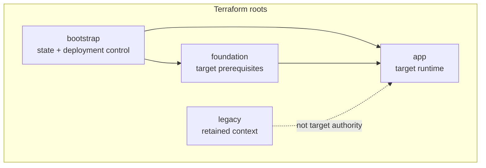
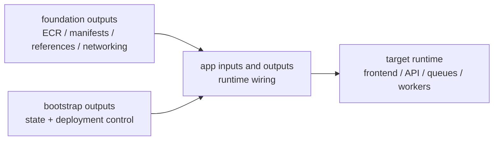

# Terraform

Target AWS runtime の Infrastructure as Code は、責務境界を明示するために root を分けます。
Terraform は application runtime、前提リソース、deployment-control リソースを分けて管理します。

公開仕様としての対象は IaC ownership model です。
開発中ブランチの移行作業記録、個別の承認証跡、production bootstrap、独自ドメインの本番 DNS 切替、旧 AWS アカウント削除の完了状態は扱いません。

## Root ownership

Terraform source は `infra/terraform/` 配下にあります。
Target 構成では root ごとに state scope を分け、ひとつの root が別 root の runtime resource を暗黙に作成しないようにします。

| パス                          | State scope  | 管理対象                                                                                                  |
| ----------------------------- | ------------ | --------------------------------------------------------------------------------------------------------- |
| `infra/terraform/app/`        | `app`        | static frontend、Hono/API、DynamoDB、Lambda、SQS、Step Functions、ECS prover task、semaphore、artifact S3 |
| `infra/terraform/foundation/` | `foundation` | ECR、release manifest storage、runtime reference containers、prover networking inputs                     |
| `infra/terraform/bootstrap/`  | `bootstrap`  | remote state bucket、deployment-control roles、CodePipeline/CodeBuild scaffolding、backend grant          |
| `infra/terraform/legacy/`     | legacy       | retained legacy/root context（Target runtime authority ではありません）                                   |

`infra/lambdas/` と `infra/docker/` は Terraform root ではなく、Lambda handler と prover container の source です。
Terraform root は、それらから作られた artifact や image reference を入力として扱います。

## State identity

Target state identity は `account_alias`、`deployment_environment`、`state_scope`、`state_backend_key` の組み合わせで表します。
Tracked `backend.tf` は partial backend として `backend "s3" {}` だけを持ち、bucket、region、key、lockfile 設定は root ごとの backend config から与えます。

State key は bare `terraform.tfstate` ではなく、project / account / environment / scope を含む key にします。

| Root       | 例示 state identity            | 例示 backend key                                                        |
| ---------- | ------------------------------ | ----------------------------------------------------------------------- |
| app        | `stark-dev/develop/app`        | `stark-ballot-simulator/stark-dev/develop/app/terraform.tfstate`        |
| foundation | `stark-dev/develop/foundation` | `stark-ballot-simulator/stark-dev/develop/foundation/terraform.tfstate` |
| bootstrap  | `stark-dev/develop/bootstrap`  | `stark-ballot-simulator/stark-dev/develop/bootstrap/terraform.tfstate`  |

State object と lockfile は S3 backend で保護します。
Root ごとの guard と Terraform validation は、意図しない account、environment、state scope への実行を fail-closed にするための境界です。

Local operator workflows render root-specific `backend.local.hcl` files and
sanitized local values from private handoff records. Public docs describe this
as a backend/tfvars handoff, not as tracked concrete account settings. The
guarded app lane must run through `scripts/terraform/terraform-guarded.sh`
under the deployment-control role identity; local app `plan` or `apply` is not
accepted as runtime deployment evidence.

## App root

`infra/terraform/app/` は target application runtime を所有します。
主な責務は、ブラウザと API が実際に使う runtime resource を宣言することです。

App root が管理するもの:

- private static frontend bucket、CloudFront distribution、OAC、cache/origin/response policy
- API Gateway HTTP API と Hono `public-api` Lambda
- session、vote、rate-limit、prover semaphore 用 DynamoDB table と app data KMS key
- finalization writer、proof dispatcher、verification worker、image signature gate、semaphore janitor Lambda
- prover work queue、verification work queue、Step Functions、ECS/Fargate prover task
- Step Functions terminal event と 30 分 sweep による semaphore janitor EventBridge trigger
- protected proof/report artifact bucket と lifecycle
- runtime wiring に必要な non-secret SSM String、Lambda env、Terraform outputs

App root が所有しないもの:

- ECR repository creation、prover image build、image publication
- runtime secret value そのもの
- DNS zone ownership、Route 53 zone、ACM certificate issuance
- production deployment authorization や legacy AWS account resource

App root は foundation root が用意した repository name、manifest storage、secret/config reference、networking input などを参照します。
参照先を app root が作り直したり、別 account の値へ暗黙に fallback したりしないことが境界です。

## Foundation root

`infra/terraform/foundation/` は独立した公開ページにはせず、この Terraform ページ内で target prerequisite ownership として扱います。

Foundation root は、app runtime の前に存在している必要がある authority を所有します。
対象は次の resource です。

- RISC Zero toolchain image と prover image の ECR repository
- encrypted / versioned release manifest storage
- Secrets Manager secret container と non-secret SSM config record
- prover networking input
- public hostname disposition record

Foundation root は app runtime resource を作りません。
API Gateway、Lambda function、DynamoDB table、SQS queue、Step Functions state machine、ECS service/task、CloudFront distribution、static frontend bucket、proof artifact bucket は app root の責務です。

## Bootstrap root

`infra/terraform/bootstrap/` は target account の Terraform state と deployment-control resource を所有します。
App runtime や foundation workload ではなく、それらを安全に plan/apply するための control plane を管理します。

Bootstrap root が管理するもの:

- Terraform remote state bucket、state KMS key、bucket policy、lockfile access
- app / foundation root 用の backend access grant
- CodePipeline / CodeBuild project、deployment role、artifact bucket、log group
- GitHub trigger role など deployment-control に必要な IAM

Bootstrap root が所有しないもの:

- app runtime resource
- ECR repository、manifest storage、secret container、prover networking など foundation workload
- production bootstrap resource
- legacy AWS account resource や legacy state import

## Runtime wiring

Root 間の接続は、Terraform outputs、SSM reference name、artifact locator、image URI などの明示的な入力で表します。
公開仕様では、これらを「どの root が所有し、どの root が参照するか」という責務境界として扱います。

| Producer   | Consumer | 情報例                                                                                     |
| ---------- | -------- | ------------------------------------------------------------------------------------------ |
| foundation | app      | ECR repository identity、manifest storage、secret/config reference names、networking input |
| bootstrap  | app      | backend config、deployment-control role access、artifact locator                           |
| app        | runtime  | API URL、DynamoDB/S3/SQS/SFN/Lambda locator、frontend trust metadata                       |

Secrets の値は public docs や tracked tfvars に置きません。
Public docs では account-specific ID、ARN、bucket name、digest-pinned image URI、secret value を placeholder または概念として扱います。

## IAM and guards

Terraform root は最小権限を前提に分離されています。

| 領域               | 境界                                                                    |
| ------------------ | ----------------------------------------------------------------------- |
| State access       | root ごとの backend key と lockfile object に限定                       |
| App runtime Lambda | `public-api`、writer、dispatcher、worker、signature gate ごとに分離     |
| Prover task        | proof artifact prefix、ECR pull、CloudWatch Logs に限定                 |
| Step Functions     | 特定 ECS task definition、Lambda、logs、managed EventBridge rule に限定 |
| Deployment control | root と command class ごとの role に分離                                |

Guard は、source branch、account alias、deployment environment、state scope、caller role、backend key の取り違えを検出するためのものです。
Public specs では guard の詳細な承認手順ではなく、責務分離と fail-closed 境界を説明します。

## Version constraints

| ツール           | バージョン                                                                                              |
| ---------------- | ------------------------------------------------------------------------------------------------------- |
| Terraform        | >= 1.10.0                                                                                               |
| AWS provider     | ~> 6.0                                                                                                  |
| Archive provider | target app / foundation / bootstrap roots では未使用。retained legacy root のみ `archive_file` 用に解決 |

<!-- source: infra/terraform/app, infra/terraform/bootstrap, infra/terraform/foundation, docs/current/guides/7-terraform/ -->
