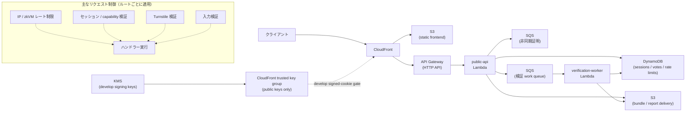
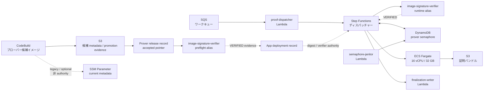
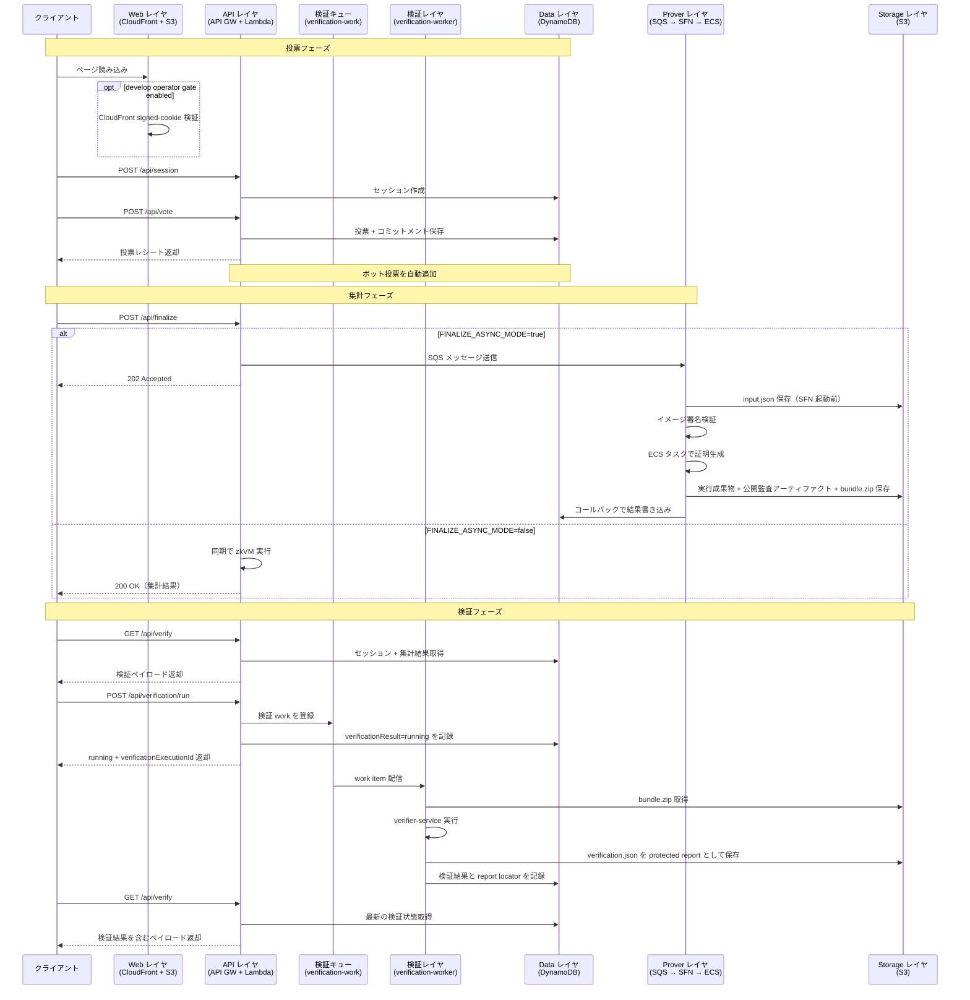
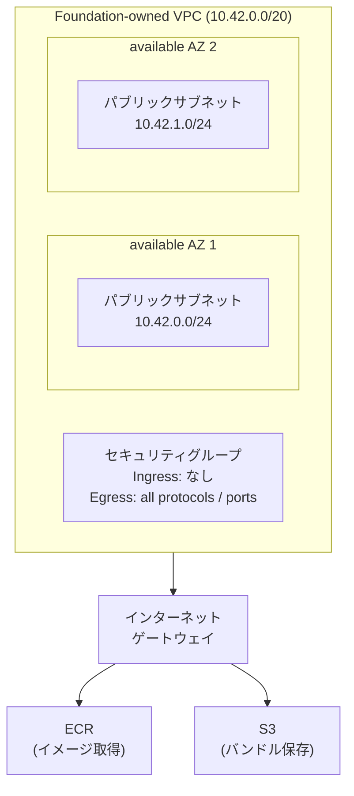

# トポロジー

AWS 上のサービス配置とコンポーネント間の通信経路を示します。
このページは runtime の責務分担を説明します（個別環境の導入進捗は扱いません）。

本システムは次の 6 つの論理レイヤで構成されます。

- [Web レイヤ](#web-レイヤ)：静的配信と develop signed-cookie gate
- [API レイヤ](#api-レイヤ)：API Gateway と `public-api` Lambda
- [Data レイヤ](#data-レイヤ)：DynamoDB による永続化
- [Prover レイヤ](#prover-レイヤ)：SQS / Step Functions / ECS による証明生成
- [Verification レイヤ](#verification-レイヤ)：STARK レシート検証
- [Storage レイヤ](#storage-レイヤ)：proof artifact の S3 保存

## レイヤ別トポロジー

### Web レイヤ

CloudFront が private S3 origin の Vite/React 静的アセットを配信します。
`/api/*` は同じ CloudFront distribution から API Gateway origin に routing されます。
extensionless browser route は viewer-request fallback で `index.html` に解決します。

develop で operator gate が有効な場合、static frontend、browser route、`/api`、`/api/*` の viewer access は CloudFront signed cookie を要求します。
信頼する public key group は、追跡対象 keyset に従って Terraform が管理する非対称 KMS signing key から public key を導出して構成します。
KMS の private signing material は CloudFront、app runtime role、Terraform state には渡しません。
この gate は develop 固有の条件付き境界であり、すべての環境に一律適用されるものではありません。

### API レイヤ

API Gateway（HTTP API）が `/api/*` パスパターンのリクエストを受け取り、単一の Lambda 関数（`public-api`）にプロキシします。
`public-api` は Hono route inventory を実行する runtime adapter で、ルーティング、セッション管理、Turnstile 検証、レート制限を処理します。
下図の「主なリクエスト制御」は、`public-api` がルートごとに適用有無と順序を切り替える代表的な要素を示します。
固定順のパイプラインではありません。

CORS 設定では `X-Session-ID` と `X-Session-Capability` ヘッダーを許可します。
これにより、セッションスコープと capability トークンによるリクエスト制御を実現しています。
`POST /api/verification/run` は、target runtime では検証 work を `verification-work` キューへ登録し、HTTP 応答では `running` と `verificationExecutionId` を返します。
実際の STARK レシート検証と protected report の保存は `verification-worker` の責務です。
後述の[エンドツーエンドのデータフロー](#エンドツーエンドのデータフロー)も参照してください。

### Data レイヤ

DynamoDB が、セッション、投票、集計結果、レート制限状態の永続化を担当します。
データプレーンは target Lambda IAM role ごとの最小権限で制限され、ブラウザから DynamoDB へ直接アクセスする経路はありません。

通常時は Terraform-owned primary sessions / votes table pair を参照します。
DynamoDB recovery の 4 phase 定義と切替契約は [Terraform](terraform.md) を参照してください（quiesced phase の図への影響は [エンドツーエンドのデータフロー](#エンドツーエンドのデータフロー) に注記）。

主要な永続化モデルは以下の 2 つです。
session row は、状態本体を `session` object に格納し、検索や条件付き更新に使う metadata を top-level に保持します。
`electionId`、`userVoteIndex`、`finalizationResult` は nested `session` のフィールドです。

| モデル        | キー/識別子             | 主な top-level field                                                                                                   | TTL         |
| ------------- | ----------------------- | ---------------------------------------------------------------------------------------------------------------------- | ----------- |
| VotingSession | `sessionId`             | `itemType`, `session`, `createdAt`, `lastActivity`, `finalized`, `botCount`, finalization contract / artifact metadata | `expiresAt` |
| Vote          | `sessionId + voteIndex` | `voteId`, encrypted `vote`, encrypted `rand`, `commit`, `path`, `timestamp`, `rootAtCast`, `treeSize`, `isUserVote`    | `expiresAt` |

レート制限用に 2 つの追加テーブル（RateLimitEvents、RateLimitCounters）が PAY_PER_REQUEST モードで運用されています。
これとは別に、同時実行数を制御する prover semaphore table も DynamoDB 上で管理します。

### Prover レイヤ

STARK 証明の生成を担当するレイヤです。
SQS キュー、Step Functions ステートマシン、ECS Fargate タスクで構成されます。
詳細は [非同期プローバー](async-prover.md) を参照してください。

normal App deployment は、選択した digest 固定 Prover image を immutable verifier version の `preflight` alias で検証し、その evidence と verifier authority を App deployment record に固定します。
runtime では Step Functions の最初の state が同じ authority の `runtime` alias を呼び、暗号学的検証に成功した場合だけ semaphore の取得と ECS 起動へ進みます。

ECS タスクは ARM64 アーキテクチャの Fargate で実行され、Foundation-owned VPC（10.42.0.0/20）内のパブリックサブネットに配置されます（セキュリティグループの設定は [ネットワーク構成](#ネットワーク構成) を参照）。
Step Functions は DynamoDB の semaphore row で prover slot を取得・解放し、`semaphore-janitor` は terminal execution event と定期 sweep から stale slot を回収します。

### Verification レイヤ

STARK レシート検証を担当するレイヤです。
`public-api` は session capability、finalization state、bundle locator、Image ID を確認したうえで検証 work を SQS に登録します。
`verification-worker` は work item に含まれる `sessionId`、`executionId`、S3 bundle locator、expected Image ID を使って private S3 bucket から `bundle.zip` を取得します。
その後、`verifier-service` で `Receipt::verify(expected_image_id)` を実行します。

検証結果は protected report artifact（`verification.json`）として保存されます（扱いは [公開境界](../verification/public-boundary.md) と後述の [Storage レイヤ](#storage-レイヤ)）。

### Storage レイヤ

S3 バケットが、証明バンドルに含まれる配布対象アーティファクトと非公開ワーク入力の保存を担当します。
Target Terraform はこれに加えて、プローバーイメージ候補の metadata、promotion evidence、release record / accepted pointer 用の非公開 S3 storage を管理します。
実行対象は選択された app deployment record から渡される digest 固定 prover image URI で決まります。

| 項目               | 設定                                                                                     |
| ------------------ | ---------------------------------------------------------------------------------------- |
| バケット命名       | `stark-ballot-simulator-{account-alias}-{environment}-proof-artifacts`                   |
| 暗号化             | AES256（サーバーサイド暗号化）                                                           |
| パブリックアクセス | 全ブロック                                                                               |
| ライフサイクル     | `proof_artifact_lifecycle_days` 日（既定 7 日）で current / noncurrent object を自動削除 |
| バージョニング     | Enabled                                                                                  |

プローバー release metadata / evidence は foundation 側の versioned manifest storage に保存します。
CodeBuild からの publish 仕様、legacy/optional SSM current pointer の非 authority 境界、digest 固定 runtime input の関係は [イメージ署名 > ビルドと署名の概念](image-signing.md#ビルドと署名の概念) を参照してください。

証明バンドル側のオブジェクトパスは既定で `sessions/{sessionId}/{executionId}/` 配下です。
target runtime では `S3_PROOF_PREFIX=sessions/` が Terraform と runtime validation の契約です。
この prefix を変更するには、`public-api`、`verification-worker`、`proof-dispatcher`、`finalization-writer`、CLI/report delivery の S3 policy と artifact lookup を同時に変更する必要があります。
影響範囲は [非同期プローバー > Dispatch 処理](async-prover.md#dispatch-処理) を参照してください。

配布対象（`bundle.zip` とその同梱物）と保護対象（`input.json`、bitmap sibling object など）の区分は [公開境界](../verification/public-boundary.md) を、bundle member と S3 レイアウトの詳細は [バンドル構造](../verification/bundle-structure.md) を参照してください。
このレイヤに固有のファイルは次のとおりです。

| ファイル            | 区分       | 説明                                                                                                            |
| ------------------- | ---------- | --------------------------------------------------------------------------------------------------------------- |
| `*-receipt.json`    | 中間データ | zkVM host の生出力。`bundle.zip` 内の `receipt.json` の元データ                                                 |
| `*-output.json`     | 中間データ | zkVM host の生出力（集計結果）。`bundle.zip` 内の `journal.json` の元データ                                     |
| `verification.json` | 保護       | 検証サービスの出力。target runtime では protected report artifact として保存を要求し、`bundle.zip` には含めない |

## エンドツーエンドのデータフロー

投票から検証までのデータフローを、レイヤ間の通信として示します。
以下は `primary_active` または `replacement_active` の非 quiesced phase における処理です。
`*_quiesced` phase では、この図に含まれる新規 session admission と prover / verification queue consumption は利用できません。
図では API request ごとの CloudFront hop を省略していますが、develop operator gate が有効な場合は frontend と API の両方で viewer request の signed cookie を検証します。

`verification-worker` は `bundle.zip` を検証入力として読み取り、target AWS runtime では `verification.json` が存在しない場合や S3 upload に失敗した場合に fail-closed に失敗します。
保存に成功した report locator は finalization state に反映します。
report 保存に失敗しても既存の `s3BundleKey` は維持されますが、verification execution 自体は成功扱いになりません（report と bitmap sibling object の扱いは [バンドル構造](../verification/bundle-structure.md)）。

## ネットワーク構成

### VPC

Foundation Terraform が管理する VPC は、ECS Fargate タスク専用です。
API Gateway、target Lambdas、DynamoDB、S3、CloudFront は VPC 外の managed service boundary で動作します。
VPC は `10.42.0.0/20` で、最初の 2 つの available AZ に `/24` public subnet を 1 つずつ配置します。
AZ 名は Terraform が実行時に取得するため、特定の AZ suffix には固定しません。

ECS タスクはパブリック IP を持ちますが、セキュリティグループがインバウンドを全拒否するため、外部からのアクセスはできません。
アウトバウンドは `0.0.0.0/0` に対する全 protocol / port を許可します。
これは public subnet から ECR、S3、CloudWatch Logs などへ到達するための明示的な develop prover 例外であり、HTTPS のみに制限された security group ではありません。

## 監視とロギング

この節はログの物理配置と保持期間を示します。
ログ、メトリクス、alarm、operations ledger の authority と読み方は [可観測性設計](observability.md) を参照してください。

### 主な CloudWatch ログ群

runtime のログ群（ECS Fargate タスク、Step Functions 実行、`public-api` / `proof-dispatcher` / `finalization-writer` / `verification-worker` / `image-signature-verifier` / `semaphore-janitor` の各 Lambda、API Gateway アクセスログ）の保持期間は develop 90 日 / main 180 日で統一しています。
例外は次の 2 つです。

| ログ群                                                                                  | 対象                         | develop | main   |
| --------------------------------------------------------------------------------------- | ---------------------------- | ------- | ------ |
| `/aws/ecs/containerinsights/{project}-{account-alias}-{environment}-prover/performance` | ECS Container Insights       | 7 日    | 30 日  |
| `/aws/events/{project}-{account-alias}-{environment}-ops-ledger`                        | normalized operations ledger | 365 日  | 731 日 |

ロググループ名は Terraform-managed physical names と component suffix に揃えます（`image-signature-verifier` の log group だけは `stark-ballot-sim-` を name prefix に使います）。
deployment pipeline の CodeBuild log group は bootstrap root の管理対象です。
develop / main の保持期間は、bootstrap pipeline が 30 / 365 日、App pipeline が 180 / 365 日、Foundation と image release pipeline が 365 / 365 日です。

### CloudTrail

CloudTrail は current target app/bootstrap/foundation Terraform runtime の構成要素ではなく、account-plane または organization-level の監査証跡として別途管理される場合があります。
旧構成の残存ロググループ、旧 standalone prover/toolchain CodeBuild log group、旧 Terraform の multi-region CloudTrail（main 環境のみ、90 日保持）は、この topology の runtime authority に含めません。

## 関連する章

- [現行構成とサービス一覧](design-and-services.md)：サービスごとの責務一覧
- [非同期プローバー](async-prover.md)：Prover レイヤの実行時フロー
- [可観測性設計](observability.md)：ログ、検出、相関、通知境界
- [バンドル構造](../verification/bundle-structure.md)：Storage レイヤの artifact 境界

<!-- source: infra/terraform/app, infra/terraform/bootstrap, infra/lambdas/, infra/docker/entrypoint.sh, packages/verification/src/verification/verification-bundle.ts -->
