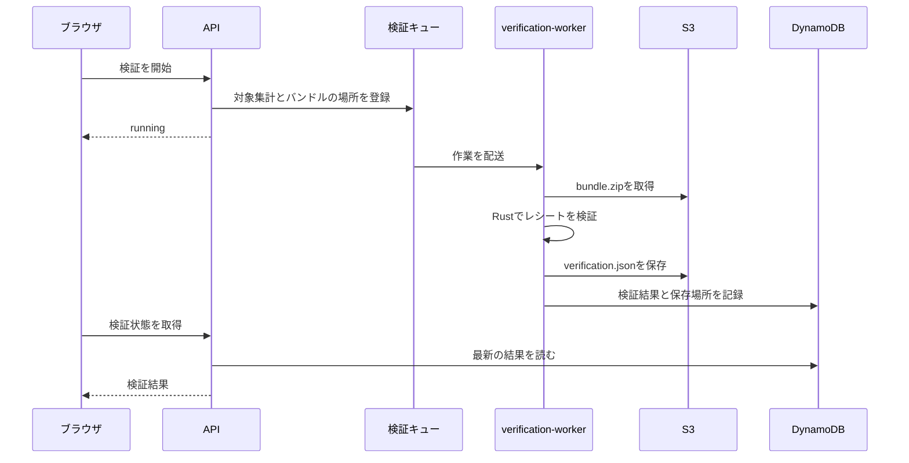
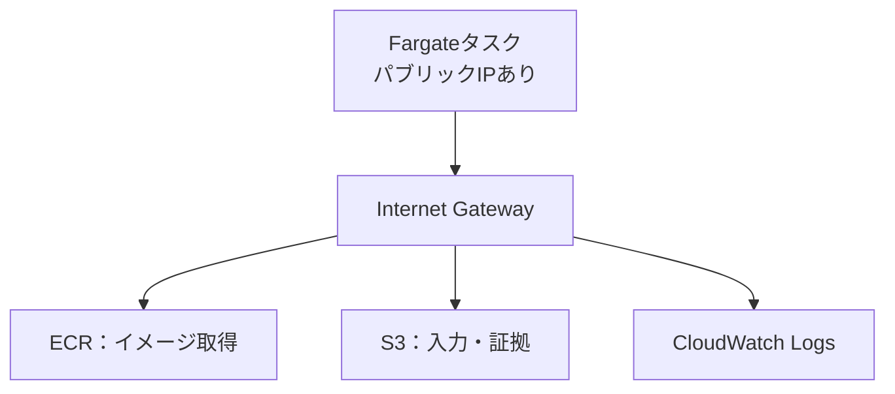

# 状態と証拠をどこへ保存するか

ブラウザを閉じても、受け付けた集計作業とその進捗は AWS 側に残ります。DynamoDB は「今どの状態か」を保持し、S3 は「何を入力し、どの証拠ができたか」を保持します。状態が完了を示すとき、対応する証拠を読み出せるように、両者を `sessionId` と `finalizationId` で結び付けます。

## DynamoDBに残す状態

sessions table のパーティションキーは文字列の `sessionId` です。ただし、セッションに関する情報を一つの大きな行へ詰め込みません。作成時に固定する選挙情報と、投票で変わる掲示板、集計の進捗、検証結果を別のレコードにします。別々のワーカーが更新するときに、担当外の情報まで上書きしないためです。

| レコード             | sessions table のキー例                                  | 保持する内容                                                                           |
| -------------------- | -------------------------------------------------------- | -------------------------------------------------------------------------------------- |
| セッションの識別情報 | `{sessionId}`                                            | `SESSION_IDENTITY`。選挙設定、`electionId`、`logId`、作成時刻                          |
| 投票中の状態         | `VOTING#{sessionId}`                                     | `SESSION_VOTING`。掲示板ルートの履歴、ボット票数、利用者の参加、最終活動時刻、revision |
| 集計の進捗           | `FINALIZATION_CURRENT#{sessionId}` / `FINALIZATION#...`  | 現在の集計へのポインターと、各集計の状態                                               |
| 検証と証拠の状態     | `VERIFICATION#...` / `OBSERVATION#...` / `BITMAP#...`    | 検証結果、ブラウザの観測、検証済みビットマップ                                         |
| AWS上の保存場所      | `FINALIZATION_RUNTIME#...` / `VERIFICATION_DELIVERY#...` | Step Functions の情報、`s3BundleKey`、`s3ReportKey` など                               |

votes table は `(sessionId, voteIndex)` の複合キーを使い、`voteId`、暗号化した選択肢と乱数、コミットメント、時刻、`rootAtCast`、`isUserVote`、`expiresAt` を保持します。ブラウザはこれらのテーブルへ直接アクセスせず、API とワーカーがそれぞれの IAM 権限で読み書きします。

期限のあるセッション関連レコードは用途に応じて `expiresAt` を持ちます。レシート掲示板の全体カウンターは独立した TTL なしのレコードです。API のレート制限には、別の RateLimitEvents / RateLimitCounters テーブルを PAY_PER_REQUEST で使い、プローバーの同時実行枠にも専用の DynamoDB テーブルを使います。

本番環境は Terraform が管理する primary の sessions / votes の組を参照します。develop では、[休止を伴うアプリ復旧経路](terraform.md#dynamodb-recovery-selection)で replacement の組へ切り替えられます。個々のワーカーが独自に保存先を選ぶことはありません。

## S3に残す入力と成果物

証明ファイルの保存先は非公開・バージョニング有効の S3 バケットです。サーバー側暗号化は AES256 を使い、現在版と旧版のオブジェクトはともに7日で削除するライフサイクルを設定します。

一回の集計のファイルは、次の同じ接頭辞にまとめます。

```text
sessions/{sessionId}/{finalizationId}/
```

AWS では `S3_PROOF_PREFIX=sessions/` が Terraform と実行時検証の共通条件です。API、dispatcher、writer、verification worker は、保存キーがこの形式と対象の識別子に一致することを確認します。名前の一致を曖昧にすると、別の集計のファイルを読み込む危険があるためです。

`input.json` はプローバーへの非公開入力です。プローバーが生成する `*-receipt.json` と `*-output.json` は host の中間出力で、それぞれ配布用の `receipt.json` と `journal.json` の元になります。配布用 ZIP の中身と、外に残すビットマップなどのファイルは[バンドル構造](../verification/bundle-structure.md)で定義しています。

同じ S3 に保存されていても、すべてのファイルを配布するわけではありません。API は[公開境界](../verification/public-boundary.md)に従ってファイルの種類とセッション権限を確認してから返します。

## 生成済みの証拠を検証する通信

集計の完了後、検証開始 API は capability、現在の集計が成功していること、集計ごとのバンドル保存場所、期待する Image ID を確認します。作業を `verification-work` に登録した応答は `verificationStatus=running` と `finalizationId`、推定所要時間、冪等な再要求かどうかを返します。



ワーカーは `Receipt::verify(expected_image_id)` を実行します。AWS では検証結果を `verification.json` として保存することも完了条件です。レポートがない場合やアップロードに失敗した場合、検証作業を成功として扱いません。

保存に成功すると、結果は `VERIFICATION_RESULT`、バンドルとレポートの保存場所は `VERIFICATION_DELIVERY` に分けて記録します。レポート保存に失敗しても既存の `s3BundleKey` は失いません。このレポートは後続の capability 付き API から取得でき、公開 ZIP には入れません。

この通信で得る STARK 検証結果を、ブラウザは投票時の記録や掲示板の確認と合わせます。ワーカーの成功だけで画面全体の判定は決まりません。

## プローバーだけをVPC内に配置する

本番で稼働する Fargate のプローバータスクは、Foundation が管理する VPC に配置します。develop も同じネットワーク構成を使います。API Gateway、Lambda、DynamoDB、S3、CloudFront は VPC 外のマネージドサービスとして動きます。

VPC の範囲は `10.42.0.0/20`。利用可能な最初の二つの AZ に、それぞれ `10.42.0.0/24` と `10.42.1.0/24` のパブリックサブネットを置きます。AZ の末尾文字は固定せず、Terraform が取得した値を使います。



タスクのセキュリティグループは受信通信を全拒否します。パブリック IP があっても、外部から接続を開始することはできません。送信は `0.0.0.0/0` への全プロトコル・全ポートを許可します。これはプローバーが ECR、S3、ログなどへ接続するための構成であり、送信先を厳密に限定したネットワークではありません。

<!-- source: packages/domain/src/types/sessionRecords.ts, packages/aws-adapters/src/store/dynamoSessionStore.ts, packages/aws-adapters/src/finalize/artifact-key-layout.ts, apps/api/src/server/api/handlers/verificationRun.ts, infra/lambdas/verification-worker, infra/terraform/app, infra/terraform/foundation, infra/docker/entrypoint.sh -->
