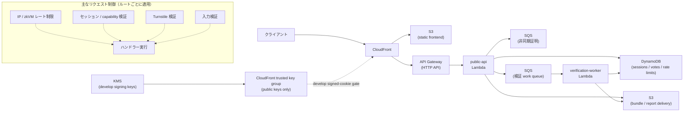
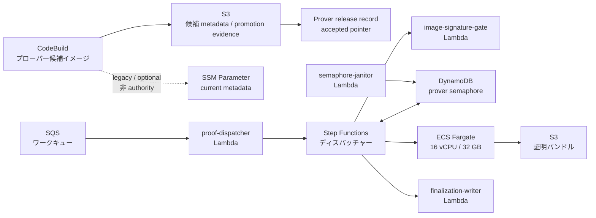
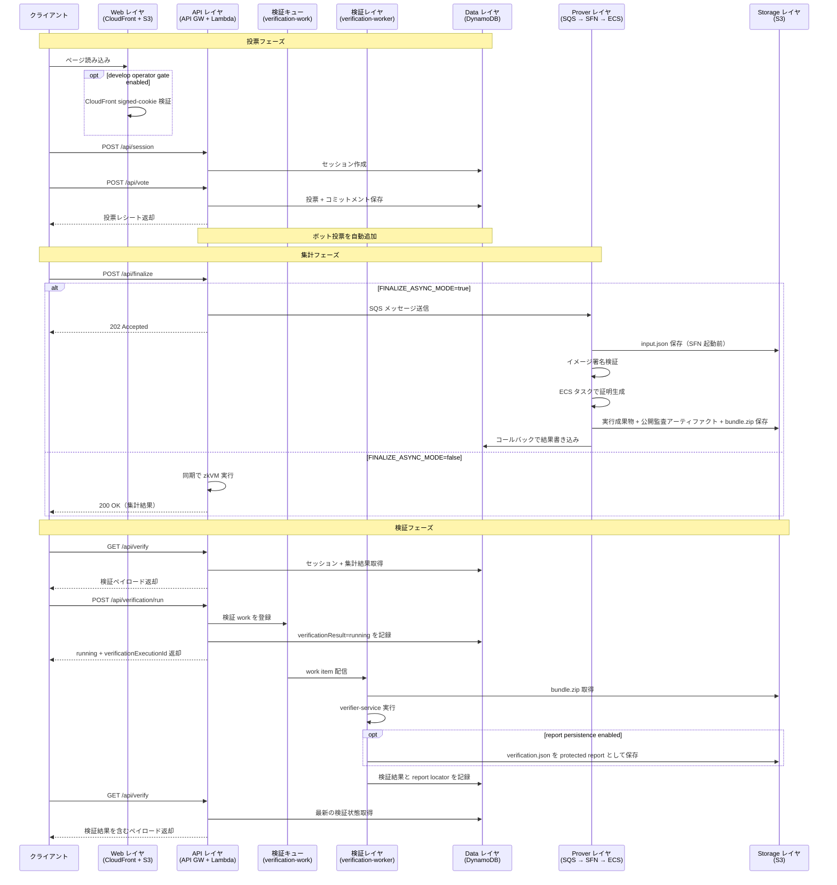
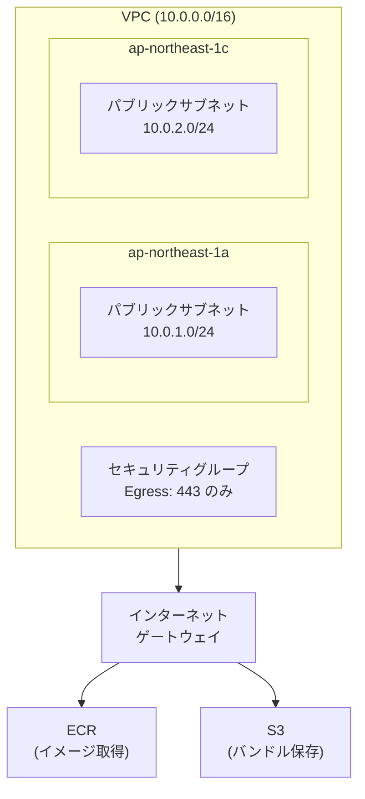

# トポロジー

AWS 上のサービス配置とコンポーネント間の通信経路を示します。
このページは runtime の責務分担を説明します（個別環境の導入進捗は扱いません）。

本システムは 6 つの論理レイヤ（Web、API、Data、Prover、Verification、Storage）で構成されます。

## レイヤ別トポロジー

### Web レイヤ

CloudFront が private S3 origin の Vite/React 静的アセットを配信します。
`/api/*` は同じ CloudFront distribution から API Gateway origin に routing されます。
extensionless browser route は viewer-request fallback で `index.html` に解決します。

develop で operator gate が有効な場合、static frontend、browser route、`/api`、`/api/*` の viewer access は CloudFront signed cookie を要求します。
信頼する public key group は、追跡対象 keyset に従って Terraform が管理する非対称 KMS signing key から public key を導出して構成します。
KMS の private signing material は CloudFront、app runtime role、Terraform state には渡しません。
この gate は develop 固有の条件付き境界であり、すべての環境に一律適用されるものではありません。

### API レイヤ

API Gateway（HTTP API）が `/api/*` パスパターンのリクエストを受け取り、単一の Lambda 関数（`public-api`）にプロキシします。
`public-api` は Hono route inventory を実行する runtime adapter で、ルーティング、セッション管理、Turnstile 検証、レート制限を処理します。
下図の「主なリクエスト制御」は、`public-api` がルートごとに適用有無と順序を切り替える代表的な要素を示します。
固定順のパイプラインではありません。

CORS 設定では `X-Session-ID` と `X-Session-Capability` ヘッダーを許可します。
これにより、セッションスコープと capability トークンによるリクエスト制御を実現しています。
`POST /api/verification/run` は、target runtime では検証 work を `verification-work` キューへ登録し、HTTP 応答では `running` と `verificationExecutionId` を返します。
実際の STARK レシート検証と protected report の保存は `verification-worker` の責務です。
後述の[エンドツーエンドのデータフロー](#エンドツーエンドのデータフロー)も参照してください。

### Data レイヤ

DynamoDB が、セッション、投票、集計結果、レート制限状態の永続化を担当します。
データプレーンは target Lambda IAM role ごとの最小権限で制限され、ブラウザから DynamoDB へ直接アクセスする経路はありません。

通常時は Terraform-owned primary sessions / votes table pair を参照します。
DynamoDB recovery は `primary_active`、`primary_quiesced`、`replacement_quiesced`、`replacement_active` の 4 phase で、`replacement_*` phase では検証済み recovery manifest が指定する replacement pair に参照先を切り替えます。
`*_quiesced` phase では新規 session admission と prover / verification queue の event-source mapping を無効化し、切替中の新規処理を fail-closed に停止します。

主要なデータモデルは以下の 2 つです（集計結果は `VotingSession.finalizationResultJson` に格納）。

| モデル        | キー/識別子             | 主要フィールド                                                         | TTL         |
| ------------- | ----------------------- | ---------------------------------------------------------------------- | ----------- |
| VotingSession | `sessionId`             | electionId, botCount, finalized, userVoteIndex, finalizationResultJson | `expiresAt` |
| Vote          | `sessionId + voteIndex` | choice, random, commitment, rootAtCast, isUserVote                     | `expiresAt` |

レート制限用に 2 つの追加テーブル（RateLimitEvents、RateLimitCounters）が PAY_PER_REQUEST モードで運用されています。
これとは別に、同時実行数を制御する prover semaphore table も DynamoDB 上で管理します。

### Prover レイヤ

STARK 証明の生成を担当するレイヤです。
SQS キュー、Step Functions ステートマシン、ECS Fargate タスクで構成されます。
詳細は [非同期プローバー](async-prover.md) を参照してください。

ECS タスクは ARM64 アーキテクチャの Fargate で実行され、専用の VPC（10.0.0.0/16）内のパブリックサブネットに配置されます（セキュリティグループの設定は [ネットワーク構成](#ネットワーク構成) を参照）。
Step Functions は DynamoDB の semaphore row で prover slot を取得・解放し、`semaphore-janitor` は terminal execution event と定期 sweep から stale slot を回収します。

### Verification レイヤ

STARK レシート検証を担当するレイヤです。
`public-api` は session capability、finalization state、bundle locator、Image ID を確認したうえで検証 work を SQS に登録します。
`verification-worker` は work item に含まれる `sessionId`、`executionId`、S3 bundle locator、expected Image ID を使って private S3 bucket から `bundle.zip` を取得します。
その後、`verifier-service` で `Receipt::verify(expectedImageId)` を実行します。

検証結果は protected report artifact（`verification.json`）として保存されます。
`verification.json` は public `bundle.zip` の構成要素ではなく、通常のブラウザ / CLI 取得は capability 保護 API の report endpoint が担当します。

### Storage レイヤ

S3 バケットが、証明バンドルに含まれる配布対象アーティファクトと非公開ワーク入力の保存を担当します。
Target Terraform はこれに加えて、プローバーイメージ候補の metadata、promotion evidence、release record / accepted pointer 用の非公開 S3 storage を管理します。
旧 Terraform には候補 metadata 参照用の SSM current pointer がありましたが、これは target bootstrap/foundation/app topology の release authority ではありません。
実行対象は選択された app deployment record から渡される digest 固定 prover image URI で決まります。

| 項目               | 設定                                                                                     |
| ------------------ | ---------------------------------------------------------------------------------------- |
| バケット命名       | `stark-ballot-simulator-{account-alias}-{environment}-proof-artifacts`                   |
| 暗号化             | AES256（サーバーサイド暗号化）                                                           |
| パブリックアクセス | 全ブロック                                                                               |
| ライフサイクル     | `proof_artifact_lifecycle_days` 日（既定 7 日）で current / noncurrent object を自動削除 |
| バージョニング     | Enabled                                                                                  |

プローバー release metadata / evidence は foundation 側の versioned manifest storage に保存します。
CodeBuild からの publish 仕様、legacy/optional SSM current pointer の非 authority 境界、digest 固定 runtime input の関係は [イメージ署名 > ビルドと署名の概念](image-signing.md#ビルドと署名の概念) を参照してください。

証明バンドル側のオブジェクトパスは既定で `sessions/{sessionId}/{executionId}/` 配下です。
target runtime では `S3_PROOF_PREFIX=sessions/` が Terraform と runtime validation の契約です。
この prefix を変更するには、`public-api`、`verification-worker`、`proof-dispatcher`、`finalization-writer`、CLI/report delivery の S3 policy と artifact lookup を同時に変更する必要があります。
影響範囲は [非同期プローバー > Dispatch 処理](async-prover.md#dispatch-処理) を参照してください。

| ファイル                 | 区分       | 説明                                                                                                                               |
| ------------------------ | ---------- | ---------------------------------------------------------------------------------------------------------------------------------- |
| `input.json`             | 保護       | zkVM への完全な入力（プライベートウィットネス）                                                                                    |
| `*-receipt.json`         | 中間データ | zkVM host の生出力。`bundle.zip` 内の `receipt.json` の元データ                                                                    |
| `*-output.json`          | 中間データ | zkVM host の生出力（集計結果）。`bundle.zip` 内の `journal.json` の元データ                                                        |
| `public-input.json`      | 配布対象   | zkVM 検証に使う、秘密データを含まない検証用レコード                                                                                |
| `election-manifest.json` | 配布対象   | 選挙設定の公開監査用スナップショット                                                                                               |
| `close-statement.json`   | 配布対象   | 集計締切時点のログ境界を表す公開監査レコード                                                                                       |
| `included-bitmap.json`   | 保護       | 厳密な counted bitmap。`bundle.zip` 外の sibling object として保持                                                                 |
| `seen-bitmap.json`       | 保護       | 厳密な presented bitmap。`bundle.zip` 外の sibling object として保持                                                               |
| `bundle.zip`             | 配布対象   | `receipt.json` + `journal.json` + `public-input.json` + `election-manifest.json` + `close-statement.json` を同梱した配布アーカイブ |
| `verification.json`      | 保護       | 検証サービスの出力で、`POST /api/verification/run` 後に protected report artifact として追加されうる。`bundle.zip` には含めない    |

「区分」は機密性の扱いを示すものです。
詳細は [バンドル構造](../verification/bundle-structure.md) を参照してください。

## エンドツーエンドのデータフロー

投票から検証までのデータフローを、レイヤ間の通信として示します。
以下は `primary_active` または `replacement_active` の非 quiesced phase における処理です。
`*_quiesced` phase では、この図に含まれる新規 session admission と prover / verification queue consumption は利用できません。
図では API request ごとの CloudFront hop を省略していますが、develop operator gate が有効な場合は frontend と API の両方で viewer request の signed cookie を検証します。

`verification-worker` は `bundle.zip` を検証入力として読み取ります。
検証レポートを保存できた場合は、report locator を finalization state に反映します。
report 保存に失敗した場合でも、既存の `s3BundleKey` は維持されるため bundle 配信元は失われません。
report と bitmap sibling object の扱いは [バンドル構造](../verification/bundle-structure.md) を参照してください。

## ネットワーク構成

### VPC

Terraform が管理する VPC は、ECS Fargate タスク専用です。
API Gateway、target Lambdas、DynamoDB、S3、CloudFront は VPC 外の managed service boundary で動作します。

ECS タスクはパブリック IP を持ちますが、セキュリティグループがインバウンドを全拒否するため、外部からのアクセスはできません。
アウトバウンドは HTTPS（ポート 443）のみ許可され、ECR からのイメージ取得、S3 へのアップロード、CloudWatch Logs などの AWS API 通信に使用されます。

## 監視とロギング

### 主な CloudWatch ログ群

| ログ群                                                                        | 対象                     | 保持期間 |
| ----------------------------------------------------------------------------- | ------------------------ | -------- |
| `/aws/ecs/{project}-{account-alias}-{environment}-prover`                     | ECS Fargate タスク       | 30 日    |
| `/aws/vendedlogs/states/{project}-{account-alias}-{environment}-finalization` | Step Functions 実行      | 30 日    |
| `/aws/lambda/{project}-{account-alias}-{environment}-public-api`              | API Lambda               | 30 日    |
| `/aws/lambda/{project}-{account-alias}-{environment}-proof-dispatcher`        | proof dispatch Lambda    | 30 日    |
| `/aws/lambda/{project}-{account-alias}-{environment}-finalization-writer`     | finalization writer      | 30 日    |
| `/aws/lambda/{project}-{account-alias}-{environment}-verification-worker`     | verification worker      | 30 日    |
| `/aws/lambda/{project}-{account-alias}-{environment}-image-signature-gate`    | イメージ署名検証 Lambda  | 30 日    |
| `/aws/lambda/{project}-{account-alias}-{environment}-semaphore-janitor`       | prover semaphore janitor | 30 日    |
| `/aws/apigateway/{project}-{account-alias}-{environment}-api/access`          | API Gateway アクセスログ | 30 日    |

ロググループ名は Terraform-managed physical names と component suffix に揃えます。
deployment pipeline の CodeBuild log group は bootstrap root の管理対象で、app pipeline は既定 180 日、foundation pipeline は既定 365 日保持します。
旧構成の残存ロググループや旧 standalone prover/toolchain CodeBuild log group は、この topology の runtime authority に含めません。

### CloudTrail

CloudTrail は current target app/bootstrap/foundation Terraform runtime の構成要素ではなく、account-plane または organization-level の監査証跡として別途管理される場合があります。
旧 Terraform の multi-region CloudTrail（main 環境のみ、90 日保持）も同様に runtime authority には含めません。

## 関連する章

- [現行構成とサービス一覧](design-and-services.md)：サービスごとの責務一覧
- [非同期プローバー](async-prover.md)：Prover レイヤの実行時フロー
- [バンドル構造](../verification/bundle-structure.md)：Storage レイヤの artifact 境界

<!-- source: infra/terraform/app, infra/terraform/bootstrap, infra/lambdas/, infra/docker/entrypoint.sh, packages/verification/src/verification/verification-bundle.ts -->
