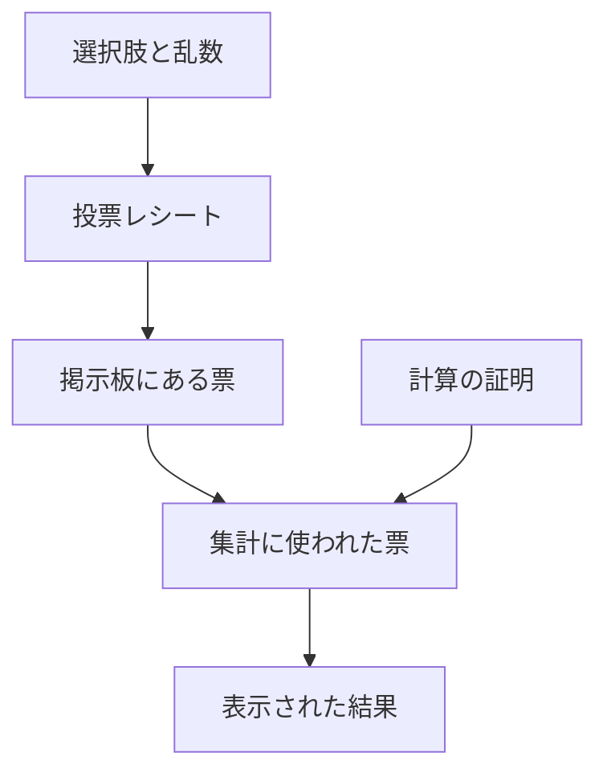

# システム概要

STARK Ballot Simulator は、投票内容とレシートの一致、掲示板の記録、集計の完全性、STARK レシートを四段階で検証します。票の受付、記録、集計、表示の各処理で起こり得る取り違えや改ざんを、それぞれの証拠から検査します。

## 検証対象

| 段階                | 検証内容                                                                   |
| ------------------- | -------------------------------------------------------------------------- |
| Cast-as-Intended    | 選択肢・乱数から再計算したコミットメントと投票レシートの一致               |
| Recorded-as-Cast    | 投票時の掲示板への包含と、その後の追記でも記録が保持されていること         |
| Counted-as-Recorded | 全 64 位置の採用、自票の採用、公開入力との対応、表示集計と証明の出力の一致 |
| STARK Verification  | 期待する集計プログラムの実行と、レシート内の公開出力の結び付き             |

全体を Verified と判定するには、四段階にわたる必須チェックがすべて成功する必要があります。STARK レシートの成功が示すのは、そのうち計算の証明に関する検証結果です。[4 段階検証モデル](verification/four-stage-model.md)で各段階の条件を定義します。

## 証拠間の照合

各証拠は、同じ選挙と集計に対応している必要があります。選挙の識別子、掲示板のルート、入力を要約するハッシュなどを照合し、別の選挙や集計の証拠の混在を検出します。

[入力コミットメント](protocol/input-commitment.md) は、証明に使った入力と公開した入力の対応を検証します。例えば、証明生成時の入力から一票を除外し、公開入力には全票を含めた場合、公開入力だけの検査ではこの違いを検出できません。証明に結び付いたコミットメントとの照合が必要です。

## 検証の実行主体

ブラウザは投票時の選択肢と乱数を保持し、投票レシートとの対応を検証します。サーバーは掲示板や集計に関するチェックを行い、Rust の検証サービスが STARK レシートを暗号検証します。ブラウザはこのサーバー側の検証結果とローカルの検証結果を合わせ、最終表示を決めます。

サーバーから独立して STARK レシートを検証する場合は、ダウンロードした ZIP と期待するプログラムの識別子（Image ID）を使い、検証サービスをローカルで実行します。

また、掲示板のハッシュが一致していることと、運営者が全員に同じ掲示板を見せていることは別の問題です。独立した観測先と照合する仕組みと、その観測先を用意する条件は [STH ダイジェスト](protocol/sth-digest.md) で説明します。
