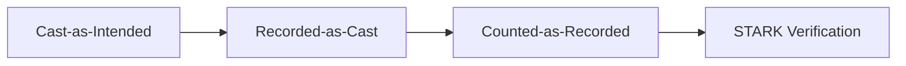
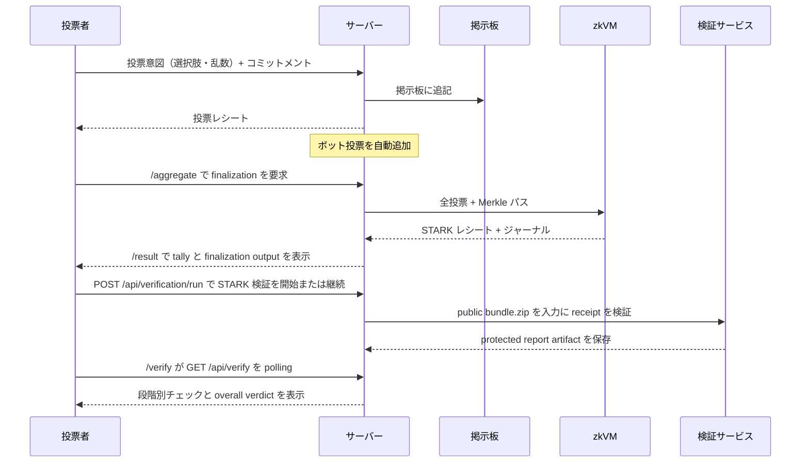

# 全体像

`STARK Ballot Simulator` は、投票の完全性を段階的に検証するための PoC です。
AWS runtime は個人プロジェクトとして運用できるよう、WAF を採用せず、artifact lifecycle やオンデマンド実行を前提にコストを抑える設計です。

## 投票から検証までの流れ

`finalization` は集計結果、zkVM ジャーナル、STARK レシート、配布用バンドルを作る段階です。
STARK receipt verification は常に finalization と同時に完了するわけではありません。
図のとおり、`/result` と `/verify` が `POST /api/verification/run` で STARK 検証を開始し、`GET /api/verify` を polling して検証レポートと各チェック結果を表示します。

API payload の `verificationStatus` は STARK receipt verification の状態です。
これは overall verdict ではありません。
最終的な「Verified / 失敗 / 制限付き」などの表示は、Cast-as-Intended、Recorded-as-Cast、Counted-as-Recorded、STARK Verification の必須チェックをまとめて評価した結果から導かれます。

## 検証で扱う要素

| 段階                | 主な証拠                                    |
| ------------------- | ------------------------------------------- |
| Cast-as-Intended    | 投票コミットメントと投票レシート            |
| Recorded-as-Cast    | RFC 6962 / CT スタイルの掲示板              |
| Counted-as-Recorded | zkVM ジャーナル、入力整合、ビットマップ証明 |
| STARK Verification  | RISC Zero レシート検証                      |

## バンドル用語の階層

検証で扱うアーティファクト群は、`証明バンドル ⊃ 配布対象アーカイブ ⊃ bundle.zip（ファイル）` の 3 層で呼び分けます。
定義は [用語集 > 証明バンドル](appendix/glossary.md#証明バンドルproof-bundle)、詳細は [バンドル構造](verification/bundle-structure.md) を参照してください。
`verification.json` は `bundle.zip` のメンバーではなく、capability 保護された report artifact として扱います。

## プロジェクト規模

概算です（2026-07-07 時点、現在の worktree ベース、生成物を除く、千行単位に丸め）。

| 区分                                        | 行数              |
| ------------------------------------------- | ----------------- |
| TypeScript / React（アプリ本体）            | 約 58,000 行      |
| TypeScript（テストコード）                  | 約 70,000 行      |
| Rust（zkVM ゲスト + ホスト + 検証サービス） | 約 8,000 行       |
| Terraform / Shell / 補助スクリプト          | 約 57,000 行      |
| **合計**                                    | **約 193,000 行** |

## 各章への案内

| 部                                           | 内容                                                                                          |
| -------------------------------------------- | --------------------------------------------------------------------------------------------- |
| [暗号プロトコル](protocol/index.md)          | コミットメント、掲示板 (CT Merkle)、入力コミットメント、STH ダイジェスト、ビットマップ Merkle |
| [zkVM 設計](zkvm/index.md)                   | ゲストプログラム、ホスト、証明生成、検証サービス、Image ID                                    |
| [検証パイプライン](verification/index.md)    | 4 段階モデル、チェック一覧、バンドル構造、ゲーティングロジック                                |
| [改ざんシナリオ](tamper/index.md)            | S0〜S5 シナリオ、検出メカニズム                                                               |
| [品質保証と形式手法](quality/index.md)       | 単体、結合、E2E、Property-based Testing、Lean による形式化                                    |
| [AWS アーキテクチャ](aws/index.md)           | トポロジー、非同期プローバー、イメージ署名、Terraform                                         |
| [API リファレンス](api/index.md)             | エンドポイント一覧、セッションライフサイクル                                                  |
| [第三者検証ガイド](reproducibility/index.md) | 検証ページで取得した `bundle.zip` を使う Ubuntu 向けローカル検証手順                          |
| [設計判断](decisions/index.md)               | PoC の意図的な制約、設計ふりかえり                                                            |
