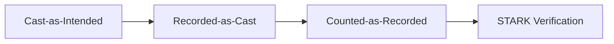
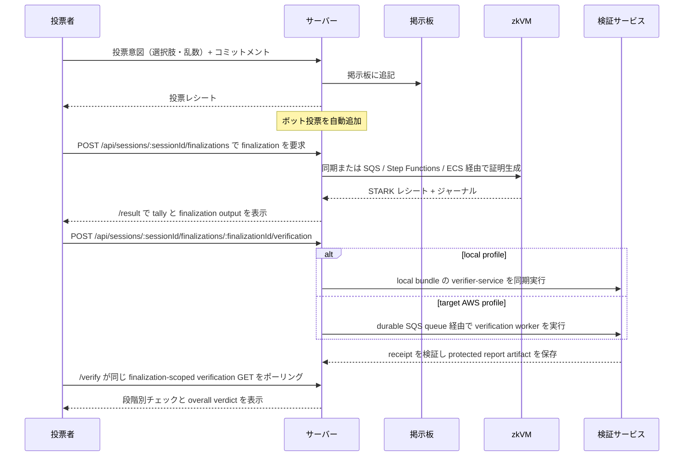

# 全体像

`STARK Ballot Simulator` は、投票の完全性を段階的に検証するための PoC です。
AWS runtime は個人プロジェクトとして運用できるよう、WAF を採用せず、artifact lifecycle やオンデマンド実行を前提にコストを抑える設計です。

## 投票から検証までの流れ

図から読み取れない要点は次の 3 点です。

- finalization と STARK receipt verification は別の lifecycle です。finalization は集計結果、zkVM ジャーナル、STARK レシート、配布用バンドルを作る段階であり、STARK receipt verification が常に同時に完了するわけではありません。
- 実行形態は profile で分かれます。ローカル構成は finalization と `verifier-service` を同期実行できますが、AWS target runtime は finalization を SQS、Step Functions、ECS Fargate で非同期実行し、STARK receipt verification は durable SQS queue 経由の verification worker が担います。非同期のあいだ、ブラウザは `GET /api/sessions/:sessionId/finalizations/current` と finalization-scoped verification GET をポーリングします。
- verification POST 応答の `verificationStatus` と、available な verification GET resource の `verifierResult.status` は STARK receipt verification の状態であり、どちらも overall verdict ではありません。ブラウザはローカルの Cast-as-Intended 証拠を server checks に重ね、共有 presentation policy が 4 段階の必須チェックと hard-failure 条件を評価して、最終的な「Verified / 失敗 / 制限付き」などの表示を導きます。

## 検証で扱う要素

| 段階                | 主な証拠                                    |
| ------------------- | ------------------------------------------- |
| Cast-as-Intended    | 投票コミットメントと投票レシート            |
| Recorded-as-Cast    | RFC 6962 / CT スタイルの掲示板              |
| Counted-as-Recorded | zkVM ジャーナル、入力整合、ビットマップ証明 |
| STARK Verification  | RISC Zero レシート検証                      |

各段階の目的、必要な証拠、失敗モードは [4 段階検証モデル](verification/four-stage-model.md) を参照してください。

## バンドル用語の階層

検証で扱うアーティファクト群は、`証明バンドル ⊃ 配布対象アーカイブ ⊃ bundle.zip（ファイル）` の 3 層で呼び分けます。
定義は [用語集 > 証明バンドル](appendix/glossary.md#証明バンドルproof-bundle)、詳細は [バンドル構造](verification/bundle-structure.md) を参照してください。
`verification.json` は `bundle.zip` のメンバーではなく、capability 保護された report artifact として扱います。

## PoC として受け入れている制約

次の制約は、検証可能投票の E2E フローを明瞭に示すための意図的な PoC
スコープです。実装漏れでも、本番選挙システムとしての安全性・性能の主張でも
ありません。正確な定数や mode 条件は各技術章を単一の参照先とします。

| 制約                     | 現行スコープ                                                                                      | 技術上の参照先                                                                                       |
| ------------------------ | ------------------------------------------------------------------------------------------------- | ---------------------------------------------------------------------------------------------------- |
| 固定されたデモ選挙 shape | 選択肢、ユーザー/ボット構成、期待票数、Merkle tree depth を固定して E2E を再現する                | [ホストと証明生成 > 現行 PoC の選挙 shape](zkvm/host-and-proving.md#現行-poc-の選挙-shape)           |
| bitmap chunk の開示      | 自票の proof が同じ chunk 内の counted / seen 状態も開示する                                      | [ビットマップ Merkle > プライバシーに関する注意](protocol/bitmap-merkle.md#プライバシーに関する注意) |
| 証明実行の resource/mode | target は CPU Fargate の非同期 production proof、local/test は目的別 profile による同期実行を使う | [非同期プローバー > 実行リソースと mode 境界](aws/async-prover.md#実行リソースと-mode-境界)          |

## プロジェクト規模

コードベースの規模は、テストを含め約 33 万行です。内訳は次のとおりです（2026 年 8 月時点）。

| 区分                                        | 行数              |
| ------------------------------------------- | ----------------- |
| TypeScript / React（アプリ本体）            | 約 66,000 行      |
| TypeScript（テストコード）                  | 約 154,000 行     |
| Rust（zkVM ゲスト + ホスト + 検証サービス） | 約 8,000 行       |
| Terraform / Shell / 補助スクリプト          | 約 99,000 行      |
| **上記 4 区分の合計**                       | **約 327,000 行** |

## 各章への案内

| 部                                                            | 内容                                                                                          |
| ------------------------------------------------------------- | --------------------------------------------------------------------------------------------- |
| [暗号プロトコル](protocol/index.md)                           | コミットメント、掲示板 (CT Merkle)、入力コミットメント、STH ダイジェスト、ビットマップ Merkle |
| [zkVM 設計](zkvm/index.md)                                    | ゲストプログラム、ホスト、証明生成、検証サービス、Image ID                                    |
| [検証パイプライン](verification/index.md)                     | 4 段階モデル、チェック一覧、バンドル構造、ゲーティングロジック                                |
| [改ざんシナリオ](tamper/index.md)                             | S0〜S5 シナリオ、検出メカニズム                                                               |
| [品質保証と形式手法](quality/index.md)                        | 単体、結合、E2E、Property-based Testing、Lean による形式化                                    |
| [AWS アーキテクチャ](aws/index.md)                            | トポロジー、非同期プローバー、可観測性、operator gate、DynamoDB recovery、Terraform           |
| [API リファレンス](api/index.md)                              | エンドポイント一覧、セッションライフサイクル                                                  |
| [第三者検証ガイド](reproducibility/index.md)                  | 検証ページで取得した `bundle.zip` を使う Ubuntu 向けローカル検証手順                          |
| [PoC として受け入れている制約](#poc-として受け入れている制約) | 固定デモ shape、bitmap 開示、証明実行 mode のスコープ                                         |
