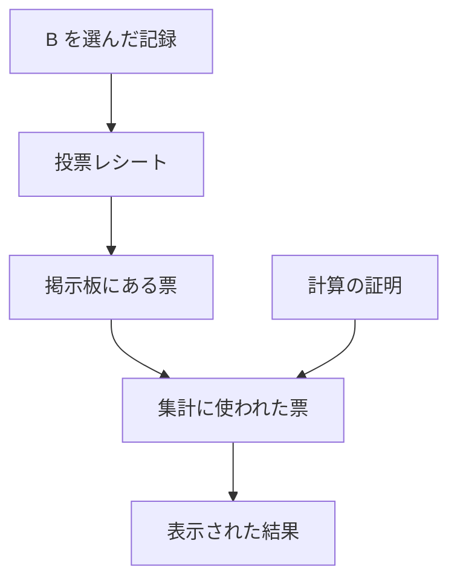

# 一票を結果までつなぐ

B に入れた一票が集計に含まれたと言うためには、何を確かめればよいでしょうか。票の受け取り、記録、集計、表示の間には、それぞれ別の取り違えや改ざんの余地があります。

## 四つの問い

| 問い                       | 確かめること                                                         |
| -------------------------- | -------------------------------------------------------------------- |
| 意図した票を送ったか       | 選択した B と、返ってきた投票レシートが対応する                      |
| 送った票が記録されたか     | 自分の票が掲示板に載り、その後の追記でも残っている                   |
| 記録された票が数えられたか | 全 64 位置が集計に採用され、自分の票の採用と表示結果の一致も確認する |
| 約束した計算が実行されたか | 期待する集計プログラムが、証明に結び付いた結果を出した               |

それぞれの答えを支える証拠を、投票から結果までつなぎます。最後の計算の証明だけでは、最初の三つの答えは得られません。

## 同じ一票を見ていることが大切

一つひとつの証拠が正しくても、別の選挙や別の集計の証拠を混ぜてしまえば、B の一票を確認したことにはなりません。そこで選挙の識別子、掲示板のルート、入力を要約するハッシュなどを照合し、証拠同士を結び付けます。

たとえば、サーバーが証明を作るときだけ一票を抜き、ダウンロード用の入力には全票を載せたとします。公開入力がもっともらしく見えるだけでは、この違いに気付けません。[入力コミットメント](protocol/input-commitment.md) は、証明に使った入力と公開した入力が対応するかを確かめるための仕組みです。

## 誰が何を確かめるか

ブラウザは投票時の選択と乱数を保持し、返されたレシートとの対応を確かめます。サーバーは掲示板や集計に関するチェックを行い、Rust の検証サービスが STARK レシートを検証します。ブラウザはその結果と自分の確認結果を合わせ、最終表示を決めます。

ブラウザ自身が STARK レシートを暗号検証する構成ではないため、通常の画面ではサーバーの検証結果を受け取ります。この部分を独立に確かめたいときは、ダウンロードした ZIP と期待するプログラムの識別子（Image ID） を使って、検証サービスを手元で実行できます。

また、掲示板のハッシュが一致していることと、運営者が全員に同じ掲示板を見せていることは別の問題です。独立した観測先と照合する仕組みと、その観測先を用意する条件は [STH ダイジェスト](protocol/sth-digest.md) で説明します。
