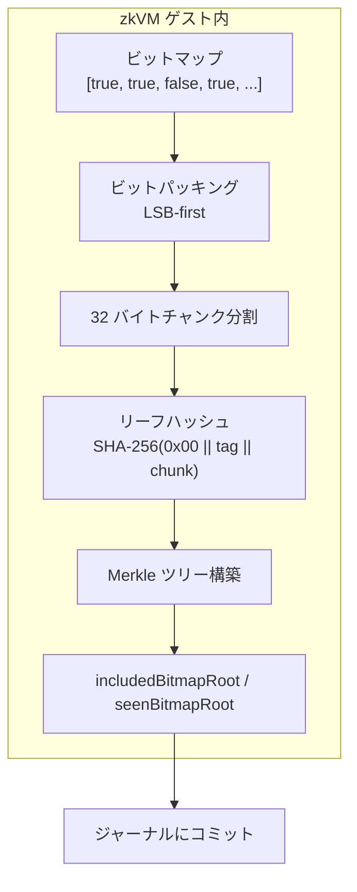
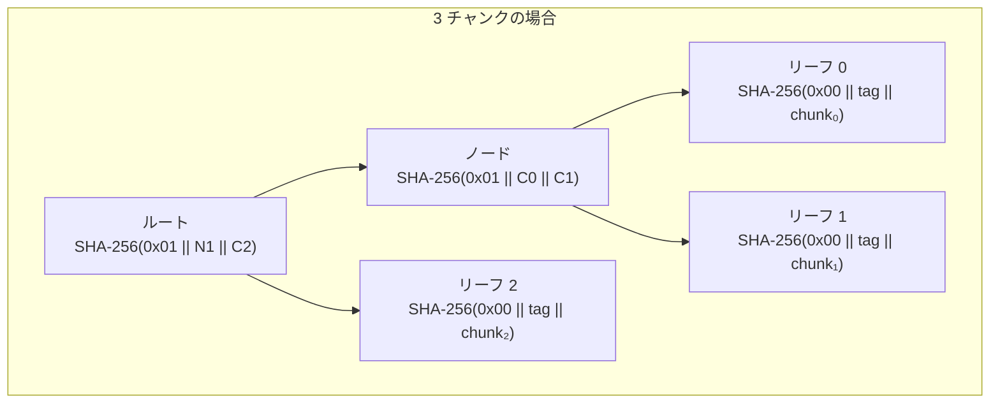
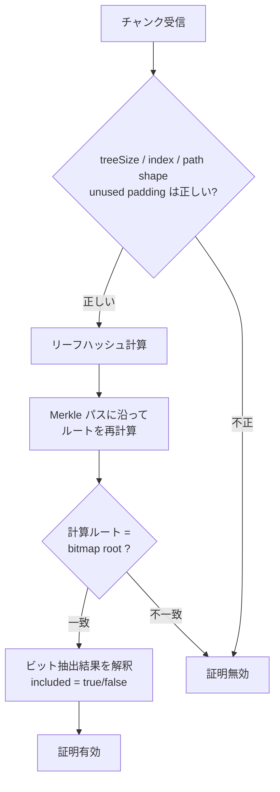

# ビットマップ Merkle

自票が集計に含まれたかを Merkle 証明で開示するためのビットマップツリーを扱う章です。

zkVM ゲスト内で計算されるビットマップにより、各投票インデックスが集計に含まれたかどうかを個別に検証可能にします。
Merkle 証明により、自票が含まれていることをサーバーを信頼せずに確認できます。

## 概要

Counted-as-Recorded 段階の検証では、zkVM に提示された入力に対する集計の正しさは STARK 証明で保証されますが、個々の投票者にとって「自票が集計に含まれたか」を直接確認する手段が別途必要です。

ビットマップ Merkle ツリーは、この「個別のカウント証明」を提供します。
zkVM ゲストは投票ごとの状態をビットマップとしてエンコードし、その Merkle ルートをジャーナルにコミットします。
投票者は自分のインデックスに対応するビットの Merkle 証明を取得し、「自票がカウントされたか」「そもそも prover に提示されたか」を独立に検証できます。



## ビットマップの構造

### ビットマップの定義

ビットマップは、ツリーサイズ（投票数）と同じ長さのブール配列です。
現行実装では同じエンコーディング規則を持つ 2 種類のビットマップを扱います。

- `includedBitmap[i] = true`: インデックス i の投票が正常に検証され、集計に含まれた
- `includedBitmap[i] = false`: インデックス i の投票が除外された
- `seenBitmap[i] = true`: インデックス i の投票が prover に提示された
- `seenBitmap[i] = false`: インデックス i の投票が prover に提示されなかった

本 PoC では 64 票を扱うため、ビットマップは 64 ビット（= 8 バイト）です。

### LSB-first ビットパッキング

ブール配列は LSB-first（Least Significant Bit first）方式でバイト列にパッキングされます。

```text
ビット配列: [b₀, b₁, b₂, b₃, b₄, b₅, b₆, b₇, b₈, ...]

バイト 0 = b₀ | (b₁ << 1) | (b₂ << 2) | ... | (b₇ << 7)
バイト 1 = b₈ | (b₉ << 1) | ...
```

| ビット位置 | バイトインデックス | バイト内ビット位置 |
| ---------- | ------------------ | ------------------ |
| 0          | 0                  | 0 (LSB)            |
| 1          | 0                  | 1                  |
| 7          | 0                  | 7 (MSB)            |
| 8          | 1                  | 0 (LSB)            |
| 63         | 7                  | 7 (MSB)            |

64 ビットのビットマップは 8 バイトにパッキングされます。

### 32 バイトチャンク分割

パッキングされたバイト列は 32 バイト（256 ビット）単位のチャンクに分割されます。
各チャンクが Merkle ツリーの 1 つのリーフとなります。

- 1 チャンク = 32 バイト = 256 ビット分の投票カウント状態
- 最後のチャンクが 32 バイトに満たない場合はゼロパディング

本 PoC の 64 票は 8 バイトであるため、1 つのチャンク（24 バイトのゼロパディング付き）に収まります。

## Merkle ツリーの構築

### ハッシュ規則

ビットマップ Merkle ツリーは、CT Merkle ツリーと同一のハッシュ規則を使用します。

**リーフハッシュ**:

```text
LeafHash = SHA-256(0x00 || "stark-ballot:leaf|v1" || chunk)
```

**内部ノードハッシュ**:

```text
NodeHash = SHA-256(0x01 || left_hash || right_hash)
```

ドメイン分離プレフィックス（`0x00` / `0x01`）と使用タグ（`"stark-ballot:leaf|v1"`）は、[CT Merkle ツリー](ct-merkle.md)の章で解説したものと同一です。

### ツリー構築アルゴリズム

1. 各 32 バイトチャンクにリーフハッシュを適用
2. ボトムアップでペアを結合し、内部ノードハッシュを計算
3. 奇数ノードがある場合は、そのまま次のレベルに昇格（ハッシュなし）
4. ルートに到達するまで繰り返す



## Merkle 証明の生成と検証

### 証明の構造

`GET /api/sessions/:sessionId/finalizations/current/bitmap-proofs/:kind/:voteIndex`
は、現在の finalization に対する証明材料を返します。`kind` と `voteIndex` はどちらも必須の
path parameter です。成功時の標準 JSON envelope は次の形です。

```json
{
  "data": {
    "leafChunk": "...",
    "auditPath": []
  },
  "meta": {
    "requestId": "..."
  }
}
```

`data` は以下の要素で構成されます:

| フィールド | 説明                                                     |
| ---------- | -------------------------------------------------------- |
| leafChunk  | 対象ビットを含む 32 バイトチャンク（16 進数）            |
| auditPath  | ルートまでの兄弟ハッシュ配列（各要素にハッシュ値と位置） |

`leafIndex`（`floor(voteIndex / 256)`）と `bitOffset`（`voteIndex mod 256`）は、クライアント側で path の `voteIndex` から導出します。
サーバーは返しません。

- `kind=included`: `includedBitmapRoot` に対する証明を返す
- `kind=seen`: `seenBitmapRoot` に対する証明を返す

このエンドポイントは path のセッション ID と `X-Session-Capability` を必須とし、
`voteIndex` はそのセッションで cast した自票の index に限られます
（任意の近傍 index に対する proof oracle としては利用できません）。

### ビット抽出

投票者は受け取ったチャンクから、path で指定した `voteIndex` に対応する `bitIndex` のビットを以下の手順で抽出します:

```text
bit_offset  = bit_index mod 256
byte_index  = bit_offset / 8    (整数除算)
bit_in_byte = bit_offset mod 8

included = (chunk[byte_index] AND (1 << bit_in_byte)) != 0
```

`kind=included` で `included = true` なら、自票がカウントされたことを意味します。
`kind=seen` で `included = true` なら、自票が prover に提示されたことを意味します。

### 検証手順

1. ジャーナルの正の整数 `treeSize` と 32 バイトの対象 root を認証済み context として使い、
   `bitIndex` が `0 <= bitIndex < treeSize` を満たすことを確認
2. `leafIndex = floor(bitIndex / 256)`、`bitOffset = bitIndex mod 256`、
   `leafCount = ceil(treeSize / 256)` をクライアント側で導出
3. `leafChunk` が 32 バイト、各 sibling hash が 32 バイトであることに加え、
   `auditPath` の長さと `left` / `right` の並びが `leafIndex` と `leafCount` から
   一意に決まる tree shape と一致することを確認
4. 最終 chunk の `treeSize` より後ろにある未使用 bit がすべて 0 であることを確認
5. チャンクのリーフハッシュを計算: `SHA-256(0x00 || "stark-ballot:leaf|v1" || chunk)`
6. Merkle パス（`auditPath`）に沿ってルートまで再計算:
   - 兄弟の位置が `left` → `SHA-256(0x01 || sibling || current)`
   - 兄弟の位置が `right` → `SHA-256(0x01 || current || sibling)`
7. 計算されたルートが、`kind` に対応するジャーナル上のルートと一致するか確認
   - `kind=included` → `includedBitmapRoot`
   - `kind=seen` → `seenBitmapRoot`
8. 以上がすべて成功した場合にのみ、チャンクから抽出したビット値を個票の状態として解釈



## zkVM ゲストとの連携

ビットマップルートは zkVM ゲストプログラム内で計算され、ジャーナルにコミットされます。

ゲストプログラムは以下の手順を実行します:

1. 各投票に対してコミットメントの再計算と包含証明の検証を実施
2. prover に提示された投票インデックスを `seenBitmap` に記録
3. 検証に成功して集計対象になった投票インデックスを `includedBitmap` に記録
4. それぞれのビットマップを LSB-first でパッキングし、32 バイトチャンクに分割
5. CT スタイルのハッシュ規則で Merkle ルートを計算
6. `seenBitmapRoot` と `includedBitmapRoot` をジャーナルにコミット

この計算はゲスト内で行われるため、STARK 証明がビットマップの正しさも保証します。
サーバーが事後的にビットマップを改ざんしても、ジャーナルのルート値と一致しなくなるため検出されます。

## サーバーのビットマップデータ管理

現行 method 14 のジャーナルは `includedBitmapRoot` と `seenBitmapRoot` の両方を必須で
コミットします。full bitmap 自体はジャーナルの公開出力ではありません。production host は
admitted prover input から `includedBitmap` と `seenBitmap` を再構成し、guest output の root と
一致した場合に sidecar を出力します。finalization 時の保存・復元と bitmap-proof endpoint はさらに、
bitmap の長さが `treeSize` と一致し、再計算した root が保存 root とジャーナル root の両方に
一致した場合にのみ、その非公開 sidecar を採用します。
これらは配布対象アーカイブ `bundle.zip` には含まれません。
async finalize 経路では、必要に応じて S3 の sibling object から復元されます。

### 安全性ゲートと検証結果の分岐

採用前と採用後で、`counted_my_vote_included` の判定が次の 2 つに分岐します。

- **採用前に弾かれる、または証明材料が取得できない** → `counted_my_vote_included` は `not_run`（証拠不足による [fail-closed](../appendix/glossary.md#fail-closed)）。
  例:
  - private bitmap sidecar が無い
  - 保存や復元時の root 一致ゲートで採用されなかった
  - cast-time 証跡（`voteReceipt` / `userVote.proof`）が store から再構成できず `voteReceipt.bulletinIndex` が確定しない
- **採用後にクライアント側の root 照合が失敗** → `counted_my_vote_included` は `failed`。
  サーバーが返した chunk と Merkle パスから再計算したルートが、ジャーナルの `includedBitmapRoot`（または `seenBitmapRoot`）と一致しない。

採用前ゲートおよび `counted_my_vote_included` の評価詳細は [チェック一覧 > `counted_my_vote_included`](../verification/checks-catalog.md#counted_my_vote_included) を参照してください。

## 検証パイプラインにおける役割

ビットマップ Merkle 証明は、Counted-as-Recorded 段階のチェックとして使用されます。

| チェック ID                | 検証内容                                                                         |
| -------------------------- | -------------------------------------------------------------------------------- |
| `counted_my_vote_included` | ビットマップ Merkle 証明により、自票のインデックスがカウントされたことを確認する |

対応する `seenBitmap` sidecar から生成した proof も取得・採用できた場合
（`seenBitmapRoot` はジャーナル必須。[前述](#サーバーのビットマップデータ管理)）、
このチェックは「prover に提示されたが無効化された」
と「そもそも提示されなかった」を区別して説明します。seen proof が取得または検証できない場合は、
included bit が false である理由を `unknown_excluded` として fail-closed に扱い、推測で分類しません。

各チェックの判定ロジックは [チェック一覧 > Counted-as-Recorded](../verification/checks-catalog.md#counted-as-recorded10-チェック) を参照してください。

## プライバシーに関する注意

ビットマップ Merkle 証明では、対象ビットを含む 32 バイトチャンク全体がクライアントに提供されます。
1 チャンクは 256 ビット分のカウント状態を含むため、近傍のインデックスのカウント状態が同時に開示されます。

本 PoC では 64 票が 1 チャンクに収まるため、チャンクを受け取った投票者は全 64 票のカウント状態を知ることができます。
この設計は、63 票がボットでありチャンク漏洩の情報価値が限定的である、という割り切りに基づきます。

開示範囲を狭めるには、chunk を小さくして Merkle tree を深くする方法があります。
一方で leaf 数、proof path、guest 内の hash 計算が増えるため、証明時間と artifact
サイズを再評価する必要があります。現行 PoC は 32 バイト chunk を維持し、この
緩和は実装していません。

LSB-first packing とビット境界の扱いは、[Property-based Testing](../quality/property-based-testing.md) で生成入力を使って境界条件を探索し、[Lean による形式化](../quality/lean-formalization.md) の bitmap vectors で抽象モデルとの対応を検査します。

<!-- source: packages/api-contract/src/routes/inventory.ts, packages/api-contract/src/schemas/artifacts.ts, packages/zkvm-contract/src/zkvm/bitmap.ts, packages/zkvm-contract/src/zkvm/types.ts, packages/verification/src/merkle/bitmap-merkle-tree.ts, packages/verification/src/verification/bitmap-verifier.ts, apps/api/src/server/api/handlers/bitmapProof.ts, packages/application/src/finalize/usecases/finalize-sync.ts, packages/aws-adapters/src/aws/bundle-restore.ts, zkvm/host/src/main.rs -->
