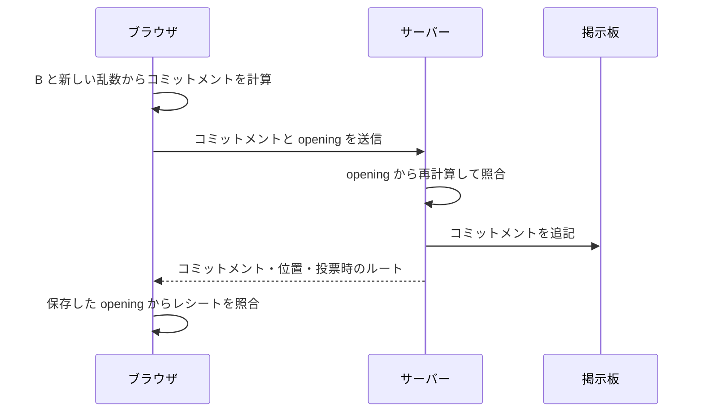

<a id="コミットメントスキーム"></a>

# 投票コミットメント

B に投票したことを後から確かめたい。しかし、掲示板に「B」とそのまま載せると選択肢が見えてしまいます。そこでブラウザは、選択肢 B、選挙 ID、投票ごとに生成する 32 バイトの乱数をまとめて SHA-256 に渡し、32 バイトの値を作ります。これが投票コミットメントです。

選択肢が五つしかないため、B だけをハッシュしても、A〜E を試せば元の選択肢が分かります。乱数は、この総当たりを困難にするために加えます。選択肢と乱数の組を **opening** と呼びます。同じ opening からは同じコミットメントを計算できるので、ブラウザはこれを保存し、後で投票レシートの値と照合します。

掲示板と公開 ZIP に載せるのはコミットメントで、opening は載せません。ただし、このデモの投票 API には opening も送信し、サーバーが集計に使います。ここで隠しているのは公開物を見る人に対する選択肢であり、運用者に対する選択肢ではありません。

## 投票時と集計時に同じ値を確かめる



集計時には、zkVM ゲストも opening から同じ計算を行います。さらに、そのコミットメントが掲示板に含まれることを確かめてから B の得票数に加えます。ブラウザは手元に保存した opening、ゲストはサーバーから渡された opening を使うため、両者の確認は異なる場所で行われます。

コミットメントの一致だけでは、掲示板に記録されたことは分かりません。レシートにある位置とルートを使った確認は、[CT Merkle ツリー](ct-merkle.md)が担います。

## コミットメントの正準フォーマット

文字列の連結方法が違えばハッシュも変わります。ブラウザの TypeScript とゲストの Rust が同じ値を得られるよう、ハッシュに渡すバイト列を次の形に固定します。

```text
commitment = SHA-256(
    UTF-8("stark-ballot:commit|v1.0")  // 24 バイト
    || election_id                    // UUID の 16 バイト
    || choice                         // 1 バイト
    || random                         // 32 バイト
)
```

| フィールド | 表現                                                      |
| ---------- | --------------------------------------------------------- |
| 選挙 ID    | UUID v4 のハイフンを除去し、16 進数を 16 バイトへデコード |
| 選択肢     | 符号なし 1 バイト。A=0、B=1、C=2、D=3、E=4                |
| 乱数       | 暗号学的に安全な乱数生成器で作る 32 バイト                |

入力は合計 73 バイト、出力は 32 バイトです。出力の 16 進数表記は 64 文字、`0x` を付けると 66 文字です。UUID や乱数を表示用文字列のままハッシュするのではありません。

## ドメイン分離

先頭の固定タグは、このバイト列が投票コミットメント用であることを区別します。同じ SHA-256 を使っていても、掲示板のノードや集計入力のハッシュと解釈が混ざらないようにするためです。

投票には `stark-ballot:commit|v1.0`、[入力コミットメント](input-commitment.md)には `stark-ballot:input|v1.0` を使います。掲示板のリーフには `0x00` と `stark-ballot:leaf|v1`、内部ノードには `0x01` を付けます。STH ダイジェストは専用タグを持たず、ログ ID を含む[固定フォーマット](sth-digest.md#ダイジェストフォーマット)で入力を区別します。

## 安全性

**秘匿性（hiding）**は、十分な乱数を秘密に保つことに依存します。投票ごとに新しい一様な 256 ビット乱数を生成し、再利用しません。同じ選挙で同じ選択肢と乱数を使うと、同じコミットメントになってしまいます。

**束縛性（binding）**は、一つのコミットメントについて、異なる選択肢に開く組を見つけることが困難であるという性質です。SHA-256 の衝突耐性が、異なる opening の組をあらかじめ作る攻撃に対する根拠になります。すでに固定された opening と同じ値になる別の opening を探す攻撃には、第二原像耐性が関わります。

この性質があっても、ブラウザ自体が改ざんされていれば手元の表示や保存内容は信頼できません。コミットメントが保証するのは、与えられた opening と記録の結び付きです。

## TypeScript と Rust の実装同期

両実装は、タグの UTF-8 バイト、UUID のデコード、選択肢の 1 バイト表現、乱数のデコードを一致させます。片側だけを変えると、正しい投票でも照合できなくなります。共有の入力例に対するバイト単位の一致をテストし、ブラウザ・サーバー・ゲストが同じ約束を使うことを確認します。

<!-- source: packages/zkvm-contract/src/zkvm/types.ts:computeCommitment, zkvm/contract-core/src/sha256.rs, zkvm/methods/guest/src/tally.rs, zkvm/host/src/main.rs, apps/api/src/server/api/handlers/vote.ts, packages/aws-adapters/src/store/ct-proof.ts, packages/application/src/finalize/usecases/user-vote-artifacts.ts -->
