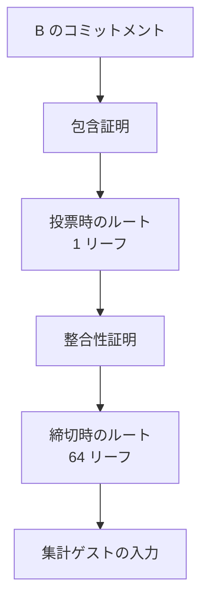

<a id="ct-merkle-ツリー"></a>

# 掲示板に票が残っていることを確かめる

投票レシートにあるコミットメントが、後から掲示板から消されていないかを確かめます。そのために、掲示板全体を短いハッシュ値にまとめます。これを**ルートハッシュ**と呼びます。記録の値や順序が変わればルートも変わるので、投票時のルートを保存しておくことに意味があります。

ただし、ルートを二つ見比べるだけでは足りません。票が追加されてもルートは変わるからです。必要なのは「自分の票が投票時の掲示板にある」という**包含証明**と、「その掲示板を残したまま末尾へ票を足した」という**整合性証明**です。

## 投票時の一票と、締切時の64票をつなぐ

B のコミットメントがインデックス 0 に記録された時点では、掲示板は 1 リーフです。このときのルートは、そのコミットメントのリーフハッシュそのものになります。投票レシートには、位置 `bulletinIndex=0` とルート `bulletinRootAtCast` が残ります。

その後、63 票のボット票が加わり、掲示板は 64 リーフになります。包含証明で最初のルートを確かめ、整合性証明で最初の 1 リーフが最後の 64 リーフの先頭に残っていることを確かめます。集計ゲストは、各票についてこの**最終ルート**への包含を検証します。投票時の包含証明と集計用の包含証明は、対象時点が違います。



これは記録の削除や書き換えを物理的に不可能にする仕組みではありません。保持したルートと証明を照合することで、変更を検出する仕組みです。サーバーが人ごとに別々の掲示板を見せる問題には、さらに [STH の照合](sth-digest.md)が必要です。

## RFC 6962 参照ハッシュ規則

Certificate Transparency（CT）は、証明書の記録を監査するための追記専用ログです。この掲示板は RFC 6962 のツリー分割と証明方式を参照し、投票コミットメントの記録に使います。

```text
LeafHash(data) = SHA-256(0x00 || UTF-8("stark-ballot:leaf|v1") || data)
NodeHash(left, right) = SHA-256(0x01 || left || right)
```

リーフのタグは 20 バイト、コミットメントの `data` は 32 バイトです。左右の子ハッシュもそれぞれ 32 バイトです。`0x00` と `0x01` を分けることで、リーフの内容を内部ノードの組として解釈させる混同を防ぎます。

本実装はリーフに独自タグを加え、後述する 1→2 の整合性証明にも固有の表現を使います。そのため、標準 CT の証明をそのまま交換できるという意味での RFC 6962 互換実装ではありません。

## Merkle Tree Hash（MTH）アルゴリズム

ツリーは順序付きのデータ列 `d₀, …, dₙ₋₁` から作ります。

```text
MTH({}) = SHA-256(空バイト列)
MTH({d₀}) = LeafHash(d₀)
MTH({d₀, ..., dₙ₋₁}) = NodeHash(
    MTH({d₀, ..., dₖ₋₁}), MTH({dₖ, ..., dₙ₋₁})
)
```

複数リーフの場合、`k` は `n` 未満で最大の 2 のべき乗です。たとえば 5 リーフなら 4 と 1、64 リーフなら 32 と 32 に分け、同じ規則を再帰的に適用します。最終的なデモは 64 票でも、追加途中の 3 票や 5 票に同じ規則を使えます。

## 掲示板のリーフデータ形式

掲示板はコミットメントを `0x` なし・小文字・64 文字の 16 進数に正規化し、ハッシュ計算にはデコードした 32 バイトを使います。各記録には 0 始まりの連番を割り当てます。同一の投票 ID やコミットメントの二重追記を拒否し、追記時点のルートをタイムスタンプとともに保持します。

## 包含証明（Inclusion Proof）

一つの票からルートまで計算するために、ツリー全体を渡す必要はありません。各分岐で相手側の部分木のハッシュだけを渡せば、自分の側と組み合わせて上へ進めます。この兄弟ハッシュの列が Merkle パスです。

### 構造

| API フィールド       | 意味                             |
| -------------------- | -------------------------------- |
| `leafIndex`          | 記録の 0 始まりの位置            |
| `merklePath`         | 下から上へ使う兄弟ハッシュの配列 |
| `treeSize`           | 証明が対象とするツリーの大きさ   |
| `bulletinRootAtCast` | 投票時点の照合先ルート           |

finalization の検証リソースの `voterEvidence.userVote.proof` と、個票の inclusion-proof API が、この投票時点の証拠を返します。

### PATH アルゴリズム

生成時は MTH と同じ位置 `k` で分割し、対象を含む側を再帰的にたどります。対象が左にあれば右部分木のハッシュ、右にあれば左部分木のハッシュをパスへ追加します。

検証時はリーフハッシュから始め、インデックスとツリーサイズで左右を決めてパスを折り畳み、期待ルートと比較します。64 リーフのツリーならパスは 6 ハッシュです。インデックス 0 の**投票時点**のツリーは 1 リーフなので、パスは空でも包含を確認できます。

Recorded-as-Cast では、ルート一致に加えて、`leafIndex = bulletinIndex` と `treeSize = bulletinIndex + 1` を要求します。別の位置や別の時点の正しい証明を渡されても、自票の投票時証拠としては使いません。

## 整合性証明（Consistency Proof）

整合性証明は、古い `m` リーフの列が、新しい `n` リーフの列の先頭に同じ順序・同じ値で残ることを、二つのルートに対して確認します。追加後もルートが同じであることを要求するわけではありません。

### 構造

| API フィールド                            | 意味                                   |
| ----------------------------------------- | -------------------------------------- |
| `fromTreeSize` / `toTreeSize`             | 古いサイズ `m` と新しいサイズ `n`      |
| `proofNodes`                              | 両方の状態のつながりを検証するノード列 |
| `rootAtFromTreeSize` / `rootAtToTreeSize` | 各サイズのルート                       |

検証 API は古いルートを投票レシートの `bulletinRootAtCast`、新しいルートを集計の `bulletinRoot` と照合します。証明と一緒に届いたルート同士が整合するだけでは不十分です。

### SUBPROOF アルゴリズム

MTH と同じ分割を使い、古いツリーに含まれる側を再帰的にたどります。`m <= k` なら左側の証明に右部分木のハッシュを加え、`m > k` なら右側の証明に左部分木のハッシュを加えます。再帰中に `m = n` となったとき、古いツリーの根をそのまま使える部分では空の証明、それ以外ではその部分木のルートを返します。

本実装の 1→2 の特殊ケースでは、2 番目のリーフのハッシュではなく、生の 32 バイトのリーフデータを返します。検証者は次を計算します。

```text
newRoot = SHA-256(0x01 || oldRoot || LeafHash(second_leaf))
```

この特殊ケースは、掲示板の整合性証明を生成・検証する TypeScript の実装で使います。ゲストが行う包含検査とは別の処理です。

## 検証パイプラインにおける役割

`recorded_inclusion_proof` と `recorded_consistency_proof` は、投票時の記録と最終掲示板をつなぎます。アプリではサーバーがこれらを評価してブラウザへ返しますが、ハッシュ計算と証明検証自体は、同じ証拠と期待ルートを持つ検証者が再実行できます。

集計ゲストが検証するのは、各入力票の**最終掲示板への包含**です。それに成功しても、サーバーが全票をゲストへ渡したことまでは分かりません。[ゲストのスロット集計](../zkvm/guest-program.md#スロット--レコード分離モデル)が、その不足を数えます。

<!-- source: packages/merkle/src/rfc6962-merkle-tree.ts, packages/domain/src/lib/bulletin/simple-bulletin-board.ts, packages/verification/src/verification/verification-checks.ts, zkvm/methods/guest/src/tally.rs, zkvm/contract-core/src/inclusion_proof.rs -->
