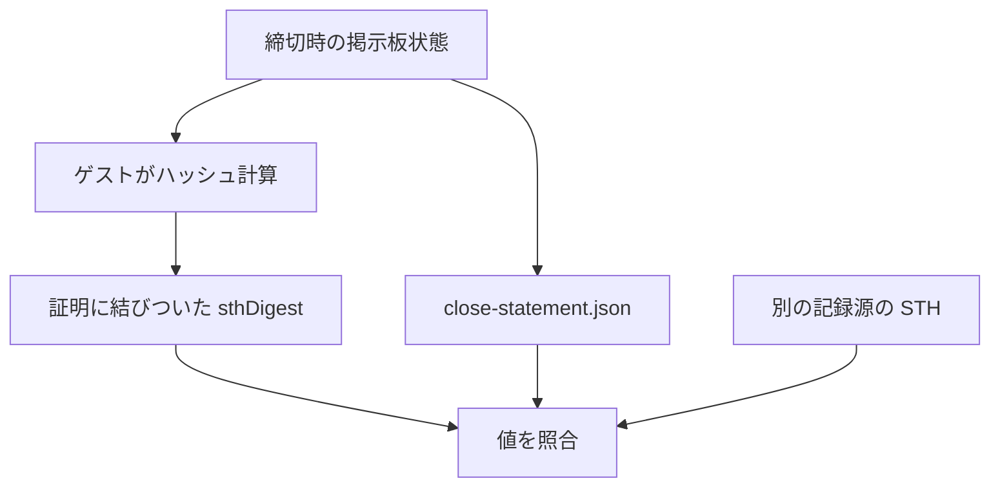

# STH ダイジェスト

STH ダイジェストは、掲示板のログ ID、票数、時刻、ルートから計算するハッシュです。別の記録源が保持する値と比較し、掲示板の状態が一致するかを検証します。STH は Signed Tree Head に由来する名前ですが、この実装はダイジェストの一致を確認し、署名は検証しません。

利用者ごとに異なる掲示板を提示する状態をスプリットビューと呼びます。たとえば、ある利用者には 64 票、別の利用者には特定の票を除いた 63 票を提示した場合、それぞれの包含証明が成立しても掲示板は一致しません。

スプリットビューの検出には、比較先が別の観測を保持している必要があります。同じサーバーの応答同士が一致しても、独立した証人による確認にはなりません。

## 締切状態とジャーナルの対応

ゲストは入力のログ ID、票数、時刻、ルートからダイジェストを計算し、公開出力の `sthDigest` に記録します。サーバーは同じ締切状態を `close-statement.json` にまとめます。



締切記録とジャーナルの一致は、集計がどの掲示板状態を参照したかを確かめる必須条件です。外部ソースとの一致は、その状態を別の記録と照合する追加の確認です。締切記録とジャーナルの一致だけでは、外部ソースとの照合を実施したことにはなりません。

## ダイジェストフォーマット

```text
sth_digest = SHA-256(
    log_id           // 32 バイト
    || tree_size     // u32 LE、4 バイト
    || timestamp     // u64 LE、8 バイト、Unix 時刻ミリ秒
    || bulletin_root // 32 バイト
)
```

入力は合計 76 バイトです。LE はリトルエンディアン、すなわち整数の下位バイトから並べる方式です。ダイジェストには専用タグを付けず、次のログ ID と固定の並びで対象を区別します。

## ログ ID

```text
log_id = SHA-256(UTF-8("stark-ballot:bulletin-log|v1.0") || seed)
```

ログ ID は掲示板の存続中に変わらない識別子です。これをダイジェストに含めることで、票数やルートが同じでも、別の掲示板の締切状態と区別できます。

## STH 応答の照合条件

検証 API は設定済みソースから応答を取得し、ジャーナルの値と照合します。「合意」とはこの照合の結果を指し、分散合意プロトコルを実行する意味ではありません。

| 応答フィールド        | 照合方法                                                         |
| --------------------- | ---------------------------------------------------------------- |
| `sthDigest`           | 必須。ジャーナルと一致を要求                                     |
| `bulletinRoot`        | 指定された場合、ジャーナルと一致を要求                           |
| `treeSize`            | 指定された場合、ジャーナルと一致を要求                           |
| `timestamp` / `logId` | 指定された場合は型・形式を検査。合意判定で直接比較する値ではない |

外部応答はこの 5 フィールドだけからなる平坦なレコードです。`sthDigest` 以外は省略できますが、未知のキー、別名、ラッパーで包んだ応答は受け付けません。

成功には、必要な最小一致数と、比較した全レコードの一致の両方を要求します。一件でも不一致、設定済みソースの取得失敗、不正な応答、利用不能があれば成功を阻止します。判定の詳細は [`recorded_sth_third_party`](../verification/checks-catalog.md#recorded_sth_third_party)に定義しています。

## 設定

| 環境変数               | 意味                                                      | 未指定時   |
| ---------------------- | --------------------------------------------------------- | ---------- |
| `VITE_STH_SOURCES`     | カンマ区切りのソース URL または同一サーバー用テンプレート | 照合しない |
| `VITE_STH_MIN_MATCHES` | 必要な最小一致数                                          | 2          |

ソース未設定では `recorded_sth_third_party` は任意チェックの `not_run` です。設定した場合は必須になり、必要な一致を得られなければ Verified を表示できません。署名検証や外部への自動公開を、この設定によって追加するわけではありません。

### 同一オリジンと外部 HTTPS の照合先

同一サーバー用の相対ソースとして使えるのは `/api/sessions/:sessionId/bulletin/sth` です。任意で `auditorId` クエリを一つ付けられます。API は現在のセッションから直接 STH の値を取り出すため、この内部照合のために HTTP 通信や認証ヘッダー転送は行いません。

このパスを通常の HTTP API として呼ぶ場合は `X-Session-Capability` が必要です。集計成功済みのセッションについて `{ data: { sth: { ... } }, meta }` の応答を返します。この応答形式は、外部ソースに要求する平坦なレコードとは異なります。

絶対 HTTPS URL は、アプリと同じオリジンを指していても外部ソースとして取得します。セッションの認証情報を送らないので、その取得先はセッション認証なしで照合用レコードを返す必要があります。

同一サーバーが返す `timestamp` は `session.voting.lastActivityMs` で、ジャーナルのダイジェスト生成に使った時刻とは限りません。このため、応答の任意フィールドをすべて再連結してダイジェストを作り直すのではなく、上表の条件で照合します。

`.env.local.example` のコメント例は、相対テンプレートと最小一致数 1 の組です。これは照合の動作を試す構成です。同じサーバーしか観測していない以上、成功しても独立した外部監査を受けたとは言えません。

<!-- source: packages/verification/src/verification/sth-verifier.ts, apps/api/src/server/api/adapters/sthProvider.ts, apps/api/src/server/api/handlers/sth.ts, apps/api/src/server/api/handlers/verify.ts, packages/api-contract/src/schemas/bulletin.ts, packages/runtime-config/src/env/nodeSthPublicRuntimeConfig.ts, packages/zkvm-contract/src/zkvm/types.ts:computeSTHDigest, packages/zkvm-contract/src/zkvm/log-id.ts, zkvm/methods/guest/src/sth.rs, packages/verification/src/verification/public-audit-artifacts.ts, packages/verification/src/verification/verification-bundle.ts, infra/docker/entrypoint.sh, packages/verification/src/verification/verification-checks.ts, packages/verification/src/verification/engine/evaluate-checks.ts, packages/application/src/finalize/finalization-result.ts, .env.local.example -->
