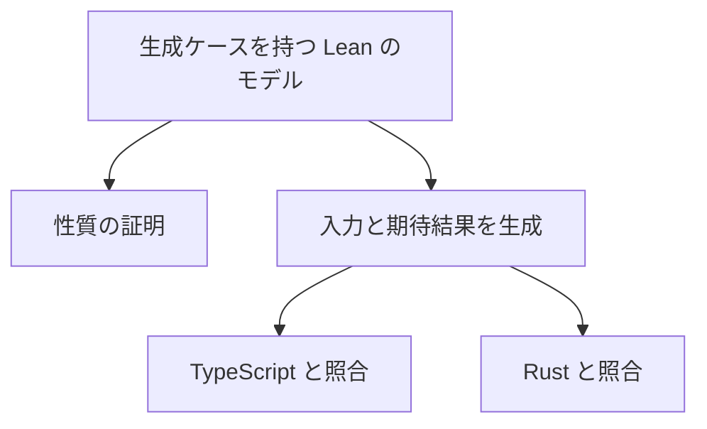

# Lean による形式化

Lean 4 では、判定規則や入力コミットメントなどのモデルを対象に性質を証明します。例えば判定規則のモデルでは、完全成功と判定した場合に必須チェックがすべて成功していることを、個別のテストケースによらず示します。

生成テストケースを持つモデルは、そのケースを使い、実際に動く TypeScript や Rust との対応も確認します。

## 票数と除外数のモデル

掲示板の各位置は、「有効票として採用された」「提示されたが採用されなかった」「提示されなかった」の三つに分かれます。[ゲストプログラム](../zkvm/guest-program.md) の票数を、Lean では自然数のモデルで表します。

```text
validVotes ≤ seenIndicesCount ≤ treeSize
missingSlots = treeSize - seenIndicesCount
invalidPresentedSlots = seenIndicesCount - validVotes
excludedSlots = missingSlots + invalidPresentedSlots
```

この関係から、`excludedSlots = 0` なら、未提示の位置も、提示されたのに採用されなかった位置もなく、`validVotes = seenIndicesCount = treeSize` と示せます。B の一票を入力から抜いた S1 なら `missingSlots` が増えるので、この条件を満たせません。

ゲストのモデルは票を一件ずつ処理します。範囲外・重複インデックスを拒否し、初めて現れた位置を提示済みにした後、選択肢、コミットメント、包含証明を調べ、採用した票を加算します。この処理順序の下で、見た位置が重複せず範囲内にあり、採用数が提示位置数を超えないことを証明します。

## 証明している性質

| 領域                 | 主張                                                                             | 代表的な定理                                                                              |
| -------------------- | -------------------------------------------------------------------------------- | ----------------------------------------------------------------------------------------- |
| ジャーナル           | 上記の計数関係の下で、除外ゼロなら採用数・提示位置数・全位置数が一致する         | `slot_partition_total`、`excluded_zero_implies_no_slot_loss`                              |
| 最終判定             | 完全成功なら必須チェックが成功し、未知のチェックがない                           | `fully_verified_implies_all_required_success`、`fully_verified_implies_no_unknown_checks` |
| 入力コミットメント   | 票を並べ替えても、定めた順序で同じ符号化になる                                   | `canonical_encoding_permutation_invariant`                                                |
| ビットマップ         | 下位ビットから詰めた長さと、取り出すビットが定義に一致する                       | `pack_bits_length`、`pack_bits_get_bit`                                                   |
| ゲスト集計           | 票を順に処理しても、候補別集計と採用数の関係が保たれる                           | `processVotes_fold_invariant`、`accepted_votes_count_tally`                               |
| 完全性               | ゲストモデルの除外ゼロから、未提示・不採用位置がないと導ける                     | `zero_exclusion_guest_model_complete`                                                     |
| 整数の上限           | 入力上限の下で、各カウンターが Rust の `u32` に収まる                            | `no_overflow_under_guest_bounds`                                                          |
| 並行実行の状態       | モデルの各遷移と空の状態からの有限の実行列で、attempt の重複がなく容量上限を守る | `batch_step_preserves_invariant`、`batch_reachable_invariant`                             |
| 並行実行の上限と経路 | モデルの同時 attempt は最大2件で、2件を実行して0件へ戻る経路が存在する           | `batch_workers_at_most_two`、`batch_can_run_two_and_drain`                                |

整数の証明では、`treeSize` と提示レコード数がそれぞれ 1,000,000 以下であることを仮定します。候補ごとの得票数も 1,000,000 以下になることは、その仮定から導かれる結論です。Rust の集計経路も入力上限を検査し、加算時のオーバーフローを拒否します。

モデルは `formal/StarkBallotFormal/` の `JournalCounts.lean`、`VerificationSummary.lean`、`InputCommitment.lean`、`Bitmap.lean`、`GuestModel.lean`、`WorkerConcurrency.lean` にあります。チェックの型などは `Basic.lean` が定義します。

### ワーカーの同時実行モデル

`WorkerConcurrency.lean` は、同じ環境の全 attempt（単一コンテナの実行試行）が共通の2単位の資源を使い、各 attempt が1単位を消費するモデルです。実行中の集合には Batch の `STARTING` から入り、計算が実際に停止して Batch が資源を解放したときに外れます。取消要求、Step Functions の時間切れ、アプリの完了通知だけでは集合から外しません。

この前提の下で、実行中の attempt が重複せず、同時に2件を超えないことを証明します。2件を実行して0件へ戻る経路が存在することも示しますが、待っている仕事が必ず実行されることや、すべての仕事が最終的に完了することは証明していません。

[Batch の資源設定と起動処理](../aws/async-prover.md#batch-の待機とコンテナの開始条件)は、ソースとテストで確認します。このモデルには実装照合用の生成テストケースがなく、AWS の実装との対応は形式証明の対象外です。モデルの前提から外れる起動には、共通資源を使わない起動や、コンテナから切り離して続く計算があります。

## 生成テストケースによる実装との照合

下表の六つの契約では、Lean から入力と期待結果の組を生成し、同じ入力を TypeScript・Rust に与えて照合します。モデルで証明した規則と実装した規則が異なる場合は、モデルの証明だけでは実装のバグを防げないためです。



生成するファイルは次の六つです。保存先は `docs/formal/generated-vectors/` です。

| ファイル                          | 照合先                                              |
| --------------------------------- | --------------------------------------------------- |
| `verification-summary-cases.json` | TypeScript の最終判定                               |
| `verification-display-cases.json` | TypeScript の共有表示ルール                         |
| `check-definitions.json`          | チェック ID・分類・役割・必須条件                   |
| `input-commitment-cases.json`     | TypeScript と Rust の票の順序・ハッシュ前のバイト列 |
| `bitmap-cases.json`               | TypeScript と Rust のビット配置・関連処理           |
| `guest-model-cases.json`          | 本番ゲストと処理を共有する Rust の検査経路          |

生成元は `formal/Scripts/EmitTestVectors.lean` です。各ファイルの種類、フィールド、モデル上限と実装定数の一致、内容の SHA-256 を消費側で調べ、古い値や別種のデータを受け入れないようにしています。内容のハッシュは、自身のハッシュ欄を除き、キー順を再帰的に揃えた空白なし JSON から計算します。

この照合の範囲は生成ケースでの実装との対応で、Rust ゲスト全体や画面描画全体の形式証明は対象外です。SHA-256、RISC Zero、コンパイラーや実行環境の正しさは、モデルの前提として扱います。

## 証明・生成物の監査と実行コマンド

`docs/formal/formal-report.json` に主張と前提を、`formal-audit.json` に定理のハッシュ、公理への依存、証明の点検結果、保存した生成ファイル全体のハッシュを記録します。ファイル全体のハッシュと、キー順を揃えて計算する JSON 内容のハッシュは計算対象が異なります。

証明に未完成を許す `sorry` や、手書きのプロジェクト固有公理はありません。定理の依存は `#print axioms` で調べます。ビットを取り出す `pack_bits_get_bit` では有限の組み合わせを `native_decide` で計算しており、その生成された判定用公理も依存先として記録します。

| コマンド                                            | 行うこと                                       |
| --------------------------------------------------- | ---------------------------------------------- |
| `pnpm formal:build`                                 | Lean のビルド                                  |
| `pnpm formal:report` / `pnpm formal:report:check`   | 主張・前提の出力 / 最新性確認                  |
| `pnpm formal:vectors` / `pnpm formal:vectors:check` | テストケースの出力 / 最新性確認                |
| `pnpm formal:audit` / `pnpm formal:audit:check`     | 証明・生成物の点検記録の出力 / 最新性確認      |
| `pnpm formal:test:ts`                               | TypeScript と生成ケースの照合                  |
| `pnpm formal:verify`                                | 上記の検査と生成 JSON の整形確認をまとめて実行 |

Rust の生成ケース照合は Rust テストのワークフローで実行します。公開ソースを作る前にも Lean をビルドして `pnpm formal:verify` を実行するため、生成物が古い状態や照合に失敗する状態では公開処理を進められません。

<!-- source: formal/StarkBallotFormal/*.lean, formal/Scripts/EmitFormalReport.lean, formal/Scripts/EmitTestVectors.lean, formal/README.md, docs/formal/README.md, docs/formal/formal-report.json, docs/formal/formal-audit.json, docs/formal/generated-vectors/, packages/zkvm-contract/src/zkvm/formal-vectors.ts, zkvm/contract-core/src/formal_vector_test_support.rs, zkvm/methods/guest/src/tally.rs, scripts/formal/audit-formal.ts, package.json -->
