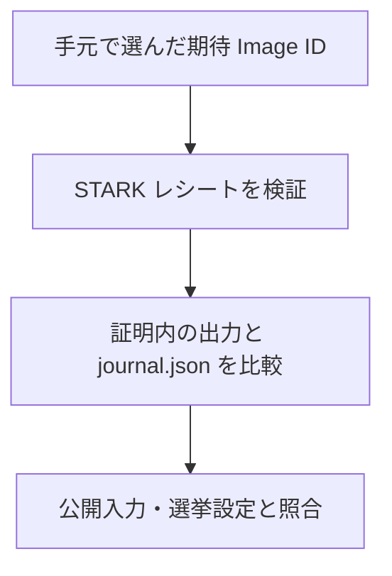

# 証拠の取得と独立検証

公開バンドル `bundle.zip` を使い、サーバーの報告から独立してローカルで証明を検証できます。検証画面から取得する ZIP には、STARK レシートと、その計算に対応する公開入力・出力が含まれます。

検証では、証明の有効性とファイル間の対応を確認します。有効な証明に別の集計の `journal.json` や公開入力が添付されている場合、その組を整合した証拠として受け入れません。

## 公開 ZIP の検証範囲

監査では、期待したプログラムの production STARK 証明が検証できること、証明内の出力が `journal.json` と一致すること、公開入力と選挙設定・締切時の掲示板がその出力に結び付くことを順に確認します。投票位置の欠落や不採用がないことと、得票数の合計も調べます。

期待する Image ID は、検証したいリリースに対応するソースの `public/imageId-mapping.json` から選びます。受け取ったレシートに書かれた ID をそのまま期待値にすると、別のプログラムの証明を受け入れてしまうためです。

## 画面の結果との違い

S2 は、証明に使う入力を変えず、画面へ渡す集計表示を変えます。そのため ZIP 内の証拠が整合していても、画面の表示と一致するとは限りません。表示用の `presentation.tally` は検証 API が返し、ZIP には入りません。

画面の四段階すべてを確認するには、ZIP に加えて、投票時にブラウザへ保存した選択肢・乱数、投票レシートと投票時ルートの照合状態、自票のビットマップ証明、第三者の掲示板との照合結果が必要です。ローカル監査の成功は、これらを含む画面の最終判定とは区別します。

準備とコマンドは[ローカル監査手順（Ubuntu）](audit-bundle.md)、ZIP のファイル形式は[バンドル構造](../verification/bundle-structure.md)に記載しています。

<!-- source: apps/web/src/api/artifacts.ts, apps/web/src/routes/verify/page.tsx, apps/web/src/routes/verify/lib/verification-data.ts, apps/api/src/server/api/handlers/verify.ts, apps/api/src/server/api/handlers/verificationBundles.ts, packages/api-contract/src/routes/inventory.ts, packages/api-contract/src/schemas/verification.ts, packages/verification/src/verification/local-cast-checks.ts, packages/verification/src/verification/public-bundle-manifest.json, packages/verification/src/verification/verification-bundle.ts, packages/verification/src/verification/public-audit-artifacts.ts, packages/verification/src/verification/public-input-contract.ts, packages/verification/src/verification/verifier-service-report.ts, packages/verification/src/verification/verification-checks.ts, packages/verification/src/verification/engine/evaluate-checks.ts, packages/verification/src/verification/verification-presentation-policy.ts, packages/verification/src/verification/verification-summary.ts, packages/zkvm-contract/src/zkvm/host-io.ts, packages/zkvm-contract/src/zkvm/types.ts, zkvm/host/src/main.rs, verifier-service/src/lib.rs, public/imageId-mapping.json -->
