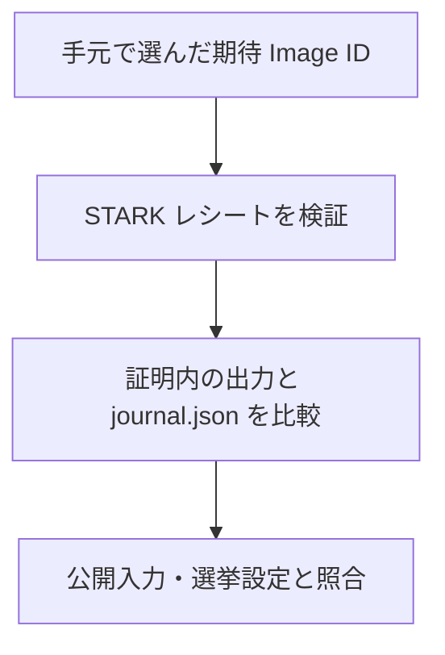

# 証拠を持ち帰って確かめる

画面に表示された「証明の検証に成功した」という報告を、自分の環境でも確認できます。検証画面から取得する `bundle.zip` には、STARK レシートと、その計算に対応する公開入力・出力が入っています。

確かめるときに大切なのは、ファイルを一つずつ読むだけで終わらないことです。正しい証明に、別の集計の `journal.json` や公開入力を添えても、その一組の証拠が正しいことにはなりません。

## ZIP で確かめられること

監査では、期待したプログラムの production STARK 証明が検証できること、証明内の出力が `journal.json` と一致すること、公開入力と選挙設定・締切時の掲示板がその出力に結び付くことを順に確認します。投票位置の欠落や不採用がないことと、得票数の合計も調べます。

期待する Image ID は、検証したいリリースに対応するソースの `public/imageId-mapping.json` から選びます。受け取ったレシートに書かれた ID をそのまま期待値にすると、別のプログラムの証明を受け入れてしまうためです。

## 画面の結果との違い

S2 は、証明に使う入力を変えず、画面へ渡す集計表示を変えます。そのため ZIP 内の証拠が整合していても、画面の表示と一致するとは限りません。表示用の `presentation.tally` は検証 API が返し、ZIP には入りません。

同様に、投票時にブラウザへ残した選択・乱数、投票レシートと投票時ルートの照合状態、自票のビットマップ証明、第三者の掲示板との照合結果も ZIP だけでは揃いません。手元の監査の成功は、画面の四段階すべてを再実行したという意味にはなりません。

実際の準備とコマンドは [手元で証拠を検証する](audit-bundle.md) にまとめています。ZIP のファイル形式を確認したい場合は [バンドル構造](../verification/bundle-structure.md) を参照できます。

<!-- source: apps/web/src/api/artifacts.ts, apps/web/src/routes/verify/page.tsx, apps/web/src/routes/verify/lib/verification-data.ts, apps/api/src/server/api/handlers/verify.ts, apps/api/src/server/api/handlers/verificationBundles.ts, packages/api-contract/src/routes/inventory.ts, packages/api-contract/src/schemas/verification.ts, packages/verification/src/verification/local-cast-checks.ts, packages/verification/src/verification/public-bundle-manifest.json, packages/verification/src/verification/verification-bundle.ts, packages/verification/src/verification/public-audit-artifacts.ts, packages/verification/src/verification/public-input-contract.ts, packages/verification/src/verification/verifier-service-report.ts, packages/verification/src/verification/verification-checks.ts, packages/verification/src/verification/engine/evaluate-checks.ts, packages/verification/src/verification/verification-presentation-policy.ts, packages/verification/src/verification/verification-summary.ts, packages/zkvm-contract/src/zkvm/host-io.ts, packages/zkvm-contract/src/zkvm/types.ts, zkvm/host/src/main.rs, verifier-service/src/lib.rs, public/imageId-mapping.json -->
