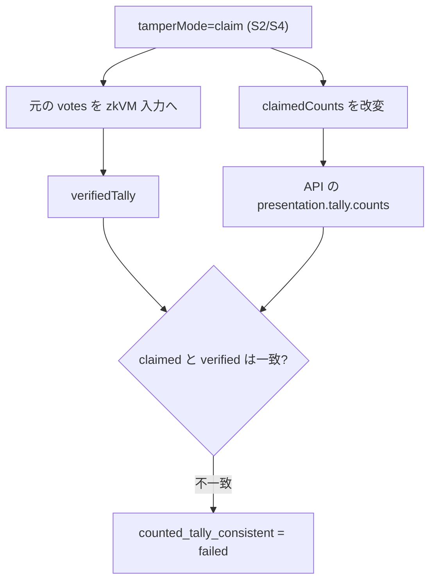
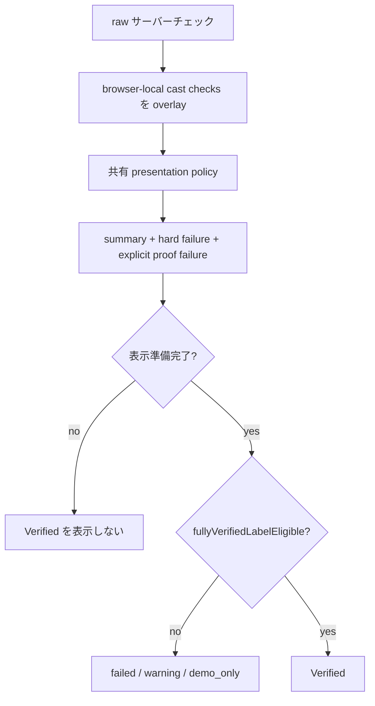

# 検出メカニズム

各改ざんシナリオに対して、検証パイプラインがどのチェックで失敗するかを整理します。
このページは実 API の判定ロジックを基準にしており、STARK 検証が `success` になった後の挙動を前提とします。

## 前提

- 実行モードと検証の前提は [シナリオ一覧 > 実行モードと検証の前提](scenarios.md#実行モードと検証の前提) と同じ。
- 現行の verification resource は
  `GET /api/sessions/:sessionId/finalizations/:finalizationId/verification` で取得する。
- サーバー応答は `castSource=client` のため、raw な `verification.checks` の `cast_*` は
  シナリオに関係なく `not_run`。ブラウザは保持している投票内容と乱数、サーバーから取得した
  exact receipt を使って local cast checks を評価し、この 4 チェックを overlay してから表示用の
  stage と最終判定を導出する。

### Counted 系チェックの zkGate

verification resource の Counted 系チェックには、STARK 前に評価できる項目と、STARK 状態でゲートされる項目が混在します。

- `counted_input_sanity` / `counted_unique_indices` / `counted_unique_commitments` は、`publicInputArtifact` から導出した内部 `publicInputAuthority` があれば STARK 未解決でも評価されます。
- `counted_tally_consistent` / `counted_missing_indices_zero` / `counted_expected_vs_tree_size` / `counted_election_manifest_consistent` / `counted_close_statement_consistent` / `counted_my_vote_included` / `counted_input_commitment_match` は zkGate の対象です。
- STARK 未解決（`not_run`/`running`）の間、zkGate 対象チェックは原則として `not_run` または `pending` になります。
- 例外として、`counted_missing_indices_zero` は journal count の異常や `excludedSlots > 0` が既に解決できる場合、STARK 未解決でも fail-closed に `failed` になり得ます。
- `verifierResult.status=failed` では、zkGate 対象チェックも `failed` になり得ます。

zkGate の一般規則は [ゲーティングロジック > zkGate](../verification/gating-logic.md#zkgate-stark-結果に基づく-counted-チェックの制御) を参照してください。

## 検出の 2 つの原理

- **原理1: 完全性違反** (`excludedSlots > 0`) → `counted_missing_indices_zero` が失敗（主に S1/S3/S5）。
- **原理2: 主張集計の不整合** (claimed ≠ verified) → `counted_tally_consistent` が失敗（主に S2/S4）。

## シナリオ別の主な失敗チェック（STARK 解決後）

| シナリオ | 主に失敗するチェック           | 説明                                                                                 |
| -------- | ------------------------------ | ------------------------------------------------------------------------------------ |
| S0       | なし                           | 正常系                                                                               |
| S1       | `counted_missing_indices_zero` | ユーザー票除外により `excludedSlots=1`                                               |
| S2       | `counted_tally_consistent`     | claimed tally と verified tally が不一致                                             |
| S3       | `counted_missing_indices_zero` | 現行実装では botId=1 のボット票除外により `excludedSlots=1`                          |
| S4       | `counted_tally_consistent`     | claimed tally と verified tally が不一致                                             |
| S5       | `counted_missing_indices_zero` | ランダムに 1 票を除外するため `excludedSlots>0` が発生し、完全性違反として検出される |

補足:

- S1 では、ビットマップ証明が利用可能な場合 `counted_my_vote_included` も失敗し得ます。
- S2/S4 では、zkVM 入力を改変していないため、`counted_input_commitment_match` は通常成功します。
- S5 ではランダム対象がユーザー票の場合、ビットマップ証明が利用可能なら `counted_my_vote_included` も失敗し得ます。

## 4 段階検証モデルとの対応（raw サーバー応答）

| 検証段階            | S0        | S1        | S2        | S3        | S4        | S5        |
| ------------------- | --------- | --------- | --------- | --------- | --------- | --------- |
| Cast-as-Intended    | `not_run` | `not_run` | `not_run` | `not_run` | `not_run` | `not_run` |
| Recorded-as-Cast    | `success` | `success` | `success` | `success` | `success` | `success` |
| Counted-as-Recorded | `success` | `failed`  | `failed`  | `failed`  | `failed`  | `failed`  |
| STARK Verification  | `success` | `success` | `success` | `success` | `success` | `success` |

この表は「シナリオ適用による典型挙動」を示します。
`running` や追加の `not_run` は、運用状態や証拠不足により別途発生します。
ここでの値はサーバーが返す `verification.steps` の状態です。
`verifierResult.status` は STARK receipt 検証の状態であり、overall verdict そのものではありません。

ブラウザ表示では [前提](#前提) の overlay を適用します。
典型フローでは overlay 後の Cast-as-Intended は `success` になり、ローカル証拠が欠けるか不整合なら `not_run` または `failed` のままで、最終表示は Verified になりません。

## 主要チェック ID マトリクス（STARK 解決後の raw サーバーチェック）

| チェック ID                      | S0        | S1                        | S2        | S3        | S4        | S5        |
| -------------------------------- | --------- | ------------------------- | --------- | --------- | --------- | --------- |
| `cast_commitment_match`          | `not_run` | `not_run`                 | `not_run` | `not_run` | `not_run` | `not_run` |
| `counted_tally_consistent`       | `success` | `success`                 | `failed`  | `success` | `failed`  | `success` |
| `counted_missing_indices_zero`   | `success` | `failed`                  | `success` | `failed`  | `success` | `failed`  |
| `counted_my_vote_included`       | `success` | `failed` または `not_run` | `success` | `success` | `success` | 対象依存  |
| `counted_input_commitment_match` | `success` | `success`                 | `success` | `success` | `success` | `success` |

- 証拠不足時の `counted_my_vote_included` は `not_run` になります。
- S5 の `counted_tally_consistent` が通常成功するのは、claimed tally と verified tally がどちらも除外後の 63 票入力ベースだからです。
- `cast_commitment_match` を含む 4 つの `cast_*` の `not_run` は raw サーバー値であり、[前提](#前提) の overlay 後は通常 `success` になります。

## S2/S4 の主張集計改ざん

S2/S4 は「入力改ざん」ではなく「主張集計改ざん」です。

このため、`counted_input_commitment_match` の失敗は通常発生しません。
zkVM 入力は元票であり、投票レシートと STARK 証明も有効なままです。

## S5 の除外処理

S5 の定義と処理内容（`tamperMode=input`、`modifiedVotes`、ジャーナル統計の扱い）は[シナリオ一覧 > S5](scenarios.md#s5-ランダムな票の除外)を参照してください。
検出の主因は、`missingSlots=1` / `excludedSlots=1` による `counted_missing_indices_zero` の失敗です。

## ビットマップ証明の役割

`counted_my_vote_included` は、チェック定義上 `required` のユーザー包含チェックです。

- S1（ユーザー票除外）では、証明が利用可能なら失敗して「自票が未集計」であることを直接示せる。
- 証拠不足で `not_run` になる場合でも、最終判定は Verified になりません:
  - 完全性違反が同時にある場合は `votes_excluded_unknown` になります。
  - 完全性違反がなく required evidence が欠ける場合は `missing_evidence` になります。

## 最終判定（Verified 表示）

最終表示は共有 `verification-presentation-policy` が決定します（厳密な判定条件は [ゲーティングロジック](../verification/gating-logic.md) を参照）。
ブラウザが policy に渡すのは、[前提](#前提) の overlay 後の完全なチェック集合です。
policy は `verification-summary` に加えて、resource の
availability、fail-closed exclusion signal、明示的な proof failure、検証シーケンスの完了状態を統合します。

`fullyVerifiedLabelEligible` が true になるのは、summary が `fully_verified`、hard failure がなく、
明示的な proof failure もなく、表示 readiness が `ready` で rendered status が `verified` の場合だけです。
summary 内の分類順序は [ゲーティングロジック > ステータスの判定順序](../verification/gating-logic.md#ステータスの判定順序) を参照してください。

代表的な失敗ステータス:

- `user_vote_excluded` / `votes_excluded` / `votes_excluded_unknown`: 完全性違反（S1/S3/S5）
- `published_tally_mismatch`: claimed と verified の不一致（S2/S4）
- `counted_integrity_failed`: Counted 系必須チェック失敗の一般ケース

これらの検出経路は、[単体、結合、E2E テスト](../quality/unit-integration-e2e.md) の CLI と E2E フローで補強しています。
Merkle と journal の不変条件は、[Property-based Testing](../quality/property-based-testing.md) でも補強しています。

<!-- source: packages/api-contract/src/routes/inventory.ts, apps/api/src/server/api/handlers/verify.ts, apps/web/src/routes/verify/lib/local-cast-evidence.ts, apps/web/src/routes/verify/lib/verification-data.ts, packages/verification/src/verification/engine/evaluate-checks.ts, packages/verification/src/verification/verification-checks.ts, packages/verification/src/verification/verification-summary.ts, packages/verification/src/verification/verification-presentation-policy.ts, packages/application/src/finalize/usecases/finalize-session.ts, packages/application/src/finalize/usecases/finalize-sync.ts, packages/application/src/finalize/finalization-result.ts, infra/lambdas/finalization-writer/handler.ts, apps/web/src/mock-api/fetcher.ts -->
