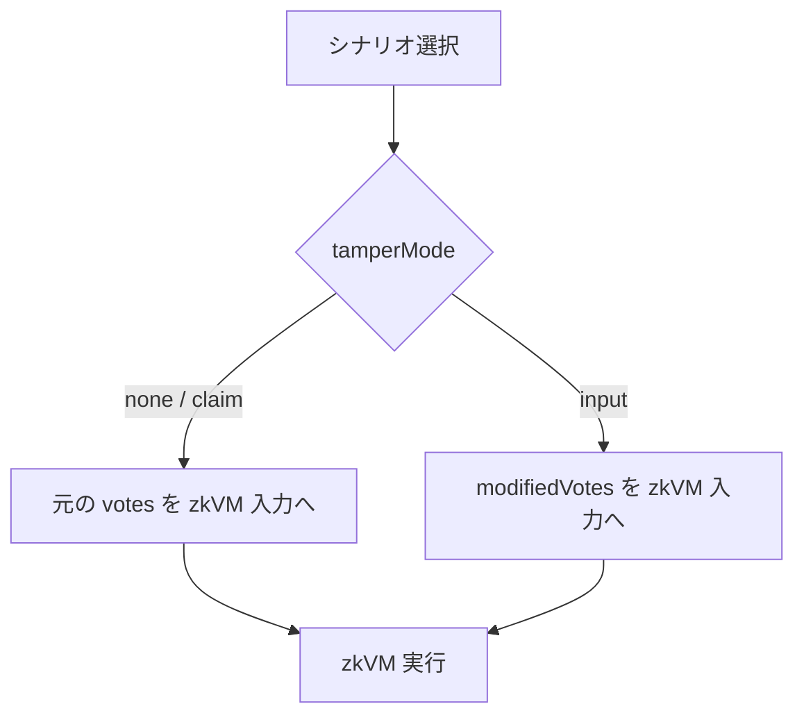
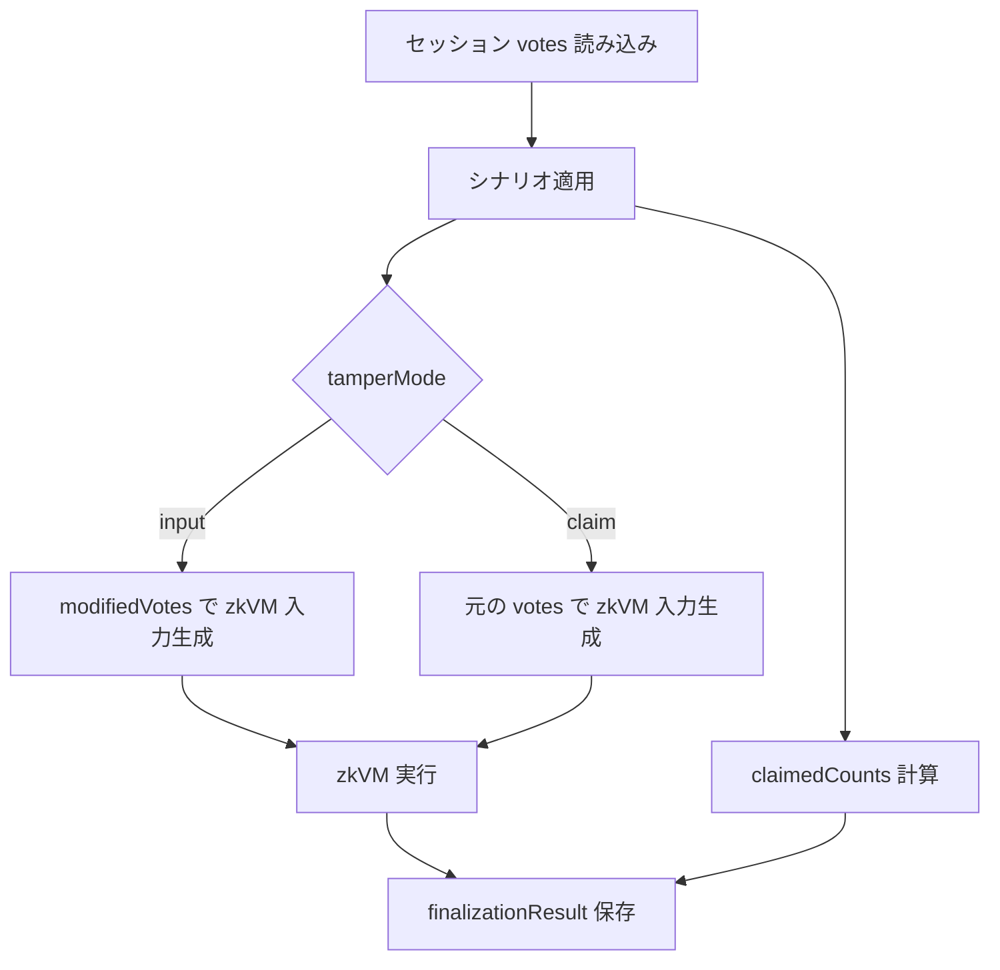

# シナリオ一覧

改ざんシナリオ S0〜S5 の定義と、実装上どこを改変するかを整理します。
説明の中心は、zkVM 入力、主張集計（claimed tally）、ジャーナル統計（missing/invalid/excluded）の関係です。

## 教育モードの目的

改ざんシナリオは、暗号的検証が実際に機能することを確認するために設計されています。

- 正常ケース（S0）を基準として、検証パイプラインが通過する状態を確認する
- 攻撃シナリオ（S1〜S5）を適用して、どの不変条件が破れると検証が失敗するかを確認する

## 攻撃の類型

- **入力改ざん** (`tamperMode=input`): S1 / S3 / S5
- **主張改ざん** (`tamperMode=claim`): S2 / S4

この分類は「改ざんがどこに入るか」のみを示します。
どのチェックで失敗するかの詳細は [検出メカニズム](detection-mechanism.md) を参照してください。

## 実装上の共通前提

- 1 回の finalize で選択されるシナリオは 1 つ（S0〜S5）
  - UI: `/aggregate` は single-select（S0〜S5 のラジオボタン）
  - API: `POST /api/sessions/:sessionId/finalizations` は `scenarioId` を 1 つ受け取る
- `totalExpected` は 64（ユーザー 1 + ボット 63）
- 掲示板（CT Merkle）は追記専用で、シナリオ適用で既存エントリは削除しない
- `tamperMode` は `none` / `input` / `claim` の 3 種

### 実行モードと検証の前提

- 本章は実 API 経路（`POST /api/sessions/:sessionId/finalizations` → `finalizeSessionHandler` → `finalizeSessionUsecase` → `finalizeSync|finalizeAsync`）を基準に説明する
- finalize 実行モード（同期 / 非同期）は `RUNTIME_PROFILE` が一意に決める。profile ごとの意味論は [AWS runtime 境界](../aws/runtime-boundary.md#semantic-runtime-profiles) を参照
- mock mode の差分: browser mock（`VITE_RUNTIME_PROFILE=local-demo`）の API fixture は本章と異なるチェック結果を返すことがあり、`local-demo` / `static-mock-e2e` の mock zkVM executor は production STARK proof を生成しない
- `local-proof-development` の dev-mode receipt も production STARK proof ではない
- 本章の「主な失敗点」は STARK 検証が `success` の局面を前提とする（zkGate の詳細は [検出メカニズム](detection-mechanism.md) を参照）

`tamperMode` は、シナリオ変更を zkVM 入力へ反映するかどうかを決めます。

## シナリオ一覧表

| シナリオ | 類型         | tamperMode | zkVM 入力             |
| -------- | ------------ | ---------- | --------------------- |
| S0       | 正常         | `none`     | 元の 64 票            |
| S1       | 除外         | `input`    | 63 票（ユーザー除外） |
| S2       | 主張改ざん   | `claim`    | 元の 64 票            |
| S3       | 除外         | `input`    | 63 票（ボット除外）   |
| S4       | 主張改ざん   | `claim`    | 元の 64 票            |
| S5       | ランダム除外 | `input`    | 63 票（通常）         |

シナリオ別に失敗するチェックは [検出メカニズム > シナリオ別の主な失敗チェック](detection-mechanism.md#シナリオ別の主な失敗チェックstark-解決後) を参照してください。

## S0: 正常（改ざんなし）

改ざんを適用しない基準シナリオです。

| 項目                | 値     |
| ------------------- | ------ |
| tamperMode          | `none` |
| zkVM 入力票数       | 64     |
| claimed と verified | 一致   |
| `excludedSlots`     | 0      |

## S1: ユーザー票の除外

ユーザー票（インデックス 0）を `modifiedVotes` から削除し、63 票を zkVM に渡します。

| 項目                | 値                                                             |
| ------------------- | -------------------------------------------------------------- |
| tamperMode          | `input`                                                        |
| zkVM 入力票数       | 63                                                             |
| claimed と verified | 一致（どちらも 63 票入力ベース）                               |
| ジャーナル統計      | `missingSlots=1`, `invalidPresentedSlots=0`, `excludedSlots=1` |

失敗するチェックは [検出メカニズム](detection-mechanism.md#シナリオ別の主な失敗チェックstark-解決後) を参照してください。

## S2: ユーザー票に関する主張集計の改ざん

ユーザー票に対する「主張集計（表示する tally）」のみ改ざんします。
zkVM には元の 64 票を渡します。

| 項目                | 値                                         |
| ------------------- | ------------------------------------------ |
| tamperMode          | `claim`                                    |
| zkVM 入力票数       | 64（元データ）                             |
| claimed と verified | 不一致（ユーザー選択肢が -1、別候補が +1） |
| `excludedSlots`     | 0（通常）                                  |
| `inputCommitment`   | zkVM 入力由来のため通常は一致              |

失敗するチェックは [検出メカニズム](detection-mechanism.md#s2s4-の主張集計改ざん) を参照してください。

## S3: ボット票の除外

現行実装ではボット票インデックス `1`（`targetBotId` 初期値）を削除し、63 票を zkVM に渡します。

| 項目                | 値                                                             |
| ------------------- | -------------------------------------------------------------- |
| tamperMode          | `input`                                                        |
| zkVM 入力票数       | 63                                                             |
| claimed と verified | 一致（どちらも 63 票入力ベース）                               |
| ジャーナル統計      | `missingSlots=1`, `invalidPresentedSlots=0`, `excludedSlots=1` |

### S1 との違い

- S1: ユーザー自身の未集計をビットマップで直接示せる
- S3: ユーザー票は含まれるが、集計全体の完全性違反で検出される

## S4: ボット票に関する主張集計の改ざん

1 票のボット票に関する「主張集計」だけを改ざんします。
zkVM 入力は元の 64 票のままです。

| 項目                | 値                                             |
| ------------------- | ---------------------------------------------- |
| tamperMode          | `claim`                                        |
| zkVM 入力票数       | 64（元データ）                                 |
| claimed と verified | 不一致（対象ボットの元候補が -1、別候補が +1） |
| `excludedSlots`     | 0（通常）                                      |
| `inputCommitment`   | zkVM 入力由来のため通常は一致                  |

S2 と同様に、改ざん対象は `tally.counts` 側です。失敗するチェックは [検出メカニズム](detection-mechanism.md#s2s4-の主張集計改ざん) を参照してください。

## S5: ランダムな票の除外

現行実装では、64 票からランダムに 1 票を選び、`modifiedVotes` から削除します。
選んだ票の候補を別候補へ変える処理はありません。

### S5 の処理

- `tamperMode` は常に `input` のため、zkVM 入力は常に `modifiedVotes` が使われる
- シナリオ変更は `IGNORED` として記録され、`ignoredCount=1`, `recountedCount=0` になる
- 元の掲示板インデックスは保存される（失敗するチェックは [検出メカニズム](detection-mechanism.md#s5-の除外処理) を参照）

| 項目           | 値                                                             |
| -------------- | -------------------------------------------------------------- |
| tamperMode     | `input`                                                        |
| zkVM 入力票数  | 63（通常）                                                     |
| シナリオ変更   | ランダムに選ばれた 1 票を `IGNORED`                            |
| ジャーナル統計 | `missingSlots=1`, `invalidPresentedSlots=0`, `excludedSlots=1` |

## ジャーナル統計の扱い（sync / async 共通）

現行実装では、`missingSlots` / `invalidPresentedSlots` / `excludedSlots` / `validVotes` などのジャーナル統計は、sync / async いずれも **zkVM が返した proof-derived な値をそのまま使います**。

- sync / async いずれも、finalize 後にジャーナル統計を上書きしない
- target async finalize は finalization writer が S3 の `bundle.zip` から復元した `journal` をそのまま使う

シナリオ由来の `ignoredCount` / `recountedCount` / `claimedCounts` は presentation 用であり、`journal` の統計値を書き換えません。

- `ignoredCount` / `recountedCount` → `tamperSummary` や `tamperedCount` に反映
- `claimedCounts` → S2/S4 の表示用 tally

`tamperMode=claim`（S2/S4）でも同様に、ジャーナル統計は zkVM の値のままです。

## 集計フローへの挿入点

<!-- source: packages/api-contract/src/routes/inventory.ts, packages/runtime-config/src/env/runtimeProfile.ts, packages/domain/src/lib/scenarios/processor.ts, packages/domain/src/lib/finalize/scenario-application.ts, packages/application/src/finalize/usecases/finalize-session.ts, packages/application/src/finalize/usecases/finalize-sync.ts, packages/application/src/finalize/finalization-result.ts, packages/node-adapters/src/zkvm/executor.ts, apps/api/src/server/api/handlers/finalize.ts, infra/lambdas/finalization-writer/handler.ts, packages/aws-adapters/src/finalize/async-prover-artifacts.ts, apps/web/src/mock-api/fixtures.ts, apps/web/src/mock-api/handlers.ts, .env.local.example -->
