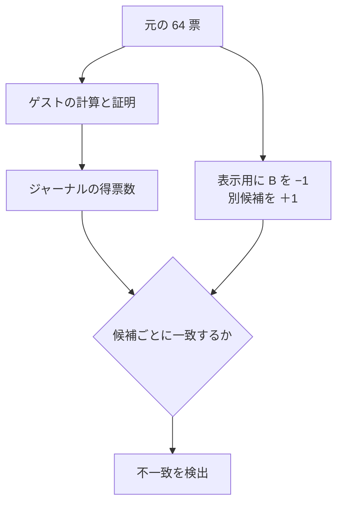

# シナリオの変更内容と検出結果

ユーザー票はインデックス 0、ボット票は残り 63 票です。集計画面で選ぶシナリオは一回につき一つで、掲示板の 64 スロットはそのまま残します。操作するのは、ゲストへ渡す票か、画面へ出す得票数です。

## シナリオ一覧表

| シナリオ | 加える変更                                             | ゲストへ渡す票数 | 検出する食い違い                   |
| -------- | ------------------------------------------------------ | ---------------- | ---------------------------------- |
| S0       | 変更しない                                             | 64               | なし                               |
| S1       | ユーザー票を入力から外す                               | 63               | 掲示板の一票が未提示。自票も未計上 |
| S2       | ユーザーの候補から一票を別候補へ移した得票数を表示する | 64               | 表示集計と証明された集計が違う     |
| S3       | ボット票を入力から外す                                 | 63               | 掲示板の一票が未提示               |
| S4       | ボットの候補から一票を別候補へ移した得票数を表示する   | 64               | 表示集計と証明された集計が違う     |
| S5       | ランダムに一票を入力から外す                           | 63               | 掲示板の一票が未提示               |

## S0: 正常（改ざんなし）

元の 64 票をゲストへ渡します。各票が有効なら全スロットが計上され、`excludedSlots = 0`、表示集計と `verifiedTally` は一致します。ユーザー票の included ビットも 1 になります。

これは他のシナリオと比べる基準です。S0 を選んだこと自体は検証成功の根拠になりません。手元の証拠、掲示板の証明、STARK なども成功し、補助チェックにも制限がない場合に Verified を表示します。

## S1: ユーザー票の除外

インデックス 0 の票を集計用の入力から外し、63 票をゲストへ渡します。掲示板には元のコミットメントが残っているので、投票時の包含証明や追記の整合性証明は成功できます。

ゲストは、掲示板の 64 スロットに対して一つのスロットが未提示であると判定します。残りの票が有効なら、ジャーナルは次の値になります。

```text
missingSlots = 1
invalidPresentedSlots = 0
excludedSlots = 1
```

これにより `counted_missing_indices_zero` が失敗します。自票のビットマップ証明を取得できれば、index 0 の seen と included がともに 0 であることも確認でき、`counted_my_vote_included` は失敗します。これにより、提示されたが無効だった票と、ゲストへ提示されなかった票を区別できます。

表示集計も 63 票の入力を基にするため、表示と `verifiedTally` は一致します。STARK 検証も成功できますが、全 64 スロットの完全性を満たさないため、全体は Verification Failed です。自票の証明が不足していても、全体の一票除外という事実は消えません。

## S2: ユーザー票に関する主張集計の改ざん

ゲストには元の 64 票を渡します。たとえばユーザーが B を選んだ場合、表示側だけで B の得票数を一つ減らし、別の候補を一つ増やします。加算先は B 以外から選び、ユーザー票の振替先として表示する値とも一致させます。



合計はどちらも 64 なので、合計だけでは検出できません。候補ごとに比較する `counted_tally_consistent` が失敗します。入力やジャーナルは変えていないため、入力コミットメント、自票の包含、STARK は通常成功します。必要な他の証拠が揃えば、最終理由は `published_tally_mismatch` です。

この場合、ZIP に収める計算の証拠は正常です。表示集計は ZIP に入っていないため、ZIP のローカル検証だけで S2 の表示改変まで再現検出できるとは限りません。表示された値との比較が必要です。

## S3: ボット票の除外

現在の実装はインデックス 1 のボット票を入力から外し、63 票を渡します。残りの票が有効なら、S1 と同じく `missingSlots = 1`、`invalidPresentedSlots = 0`、`excludedSlots = 1` です。

`counted_missing_indices_zero` は失敗しますが、ユーザー票の index 0 は計上されるので、自票のビットマップ確認は成功できます。このとき最終理由は `votes_excluded` です。自票の計上と集計全体の完全性は、それぞれのチェックで確認します。

## S4: ボット票に関する主張集計の改ざん

ボット票を一つランダムに選び、その元候補の得票数を表示側だけで一つ減らし、別の候補へ一つ加えます。ゲストに渡す入力は元の 64 票です。

S2 と同様に `counted_tally_consistent` が表示とジャーナルの差を検出します。入力コミットメント、STARK、ユーザー票の包含は通常成功できます。必要な他の証拠が揃えば、全体の失敗理由は `published_tally_mismatch` です。

## S5: ランダムな票の除外

64 票の中からランダムに一票を選んで、集計入力から外します。残りの票のインデックスは詰め直さず、掲示板上の位置を保ちます。候補を書き換える操作はしません。

`missingSlots = 1` と `excludedSlots = 1` により、`counted_missing_indices_zero` が失敗します。選ばれたのがユーザー票なら、自票の証明でも未計上を示せます。ボット票なら自票は含まれたままです。どちらの場合も、全体の完全性の確認で検出できます。

表示集計は除外後の 63 票を基にするので、ジャーナルと一致します。`counted_tally_consistent` は表示集計とジャーナルの一致を確認するため成功します。一票の除外は、完全性のチェックで検出します。

## 改ざんを反映する場所

実装では S1 / S3 / S5 を `tamperMode = input`、S2 / S4 を `tamperMode = claim`、S0 を `none` として扱います。入力改変の場合だけ、変更後の票集合をゲストへ渡します。表示改変の場合は元の票を渡し、変更後の得票数を表示用に保存します。

同期・非同期のどちらでも、ゲストが返したジャーナルの集計値や除外数を、シナリオ説明に合わせて上書きしません。`ignoredCount`、`recountedCount`、`claimedCounts` は表示用の情報です。S5 の変更記録は `IGNORED`、`ignoredCount = 1`、`recountedCount = 0` です。

API は、シナリオ、除外数、改ざん数、対象ボット、得票差の説明も相互に検査します。S0 / S1 / S3 / S5 は表示と検証済み集計の一致を要求し、S2 / S4 は一候補 −1、別候補 ＋1 という差を要求します。説明と証拠が矛盾する応答を、シナリオの正常な結果として受理することはありません。

## 実行モードと検証の前提

上の結果は、実 API での処理について、残りの証拠が有効で STARK 検証が成功した場合を説明しています。実行場所は runtime profile が選ぶ[同期・非同期の構成](../aws/runtime-boundary.md)に従います。

ブラウザ mock の固定応答は、実 API と異なるチェック結果を返すことがあります。`local-demo` と `static-mock-e2e` は本番用 STARK 証明を生成せず、`local-proof-development` のフェイクレシートも本番用の暗号的裏付けにはなりません。証明未完了や証拠不足が加わる場合の状態は、[チェック結果の対応表](detection-mechanism.md)で区別しています。

<!-- source: packages/api-contract/src/routes/inventory.ts, packages/runtime-config/src/env/runtimeProfile.ts, packages/domain/src/lib/scenarios/processor.ts, packages/domain/src/lib/finalize/scenario-application.ts, packages/application/src/finalize/usecases/finalize-session.ts, packages/application/src/finalize/usecases/finalize-sync.ts, packages/application/src/finalize/finalization-result.ts, packages/node-adapters/src/zkvm/executor.ts, apps/api/src/server/api/handlers/finalize.ts, infra/lambdas/finalization-writer/handler.ts, packages/aws-adapters/src/finalize/async-prover-artifacts.ts, apps/web/src/mock-api/fixtures.ts, apps/web/src/mock-api/handlers.ts, .env.local.example -->
