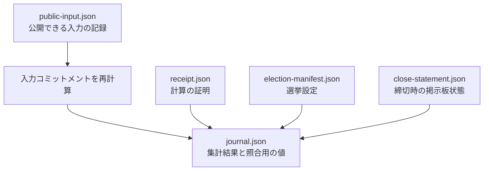

# バンドル構造

`bundle.zip` を開くと、集計結果だけでなく、何を集計したかを照合するための JSON が並びます。中心になるのは、入力側の記録、計算の出力、それを裏付けるレシートです。



図の矢印は照合関係です。JSON が互いに一致することに加えて、期待する Image ID に対するレシートの検証と、レシート内のジャーナルとの一致が必要です。

## アーカイブのメンバー

| ファイル                 | 内容                                                                 | 同期生成 | 非同期生成 |
| ------------------------ | -------------------------------------------------------------------- | -------- | ---------- |
| `public-input.json`      | 選択肢と乱数を除いた、ゲスト入力の公開監査用レコード                 | 必須     | 必須       |
| `election-manifest.json` | 選挙設定と `electionConfigHash`                                      | 必須     | 必須       |
| `close-statement.json`   | 締切時のログ ID、ツリーサイズ、ルート、時刻とダイジェスト            | 必須     | 必須       |
| `receipt.json`           | ホストが出力した `{ receipt, image_id }` のラッパー JSON             | 必須     | 必須       |
| `journal.json`           | 得票数、除外数、入力コミットメント、ビットマップルートなどの公開出力 | 必須     | 必須       |
| `metadata.json`          | 作成時刻、セッション ID、メソッドバージョンなど                      | 必須     | 含めない   |
| `sth.json`               | 保存する場合の STH スナップショット                                  | 任意     | 含めない   |
| `consistency-proof.json` | 保存する場合の RFC 6962 整合性証明                                   | 任意     | 含めない   |

同期 ZIP は必須 6 ファイルと任意 2 ファイル、非同期 ZIP は必須 5 ファイルだけを認めます。任意の二つは、現在の通常フローでは生成されません。構成を決める正本は `public-bundle-manifest.json` です。許可外ファイルや危険なパスを拒否する規則と、秘密入力を収めない理由は [公開境界](public-boundary.md)に定めています。

`receipt.json` の存在や、その `image_id` の自己申告だけでは、計算の正しさは確かめられません。また、開発用のレシートも同じファイル名を使えるため、ファイル名から本番用 STARK 証明だとは判断しません。

## 公開入力の構造

`public-input.json` は、入力コミットメントの再計算と、選挙設定・締切状態との照合に使います。秘密入力を丸ごと写したファイルではありません。

| フィールド           | 内容                                            |
| -------------------- | ----------------------------------------------- |
| `schema`             | `"stark-ballot.public_input"`                   |
| `version`            | `"1.1"`                                         |
| `electionId`         | 選挙 ID（UUID）                                 |
| `electionConfigHash` | 選挙設定のハッシュ                              |
| `bulletinRoot`       | 掲示板の最終ルート                              |
| `treeSize`           | 掲示板のスロット数                              |
| `totalExpected`      | 期待する投票数                                  |
| `logId`              | 掲示板のログ ID                                 |
| `timestamp`          | 集計時のタイムスタンプ                          |
| `methodVersion`      | ゲストのメソッドバージョン                      |
| `votes`              | 各票のインデックス、コミットメント、Merkle パス |

`inputCommitment` はこの JSON 全体のハッシュではありません。[入力コミットメント](../protocol/input-commitment.md)で定めるフィールドとバイト表現から再計算します。それ以外の項目は、対応するマニフェストや締切ステートメント、ジャーナルと別途照合します。

`journal.json` は、ゲスト出力を UUID・hex・camelCase のフィールドへ変換した公開表現です。レシート内部のジャーナルは RISC Zero のシリアライズ形式を使うため、JSON の文字列をそのままハッシュして照合することはできません。[ゲストプログラム](../zkvm/guest-program.md#ジャーナル出力)に論理フィールドと表現の関係を示しています。

## 同期バンドルと非同期バンドルの違い

ローカルの同期生成では、TypeScript の処理がホストの出力から公開 JSON を構築し、選挙設定・締切状態・入力コミットメント・ジャーナルの整合を確認して ZIP を作ります。保存先はセッションと集計ごとのローカルディレクトリです。

AWS の非同期生成では、Fargate コンテナが入力を S3 から取得し、ホストを実行します。その後 Rust の `prover-artifacts` が秘密入力とホスト出力を検査して公開 JSON を構築し、生成済みの JSON を読み直して正準ハッシュと相互整合性を確認します。シェルは検査済みのファイルから ZIP を作り、完成後の構成検査を経て S3 へアップロードします。

コールバックは ZIP からジャーナル、レシート、公開入力、マニフェスト、締切ステートメントを復元し、利用可能なビットマップの隣接オブジェクトも検査して保存します。ジャーナルのカウントをシナリオ表示に合わせて変更することはありません。検証レポートは、その後の STARK 検証を処理したワーカーが保存した場合に利用可能になります。

現在の Rust の変換処理は method version 14 の出力を要求します。異なる契約の出力を推測で読み替えません。非同期処理の完了・再試行の条件は [非同期プローバー](../aws/async-prover.md)に示します。

## バンドルディレクトリ構造

### 同期モード（ローカルファイルシステム）

保存ディレクトリには ZIP の外に保護対象のファイルもあります。次の配置は、すべてを一緒に配布してよいという意味ではありません。

```text
{VERIFIER_WORK_DIR}/{sessionId}/{finalizationId}/
  input.json
  public-input.json
  election-manifest.json
  close-statement.json
  journal.json
  receipt.json
  metadata.json
  included-bitmap.json
  seen-bitmap.json
  verification.json
  bundle.zip
```

ビットマップのファイルは計上・提示の保存証拠、`verification.json` は検証サービス実行後のレポートです。ZIP の内容は、冒頭のメンバー表だけで決まります。

### 非同期モード（S3）

```text
s3://{BUCKET}/sessions/{sessionId}/{finalizationId}/
  input.json
  {inputBase}-receipt.json
  {inputBase}-output.json
  {inputBase}-journal.json
  public-input.json
  election-manifest.json
  close-statement.json
  included-bitmap.json
  seen-bitmap.json
  bundle.zip
  verification.json
  failure-marker.json
```

`inputBase` はコンテナの一時入力名に由来します。ホストの生出力名と、ZIP 内の固定名 `receipt.json` / `journal.json` は異なります。`{inputBase}-journal.json` はホストが生成した場合だけ存在します。

この配置図には異なる時点の任意ファイルも含みます。レポートは後続の検証後に保存される場合があり、`failure-marker.json` は非ゼロ終了時にだけ最善努力で保存する内部診断です。成功した ZIP と失敗診断が必ず同時にできることを示してはいません。

## アーカイブの再現性

同期 ZIP は、エントリ時刻をゼロに固定し、ファイル名順で追加します。同じ内容から作ったアーカイブの再現性を保つためです。非同期のシェルは `zip -r` を使い、同じ時刻固定の実装ではありません。内容の検証と、ZIP ファイル全体のバイト一致は分けて確認します。

実際に取得した ZIP を安全に展開し、レシートと各 JSON を照合する操作は、[ZIP のローカル検証](../reproducibility/audit-bundle.md)に続きます。

<!-- source: packages/verification/src/verification/public-bundle-manifest.json, packages/verification/src/verification/public-bundle-manifest.ts, packages/verification/src/verification/verification-bundle.ts, packages/node-adapters/src/verification-bundle.ts, zkvm/host/src/artifacts.rs, zkvm/host/src/bin/prover-artifacts.rs, packages/aws-adapters/src/finalize/async-prover-artifacts.ts, infra/docker/entrypoint.sh, infra/docker/prover-failure-marker-contract.json, infra/lambdas/finalization-writer/handler.ts, packages/aws-adapters/src/aws/bundle-restore.ts, infra/lambdas/verification-worker/handler.ts, apps/api/src/server/api/routes/definitions.ts, apps/api/src/server/api/handlers/verificationBundles.ts -->
