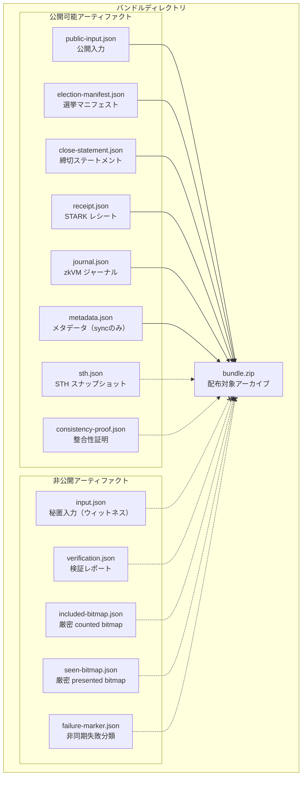

# バンドル構造

この章は、証明バンドルのファイル構造と、同期モードと非同期モードの差分を説明します。
公開可能アーティファクトと保護対象アーティファクトの境界は [公開境界](public-boundary.md) に集約しています。

## 概要

[証明バンドル](../appendix/glossary.md#証明バンドルproof-bundle) は、zkVM の実行結果を検証可能な形で保存し、配布するためのアーティファクト群です。
実際に配布される [`bundle.zip`](../appendix/glossary.md#配布対象アーカイブbundlezip) は、厳格な許可リストによって公開可能アーティファクトだけを含める配布対象アーカイブです。

ここでいう `public` / 「公開可能」は「秘密を含まず第三者検証に使える」という機密性の分類であり、無認証公開を意味しません。
アクセス経路は [バンドルのアクセス方法](#バンドルのアクセス方法) を参照してください。

`bundle.zip` は監査用成果物であり、`/verify` 画面の最終判定を単体で完全再現することは目的としていません。
UI 最終判定に必要な追加材料は [第三者検証ガイド](../reproducibility/index.md) を参照してください。



## 公開境界の要約

配布対象アーカイブ（`bundle.zip`）に含められるファイルは、許可リストによって厳格に制限されています。
この節は構造を読むための要約です。境界の規則そのものは [公開境界](public-boundary.md) が正です。

### `bundle.zip` に入る公開可能アーティファクト

| ファイル                 | 内容                                                               | 用途                                       |
| ------------------------ | ------------------------------------------------------------------ | ------------------------------------------ |
| `public-input.json`      | zkVM 検証に使う秘密データを含まない検証用レコード                  | 第三者が入力コミットメントを再計算するため |
| `election-manifest.json` | 選挙設定の公開監査用スナップショット                               | 選挙設定と `electionConfigHash` の照合     |
| `close-statement.json`   | 集計締切時点のログ境界を表す公開監査レコード                       | `logId`、`treeSize`、`bulletinRoot` の照合 |
| `receipt.json`           | ホストが出力する `{ receipt, image_id }` ラッパー JSON             | 第三者がレシートを独立に検証するため       |
| `journal.json`           | zkVM ゲストの公開出力（集計結果、除外情報、ビットマップルート等）  | 集計結果と整合性データの確認               |
| `metadata.json`          | バンドルの作成日時、セッション ID、メソッドバージョン（sync のみ） | バンドルの来歴追跡                         |
| `sth.json`               | 第三者 STH 検証のスナップショット（任意）                          | STH 合意の再現可能な証拠                   |
| `consistency-proof.json` | RFC 6962 整合性証明（任意）                                        | 追記専用性の独立検証                       |

`receipt.json` の存在だけでは成功扱いになりません。dev-mode（`RISC0_DEV_MODE=1`）receipt の扱いは [公開境界](public-boundary.md) と同じ規則です。
`sth.json` と `consistency-proof.json` は許可リストに含まれますが、現行フローでは通常生成されません。

### `bundle.zip` に入れない保護対象アーティファクト

`input.json`、`verification.json`、`included-bitmap.json`、`seen-bitmap.json`、`failure-marker.json` は `bundle.zip` のメンバーではありません。
`verification.json` は検証サービスの protected report artifact であり、必要時のみ `bundle.zip` とは別の capability 保護 report エンドポイントで扱います。
各ファイルを除外する理由は [公開境界](public-boundary.md#bundlezip-に入れないファイル)、`failure-marker.json` の契約は [非同期プローバー](../aws/async-prover.md) を参照してください。

## 公開入力の構造

`public-input.json` は、第三者検証に必要で、かつ選択肢と乱数を含まない入力側レコードです。
`input.json` の単純なサブセットではありません。

| フィールド           | 説明                                                    |
| -------------------- | ------------------------------------------------------- |
| `schema`             | スキーマ識別子（`"stark-ballot.public_input"`）         |
| `version`            | スキーマバージョン（`"1.1"`）                           |
| `contractGeneration` | 現行契約世代を示す互換性マーカー                        |
| `electionId`         | 選挙 ID（UUID）                                         |
| `electionConfigHash` | 選挙設定のハッシュ                                      |
| `bulletinRoot`       | 掲示板の最終ルートハッシュ                              |
| `treeSize`           | 掲示板のツリーサイズ                                    |
| `totalExpected`      | 期待される投票数                                        |
| `logId`              | 掲示板ログ ID                                           |
| `timestamp`          | 集計時のタイムスタンプ                                  |
| `methodVersion`      | zkVM メソッドバージョン                                 |
| `votes`              | 各投票のインデックス、コミットメント、Merkle パスの配列 |

`votes` 配列の内容から、第三者は入力コミットメントを再計算できます。選択肢と乱数はこのファイルに含まれません。

`public-input.json` と `inputCommitment` は同一ではありません。
後者が直接束縛するのはこのレコードの一部です。
計算対象フィールドと非対象フィールドの整理は [入力コミットメント](../protocol/input-commitment.md) を参照してください。

## 同期バンドルと非同期バンドルの違い

証明生成には、**同期モード**（ローカルプロセスまたは Lambda 上の TypeScript が生成）と **非同期モード**（ECS Fargate コンテナの `entrypoint.sh` が生成し、S3 経由でコールバック Lambda がセッションに反映）の 2 つのパスがあります。
両モードとも、`public-input.json`、`election-manifest.json`、`close-statement.json` は `journal.json` と正準な proof-bound data との整合性検査を通過した場合にのみ bundle 化されます。
不一致があれば [fail-closed](../appendix/glossary.md#fail-closed) で処理を中断します。

| 項目                     | 同期モード                                                 | 非同期モード                                                                                                         |
| ------------------------ | ---------------------------------------------------------- | -------------------------------------------------------------------------------------------------------------------- |
| 実行環境                 | ローカルプロセスまたは Lambda                              | ECS Fargate コンテナ                                                                                                 |
| `input.json`             | 生成される（非公開保存）                                   | ワーク入力として S3 に置かれる（配布対象外）                                                                         |
| `public-input.json`      | TypeScript で生成                                          | entrypoint.sh 内で生成                                                                                               |
| `election-manifest.json` | TypeScript で生成                                          | entrypoint.sh 内で生成                                                                                               |
| `close-statement.json`   | TypeScript で生成                                          | entrypoint.sh 内で生成                                                                                               |
| `journal.json`           | TypeScript で生成                                          | `*-output.json` から `bundle.zip` 用に生成                                                                           |
| `receipt.json`           | ホストの `{ receipt, image_id }` 出力を保存                | `*-receipt.json` を `receipt.json` としてコピーして同梱                                                              |
| `included-bitmap.json`   | 生成される場合は private に保持                            | 生成される場合は隣接オブジェクト（sibling object）として保持                                                         |
| `seen-bitmap.json`       | 生成される場合は private に保持                            | 生成される場合は隣接オブジェクトとして保持                                                                           |
| `metadata.json`          | 生成される                                                 | 生成されない                                                                                                         |
| `verification.json`      | 検証サービス呼び出し後に保存                               | finalize コールバック時点では生成されず、後続の `/api/verification/run` で report が保存された場合に限り参照可能     |
| `failure-marker.json`    | 生成されない                                               | 非ゼロ終了時だけ、bounded な失敗分類を持つ private sibling object として best-effort で保存                          |
| `bundle.zip`             | 許可リストに基づき作成                                     | `receipt.json`、`journal.json`、`public-input.json`、`election-manifest.json`、`close-statement.json` を同梱して作成 |
| 保存先                   | ローカルファイルシステム（+ 任意で S3）                    | S3                                                                                                                   |
| 配信方法                 | capability 保護 API がローカルまたは S3 から読み出して返す | capability 保護 API が S3 から読み出して返す。大きい bundle は range response で配信                                 |

### 非同期バンドルの生成フロー

非同期モードでは、ECS Fargate コンテナの `entrypoint.sh` が次の手順でバンドルを構築します。

1. S3 から入力 JSON をダウンロード
2. ホストバイナリを実行し、レシートと出力を生成
3. 出力から `journal.json` を変換生成
4. 入力と出力から `public-input.json`、`election-manifest.json`、`close-statement.json` を構築
5. 整合性検査（本節冒頭参照）を通過したものだけを bundle に含める
6. `receipt.json`、`journal.json`、`public-input.json`、`election-manifest.json`、`close-statement.json` を `bundle.zip` にアーカイブ
7. 次を S3 にアップロード
   - ホストの生出力: `*-receipt.json`、`*-output.json`
   - 公開可能アーティファクト: `public-input.json`、`election-manifest.json`、`close-statement.json`
   - 非公開の隣接 artifact: `included-bitmap.json`、`seen-bitmap.json`
   - 配布対象アーカイブ: `bundle.zip`

上記は成功時の生成フローです。
非ゼロ終了時、entrypoint は `failure-marker.json`（bounded な失敗カテゴリだけを持つ private sibling object）を同じ execution scope の private S3 prefix へ best-effort で保存します。
`bundle.zip` にも protected `verification.json` report にも取り込まれません。カテゴリ集合や配信されない規則を含む契約の詳細は [非同期プローバー](../aws/async-prover.md) を参照してください。

コールバック Lambda は S3 の `bundle.zip` からジャーナル、レシート、`public-input.json`、`election-manifest.json`、`close-statement.json` を復元します。
利用可能な場合は隣接オブジェクトの bitmap artifact も取り込み、bundle locator と監査用データを保存します。
report locator は後続の `/api/verification/run` で report が保存された場合に記録されます。
ブラウザと CLI への通常配信は capability 保護 API が担当します。

`infra/docker/entrypoint.sh` は methodVersion 14 のホスト出力を検証し、現行契約と一致しない出力は fail-closed で停止します。
`journal.json` と `public-input.json` の methodVersion および `inputCommitment` が一致し、`election-manifest.json` と `close-statement.json` が各自の公開監査フィールドと整合することを確認してから `bundle.zip` を生成します。

## バンドルディレクトリ構造

### 同期モード（ローカルファイルシステム）

```text
{VERIFIER_WORK_DIR}/
  {sessionId}/
    {executionId}/
      input.json               ← 非公開: ウィットネス
      public-input.json        ← 公開可能
      election-manifest.json   ← 公開可能
      close-statement.json     ← 公開可能
      journal.json             ← 公開可能
      receipt.json             ← 公開可能
      metadata.json            ← 公開可能
      included-bitmap.json     ← 非公開: 厳密 counted bitmap artifact
      seen-bitmap.json         ← 非公開: 厳密 presented bitmap artifact
      verification.json        ← 非公開: 検証レポート
      bundle.zip               ← 配布対象: 許可リストファイルのアーカイブ
```

### 非同期モード（S3）

```text
s3://{BUCKET}/sessions/{sessionId}/{executionId}/
  input.json                 ← 非公開: ワーク入力
  {inputBase}-receipt.json   ← ホストの生出力
  {inputBase}-output.json    ← ホストの生出力
  {inputBase}-journal.json   ← ホストが生成した場合のみ
  public-input.json          ← 公開可能
  election-manifest.json     ← 公開可能
  close-statement.json       ← 公開可能
  included-bitmap.json       ← 非公開: 厳密 counted bitmap artifact
  seen-bitmap.json           ← 非公開: 厳密 presented bitmap artifact
  bundle.zip                 ← 配布対象: 内部は receipt.json / journal.json / public-input.json / election-manifest.json / close-statement.json
  verification.json          ← `/api/verification/run` 後に参照可能になる場合あり（非公開）
  failure-marker.json        ← 非ゼロ終了時のみ: bounded category-only diagnostic（非公開、best-effort）
```

### 補足

- 上記の S3 構造は成功時と失敗時の任意 artifact をまとめたものです。`bundle.zip` と `failure-marker.json` が同時に生成されることを意味しません。
- 非同期モードの S3 オブジェクト名は、コンテナ実行時に生成される一時入力ファイル名 `inputBase` に依存するため、固定の `receipt.json` / `journal.json` になりません。
- S3 上の report がこのセッションの配信対象として記録されていれば、capability 保護 API が S3 から読み出して保護された本文として返します。
- 未記録ならローカル report を探し、いずれもなければ `404` を返します。

## バンドルのアクセス方法

### ダウンロードエンドポイント

取得経路は capability 保護 API の 2 endpoint です（一覧は [公開境界 > bundle と report の取得経路](public-boundary.md#bundle-と-report-の取得経路)）。

`executionId` がそのセッションで現在許可されている `verificationExecutionId` と一致しない、または未設定の場合、API は `404` を返します。
S3 バンドルもこの endpoint 経由でのみ配布され、大きい bundle は `Range` リクエストに対する `206 Partial Content` の range response で配信されます。
raw S3 URL や presigned URL へのリダイレクトは、通常のブラウザと CLI の契約ではありません。

### アーカイブの再現性

同期モード（`verification-bundle.ts`）の `bundle.zip` は再現性を確保するため、次の措置を講じています。

- エントリのタイムスタンプをゼロに固定
- 許可リストに一致するファイルのみを含める
- ファイル名のアルファベット順でエントリを追加

非同期モード（`infra/docker/entrypoint.sh`）は `zip -r` で作成されます。
そのため、上記の再現性制御とは実装が異なります。

## セキュリティ上の制約

### パストラバーサル防止

バンドルのパスセグメント（セッション ID、実行 ID）は英数字とハイフンのみに制限されています。
`..` を含むパスや許可されていない文字を含むパスは拒否されます。

<!-- source: packages/verification/src/verification/verification-bundle.ts, packages/aws-adapters/src/finalize/async-prover-artifacts.ts, infra/docker/entrypoint.sh, infra/docker/prover-failure-marker-contract.json, infra/lambdas/finalization-writer/handler.ts, packages/aws-adapters/src/aws/bundle-restore.ts, infra/lambdas/verification-worker/handler.ts, apps/api/src/server/api/routes/definitions.ts, apps/api/src/server/api/handlers/verificationBundles.ts -->
