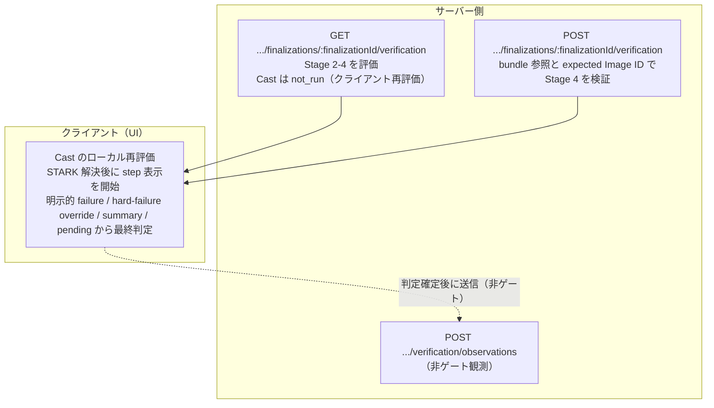
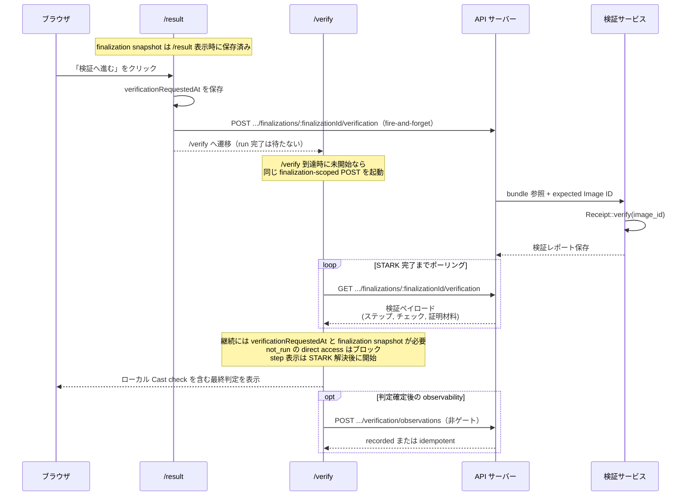

# 設計と実行フロー

この章では、検証パイプラインの設計原則と、リクエストから判定までの実行フローを説明します。

## 設計原則

本システムの検証パイプラインは、5 つの原則に基づいています。

### 原則 1: 必要な検証が未実行なら Verified を表示しない

required チェックが `not_run`（未実行）、`pending`（依存待ち）、`running`（実行中）のいずれかにある場合、システムは「Verified」を表示しません。
証拠の不在や未解決状態は成功として扱いません。

### 原則 2: 失敗した検証は即座にブロックする

いずれかの必須チェックが失敗すれば、「Verified」表示は即座にブロックされます。
代表的な失敗条件は次のとおりです。

- `excludedSlots > 0`（除外されたスロットが存在する）
- 整合性証明の失敗
- 公開監査アーティファクトとの不一致
- 第三者 STH 合意の不成立（設定時）

### 原則 3: チェック評価と集約の責務を分ける

チェック評価はサーバーが担い（`GET /api/sessions/:sessionId/finalizations/:finalizationId/verification` が Stage 2-4 を評価し、STARK 検証は同じ resource への `POST` で実行）、Cast-as-Intended のローカル再評価と最終判定の集約はクライアントが担います。
集約ルールと最終判定の決まり方は [ゲーティングロジック](gating-logic.md#最終判定の種類) を参照してください。

### 原則 4: evidence の取得・admission と評価を分ける

provider 選択、URL fetch、capability 付与、store read、外部 response の strict
admission、transport/unavailable/malformed の分類は application/API の acquisition
boundary が担います。verification evaluator は admission 済みの consistency proof、
STH result、bitmap material、session/finalization authority を受け取り、transport
や credential を解決しません。

取得失敗を成功相当の空値に変換せず、閉じた unavailable/corrupt または check
status へ fail-closed に写像することで、I/O と暗号・整合性評価を独立に検査できます。

### 原則 5: proof authority と presentation を分ける

`proofAuthority`、included journal、公開監査 artifact は検証根拠です。
claimed tally、scenario、tamper 表示、shared policy result は
`presentation` として分離し、authority から導出または照合します。
presentation の都合で proof-bound data を書き換えず、両者が不一致なら
`published_tally_mismatch` などの失敗として表示します。

## 検証パイプラインの全体構造

パイプラインは Stage 1（Cast-as-Intended）→ Stage 2（Recorded-as-Cast）→ Stage 3（Counted-as-Recorded）→ Stage 4（STARK Verification）→ 結果表示の順に評価されます。

### 実行責務

`GET /api/sessions/:sessionId/finalizations/:finalizationId/verification` は 22 チェックのレスポンスを組み立てます。

- 評価対象: サーバーは Stage 2-4 の 18 チェックを評価し、Cast-as-Intended の 4 チェックは `not_run` で返します。クライアントがローカル再評価で上書きします。summary の導出（`deriveVerificationSummary`）はサーバー側の verification resource とクライアント側の `/verify` の両方で使われます。
- `200` + fail-closed のケース:
  - Recorded-as-Cast は [cast-time 証跡](../appendix/glossary.md#cast-time-証跡cast-time-ct-artifact)（`voteReceipt` と `userVote.proof`）を前提とします。exact proof を store から取得できない場合でも verification resource は `200` を返し、`voterEvidence.availability = "unavailable"` と関連チェックの `not_run` によって全体判定を `missing_evidence` 側へ倒します。flat field や不完全な proof への fallback はありません。
  - `userVote.proof.treeSize` など exact voter evidence 側の必要データが不在のときは、関連チェックを `not_run` に補正します。
  - サーバーは `verificationStatus` を [fail-closed](../appendix/glossary.md#fail-closed) に補正します。unsupported な verifier status でも `verificationSteps` / `verificationChecks` を含む `200` 応答を返します。
- corrupt のケース: `journal` は成功済み finalization の必須 authority です。不在または malformed なら check 単位に修復せず、corrupt として fail-closed に扱います。

## 検証の実行フロー

検証導線では通常、`/result` から `/verify` へ進みます。

1. `/result` は正準な finalization snapshot をクライアント状態に保存します。
   「検証へ進む」を押すと `verificationRequestedAt` を保存し、必要なら `POST /api/sessions/:sessionId/finalizations/:finalizationId/verification` を非同期に先行起動します（完了を待たずに `/verify` へ遷移します）。
2. `/verify` はその継続状態がある場合に検証シーケンスを続行します。
   STARK が未開始ならシーケンス内で起動できます。
3. 継続状態がなく STARK が `not_run` のまま直接 `/verify` へアクセスした場合は、自動続行せずブロックします
4. `/verify` の UI シーケンスは、step を順に見せる前に STARK が terminal status に到達するまでポーリングします。
   timeout や transport failure は STARK failure として扱われます。
5. UI の最終判定が確定し、pending check がなく、server response が検証済みで、STARK status が terminal なら、`/verify` は `POST /api/sessions/:sessionId/finalizations/:finalizationId/verification/observations` を best-effort で送信します。
   current `finalizationId` は path authority であり、body に identity を重複させません。strict body は 4 個の browser-local Cast check status だけを持ちます。この事後観測は表示済みの verdict を gate または変更せず、送信失敗も検証失敗として扱いません。
   リクエスト内容と authority 規則は [API エンドポイント](../api/endpoints.md#post-apisessionssessionidfinalizationsfinalizationidverificationobservations) を参照してください。

継続判定に使うクライアント状態キーの視点は [セッションライフサイクル](../api/session-lifecycle.md) を参照してください。

## 4 段階の概要

各段階が何を証明するかは [4 段階検証モデル](four-stage-model.md) を参照してください。
この章の観点で重要なのは、検証の実行場所が段階ごとに異なることです。

| 段階    | 名称                | 検証の実行場所                                     |
| ------- | ------------------- | -------------------------------------------------- |
| Stage 1 | Cast-as-Intended    | クライアント（`/verify` 画面でローカル再計算）     |
| Stage 2 | Recorded-as-Cast    | サーバー（finalization-scoped verification `GET`） |
| Stage 3 | Counted-as-Recorded | サーバー（finalization-scoped verification `GET`） |
| Stage 4 | STARK Verification  | サーバー（同じ resource への `POST`）              |

各ステージの導出ルール（required チェック群からの集約、STH source 設定時の昇格、ガード条件）は [ゲーティングロジック](gating-logic.md#ステップとチェックの対応関係) を参照してください。

## 検証チェック数

パイプライン全体で 22 個の検証チェックが定義されており、各チェックには一意の ID が割り当てられています。
チェック ID の単一ソースは `packages/verification/src/verification/verification-checks.ts` です。

| 段階                | チェック数 |
| ------------------- | ---------- |
| Cast-as-Intended    | 4          |
| Recorded-as-Cast    | 6          |
| Counted-as-Recorded | 10         |
| STARK Verification  | 2          |
| **合計**            | **22**     |

各チェックの重要度（required / optional）と判定ロジックは [チェック一覧](checks-catalog.md) を参照してください。

<!-- source: apps/web/src/api/verification.ts, apps/web/src/routes/result/page.tsx, apps/web/src/routes/verify/page.tsx, apps/web/src/routes/verify/lib/local-cast-evidence.ts, apps/web/src/routes/verify/lib/verification-presentation.ts, apps/web/src/routes/verify/hooks/useVerificationData.ts, apps/web/src/routes/verify/hooks/useVerificationSequence.ts, apps/web/src/routes/verify/hooks/useVerificationObservation.ts, apps/api/src/server/api/handlers/verify.ts, apps/api/src/server/api/handlers/verificationRun.ts, apps/api/src/server/api/handlers/verificationObservation.ts, packages/api-contract/src/routes/inventory.ts, packages/api-contract/src/schemas/verification.ts, packages/application/src/verification/prepare-verification-read.ts, packages/verification/src/verification/build-verification-steps.ts, packages/verification/src/verification/engine/derive-stages.ts, packages/verification/src/verification/verification-presentation-policy.ts, packages/verification/src/verification/verification-summary.ts -->
