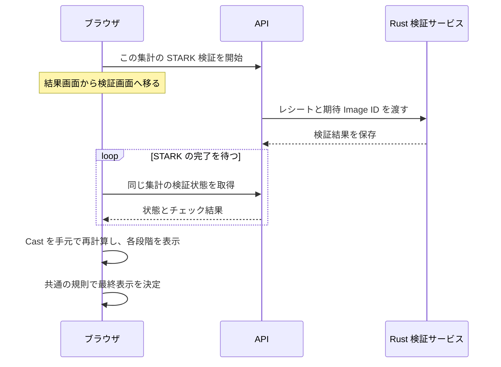

# 検証の実行フロー

「検証へ進む」を押すと、ブラウザとサーバーがそれぞれの持つ証拠を使って確認を始めます。ブラウザには投票時の B と乱数が残り、サーバーには掲示板の証拠、集計入力、STARK レシートが保存されています。

## 誰が何を検証するか

| 実行場所          | 確認すること                                                                       | ブラウザが受け取るもの                                 |
| ----------------- | ---------------------------------------------------------------------------------- | ------------------------------------------------------ |
| ブラウザ          | 手元の投票内容からコミットメントを再計算する（Cast）                               | サーバーから取得した投票レシートを、手元の値と照合する |
| TypeScript API    | 掲示板の証明、公開入力、集計の包含・完全性・表示値を確認する（Recorded / Counted） | チェック結果と、それを説明する投票・集計の情報         |
| Rust 検証サービス | 指定 Image ID に対して STARK レシートを検証する                                    | API を通じて検証状態とレポートの情報                   |

API の検証応答には全 22 チェックが並びますが、Cast の 4 チェックは `not_run` です。サーバーだけでは投票者の手元の意図を検証できないためです。ブラウザはこの 4 件をローカルで再計算した結果に置き換え、共通の[表示判定規則](gating-logic.md)を適用します。

この画面の Recorded / Counted と STARK の結果は、サーバーが行った検証の報告を利用します。ブラウザがすべての暗号検証を独立に実行するわけではありません。サーバーの報告から独立してレシートや公開入力を調べる場合は、[手元での検証](../reproducibility/index.md)を行います。その場合も、ZIP だけでは手元の投票意図や自票の証拠まで揃いません。

## 画面で進む処理

結果画面は、集計結果をその `finalizationId` とともに保存します。「検証へ進む」を押すと開始時刻を記録し、必要なら STARK 検証を先に起動して、完了を待たずに検証画面へ移ります。

検証の開始には `POST /api/sessions/:sessionId/finalizations/:finalizationId/verification`、状態の取得には同じパスの `GET` を使います。AWS では POST がキューへ仕事を渡し、ワーカーが検証サービスを動かします。ローカルでは、選択されたローカル保存先のバンドルを直接検証します。

検証画面は、開始時刻と集計結果が保存された継続状態から処理を引き継ぎます。必要ならそこで STARK 検証を起動します。継続状態がなく、STARK も `not_run` のまま検証画面へ直接アクセスした場合は、自動開始しません。

STARK が終了してから段階表示を始めるので、画面上の順番と実際の処理順は一致しません。ポーリングのタイムアウトや通信失敗は成功として処理せず、検証実行の失敗として表示します。

## 証拠がない場合と、壊れている場合

投票時の証拠を取得できない場合、何も矛盾が見つからなかったとしても、記録を確認できたとは言えません。逆に、取得した証拠のインデックスやコミットメントが保存済みの票と食い違う場合は、単なる不足ではありません。

検証リソースの内部では、この違いを次のように扱います。

| 状況                                                                                           | 現在の GET の扱い                                                                                                              |
| ---------------------------------------------------------------------------------------------- | ------------------------------------------------------------------------------------------------------------------------------ |
| 集計結果は有効だが、投票時の完全な証跡を取得できない                                           | `200` の応答内で `voterEvidence.availability = "unavailable"`。関連する必須チェックは `not_run` となり、証拠不足として表示する |
| 成功済み集計に必須のジャーナルがない・壊れている、証跡が部分的に壊れている、各データが矛盾する | 有効な検証リソースとして返さず、現在の実経路では `INTERNAL_ERROR`（`500`）になる                                               |
| 集計未完了、未投票、認可条件を満たさない                                                       | 各前提条件に対応する `400` 系のエラーを返す                                                                                    |

読み取り準備が返すリソース全体の `unavailable` / `corrupt` と、正常な応答内の `voterEvidence.availability` は別の状態です。現在の GET は、前者をエラー応答の検査へ通すため `500` になります。正確な wire 形式は [API エンドポイント](../api/endpoints.md)に示します。

取得した JSON は、チェック評価の前に形式と相互整合性を検査します。期待と違うジャーナルや部分的な証跡を、空値や成功値へ補正しません。一方、教育用シナリオの「表示集計だけが違う」という状態は、その差を失敗の証拠として保持します。証拠の内容を変えて辻褄を合わせることはありません。

## 判定後に記録する観測

最終表示が確定し、保留中のチェックがなく、サーバー応答と STARK の終了状態を確認できた後、ブラウザは Cast の 4 チェックの状態だけを観測 API へ送ります。選択肢、乱数、レシート、最終判定そのものは送りません。サーバーは残りの証拠から観測内容を組み立てます。

この送信は運用上の集計に使います。失敗しても、すでに確定した検証結果は変わりません。同じ集計についての再送と競合の扱いは、[観測 API](../api/endpoints.md#post-apisessionssessionidfinalizationsfinalizationidverificationobservations)に定めています。

<!-- source: apps/web/src/api/verification.ts, apps/web/src/routes/result/page.tsx, apps/web/src/routes/verify/page.tsx, apps/web/src/routes/verify/lib/local-cast-evidence.ts, apps/web/src/routes/verify/lib/verification-presentation.ts, apps/web/src/routes/verify/hooks/useVerificationData.ts, apps/web/src/routes/verify/hooks/useVerificationSequence.ts, apps/web/src/routes/verify/hooks/useVerificationObservation.ts, apps/api/src/server/api/handlers/verify.ts, apps/api/src/server/api/handlers/verificationRun.ts, apps/api/src/server/api/handlers/verificationObservation.ts, packages/api-contract/src/routes/inventory.ts, packages/api-contract/src/schemas/verification.ts, packages/application/src/verification/prepare-verification-read.ts, packages/verification/src/verification/build-verification-steps.ts, packages/verification/src/verification/engine/derive-stages.ts, packages/verification/src/verification/verification-presentation-policy.ts, packages/verification/src/verification/verification-summary.ts -->
