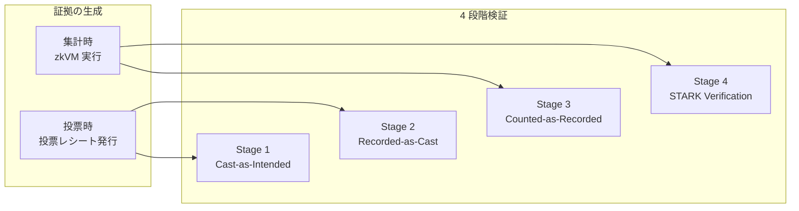
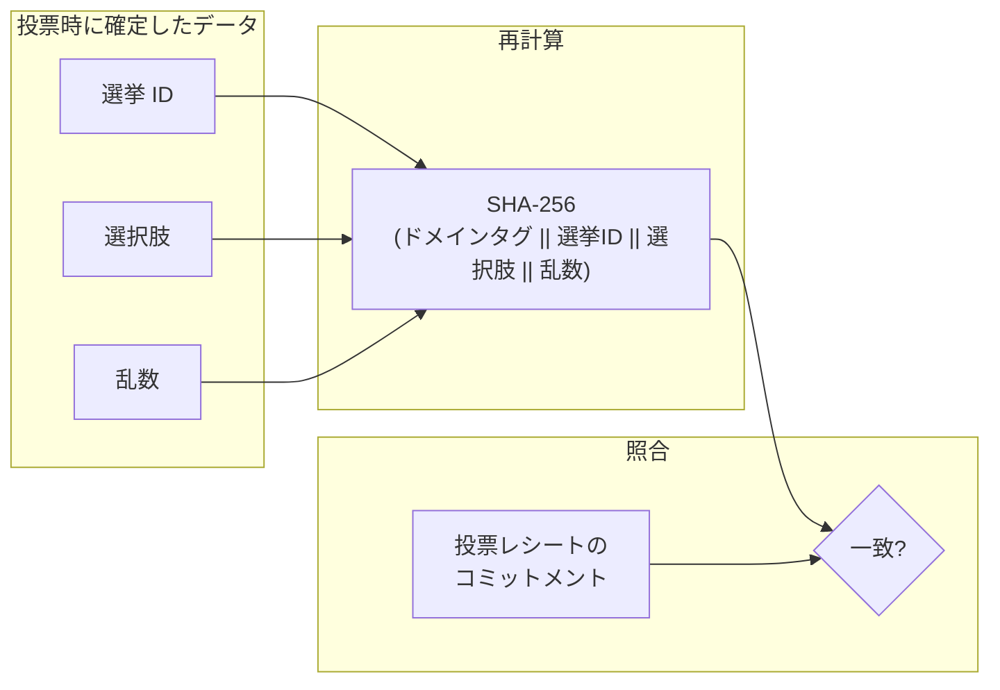
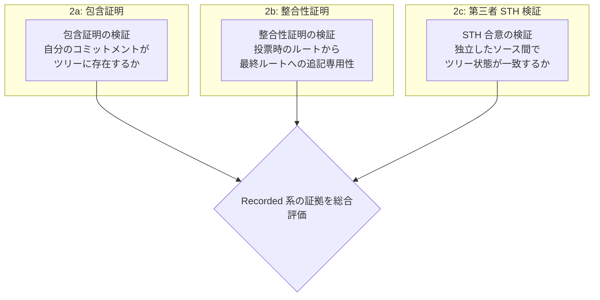
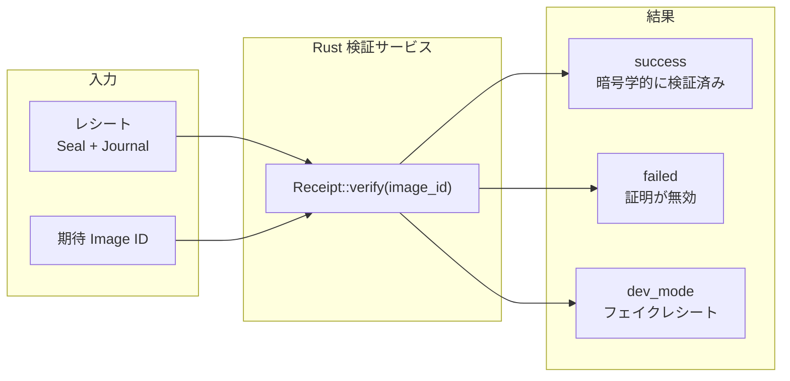

# 4 段階検証モデル

この章では、E2E 検証可能投票の各段階（Cast-as-Intended / Recorded-as-Cast / Counted-as-Recorded / STARK Verification）で成立する保証を説明します。

## 段階間の依存関係

概念モデルでは 4 段階を順に評価します。
ただし、実行場所は段階ごとに異なります。
Stage 1 はクライアントで実行し、Stage 2 から Stage 4 はサーバー中心で実行します。
実行責務の詳細は [設計と実行フロー](design-and-flow.md) を参照してください。

## Stage 1: Cast-as-Intended

### 目的

投票者が意図した選択肢のコミットメントが、サーバーから返却された投票レシートと一致することを確認します。
この確認により、サーバーが投票者の選択を差し替える攻撃を検出します。

### 検証する内容

`/verify` 画面のクライアントコードがローカルに保持された 3 つの値（選挙 ID、選択肢、乱数）からコミットメントを再計算し、投票レシートのコミットメント値と照合します。
再計算の規則（ドメインタグ、正準フォーマット）は [コミットメントスキーム](../protocol/commitment.md) を参照してください。

### 必要な証拠

選挙 ID、選択肢、乱数はクライアントセッション（`localStorage.starkBallotSession`）に保持されます。
投票レシートは capability で保護された
`GET /api/sessions/:sessionId/finalizations/:finalizationId/verification` 応答の
`data.voterEvidence` が `availability: "available"` のときに、その `voteReceipt` から取得します。

| 証拠         | 説明                                                         |
| ------------ | ------------------------------------------------------------ |
| 選挙 ID      | セッション作成時に確定した UUID                              |
| 選択肢       | 投票者が選択した値（A〜E）                                   |
| 乱数         | 投票時にクライアントが生成した 32 バイト乱数                 |
| 投票レシート | commitment, voteId, bulletinIndex, bulletinRootAtCast を含む |

[cast-time 証跡](../appendix/glossary.md#cast-time-証跡cast-time-ct-artifact)を再構成できない場合、`data.voterEvidence` は `availability: "unavailable"` と reason を返し、投票レシートは得られません（取得と fail-closed 挙動の正本は [設計と実行フロー](design-and-flow.md#実行責務)）。

### 失敗モード

| 症状                   | 原因                                                                    | 深刻度   |
| ---------------------- | ----------------------------------------------------------------------- | -------- |
| ローカル証拠の欠落     | `localStorage` 消去や別端末アクセスで投票時データを復元できない         | 検証不能 |
| 投票レシート証跡の欠落 | store から cast-time 証跡を再構成できず、`voterEvidence` が unavailable | 検証不能 |
| コミットメント不一致   | 投票時データと投票レシートの不整合、またはエンコーディングの不整合      | 重大     |
| 選択肢の範囲外         | 不正な入力（`A`〜`E` の範囲外）                                         | 重大     |
| 乱数フォーマット不正   | 32 バイト hex でない                                                    | 重大     |

### 限界

この段階は投票者の手元データに依存します。
そのため、`localStorage` 消去後や別端末からは検証できません。

## Stage 2: Recorded-as-Cast

### 目的

投票者のコミットメントが、追記専用の掲示板（CT Merkle ツリー）に正しく記録されていることを確認します。
さらに、掲示板が追記専用性を維持していることを検証します。
つまり、過去のエントリが削除や改変を受けていないことを確認します。
掲示板のツリー構造とハッシュ規則は [CT Merkle ツリー](../protocol/ct-merkle.md) を参照してください。

### 検証する内容

この段階には 3 系統の検証があります。

#### 2a: 包含証明（Inclusion Proof）

RFC 6962 の PATH 関数に基づく CT スタイルの Merkle 包含証明を検証し、投票者のコミットメントが掲示板のツリーに含まれていることを確認します。
検証者はリーフハッシュと Merkle パスからルートハッシュを再計算し、期待されるルートと照合します。

#### 2b: 整合性証明（Consistency Proof）

投票時点のツリー状態（ルートとサイズ）から、最終的なツリー状態への遷移が追記のみで行われたことを検証します。
RFC 6962 の SUBPROOF アルゴリズムに基づく整合性証明により、サーバーが過去のエントリを密かに削除したり順序を変更したりするスプリットビュー攻撃を検出します。

#### 2c: 第三者 STH 検証（オプション）

複数の独立した STH（Signed Tree Head）ソースに問い合わせ、合意が成立しているかを確認します。
この確認により、サーバーが検証者ごとに異なるツリー状態を提示するスプリットビュー攻撃を検出します。
照合対象となるダイジェストの構成は [STH ダイジェスト](../protocol/sth-digest.md) を、照合条件の詳細は [チェック一覧](checks-catalog.md#recorded_sth_third_party) を参照してください。

### 必要な証拠

Recorded の検証リソースは
`GET /api/sessions/:sessionId/finalizations/:finalizationId/verification` の `data` です。

| 証拠                                  | 取得元                                                                                | 説明                                                                                           |
| ------------------------------------- | ------------------------------------------------------------------------------------- | ---------------------------------------------------------------------------------------------- |
| 包含証明の検証結果                    | `data.verification.checks`                                                            | サーバー側で RFC 6962 包含証明を評価したチェック結果                                           |
| 整合性証明の検証結果                  | `data.verification.checks`                                                            | サーバー側で RFC 6962 整合性証明を評価したチェック結果                                         |
| 投票時のルートハッシュ                | `data.voterEvidence.voteReceipt.bulletinRootAtCast`                                   | `voterEvidence.availability="available"` のときの投票受理時ツリールート                        |
| 投票時のツリーサイズ（oldSize）       | `data.voterEvidence.userVote.proof.treeSize`                                          | `voterEvidence.availability="available"` のときの整合性証明の oldSize                          |
| 最終ルートハッシュ/最終ツリーサイズ   | `data.proofAuthority.bulletinRoot` / `data.proofAuthority.treeSize`                   | 集計時の proof-bound な最終状態                                                                |
| 独立検証用の包含証明材料（任意）      | `/api/sessions/:sessionId/votes/:voteId/inclusion-proof`                              | capability で保護された、個別に包含証明を再検証するための材料                                  |
| 補助 tooling の整合性証明材料（任意） | `/api/sessions/:sessionId/bulletin/consistency-proof?fromTreeSize=...&toTreeSize=...` | capability で保護された補助 tooling 用。verification handler の最終判定はこの route を呼ばない |
| STH スナップショット                  | 設定済み STH ソース（same-origin template と外部 HTTPS）                              | same-origin template は `/api/sessions/:sessionId/bulletin/sth`。外部応答の必須値は digest     |

cast-time 証跡（`voteReceipt` と、oldSize を与える `userVote.proof.treeSize`）を再構成できない場合、Recorded の必須チェックは `not_run` となり、全体判定は [fail-closed](../appendix/glossary.md#fail-closed) で `missing_evidence` 側へ倒れます。
取得と admission の分離は [設計原則 4](design-and-flow.md#原則-4-evidence-の取得admission-と評価を分ける) を、check 単位の判定は [チェック一覧](checks-catalog.md#recorded_inclusion_proof) を参照してください。

### 失敗モード

| 症状                     | 原因                                                                          | 深刻度         |
| ------------------------ | ----------------------------------------------------------------------------- | -------------- |
| 包含証明の検証失敗       | ツリーサイズ/インデックスの不一致、掲示板のリセット                           | 重大           |
| 整合性証明の検証失敗     | 追記専用性の違反（スプリットビュー攻撃の可能性）                              | 重大           |
| cast-time 証跡の欠落     | store から `voteReceipt` / `userVote.proof` を再構成できず、Recorded が未実行 | 検証不能       |
| 第三者 STH 合意の不成立  | サーバーが検証者ごとに異なるツリーを提示                                      | 重大（有効時） |
| ルートが履歴に存在しない | ルート履歴の不整合                                                            | 重大           |

## Stage 3: Counted-as-Recorded

### 目的

掲示板に記録された全投票が、zkVM の集計処理に正しく含まれたことを確認します。
投票の除外、欠落、重複がないことも確認します。
さらに、公開された claimed tally（表示用集計値）が zkVM の `verifiedTally` と一致することを検証し、集計結果の完全性と整合性を保証します。

### 検証する内容

この段階では 10 個の required チェックが全て `success` であることを要求します。
導出ルールと journal 省略時のガード補正は [ゲーティングロジック](gating-logic.md#ステップとチェックの対応関係) を参照してください。

| 系統           | required チェック                                                                                                                                                                              |
| -------------- | ---------------------------------------------------------------------------------------------------------------------------------------------------------------------------------------------- |
| public 系（6） | `counted_input_sanity`, `counted_unique_indices`, `counted_unique_commitments`, `counted_election_manifest_consistent`, `counted_close_statement_consistent`, `counted_input_commitment_match` |
| zk 系（4）     | `counted_tally_consistent`, `counted_missing_indices_zero`, `counted_expected_vs_tree_size`, `counted_my_vote_included`                                                                        |

1 つでも `success` でないチェックが残る場合、Counted は成功にならず、Verified をブロックします。

### 必要な証拠

| 証拠                     | 取得元                                                                                                        | 説明                                                                                                                |
| ------------------------ | ------------------------------------------------------------------------------------------------------------- | ------------------------------------------------------------------------------------------------------------------- |
| zkVM ジャーナル（詳細）  | `/api/sessions/:sessionId/finalizations/:finalizationId/verification?include=journal` の `data.journal.value` | `data.journal.representation="included"` のときの集計結果、除外情報、bitmap root など                               |
| 集計サマリー（通常応答） | 同じ verification resource の `data.proofAuthority`                                                           | `missingSlots` / `invalidPresentedSlots` / `rejectedRecords` / `excludedSlots` / `totalExpected` / `treeSize` など  |
| 公開入力サマリー         | サーバー内部評価用                                                                                            | `public-input.json` 相当から組み立てた、秘密データを含まない入力要約                                                |
| 選挙マニフェスト         | 公開監査アーティファクト（`election-manifest.json`）                                                          | `electionId` と `electionConfigHash` を束縛する公開可能アーティファクト                                             |
| 締切ステートメント       | 公開監査アーティファクト（`close-statement.json`）                                                            | `logId` / `treeSize` / `bulletinRoot` / `timestamp` / `sthDigest` を束縛する公開可能アーティファクト                |
| ビットマップ証明材料     | `/api/sessions/:sessionId/finalizations/current/bitmap-proofs/:kind/:voteIndex`                               | `kind` の `included` と `seen` を使い分け、自分の index が counted されたことや prover に提示されたかを説明する材料 |
| ビットマップルート       | ジャーナル / `data.proofAuthority`                                                                            | zkVM ゲストが計算した `includedBitmapRoot` と `seenBitmapRoot`                                                      |

公開入力サマリーはサーバー内部表現であり、レスポンスにそのまま含まれません。
`inputCommitment` が束縛するのは `public-input.json` の部分集合です。
通常応答で proof-bound な値は `data.proofAuthority`、claimed tally は
`data.presentation.tally` に分離され、旧 flat field への fallback はありません。
各チェックの判定ロジックは [チェック一覧](checks-catalog.md#counted-as-recorded10-チェック) を参照してください。

### 重要な判定: 除外数（`excludedSlots`）

`excludedSlots > 0` はハード失敗であり、全体の検証成功を阻止します。
除外数の解決順序と legacy aliases の扱いは [チェック一覧の `counted_missing_indices_zero`](checks-catalog.md#counted_missing_indices_zero) を、全体判定への影響は [ゲーティングロジック](gating-logic.md) を参照してください。

### 失敗モード

| 症状                                   | 原因                                                                                         | 深刻度                                            |
| -------------------------------------- | -------------------------------------------------------------------------------------------- | ------------------------------------------------- |
| `excludedSlots > 0`                    | 欠落スロットまたは計上失敗スロットが存在する                                                 | 重大（即座にブロック）                            |
| 欠落スロット / invalid presented slot  | 一部の bulletin slot が prover に提示されなかった、または提示後に計上されなかった            | 重大                                              |
| 公開集計値の不一致                     | 公開表示された `tally.counts` が zkVM の `verifiedTally` と一致しない                        | 重大（claimed tally 改ざんシナリオ S2/S4 で発火） |
| 集計合計の不一致                       | `verifiedTally` の合計が `validVotes` または `tally.totalVotes` と一致しない                 | 重大                                              |
| 選挙マニフェスト不整合                 | `electionId` または `electionConfigHash` が verification inputs と一致しない                 | 重大（必須チェック失敗）                          |
| 締切ステートメント不整合               | `logId` / `timestamp` / `sthDigest` / `bulletinRoot` / `treeSize` が一致しない               | 重大（必須チェック失敗）                          |
| 入力コミットメント不一致               | 公開入力のうち inputCommitment 対象フィールドと zkVM 実行で使用された入力が異なる            | 重大                                              |
| 自票のビットマップ証明が失敗または欠落 | bit が 0、proof source 不可、またはルート不一致                                              | 重大（required check が `failed/not_run`）        |
| ツリーサイズの不一致                   | `totalExpected` と `treeSize` が異なる（暗黙の除外、または close/input side の不整合を示す） | 重大（必須チェック失敗）                          |

## Stage 4: STARK Verification

### 目的

zkVM の実行が正しく行われたことを STARK 証明（レシート）の暗号学的検証により確認します。
レシートの検証に成功すれば、ジャーナルの内容（集計結果、除外情報、入力コミットメント等）がゲストプログラムの正しい実行の結果であることが保証されます。

### 検証する内容

### 検証の 2 段階

STARK Verification では 2 つのチェックを実行します。

**Image ID 照合**: verifier-confirmed な `receipt_image_id` が期待 Image ID と一致し、ホスト主張値（`imageId`）や comparison-only の `journal.imageId` とも矛盾しないことを確認します。
Image ID はゲストプログラムから導出される暗号的識別子であり、プログラムの改変やホスト主張値の食い違いを検出します。
解決順の詳細は [チェック一覧](checks-catalog.md#stark_image_id_match) を参照してください。

**レシート検証**: RISC Zero の `Receipt::verify(image_id)` を呼び出し、Seal（STARK 証明）がジャーナルと Image ID に対して暗号学的に正当であることを検証します。
この検証は計算量が多いため、サーバー側の Rust 検証サービスで実行されます。

### 必要な証拠

| 証拠                           | 取得元                    | 説明                                                                                                   |
| ------------------------------ | ------------------------- | ------------------------------------------------------------------------------------------------------ |
| レシート（Seal + Journal）     | 証明バンドル              | zkVM ホストが生成した STARK 証明                                                                       |
| 期待 Image ID                  | サーバー側で解決          | ゲストプログラムの暗号的識別子（解決順は [チェック一覧](checks-catalog.md) 参照）                      |
| ホスト主張値と比較用メタデータ | 検証コンテキストと report | `imageId`, `journal.imageId`, `verificationReport.receipt_image_id` を相互照合し、主張の食い違いを検出 |

### 開発モードの検出

`RISC0_DEV_MODE=1` で生成された dev-mode receipt はフェイクレシートであり、本物の STARK 証明ではありません。
`dev_mode` ステータスの検出、正規化、`Demo Only`（`demo_only`）表示のルールは [ゲーティングロジック](gating-logic.md#stark-検証のゲーティング) を参照してください。
profile ごとの帰結は次節の失敗モード表にまとめています。

### 失敗モードと非 production evidence

| 症状               | 原因                                                                         | 影響                               |
| ------------------ | ---------------------------------------------------------------------------- | ---------------------------------- |
| Image ID 不一致    | マッピングが古い、ホスト主張値が誤っている、またはプローバーイメージが異なる | 重大。Verification Failed          |
| レシート検証失敗   | 証明が暗号学的に無効                                                         | 重大。Verification Failed          |
| 開発モード検出     | 非 production profile でフェイクレシートを検出                               | `Demo Only`。`Verified` をブロック |
| 未許可の開発モード | production または dev-mode を許可しない profile でフェイクレシートを検出     | fail-closed。`Verified` をブロック |

UI ステップの対応チェック、集約ルール、最終判定の決定方法は [ゲーティングロジック](gating-logic.md) を参照してください。

<!-- source: packages/api-contract/src/routes/inventory.ts, packages/api-contract/src/schemas/verification.ts, apps/api/src/server/api/handlers/verify.ts, packages/verification/src/verification/engine/evaluate-checks.ts, packages/verification/src/verification/verification-checks.ts, packages/verification/src/verification/build-verification-steps.ts, packages/verification/src/verification/verification-presentation-policy.ts, apps/web/src/routes/verify/lib/local-cast-evidence.ts, apps/web/src/routes/verify/hooks/useVerificationData.ts, apps/web/src/routes/verify/hooks/useVerificationSequence.ts, packages/verification/src/verification/consistency-verifier.ts -->
