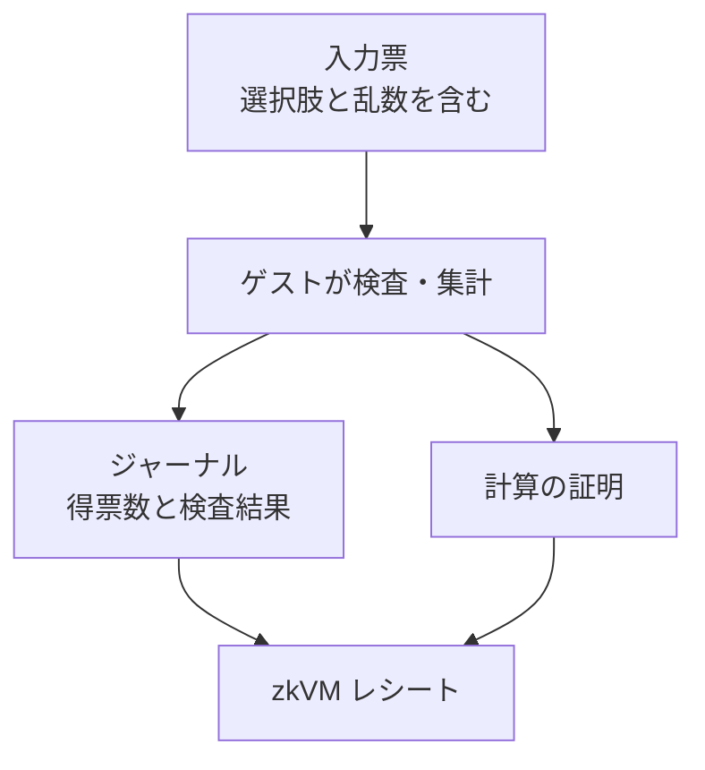

# zkVM の基礎

zkVM は、入力の一部を非公開にしたまま、指定したプログラムの計算結果を検証するための仮想マシンです。サーバーの集計結果だけでは計算過程を確認できず、全票を公開して再集計する方式では投票先も公開されます。zkVM は実行の証明を使って計算結果を確認します。

## 実行モデル

このデモでは RISC Zero を使い、Rust で書いた投票検査・集計プログラムをゲストとして実行し、暗号学的な証明を生成します。ゲストは RISC-V の RV32IM 命令列として動きます。[RISC Zero の技術仕様](https://dev.risczero.com/api/zkvm/zkvm-specification)が、この実行モデルを定義しています。

ゲストは提示された各レコードについて、選択肢と乱数からコミットメントを再計算し、掲示板の記録と照合します。さらに、最終掲示板への包含を確認してから得票数へ加算します。

証明は、指定したプログラムがある入力を処理し、その公開出力を生成したことを示します。プログラムの設計は、レビューや[テスト・形式化](../quality/index.md)によって検討します。また、渡した入力が必要な票をすべて含むかは、ゲストが出す欠落数や公開入力との照合によって確認します。

## ジャーナルとレシート

ゲストが公開する出力をジャーナル、その出力を計算に結びつける証明を含む成果物を zkVM レシートと呼びます。投票時にブラウザが受け取る「投票レシート」とは別のものです。

ジャーナルには得票数、除外スロット数、入力コミットメント、二つのビットマップルート、掲示板の締切状態などが入ります。レシートの検証が成功すると、この出力が指定ゲストの実行に結びついていると確認できます。出力を変更すれば、同じ証明では検証できなくなります。

別ファイルの `journal.json` は、レシート内部のジャーナルを読みやすい JSON に変換したものです。ファイル名だけで証明済みの値とみなさず、検証済みレシートから取り出した値との一致を確認します。

## Image ID によるゲストの識別

証明の検証では、期待するゲストを検証者が選ぶ必要があります。入力にかかわらず任意の得票数を返すプログラムについても、有効な実行証明を生成できるためです。検証者は、証明の差出人が指定したプログラムを無条件に受け入れてはいけません。

Image ID は実行対象のゲストを識別する 256 ビットの値です。検証者が別途選んだ期待値を `Receipt::verify(expected_image_id)` に渡すことで、意図したゲストの計算であることを確認します。具体的な選択方法は [Image ID](image-id.md)で定義します。

## ホスト・ゲスト・検証サービス

| 構成要素     | 行うこと                                                   |
| ------------ | ---------------------------------------------------------- |
| ゲスト       | 投票を検査・集計し、公開する結果を決める                   |
| ホスト       | 入力を読み、ゲストの実行と証明生成を行い、成果物を書き出す |
| 検証サービス | 期待 Image ID を使ってレシートを検証する                   |

ホストが「成功」とログに出したことは、レシートの検証成功ではありません。アプリでは独立した Rust バイナリ `verifier-service` に検証を委ね、そのレポートを受け取ります。ブラウザとサーバーがそれぞれ確かめる内容は、[検証の実行フロー](../verification/design-and-flow.md)にまとめています。

## RISC Zero を採用する理由

集計規則を通常の Rust コードとして書き、テストできることが、この構成の利点です。暗号回路専用の言語へ集計ロジックを移し替えずに、実行するプログラムと検証するプログラムの識別子を対応させられます。

RISC Zero は長い実行を複数セグメントへ分割して証明できます。このデモは `Composite` receipt を配布し、Groth16 への圧縮は行いません。この STARK 証明経路は、証明ごとの秘密の初期設定値を作る trusted setup を必要としません。

開発用の fake receipt は、ゲストとの入出力連携を試すためのものです。実際の STARK 証明を持たないので、形式が似ていても上記の暗号学的保証は得られません。

## STARK の検証原理

STARK は、プログラムの各ステップの状態と、その間の遷移を検査対象にします。状態の列を有限体上の多項式として表し、命令の制約を満たしているかを確かめます。

概念的には、評価点の集合 `H` 上で制約多項式 `C(x)` がすべて 0 になることを調べます。`H` 上で 0 になる多項式を `Z_H(x)` とすると、制約を満たす場合は `C(x)` が `Z_H(x)` で割り切れます。STARK は、このような関係を Merkle コミットメントや FRI を使って効率よく検証します。FRI は、提示された値の列が低い次数の多項式として振る舞うかを少数の問い合わせで検査する仕組みです。

実際の証明方式の構成は [RISC Zero の技術仕様](https://dev.risczero.com/api/zkvm/zkvm-specification)と [STARK by Hand](https://dev.risczero.com/proof-system/stark-by-hand)に詳述されています。アプリがレシートを採用する境界では、SDK の検証 API を使い、この数学的検証を独自に実装しません。

<!-- source: zkvm/, packages/zkvm-contract/src/zkvm/, verifier-service/ -->
