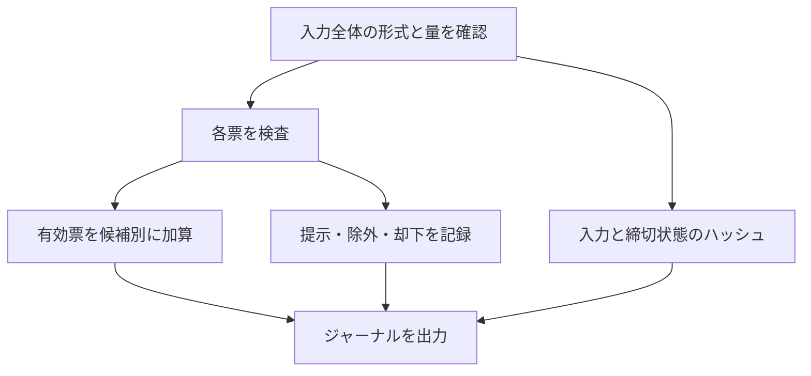

# ゲストプログラム

集計ゲストは、入力レコードの位置、opening、コミットメント、包含証明を検査し、すべてを通過した票だけを候補別の得票数に加算します。

検査に失敗したレコード数と、掲示板上にある未提示のスロット数も出力します。たとえば、64 スロットの掲示板に対して 63 票だけが提示された場合、その不足を計算結果に記録します。

## 処理パイプライン



入力全体が処理可能かという検査と、一票を有効と認める検査は分けています。処理量の上限を超えれば実行を拒否します。一方、範囲内の入力に無効票や重複があれば、それを却下した結果をジャーナルに残します。

## 投票の 6 段階検証

入力レコードを受け取った順に検査します。最初に失敗したところで、そのレコードの検査を打ち切ります。

| 順序 | 確かめること                                     | 失敗する例                         |
| ---- | ------------------------------------------------ | ---------------------------------- |
| 1    | インデックスが `0 <= index < tree_size` か       | 64 スロットなのに位置 64 を指定    |
| 2    | そのインデックスが初出か                         | 位置 0 の票をもう一度渡す          |
| 3    | 選択肢が 0〜4 か                                 | 候補 A〜E に対応しない値           |
| 4    | opening から再計算したコミットメントが一致するか | B を C に変えて元の乱数を使う      |
| 5    | 同じコミットメントをすでに処理していないか       | 別の位置へ同じ記録を複製           |
| 6    | 最終掲示板への包含証明が成立するか               | 記録やパスが掲示板ルートと合わない |

1、2 を通過した時点で、そのスロットを `seenBitmap` に記録します。3〜6 で失敗しても「提示された」という事実は残ります。6 まで通過すれば `includedBitmap` も立て、対応する候補へ 1 票を加えます。

重複の検査は先着順です。先のレコードが検証に失敗しても、その位置を後続レコードでやり直すことはできません。コミットメントも、照合と重複検査を通過して登録された後は、包含検査に失敗しても予約されたままです。

コミットメントの計算は[投票コミットメントの式](../protocol/commitment.md#コミットメントの正準フォーマット)、包含検査は [CT Merkle の規則](../protocol/ct-merkle.md)を使います。

## スロット / レコード分離モデル

スロットは掲示板上の位置、レコードはゲストに渡された票データです。一つの位置に重複レコードを何件送っても、掲示板のスロット数は増えません。未提示のスロットと却下したレコードは、別の値として記録します。

| 状況                                       | `validVotes` | `invalidPresentedSlots` | `missingSlots` | `rejectedRecords` |
| ------------------------------------------ | -----------: | ----------------------: | -------------: | ----------------: |
| 64 票すべてを正しく提示                    |           64 |                       0 |              0 |                 0 |
| 位置 0 を提示せず、ほかの 63 票は有効      |           63 |                       0 |              1 |                 0 |
| 位置 0 を不正な opening で提示、ほかは有効 |           63 |                       1 |              0 |                 1 |
| 正しい 64 票の後に位置 0 の重複を追加      |           64 |                       0 |              0 |                 1 |

スロットは「計上済み」「提示されたが未計上」「一度も提示されなかった」の三つに分かれます。

```text
validVotes + invalidPresentedSlots + missingSlots = treeSize
seenIndicesCount = validVotes + invalidPresentedSlots
excludedSlots = missingSlots + invalidPresentedSlots
```

`excludedSlots > 0` なら、少なくとも一つの掲示板スロットを数えられていません。`rejectedRecords` は、それとは別に、重複や範囲外を含む却下レコードの総数です。最後の例のように除外が 0 でも却下が 1 になり得ますが、アプリが Verified として受け入れるには却下も 0 であることを要求します。

入力レコードと得票数には、さらに次の関係が成立します。

```text
sum(verifiedTally) = validVotes
validVotes + invalidVotes = totalVotes
rejectedRecords = invalidVotes
rejectedRecords >= invalidPresentedSlots
```

`totalVotes` はゲストへ提示したレコード数で、掲示板のスロット数ではありません。`totalExpected` は選挙設定が要求する票数です。ゲストはこれを入力から出力へ引き継ぎ、`treeSize` との一致は検証側が確認します。

## ジャーナル出力

ジャーナルは、上の計算を検証者へ伝える公開出力です。下表は公開 JSON の名前と論理的な値を定義します。

| フィールド            | 型        | 説明                                                                                                            |
| --------------------- | --------- | --------------------------------------------------------------------------------------------------------------- |
| electionId            | UUID      | 対象選挙 ID（入力の `election_id` をエコー）                                                                    |
| electionConfigHash    | 32 バイト | 選挙設定ハッシュ（入力の `election_config_hash` をエコー）                                                      |
| bulletinRoot          | 32 バイト | 掲示板ルート（入力の `bulletin_root` をエコー）                                                                 |
| treeSize              | u32       | 掲示板のツリーサイズ（入力をエコー）                                                                            |
| totalExpected         | u32       | 想定総投票数（入力をエコー）                                                                                    |
| sthDigest             | 32 バイト | [STH ダイジェスト](../protocol/sth-digest.md)                                                                   |
| verifiedTally         | u32[5]    | 選択肢 A〜E ごとの得票数                                                                                        |
| totalVotes            | u32       | zkVM が受け取った投票レコード数                                                                                 |
| validVotes            | u32       | 検証に成功した投票数                                                                                            |
| invalidVotes          | u32       | 検証に失敗した投票数                                                                                            |
| seenIndicesCount      | u32       | 範囲内かつ初出のインデックスとして処理した件数                                                                  |
| missingSlots          | u32       | 一度も提示されなかった掲示板スロット数（[スロット / レコード分離モデル](#スロット--レコード分離モデル) を参照） |
| invalidPresentedSlots | u32       | 提示はされたが計上されなかった範囲内スロット数（同上）                                                          |
| rejectedRecords       | u32       | 却下されたレコード数（同上）                                                                                    |
| seenBitmapRoot        | 32 バイト | prover に提示されたインデックス集合の [ビットマップ Merkle](../protocol/bitmap-merkle.md) ルート                |
| includedBitmapRoot    | 32 バイト | 実際にカウントされたインデックス集合の [ビットマップ Merkle](../protocol/bitmap-merkle.md) ルート               |
| excludedSlots         | u32       | 除外されたスロットの総数（定義は [スロット / レコード分離モデル](#スロット--レコード分離モデル) の式）          |
| inputCommitment       | 32 バイト | [入力コミットメント](../protocol/input-commitment.md)                                                           |
| methodVersion         | u32       | ゲストプログラムのバージョン（現行 = `14`）                                                                     |

### ジャーナルの信頼モデル

期待する Image ID で本番用レシートの検証が成功したとき、そのレシート内のジャーナルを、指定ゲストが出した結果として受け入れられます。得票数や不足数はゲストの計算結果ですが、選挙 ID、設定ハッシュ、掲示板ルート、期待票数は入力から引き継いだ値です。これらが対象の選挙・掲示板に一致することは、公開入力や投票時の記録との照合で確かめます。

`inputCommitment` は[決められた公開フィールド](../protocol/input-commitment.md#フィールド一覧)だけを束縛します。`sthDigest` はゲストに渡された締切状態のハッシュであり、外部の記録源が同じ状態を観測したことを、それだけで示すものではありません。

### レシート内部と JSON の表現

Rust の `VerificationOutput` は `election_id: [u8; 16]` などのフィールドを持ち、`env::commit(&output)` が RISC Zero serde で直列化します。receipt 内部はこの形式でデコードし、公開 JSON の表現と区別します。固定オフセットや手書きの packed layout での読み取りは行いません。

ホストがデコードした camelCase JSON では UUID とハッシュがバイト配列で出力され、配布用 `journal.json` では UUID 文字列・16 進数文字列へ変換されます。[検証サービスの `decode-journal`](verifier-service.md#検証済みジャーナルの取得)は、同じレシートを検証してから Rust の契約でデコードします。

## ビットマップルートの計算

`seenBitmap` と `includedBitmap` はそれぞれ `treeSize` 個のビットを持ち、提示された位置と計上した位置を表します。全ビットをジャーナルへ載せる代わりに、それぞれの Merkle ルートを載せます。

このルートを使った証明により、自票の提示・計上状態を検証できます。位置 0 のユーザー票も、提示・計上済み、提示済み・無効、未提示のいずれかに分類します。未計上の提示スロットがなければ、両ビットマップの集合もルートも一致します。バイト表現と個票の証明は[ビットマップ Merkle](../protocol/bitmap-merkle.md)で定義します。

## 入力データ構造

入力の Rust フィールドは次のとおりです。opening を含む入力全体は公開 ZIP に入れません。

| フィールド           | 型               | 説明                                                              |
| -------------------- | ---------------- | ----------------------------------------------------------------- |
| election_id          | 16 バイト        | 選挙の UUID v4 バイナリ表現                                       |
| bulletin_root        | 32 バイト        | 掲示板 Merkle ツリーの最終ルート                                  |
| tree_size            | u32              | 掲示板のリーフ数（= 投票スロット数）                              |
| log_id               | 32 バイト        | 掲示板のログ識別子                                                |
| timestamp            | u64              | 入力構築時に採用された最新 STH スナップショットの Unix 時刻ミリ秒 |
| total_expected       | u32              | 想定される総投票数                                                |
| election_config_hash | 32 バイト        | 選挙設定のハッシュ値                                              |
| votes                | VoteWithProof[ ] | 投票データと Merkle パスの配列                                    |

各 `VoteWithProof` は以下のフィールドを持ちます。

| フィールド  | 型           | 説明                                        |
| ----------- | ------------ | ------------------------------------------- |
| index       | u32          | 掲示板上のインデックス                      |
| choice      | u8           | 選択肢（0 = A, 1 = B, 2 = C, 3 = D, 4 = E） |
| random      | 32 バイト    | コミットメント計算に使用した乱数            |
| commitment  | 32 バイト    | 投票コミットメント値                        |
| merkle_path | 32 バイト[ ] | RFC 6962 Merkle 包含証明のパスノード        |

### 入力の境界条件

`bulletin_root` の全ゼロ、`tree_size=0`、`timestamp=0` は拒否します。さらに、ツリーサイズ・期待票数・レコード数・各候補の得票数は最大 1,000,000、各パス長は最大 `u16::MAX`、全パスノード数は最大 1,000,000、推定構造化入力サイズは最大 64 MiB です。

`votes.length > tree_size` は、それだけでは入力全体の拒否理由になりません。上限内であれば個々の重複・範囲外レコードを検査し、却下数を出力できます。

## ゲストプログラムのバージョニング

現在の `methodVersion` は 14 です。これはジャーナル契約の識別に使います。実際に実行したゲストバイナリの識別は [Image ID](image-id.md)で行い、バージョン番号の一致だけで証明を受け入れません。

投票の却下・スロット分割・処理量の上限は、[Lean の抽象モデル](../quality/lean-formalization.md)と Rust の共有ベクトルでも検査しています。その対応検査は、ゲストを含むシステム全体の実装証明ではありません。

<!-- source: zkvm/methods/guest/src/main.rs, zkvm/methods/guest/src/tally.rs, zkvm/methods/guest/src/sth.rs, zkvm/contract-core/src/sha256.rs, zkvm/contract-core/src/inclusion_proof.rs, zkvm/contract-core/src/bitmap.rs, zkvm/contract-core/src/encoding.rs, zkvm/contract-core/src/types.rs, zkvm/contract-core/src/current-zkvm-semantic-contract.json, zkvm/host/src/artifacts.rs, zkvm/contract-core/src/work_budget.rs -->
