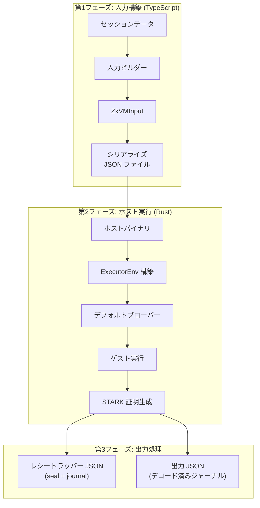
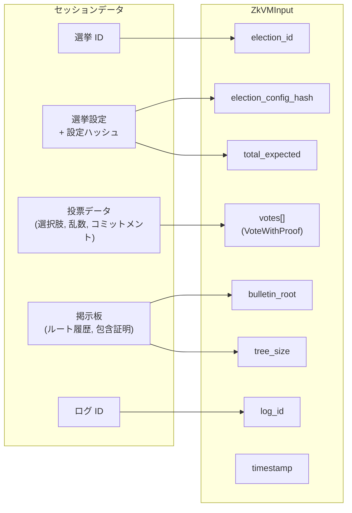
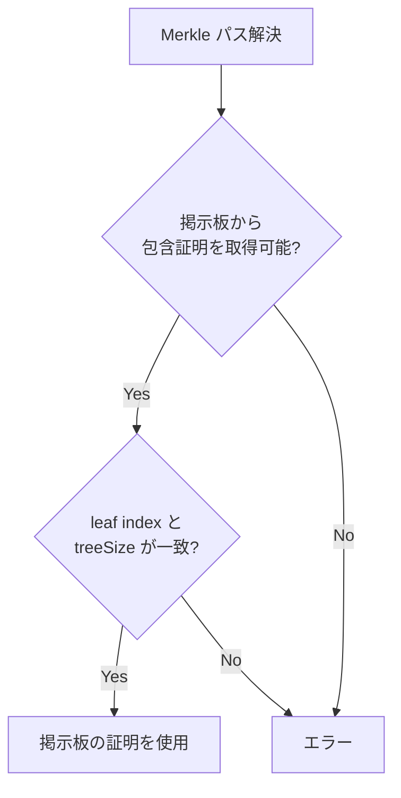
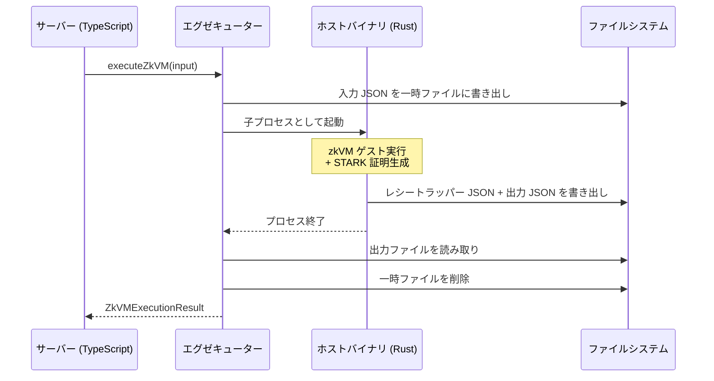
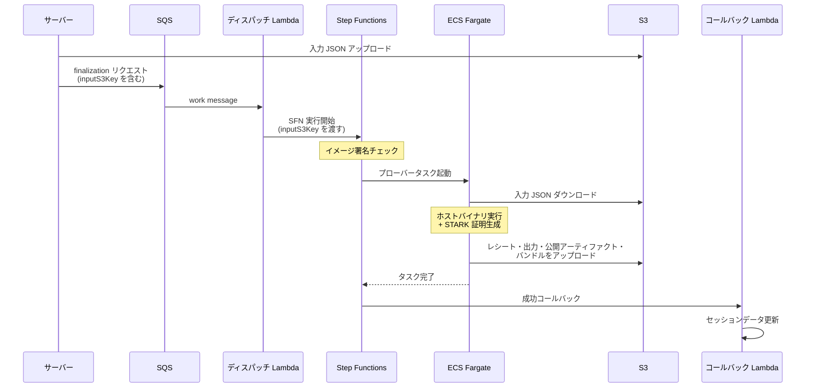

# ホストと証明生成

この章では、ホストプログラムが zkVM 入力を組み立て、同期モードまたは非同期モードで STARK 証明を生成する流れを扱います。

| モード | 実行形態                                                                                              |
| ------ | ----------------------------------------------------------------------------------------------------- |
| 同期   | ローカルにビルドされた `zkvm/target/release/host` をローカルプロセスとして起動                        |
| 非同期 | production feature 有効のホストバイナリを組み込んだ Fargate 用コンテナを ECS Fargate タスクとして実行 |

どちらのモードも同じ Rust ホスト CLI / 入出力契約を使用します。

このページの構成:

- [パイプライン全体像](#パイプライン全体像)
- [入力構築](#入力構築)
- [ホストプログラムの実行](#ホストプログラムの実行)
- [同期モード](#同期モード)
- [非同期モード](#非同期モード)
- [開発モードの動作](#開発モードの動作)

## パイプライン全体像

証明生成パイプラインは、入力構築、ホスト実行、出力処理の 3 フェーズで構成されます。

## 入力構築

### 現行 PoC の選挙 shape

デモの session orchestration は、選択肢 `A`〜`E`、ユーザー 1 票、
ボット 63 票、合計 64 slot、Merkle tree depth 6 に固定されています。
default config の authority は
`packages/zkvm-contract/src/zkvm/contract-constants.ts` と
`packages/zkvm-contract/src/zkvm/election-config.ts` です。domain と verification
package の公開定数は repository boundary test で同値性を確認します。

これは PoC の再現可能なデモ構成であり、zkVM guest や RFC 6962 Merkle
実装を任意の session で常に 64 票に制限するプロトコル主張ではありません。
host input は admitted election configuration の `totalExpected` と bulletin の
`treeSize` を保持し、その一致は検証パイプラインで fail-closed に確認します。

### セッションデータからの抽出

入力ビルダーは、投票セッションに蓄積されたデータから zkVM 入力を構築します。

入力構築の主な処理は次のとおりです。

1. **掲示板の最新 STH スナップショット取得**: ルートハッシュ、ツリーサイズ、タイムスタンプを取得します。
2. **選挙設定の整合性確認**: `electionConfig` と `electionConfigHash` が一致することを確認します。
3. **投票データの変換**: 各投票の選択肢を整数に変換します（A=0, B=1, C=2, D=3, E=4）。
4. **Merkle パスの解決**: 各投票について、掲示板から最新の包含証明を取得します。
5. **総投票数の設定**: 選挙設定の `totalExpected` を設定します（デモ定数は
   [現行 PoC の選挙 shape](#現行-poc-の選挙-shape) を参照）。

通常のセッション入力では、投票インデックスが 0 から連続する canonical CT index であることを要求します。
教育的な除外シナリオでは、元の掲示板インデックスを保つために sparse index を許可します。
これにより、ゲスト側で `missingSlots` として観測できます。

### Merkle パスの解決戦略

各投票の Merkle パスは、session の canonical bulletin authority から解決します。
保存済みの投票レコードは proof path を保持しないため、別の事前計算パスへの
fallback はありません。

## ホストプログラムの実行

### ホストバイナリの役割

ホストバイナリは Rust で記述された CLI プログラムです。
証明モードでは次の処理を行います。

1. JSON 形式の入力ファイルを読み込みます。
2. JSON のバイト配列表現を Rust の固定長配列型へ変換します（`Vec<u8>` → `[u8; 16/32]`）。
3. `ExecutorEnv` に入力をシリアライズして設定します。
4. デフォルトプローバーを使用して zkVM ゲストを実行します。
5. レシート（STARK 証明 + ジャーナル）を取得します。
6. ジャーナルをデコードし、出力ファイルに書き出します。

入力 JSON は TypeScript 側のエグゼキューターが事前に正規化して生成します（UUID/ハッシュ文字列をバイト配列へ変換）。

Image ID の確認だけを行う場合は `host --print-image-id [--json]` を使います。
このモードでは入力ファイルを読まず、証明生成やアーティファクト出力も行いません。
`--json` 付きでは `imageId` と `methodVersion` を含む JSON を stdout に出力します。

境界に違反する入力が渡された場合、host run は fail-closed で停止し、receipt と journal を出力しません。
境界条件の詳細は [処理パイプライン](guest-program.md#処理パイプライン) を参照してください。

非同期モードで S3 に置かれる work input には、host CLI の証明入力に加えて
`election_config` / `electionConfig` も含まれます。コンテナ entrypoint はこの設定を
`election-manifest.json` の生成と入力の整合性検査に使います。退役済みの
`contractGeneration` / `contract_generation` は work input に含めません。

### 出力ファイル

証明モードのホストバイナリは 2 つの JSON ファイルを出力します。
ビットマップ整合性検査を通過した場合は、private bitmap artifact も追加で出力します。

| ファイル              | 内容                                                           |
| --------------------- | -------------------------------------------------------------- |
| レシートラッパー JSON | `{ "receipt": ..., "image_id": "0x..." }` 形式のラッパー JSON  |
| 出力 JSON             | デコード済みのジャーナル（集計結果、除外情報、各種ハッシュ値） |

レシートラッパー JSON には top-level `image_id` フィールドも含まれます。
検証サービスでの使われ方は [検証サービス](verifier-service.md#検証フロー) を参照してください。

ホストはビットマップの整合性を確認し、一致した場合のみ次の非公開アーティファクトを出力します。

| ファイル             | 内容                                                          |
| -------------------- | ------------------------------------------------------------- |
| `*-bitmap.json`      | counted bitmap の厳密 artifact（`includedBitmapRoot` と対応） |
| `*-seen-bitmap.json` | presented bitmap の厳密 artifact（`seenBitmapRoot` と対応）   |

非同期モードでの配置と非同梱の扱いは [配布対象アーカイブの構築](#配布対象アーカイブの構築) を参照してください。

## 同期モード

同期モードでは、TypeScript のサーバーサイドプロセスからホストバイナリを直接起動します。

### 同期モードの特性

| 項目         | 値                                                                                                                                                                                           |
| ------------ | -------------------------------------------------------------------------------------------------------------------------------------------------------------------------------------------- |
| 起動方式     | Node.js `child_process.exec`                                                                                                                                                                 |
| タイムアウト | 10 分（600 秒）                                                                                                                                                                              |
| 一時ファイル | リポジトリ直下の `.zkvm-temp/` 配下                                                                                                                                                          |
| 環境変数     | 基本は Node.js の `process.env` を引き継ぐ。`RUST_LOG` はログに影響するが、証明モードは resolved runtime profile が決定し、adapter が child process の `RISC0_DEV_MODE` を設定または除去する |
| エラー処理   | 終了コード非ゼロ、タイムアウト、ファイル不在で失敗                                                                                                                                           |

### 結果の変換

エグゼキューターは出力 JSON のフィールドを TypeScript の命名規則へ正規化し、文字列だけでなくバイト配列形式の値も受理します。
ハッシュ系フィールドは `0x` 付き 16 進文字列に、`election_id` は UUID 文字列に変換して `ZkVMExecutionResult` を構築します。

## 非同期モード

AWS 環境では、証明生成を ECS Fargate タスクとして非同期に実行します。
STARK 証明の生成に数分を要するため、Lambda のタイムアウト制限を回避し、専用のコンピューティングリソースを割り当てます。

### イメージ署名チェック

Step Functions はプローバータスク起動前にコンテナイメージの署名を検証し、承認されたイメージ以外の実行を拒否します。
署名と digest pin の運用は [イメージ署名](../aws/image-signing.md) を参照してください。

### 配布対象アーカイブの構築

非同期モードでは、ホストバイナリの出力のうち秘密データを含まないファイルだけを `bundle.zip` に同梱し、`input.json` などの秘密入力は含めません。
同梱対象の一覧、整合性検査ルール、取得経路は [バンドル構造](../verification/bundle-structure.md) を、`public-input.json` の項目と `inputCommitment` の関係は [入力コミットメント](../protocol/input-commitment.md) を参照してください。

async Docker entrypoint は、`journal.json`、`public-input.json`、`election-manifest.json`、`close-statement.json` を生成する際に methodVersion（現行 14）と `inputCommitment` の整合性を検査し、契約と一致しない host artifact は fail-closed で停止します。
非同期 S3 出力では、通常は次のオブジェクトが保存されます。

- ホスト生出力の `*-output.json` と `*-receipt.json`
- 生成済みの公開アーティファクト
- private bitmap sibling（`included-bitmap.json` / `seen-bitmap.json`。非公開のまま `bundle.zip` には同梱しない）
- `bundle.zip`

`journal.json` は `bundle.zip` の中に生成される公開アーティファクトであり、固定名の standalone `journal.json` は sibling object として保存しません。

entrypoint が非ゼロ終了した場合は、失敗分類だけを持つ private sibling artifact
`failure-marker.json` を同じ finalization scope に best-effort で保存します。S3 object は
`sessions/{sessionId}/{finalizationId}/failure-marker.json` という finalization identity に
従います（分類の制限、create-only 保存、finalization writer による検証などの契約は
[非同期プローバー](../aws/async-prover.md) を参照）。

### 非同期モードの特性

| 項目                   | 値                                                                                                                          |
| ---------------------- | --------------------------------------------------------------------------------------------------------------------------- |
| ホスト実行タイムアウト | 15 分（900 秒）がデフォルト。entrypoint の `ZKVM_TIMEOUT_SECONDS` で変更可能                                                |
| ECS タスクタイムアウト | 30 分（1800 秒）がデフォルト。Terraform の `prover_task_timeout_seconds` が Step Functions の `RunProver` に設定            |
| リトライ               | S3 アップロードはデフォルトで最大 3 回の合計試行（初回 + 最大 2 回のリトライ）。再試行間隔は指数バックオフ                  |
| エラー処理             | entrypoint が private failure marker を best-effort で保存し、Step Functions がタスク失敗を検出して failure callback を実行 |
| ステータス確認         | クライアントは `/api/sessions/:sessionId/finalizations/current` で current finalization resource をポーリング               |

## 開発モードの動作

dev-mode build のホストで `RISC0_DEV_MODE=1` を設定すると、RISC Zero は STARK 証明を生成せず、フェイクレシートを返します。
フェイクレシートを作れるのは `pnpm build:zkvm:dev-mode` など dev mode を許可するホストビルドだけです。
production feature 有効のホスト（`pnpm build:zkvm` や Fargate prover image）は
`RISC0_DEV_MODE=1` を受理しません。非同期 prover の entrypoint は production proof profile
（S3-backed 実行では `RUNTIME_PROFILE=target-aws-async`）を要求し、退役済みの
`RISC0_DEV_MODE` / `FORCE_DEV_MODE` を host process の環境から除去します。

| 項目         | 開発モード (`RISC0_DEV_MODE=1`) | 本番モード                     |
| ------------ | ------------------------------- | ------------------------------ |
| 証明の種類   | フェイクレシート                | 本物の STARK 証明              |
| 実行時間     | 約 100 ミリ秒                   | 約 370 秒（64 票の場合）       |
| 保証         | 暗号学的保証なし                | guest 実行に対する暗号学的証明 |
| 検証サービス | Fake として検出                 | 完全な STARK 検証を実行        |

production receipt が証明するのは、対応する Image ID の guest が公開 journal を生成したことです。
これだけで投票システム全体の安全性、運用者に対する ballot secrecy、または選挙運用の妥当性まで
証明するものではありません。

開発モードのレシートは内部的には `InnerReceipt::Fake` 型です。
[検証サービス](verifier-service.md) では通常 `dev_mode` 扱いになります（`image_id` 不一致などの事前条件違反時のみ `Failed`）。
**`dev_mode` は診断ステータスであり、本番モードの成功検証としては採用されません。**

開発モードは次の用途に限定されます。

- host CLI や verifier 連携を含むローカルの高速フィードバック
- TypeScript と Rust の契約を短時間で確認する smoke test
- dev-mode receipt 分岐を明示的に通す CLI と E2E 検証

アプリケーションの proof executor は immutable な runtime profile が選択します。
mock 系 profile（`local-demo` / `static-mock-e2e`）の mock executor は、ホストバイナリも
RISC Zero SDK も呼びません。profile ごとの proof evidence の対応は
[AWS runtime 境界](../aws/runtime-boundary.md#semantic-runtime-profiles) を参照してください。
`USE_MOCK_ZKVM` と server 設定としての `RISC0_DEV_MODE` は置換済み selector であり、
runtime profile の入力に混在させると fail-closed で拒否されます。なお、dev-mode 対応 host
CLI を直接診断するときの `RISC0_DEV_MODE=1` は、この application runtime selector とは
異なる低レベルの host 設定です。

<!-- source: packages/zkvm-contract/src/zkvm/contract-constants.ts, packages/zkvm-contract/src/zkvm/election-config.ts, scripts/__tests__/repository-boundaries.test.ts, packages/application/src/zkvm-input/input-builder.ts, packages/aws-adapters/src/finalize/async-prover-artifacts.ts, packages/aws-adapters/src/finalize/artifact-key-layout.ts, packages/node-adapters/src/zkvm/executor.ts, packages/runtime-config/src/env/runtimeProfile.ts, packages/api-contract/src/routes/inventory.ts, zkvm/host/src/main.rs, infra/docker/entrypoint.sh -->
