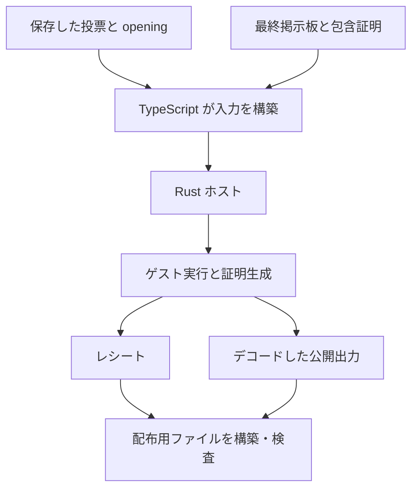
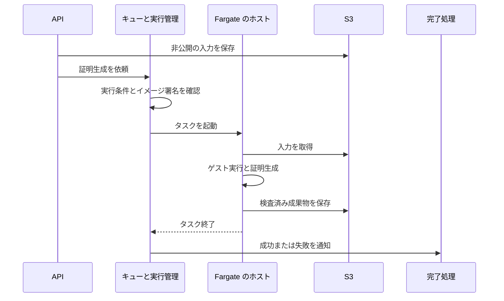

# ホストと証明生成

ゲストが投票を検査するには、サーバーが保存した opening と、掲示板の記録を一つの入力にまとめる必要があります。ホストはその入力を読み、ゲストの実行と証明生成を行い、レシートと公開出力を書き出します。

B の一票なら、位置 0、選択肢 B、投票時の乱数、コミットメント、**最終掲示板への**包含証明を渡します。投票時のレシートにある小さいツリーへの証明を、そのまま集計入力に流用するわけではありません。

## パイプライン全体像

入力を作る TypeScript、計算を証明する Rust、配布用ファイルを作る処理は、それぞれ受け渡し先で内容を検査します。ホストの終了コードだけで集計を成功として扱わず、出力の形式と整合性も確認します。レシートの暗号学的検証は、さらに[検証サービス](verifier-service.md)が担当します。

## 入力構築

### 現行 PoC の選挙構成

デモのセッションは A〜E、ユーザー 1 票とボット 63 票、合計 64 スロットです。最終的な掲示板ツリーの深さは 6 になります。この構成は `contract-constants.ts` と `election-config.ts` に定義します。

64 はデモの選挙設定であり、Merkle アルゴリズムやゲストの処理上限ではありません。入力は選挙設定の `totalExpected` と掲示板の `treeSize` を別々に持ち、検証側で一致を確認します。

### セッションデータからの抽出

入力ビルダーは、掲示板の最新 STH スナップショットからルート、サイズ、時刻を取得します。選挙設定とそのハッシュの一致を確認し、保存した各票の選択肢を A=0〜E=4 に変換します。その票の元の掲示板インデックスを使って、最終状態への包含証明を取得します。

通常の入力ではインデックスが 0 から連続することを要求します。S1 の除外では、位置 0 を外しても残りを 0〜62 に振り直さず、1〜63 のまま渡します。掲示板は 64 スロットなので、ゲストは位置 0 が足りないと数えられます。

### Merkle パスの解決戦略

包含証明は、そのセッションの掲示板から取得します。リーフ位置とツリーサイズを照合し、取得できない証明や一致しない証明で入力構築を続けません。保存した投票レコードは、代わりに使う別のパスを持ちません。

## ホストプログラムの実行

TypeScript のアダプターは、UUID とハッシュの文字列をバイト配列へ変換し、Rust が読む JSON を作ります。ホストは固定長配列と現在の入力フィールドを検査し、`ExecutorEnv` へ直列化して、組み込まれたゲストを実行します。処理量の上限も[ゲストの境界条件](guest-program.md#入力の境界条件)に従います。

正常に証明を生成すると、ホストはレシート内部のジャーナルをデコードして、出力 JSON を作ります。

| ファイル             | 内容                                                         |
| -------------------- | ------------------------------------------------------------ |
| `*-receipt.json`     | `{ "receipt": ..., "image_id": "0x..." }` のレシートラッパー |
| `*-output.json`      | デコードしたジャーナルと Image ID                            |
| `*-bitmap.json`      | 計上した位置の非公開ビットマップ                             |
| `*-seen-bitmap.json` | 提示された位置の非公開ビットマップ                           |

ビットマップは入力から再構成し、ゲストの公開ルートとの一致を確認できた場合に書き出します。出力の UUID・ハッシュを配布用の文字列表現にする処理は、ホストの生出力を受け取ったアダプターや artifact 生成処理が行います。

Image ID の確認だけなら `host --print-image-id --json` を使います。この場合は入力ファイルの読み取りも証明生成も行いません。

## 同期モード

ローカルの実証明プロファイルでは、Node.js が `zkvm/target/release/host` を子プロセスとして起動し、終了を待ちます。shell を介さず引数を渡し、専用の POSIX プロセスグループで起動します。

入力と出力は `.zkvm-temp/` に置きます。アダプターは出力の現在のフィールド集合を検査し、欠落や未知のフィールドを拒否してから、アプリ用の値へ変換します。UUID は文字列、ハッシュは `0x` 付き 16 進数へそろえます。

### 終了と一時ファイル

証明の期限は 600 秒です。期限到達またはホスト終了時には、所有するプロセスグループへ SIGTERM を送り、最大 5 秒待ってから SIGKILL、さらに最大 1 秒待ちます。残ったプロセスの終了を確認できなければ成功にはしません。これは Linux、WSL、macOS の POSIX グループを対象にした後始末です。

成功・失敗のどちらでも、入力と四つの出力ファイルの削除を試みます。ファイルがすでに無い場合は問題とせず、それ以外の削除失敗は安全な警告として残します。起動失敗、非ゼロ終了、外部シグナル、期限切れ、サーバー停止、出力欠落を区別して扱います。

## 非同期モード

AWS では、時間のかかる証明生成を ECS Fargate の専用タスクへ渡します。API は完了まで接続を保持せず、ブラウザが現在の集計状態を問い合わせます。

ホストの入出力契約は同期実行と共通です。実行の重複・取消・再試行や結果の保存は、[非同期プローバー](../aws/async-prover.md)の処理が担います。

### 配布対象アーカイブの構築

非同期の入力ファイルは、通常のゲスト入力に加えて `election_config` を含みます。ホスト CLI では省略可能ですが、非同期の公開ファイル生成には必要です。内側の設定キーは camelCase を使います。

コンテナの entrypoint は Rust の `prover-artifacts` を呼び、入力とホスト出力から `journal.json`、`public-input.json`、`election-manifest.json`、`close-statement.json` を作ります。現在の method version、入力コミットメント、正準ハッシュ、各値の対応を検査し、生成した四つのファイルを読み直して確認します。その後、許可されたファイルだけで ZIP を構築・検査し、S3 にアップロードします。

非公開の入力と二つのビットマップは ZIP に含めません。S3 にはホストの `*-output.json`、`*-receipt.json`、公開ファイル、非公開ビットマップ、ZIP が保存されます。公開 `journal.json` は ZIP 内にあり、その固定名で ZIP の隣へ別オブジェクトを保存する方式ではありません。同梱ファイルの正確な一覧は[バンドル構造](../verification/bundle-structure.md)に定義します。

失敗時は分類だけを持つ非公開の `failure-marker.json` の保存を試み、実行管理から失敗の完了処理を呼びます。この記録も公開 ZIP には入りません。

### 非同期モードの特性

| 項目                 | 既定値・動作                                                    |
| -------------------- | --------------------------------------------------------------- |
| ホストの期限         | 900 秒。entrypoint の `ZKVM_TIMEOUT_SECONDS` で設定             |
| Fargate タスクの期限 | 1800 秒。Terraform の `prover_task_timeout_seconds` で設定      |
| S3 アップロード      | 合計最大 3 回、再試行間隔は指数バックオフ                       |
| ブラウザの進捗取得   | `/api/sessions/:sessionId/finalizations/current` を問い合わせる |

証明生成が終わったことと、検証サービスがその証明を検証したことは別の状態です。AWS では検証の要求を受けた後、別のキューと worker がレシートを確認します。

## 開発モードの動作

開発中に毎回 STARK 証明を作ると、入出力の修正を確認するにも時間がかかります。そこで、用途に応じて次の実行を使い分けます。

| 実行するもの                          | 得られる証拠                        |
| ------------------------------------- | ----------------------------------- |
| Rust ホストを起動しない mock executor | 動作確認用の代替データ              |
| 開発モードを許す Rust ホスト          | 暗号学的保証を持たない fake receipt |
| production feature のホスト           | 実際の STARK レシート               |

ホストと証拠の組は、[実行プロファイル](../aws/runtime-boundary.md#semantic-runtime-profiles)の選択で決まります。

開発用ホストは `RISC0_DEV_MODE=1` で証明を作らずに fake receipt を返せます。production feature のビルドはこの開発モードを受け入れません。AWS entrypoint は対象の production プロファイルを要求し、ホストの環境から開発モード指定を除去します。

アプリでどの実行を使うかは、起動時に確定する runtime profile が決めます。fake receipt は入出力契約を試す材料ですが、計算の暗号学的証拠ではありません。検証サービスも成功へ昇格させず、開発用の診断結果として区別します。

<!-- source: packages/zkvm-contract/src/zkvm/contract-constants.ts, packages/zkvm-contract/src/zkvm/election-config.ts, packages/zkvm-contract/src/zkvm/host-io.ts, tooling/repository/repository-boundaries.test.ts, packages/application/src/zkvm-input/input-builder.ts, packages/aws-adapters/src/finalize/async-prover-artifacts.ts, packages/aws-adapters/src/finalize/artifact-key-layout.ts, packages/node-adapters/src/zkvm/executor.ts, packages/node-adapters/src/zkvm/host-process.ts, packages/runtime-config/src/env/runtimeProfile.ts, packages/api-contract/src/routes/inventory.ts, zkvm/host/src/main.rs, zkvm/host/src/artifacts.rs, zkvm/host/src/bin/prover-artifacts.rs, infra/docker/entrypoint.sh -->
