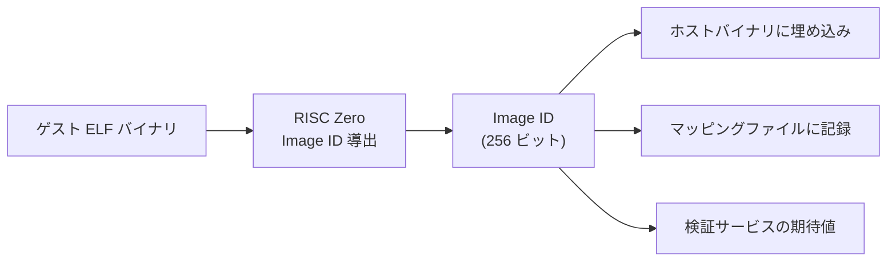
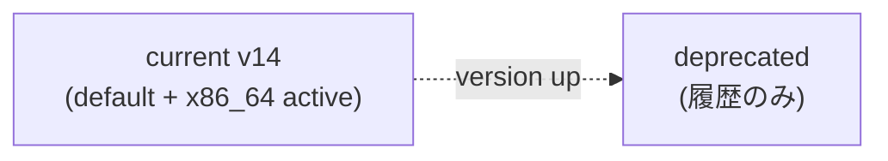
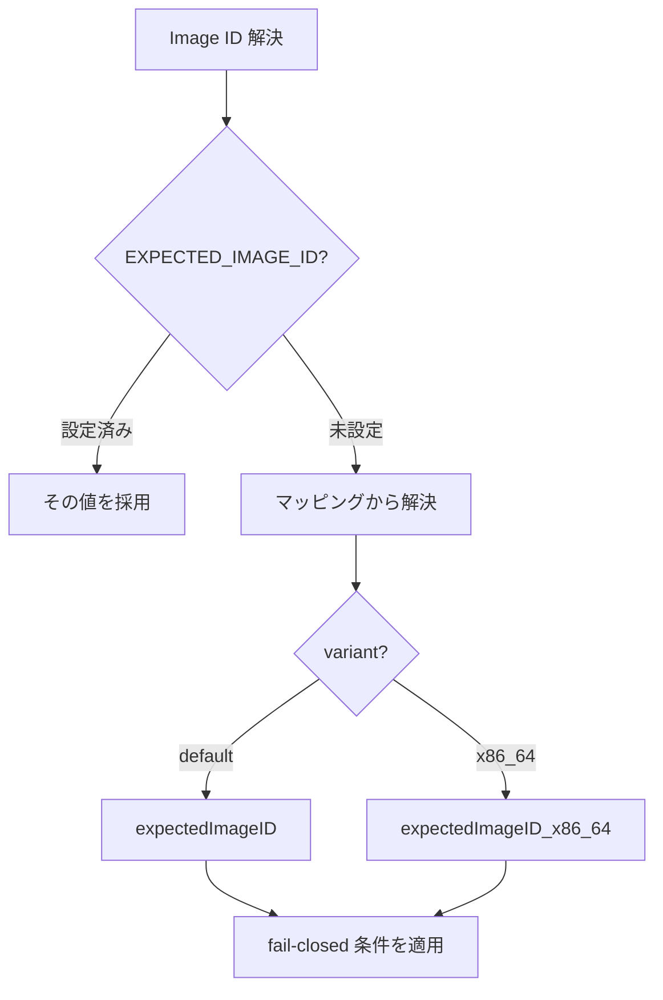

# Image ID

Image ID は、ゲストバイナリを一意に識別する値です。
検証時には、この値でレシートがどのゲストプログラムの実行結果かを照合します。

Image ID は、ゲストプログラムの ELF バイナリから決定的に導出される 256 ビットのハッシュ値です。
レシート検証時に期待値との一致を確認することで、レシートが正しいプログラムの実行結果であることを検証します。

## RISC Zero の Image ID

RISC Zero zkVM では、ゲストプログラムの ELF バイナリが Image ID と呼ばれる 256 ビットの識別子に変換されます。
この変換は決定的であり、同一のバイナリからは常に同一の Image ID が生成されます。

`Receipt::verify(image_id)` は、レシートが指定した Image ID のゲスト実行結果であることを暗号学的に検証します。
期待する Image ID と一致しないレシートは拒否されます。
ラッパーメタデータとの照合手順は [検証サービス](verifier-service.md#検証フロー) を参照してください。

## Image ID の導出

Image ID は RISC Zero のビルドシステムによってコンパイル時に自動生成されます。

### Image ID が変わる要因

同一のゲストソースコードであっても、以下の要因により異なる Image ID が生成され得ます:

| 要因                     | 影響                                              |
| ------------------------ | ------------------------------------------------- |
| ゲストコードの変更       | ロジックの変更により異なるバイナリが生成される    |
| コンパイラバージョン     | Rust ツールチェインの差異がバイナリに反映される   |
| ターゲットアーキテクチャ | 同一コードでも x86_64 と ARM64 で Image ID が違う |
| RISC Zero SDK バージョン | SDK の変更がゲストバイナリの構造に影響する        |

### variant とアーキテクチャ

本システムでは、同一バージョンのゲストに対して、既定 variant 用 (`expectedImageID`) と x86_64 用 (`expectedImageID_x86_64`) の 2 つの Image ID をマッピング上で管理できます。
現行 methodVersion 14 では、次の 2 系統を active trust material（検証の期待値として現在有効な Image ID）として扱います。

| variant / アーキテクチャ | 取得元のビルド                      |
| ------------------------ | ----------------------------------- |
| default / ARM64          | target-account prover image build   |
| x86_64                   | local / CI production-feature build |

app deployment では、選択された prover release metadata から Image ID と methodVersion を導出し、mapping は互換性と公開台帳の証拠として照合します。
`public/imageId-mapping.json` は公開検証者が expected Image ID を解決するための互換性台帳であり、prover image digest の承認 authority ではありません。
ECR digest と Image ID / `methodVersion` の組み合わせは、選択された prover release record と app deployment record で固定します。

現行実装では、実行環境を自動判定して x86_64 を選びません。
未指定時は `default` variant を選択します。
methodVersion 14 の mapping は `supportedVariants: ["default", "x86_64"]` です。
x86_64 用の値を使うには、アプリ側で `EXPECTED_IMAGE_ID_VARIANT=x86_64` を設定するか、呼び出し側で variant を明示します。
variant 選択と `EXPECTED_IMAGE_ID` オーバーライドの優先順位は、下の [Image ID の解決](#image-id-の解決) を参照してください。

## Image ID マッピング

期待される Image ID は、バージョンごとにマッピングファイルで管理されます。

### マッピングファイルの構造

マッピングファイルには、各バージョンの Image ID、説明、ビルド情報、機能リストを記録します。

| フィールド             | 説明                                                                                             |
| ---------------------- | ------------------------------------------------------------------------------------------------ |
| methodVersion          | ゲストプログラムのバージョン番号                                                                 |
| expectedImageID        | default / ARM64 variant の Image ID（[variant とアーキテクチャ](#variant-とアーキテクチャ)参照） |
| expectedImageID_x86_64 | x86_64 variant の Image ID（同上）                                                               |
| description            | バージョンの説明                                                                                 |
| compiledAt             | Image ID を取得したビルド時刻                                                                    |
| rustVersion            | ビルドに使用した Rust バージョン                                                                 |
| risc0Version           | ビルドに使用した RISC Zero SDK バージョン                                                        |
| guestToolchain         | ゲストビルド用ツールチェイン                                                                     |
| features               | このバージョンで実装された機能リスト                                                             |
| current                | 現在有効なバージョン番号                                                                         |
| deprecated             | 非推奨バージョンの一覧                                                                           |
| metadata               | マッピングファイル全体の管理メタデータ                                                           |

### current と deprecated の扱い

マッピングファイルは、バージョンの履歴を保持します。
`current` フィールドは現在有効なバージョンを指し、`deprecated` フィールドは過去のバージョンを列挙します。
過去バージョンには既定 variant と x86_64 の 2 系統の Image ID を持つものがありますが、現行の `current` バージョンが常に両方を持つとは限りません。

現行実装では `current` は `14` で、`v8`〜`v13` が `deprecated` 側にあります。
v14 の mapping は `expectedImageID`、`expectedImageID_x86_64`、`supportedVariants: ["default", "x86_64"]` を保持します。

## Image ID の解決

検証時に使用する期待 Image ID の決定方法は、`EXPECTED_IMAGE_ID` の有無で分かれます。
`EXPECTED_IMAGE_ID` が設定されている場合は、その値を使用します。
設定されていない場合は、`methodVersion` と variant を使ってマッピングから解決します。

期待 Image ID の解決順:

- `EXPECTED_IMAGE_ID` 環境変数は最優先のオーバーライドです。
  設定されている場合は mapping と variant による解決を行わず、その値を期待 Image ID として採用します。
  運用者は、この値が対象 methodVersion のデプロイ済みゲスト Image ID と一致することを別途保証する必要があります。
  不一致なら `stark_image_id_match` または `stark_receipt_verify` が失敗します。
- `resolveExpectedImageId()` / `/api/verification/run` の version 選択:
  - 省略時: マッピングの `current` を使用
  - 明示時: `CURRENT_METHOD_VERSION` と一致する場合のみ受理。`deprecated` 側は拒否
- 低レベルのマッピング読み取り API は `deprecated` も含めて明示 version を解決できる（この検証実行経路では使わない）。
- variant は `EXPECTED_IMAGE_ID_VARIANT`（`default` または `x86_64`）または呼び出し側の明示 option で選択し、未指定時は `default`。
  それ以外の値は受け付けません。
- app deployment flow（default / ARM64 trust material）では、variant 未指定の `default` を使用します。
- ローカル / CI フロー（x86_64 trust material）では、`EXPECTED_IMAGE_ID_VARIANT=x86_64` を明示します。
  `verifier-service` 単体は `EXPECTED_IMAGE_ID_VARIANT` を直接読みません。
  第三者検証では `read-image-id.mjs --variant x86_64` または同スクリプト実行時の `EXPECTED_IMAGE_ID_VARIANT=x86_64` で `EXPECTED_IMAGE_ID` を導出し、`verifier-service` に渡します。
- 未対応 `methodVersion`、マッピング読み込み失敗、unsupported variant、`supportedVariants` に含まれない variant、選択した variant の値が空の場合は、いずれも暗黙のフォールバックを行わず [fail-closed](../appendix/glossary.md#fail-closed) でエラーになります。
- 現行の検証実行フローでは、正規化済みのジャーナルから `methodVersion` を取得して `resolveExpectedImageId(methodVersion)` を呼びます（`public-input.json` フォールバックは現行未使用）。

## 検証パイプラインでの役割

Image ID は 4 段階検証モデルの STARK 検証段階で使用されます。

### Image ID 関連チェック

現行実装では、STARK 検証段階で次の 2 つの必須チェックが Image ID に関与します。

- `stark_image_id_match`: `receipt.json` ラッパーの `image_id` と期待値を照合する
- `stark_receipt_verify`: 同じ期待 Image ID を使って `Receipt::verify(expectedImageID)` を実行する

詳細は [検証サービス](verifier-service.md#検証フロー) を参照してください。

Image ID が不一致の場合は、以下のいずれかの状況が考えられます:

| 原因                           | 対処                                     |
| ------------------------------ | ---------------------------------------- |
| マッピングが古い               | ゲストの再ビルド後にマッピングを更新する |
| 異なるゲストで証明が生成された | レシートの出所を調査する                 |
| アーキテクチャの不一致         | 対象 variant の Image ID で照合する      |

Image ID が一致していても、`RISC0_DEV_MODE=1` の dev-mode receipt（フェイクレシート）は production STARK proof として扱いません（生成側は [ホストと証明生成](host-and-proving.md)、判定側は [ゲーティングロジック](../verification/gating-logic.md#stark-検証のゲーティング) を参照）。

## Image ID 更新時の手順

ゲストプログラムを変更した場合、Image ID を更新する必要があります。

1. ゲストコードを変更する
2. zkVM ゲストをビルドし、`host --print-image-id [--json]` で新しい Image ID を取得する
3. `public/imageId-mapping.json` を更新する（active trust material だけを `supportedVariants` に含める。
   methodVersion 14 の現行 trust material は `expectedImageID` と `expectedImageID_x86_64`）
4. 関連コードに残る定数参照も必要に応じて更新する（現行実装では `packages/verification/src/verification/expected-image-id.ts` の `DEFAULT_POC_IMAGE_ID` がテストなどで参照される）
5. Image ID / `methodVersion` が変わる場合は、プローバーイメージ、release record / runtime expected Image ID、マッピングを同じ release 境界で切り替える

`--json` を付けると `{"imageId":"0x...","methodVersion":14}` の形で出力されます。

### 同一リリースで同期するもの

Image ID / `methodVersion` が変わる場合は、prover release record、runtime expected Image ID、`imageId-mapping.json` を同じ release 境界で切り替えます。
片方だけが新しい場合は、検証時に Image ID 不一致で失敗します。
一方で、entrypoint だけの prover container rebuild のように guest Image ID が変わらない変更では、ECR digest は変わっても mapping を更新する必要はありません。

- 通常の `/api/verification/run` フローでは、現行の journal contract のみ受け付ける
- 旧成果物は Image ID 照合に進む前に、未対応の journal contract として失敗し得る
- `DEFAULT_POC_IMAGE_ID` はテスト用定数で、期待 Image ID の解決経路には現れない（マッピングが source of truth）

## 信頼アンカーとしての位置づけ

Image ID は、zkVM の信頼モデルにおける信頼アンカーです。

- **Image ID を知っている検証者は、対象ゲストプログラムの実行を検証できる**: レシートが有効であれば、そのロジックが実行されたことを確認できる
- **Image ID の管理が破綻すると、検証の信頼性が失われる**: 攻撃者が独自のゲストプログラムで有効なレシートを生成し、その Image ID がマッピングに混入すると、不正な集計が「検証済み」として受理され得る

マッピングファイルは公開リポジトリにコミットされ、変更履歴を追跡できます。
AWS 構成では、イメージ署名検証と組み合わせることで、承認されたプローバーイメージだけを使用する設計です。
イメージ署名の詳細は [イメージ署名](../aws/image-signing.md) を参照してください。

<!-- source: public/imageId-mapping.json, packages/verification/src/verification/expected-image-id.ts, apps/api/src/server/api/handlers/verificationRun.ts, packages/zkvm-contract/src/zkvm/journal-guards.ts, verifier-service/src/lib.rs -->
