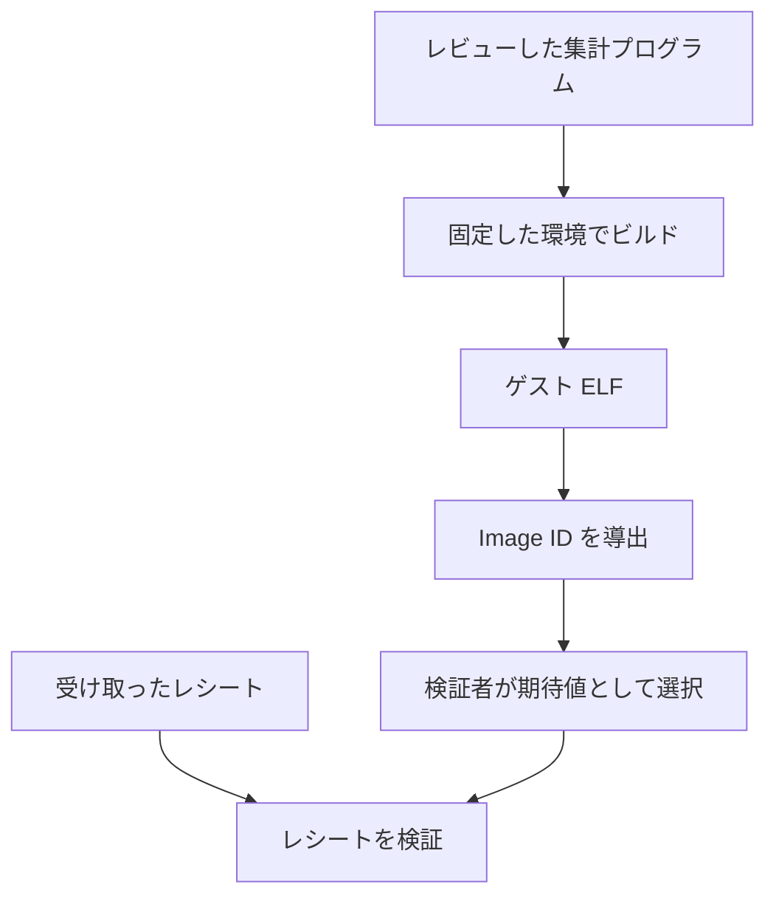

<a id="image-id"></a>

# 計算するプログラムを指定する

「正しく実行された」という証明だけでは、どのプログラムを実行したのかが決まりません。攻撃者が任意の得票数を返すゲストを用意すれば、そのゲストについて有効な証明を作れてしまいます。検証者は、証明を受け取る前に、受け入れる集計プログラムを決めておく必要があります。

その識別に使うのが **Image ID** です。RISC Zero はゲストの ELF バイナリから 256 ビットの識別子を導出します。検証者は別途用意した期待値を `Receipt::verify(expected_image_id)` に渡し、指定したゲストの実行結果かを確認します。レシートに書かれた ID をそのまま期待値として採用するだけでは、プログラムの選択を差出人に任せたことになります。

## RISC Zero の Image ID



Image ID はゲストの実行イメージから決定的に導出されます。ELF ファイル全体を単純に SHA-256 した値でも、プローバーのコンテナイメージの digest でもありません。

ゲストのソース、依存ライブラリ、Rust コンパイラ、RISC Zero SDK、ビルド環境が変わり、生成されるゲストが変われば Image ID も変わり得ます。同じソース名や同じ `methodVersion` であることだけでは、同じバイナリの証拠になりません。

## Image ID の導出

ホストはビルド時にゲスト ELF とその Image ID を埋め込みます。証明を生成せず、そのホストが使う値を確認するには、リポジトリルートで次を実行します。

```bash
./zkvm/target/release/host --print-image-id --json
```

出力には `imageId` と `methodVersion` が入ります。このコマンドは埋め込まれた値を表示するので、どのソースとビルド環境から作ったホストかを別途確認します。変更後の ID を確定するときは、新しいビルド出力先を使い、以前のゲスト成果物を再利用していないことを確かめます。

### variant とアーキテクチャ

公開マッピングは、ビルド環境別に二つの値を管理します。

| variant   | 値の由来                               |
| --------- | -------------------------------------- |
| `default` | 採用された ARM64 のプローバーリリース  |
| `x86_64`  | 独立に確認したローカル x86_64 のビルド |

ARM64 と x86_64 はホスト側のビルド環境です。どちらもゲストの命令セットは RV32IM です。検証者のマシンの CPU に合わせて値を選ぶのではなく、**受け取ったレシートを生成したゲスト**に対応する値を選びます。

各 variant は `confirmed` または `unconfirmed` の状態を持ちます。前者には `imageId` と由来の `provenance` があり、後者には `requiredEvidence: "accepted-prover-release"` があるだけで、期待 Image ID としては使えません。

## Image ID マッピング

`public/imageId-mapping.json` は、公開検証者がバージョンとビルド由来を確認するための台帳です。現在の `current` は `14` です。変更後のゲストについて、`default` は採用済み ARM64 プローバーリリースの証拠を待つ `unconfirmed`、`x86_64` は新しい出力先で行ったローカル production ビルドに基づく `confirmed` です。`deprecated` は空です。

| フィールド                 | 意味                               |
| -------------------------- | ---------------------------------- |
| `mappingType`              | `image-id-mapping`                 |
| `current`                  | 現在の method version のキー       |
| `mappings.*.methodVersion` | ジャーナル契約のバージョン         |
| `mappings.*.variants`      | 二つのビルド由来と確認状態         |
| `description` / `features` | プログラムの説明                   |
| `deprecated` / `metadata`  | 過去バージョンとファイルの管理情報 |

マッピングは公開リポジトリで履歴を確認できます。ただし、正しい期待値として使うには、そのソースとビルド由来を信頼する判断が必要です。攻撃者が用意したマッピングとレシートを一緒に検証しても、その判断を省略したことには変わりありません。

## Image ID の解決

アプリは検査済みジャーナルの `methodVersion` を使って期待値を解決します。現在の検証フローが受け入れるのは、現行のジャーナル契約です。

| 条件                                 | 採用する期待値                                      |
| ------------------------------------ | --------------------------------------------------- |
| `EXPECTED_IMAGE_ID` が設定されている | その明示値。mapping と variant による解決を使わない |
| 明示値なし、variant の指定あり       | 現行 mapping の指定 variant                         |
| 明示値も variant もなし              | 現行 mapping の `default`                           |

`EXPECTED_IMAGE_ID_VARIANT` は `default` または `x86_64` に限定します。実行環境の自動判定は行いません。未知のバージョン、不正または読み込めないマッピング、未確認の variant はエラーになり、別の値で検証を続けません。

明示した `EXPECTED_IMAGE_ID` は、対象 `methodVersion` のゲストに対応させる必要があります。AWS のデプロイでは、選択したプローバーリリースの Image ID と method version を使い、公開マッピングとも照合します。公開マッピング自体が、コンテナを実行してよいという許可を与えるわけではありません。

### ローカル検証での選択

`verifier-service` 単体は `EXPECTED_IMAGE_ID` を読みますが、`EXPECTED_IMAGE_ID_VARIANT` を直接は読みません。たとえばローカル x86_64 で生成したレシートの期待値は、次のスクリプトで導出します。

```bash
node verifier-service/scripts/read-image-id.mjs \
  public/imageId-mapping.json --variant x86_64
```

この出力を検証 CLI の `--image-id` または `EXPECTED_IMAGE_ID` に渡します。ARM64 の配布レシートには、そのリリースに対応するソースの確認済み `default` を使います。現在のソースでは `default` が未確認のため、ARM64 の期待値の解決と通常の App デプロイは停止します。

## 検証パイプラインでの役割

検証サービスはレシートラッパーの `image_id` を期待値と比較し、さらに暗号学的な `Receipt::verify` を行います。単に JSON の文字列が一致したことを証明検証の代わりにはしません。

アプリは `stark_image_id_match` と `stark_receipt_verify` の両方を必須とし、レポート・集計結果側の ID の整合も確認します。それらが成功しても、投票の記録、入力の完全性、表示の得票数に対する確認が残ります。

## ゲスト更新とコンテナ更新

ゲストが変わる更新では、新しい Image ID を確定し、マッピング、検証側の期待値、生成するレシートをそろえます。片側だけの更新では、新旧の不一致として検証できなくなります。

一方、ゲストが変わらないコンテナの起動処理の更新なら、コンテナ digest が変わっても Image ID は変わらないことがあります。AWS はこの二つを別々に検査します。コンテナの出所と実行許可は[イメージ署名](../aws/image-signing.md#image-id-との関係)、ゲストの実行結果は Image ID に対するレシート検証で確認します。

<!-- source: public/imageId-mapping.json, packages/verification/src/verification/expected-image-id.ts, packages/verification/src/verification/engine/evaluate-checks.ts, apps/api/src/server/api/handlers/verificationRun.ts, packages/zkvm-contract/src/zkvm/journal-guards.ts, verifier-service/src/lib.rs, scripts/aws/generate-develop-zkvm-contract-hash.ts, infra/terraform/bootstrap/foundation-acceptance-scripts/resolve-foundation-consumer-contract.mjs -->
