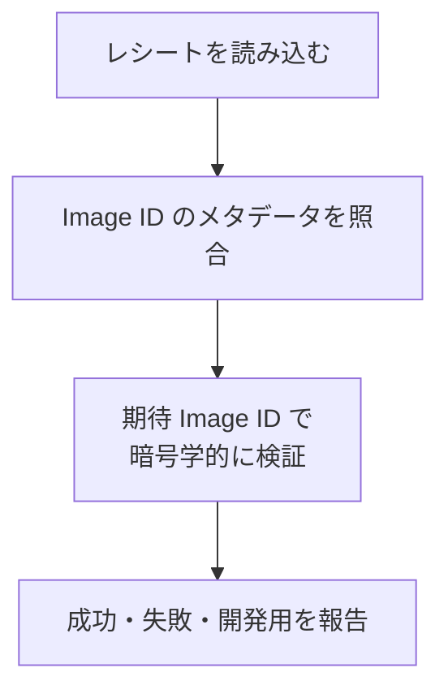

# 検証サービス

ホストがレシートを作れても、それを検証者が受け入れてよいかは別に確かめます。`verifier-service` は、レシートと期待する Image ID を受け取り、RISC Zero の `Receipt::verify` を実行する Rust の CLI です。

アプリはこの CLI をサーバー側で呼び出し、ブラウザへ結果を返します。

## 検証フロー



メタデータの一致は、証明を検証する前の確認です。JSON の `image_id` を期待値に書き換えても、その値を使った暗号学的検証に通るわけではありません。

### 入力形式の解決

| 入力          | 読み取るもの                                              |
| ------------- | --------------------------------------------------------- |
| JSON ファイル | レシート本体、または `receipt` フィールドで包んだレシート |
| ディレクトリ  | `receipt.json` または `*-receipt.json`                    |
| ZIP           | 名前の末尾が `receipt.json` のエントリ                    |

非開発用のレシートには、JSON のトップレベルの `image_id` が必要です。`receipt.imageId` だけでは代用できません。検証サービスはこの値を期待 Image ID と照合した後、レシート本体を検証します。

CLI がこれらの形式を読めることと、アプリの公開 ZIP として適切であることは別です。アプリは[バンドルの構造と公開境界](../verification/bundle-structure.md)も検査してから検証サービスへ渡します。

<a id="image-id-照合と-fake-receipt-の扱い"></a>

### Image ID の照合と開発用レシート

`InnerReceipt::Fake` は開発用のレシートです。`image_id` が存在して期待値と異なれば、Fake でも `failed` です。Fake の場合に限りメタデータがなくても暗号学的検証の分岐へ進み、検証が成功するか `InvalidProof` で拒否されたときは `dev_mode`、その他の失敗は `failed` として報告します。

非 Fake はメタデータ欠落を拒否します。メタデータが一致し、`Receipt::verify(expected_image_id)` が成功した場合だけ `success` です。production feature は SDK の開発モードを無効化し、開発モードを扱えるビルドも Fake を成功とは報告しません。

### STARK 検証の実行

成功した検証は、レシートの証明が有効で、その内部のジャーナルが期待するゲストの実行結果に結びつくことを確認します。ゲストが全票を受け取ったか、表示値がジャーナルと一致するかは、ジャーナルの内容を使ってアプリが別途確認します。

<a id="検証済み-receipt-からの-journal-取得"></a>

## 検証済みレシートから出力を取り出す

配布された `journal.json` をレシートと照合するには、レシート内部から同じ出力を取り出す必要があります。`decode-journal` は、一度読み込んだレシートを検証し、成功した**その同じレシート**のジャーナルを現在の Rust 契約でデコードします。

```bash
./verifier-service/target/release/verifier-service decode-journal \
  --bundle /path/to/bundle.zip \
  --image-id "$EXPECTED_IMAGE_ID" \
  --output /tmp/receipt-journal.json \
  --quiet
```

期待 Image ID は、[マッピングとビルド由来](image-id.md)を確認して設定します。このコマンドは開発用レシート、検証失敗、Image ID 欠落、現行でない `methodVersion` を拒否します。

出力はホストと同じ camelCase JSON で、検証済みの `imageId` を含みます。UUID とハッシュはバイト配列なので、公開 `journal.json` の UUID・16 進数文字列とは表現が異なります。[ローカル検証手順](../reproducibility/audit-bundle.md)では、この表現をそろえて値を比較します。receipt の固定バイトオフセットを読む手順ではありません。

## 検証レポート

`verify` は、検証が完了した試行について JSON レポートを出します。呼び出し側は終了コードとレポートの両方を確認します。

| 終了コード | レポートの `status` | 意味                                        |
| ---------- | ------------------- | ------------------------------------------- |
| 0          | `success`           | 本物のレシート検証に成功し、Image ID も一致 |
| 1          | 失敗段階による      | 引数・入力・レポート出力などの処理エラー    |
| 2          | `dev_mode`          | 開発用 fake receipt を検出                  |
| 3          | `failed`            | Image ID または証明の検証に失敗             |

終了コード1でも、レポートが生成されている場合があります。例えば、標準出力へレポートを出した後に `--output` のファイル書き込みが失敗する場合です。レポートがあるだけでは正常終了と扱えません。`--quiet` は標準出力を抑えるので、レポートを残すには `--output` を併用します。

| レポートのフィールド           | 内容                                        |
| ------------------------------ | ------------------------------------------- |
| `status`                       | `success` / `dev_mode` / `failed`           |
| `verifier_version`             | 検証サービスのバージョン                    |
| `verified_at`                  | RFC 3339 形式の完了時刻                     |
| `duration_ms`                  | 処理時間、ミリ秒                            |
| `expected_image_id`            | 検証に使った期待値                          |
| `receipt_image_id`             | トップレベル `image_id` の値。無ければ null |
| `bundle_path` / `receipt_path` | ディレクトリを除いたファイル名              |
| `dev_mode_receipt`             | Fake なら true                              |
| `errors`                       | 診断文字列の配列。空なら省略                |

`success` では `errors` を持たず、`dev_mode_receipt=false`、二つの Image ID が一致します。`dev_mode` では `dev_mode_receipt=true` で、レシートの ID が存在すれば期待値と一致します。`failed` は一つ以上の非空の診断文字列を持ちます。`errors` の各文字列は固定エラーコードではありません。

### アプリがレポートを受け取る境界

Node.js アダプターは `--output` に指定したファイルを最大 1 MiB まで読みます。標準出力を検証結果の根拠にはしません。フィールド形式、Image ID、時刻、数値の範囲、ファイル名、status 間の条件を検査したうえで、終了コードとの組が `0/success`、`2/dev_mode`、`3/failed` のいずれかであることを要求します。

さらに、呼び出し時の期待 Image ID とバンドル名に対応するレポートかを確認します。不在、不正、組の不一致は拒否します。API の `verifierResult.report` へ投影するときは二つのパスフィールドを除きます。

## デプロイメントモデル

アプリからの検証要求は、セッションと集計 ID で対象を指定します。クライアントが任意のローカルパス、S3 キー、receipt 本文を指定する API ではありません。サーバーが、その集計結果に保存したバンドルの所在を解決します。

| 実行経路                   | 検証サービスを呼ぶ場所                                   |
| -------------------------- | -------------------------------------------------------- |
| ローカルの同期集計         | real executor のときに Rust CLI を実行。mock は呼ばない  |
| ローカルの明示的な検証要求 | API が対象のローカルバンドルを使って CLI を起動          |
| AWS の明示的な検証要求     | API が SQS へ依頼し、`verification-worker` が CLI を起動 |

AWS の集計完了コールバックは結果の復元・保存を行います。その時点で STARK 検証を自動完了するわけではありません。`POST /api/sessions/:sessionId/finalizations/:finalizationId/verification` で検証を要求すると、API は `running` を保存し、キューへ作業を送って返ります。

worker は S3 のバンドルを取得・検査し、CLI を実行してレポートを保存します。終了した検証結果は、セッションと集計 ID に対応する独立した保存レコードへ書きます。ブラウザは検証リソースを繰り返し取得して完了を知ります。

### 再試行と終端状態

S3 取得、バンドル検査、プロセス起動、成果物アップロード、結果の記録などの基盤処理で失敗した場合は SQS で再試行し、3 回目の受信でも失敗すれば終端の `failed` と内部の失敗分類の保存を試みます。暗号学的な不一致で CLI が返した `failed` とは区別します。

レポートやその所在が残るかは、失敗した段階によって異なります。CLI の実行前なら、その試行のレポートはまだありません。アップロード時の失敗なら生成済みでも配送情報は記録されず、検証結果の記録時の失敗なら、S3 のレポートと配送情報がすでに保存されている場合があります。ファイルの存在だけで検証作業の成功を判断しません。

検証 POST を再送しても、`success`、`failed`、`dev_mode` は再検証せず同じ終端結果を返します。`running` も実行中として返しますが、AWS でキュー送信の記録がなければ同じ集計の作業を再発行して補修します。未設定または `not_run` なら新たな実行へ進みます。

## サーバー側検証の信頼境界

ブラウザはこの検証サービスの結果をサーバー経由で受け取るため、その報告を信頼します。自分で再検証する場合に必要な材料は [手元での検証](../reproducibility/index.md)、画面の他の確認との関係は [検証の実行フロー](../verification/design-and-flow.md)に示します。

公開 ZIP には、検証レポートの代わりにレシート自体を含めます。受け取った人が同じ暗号学的検証を実行できるようにするためです。全レポート `verification.json` は、別の認証付き API で取得します。

<!-- source: verifier-service/src/main.rs, verifier-service/src/lib.rs, packages/node-adapters/src/verifier-service-client.ts, packages/verification/src/verification/verifier-service-report.ts, apps/api/src/server/api/handlers/verificationRun.ts, infra/lambdas/verification-worker/, packages/aws-adapters/src/sqs/verificationWorkMessage.ts, packages/aws-adapters/src/sqs/publishVerificationWorkMessage.ts -->
